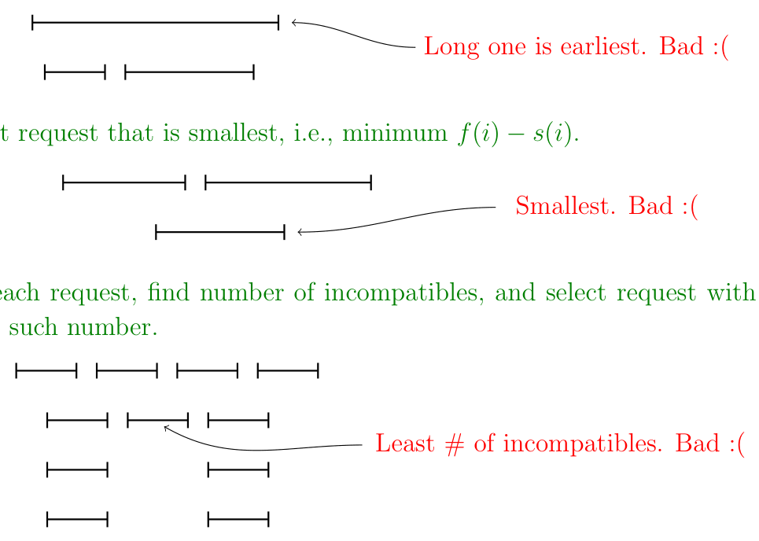

<!-- ===== PDF p1 ===== -->

<span style="color:#c0392b;">**6.046J / 18.410J　算法设计与分析（Design and Analysis of Algorithms）**</span>

<span style="color:#c0392b;">**讲次 1（Lecture 1）：引言（Introduction）**</span> <span style="color:#7f8c8d;">（Spring 2015，2015 春季学期）</span>

<span style="color:#2471a3;">**[section]**</span> <span style="color:#00838f;">**6.006 前置要求（pre-requisite）**</span>

6.006 课程的前置知识包括：
- 数据结构（data structures）：堆（heaps）、树（trees）、图（graphs）等；
- 算法（algorithms）：排序（sorting）、最短路（shortest paths）、图搜索（graph search）、动态规划（dynamic programming）等。

<span style="color:#2471a3;">**[section]**</span> <span style="color:#00838f;">**课程概览（Course Overview）**</span>

本课程涵盖若干模块（modules）：

1. 分治（Divide and Conquer）——FFT、随机化算法（randomized algorithms）
2. 优化（Optimization）——贪心（greedy）与动态规划
3. 网络流（Network Flow）
4. 难解性（Intractibility，以及如何应对它）
5. 线性规划（Linear programming）
6. 次线性算法（sublinear algorithms）、近似算法（approximation algorithms）
7. 高级专题（Advanced topics）

<span style="color:#2471a3;">**[section]**</span> <span style="color:#00838f;">**今日讲次的主题（Theme of today's lecture）**</span>

非常相似的问题可以具有非常不同的复杂度（complexity）。回顾：

- **P**：能在多项式时间（polynomial time）内求解的问题类，即对某个常数 $k$ 有 $O(n^k)$。例如，图（graph）中的最短路（shortest paths）可以在 $O(V^2)$ 内求出。
- **NP**：能在多项式时间内验证（verifiable）的问题类。有向图（directed graph）$G(V, E)$ 中的哈密顿回路（Hamiltonian cycle）是包含 $V$ 中每个顶点（vertex）的简单回路（simple cycle）。判定一个图是否存在哈密顿回路是 NP-complete 的，但验证一条回路确实是哈密顿回路却很容易。
- **NP-complete**：问题属于 NP，且与 NP 中任何问题一样难（as hard as any problem in NP）。如果任何 NPC 问题都能在多项式时间内求解，那么 NP 中的每个问题都有多项式时间解。

🎥 *Srinivas Devadas 在视频开头即点出本讲要传达的核心直觉*："very small changes in problem statements can end up with very different situations."（翻译：问题表述上的微小改动，最终可能导向截然不同的处境。）——这正是本讲「区间调度 vs 加权区间调度 vs 非相同机器」三连对比的用意所在。

> <span style="color:#1e8449;">**[note] Note（译者注）:**</span>
> P 与 NP 的分界不是「跑得快不快」的程度差别，而是「答案能不能被一条短证据核实」这一层结构差别。先把这一点钉死，后面三个层级（贪心、动态规划、难解性）为什么会在同一条时间轴上分道扬镳，才有判据。
>
> 先固定形式。一个 decision problem（决策问题）的输入是一串符号，输出只有两个值；把所有答「是」的实例收成一个集合之后，判定一个实例就变成问「它是否属于这个集合」。集合有无穷多种描述方式，所以必须挑一种能支撑证明的描述。P 是能被确定性算法在多项式时间内判定完的那一类问题，它的定义里不给「证据」留位置；而说某个问题属于 NP，等于说存在一台确定性的 verifier（验证机），它在多项式时间内读完「实例 + 一条候选证据」，并且对答「是」的实例，至少存在一条长度多项式的 certificate（证书）能让它输出接受。
>
> 这个选择不是文风问题。求解是搜索，要在指数大的候选空间里翻找，「它没有多项式算法」是关于所有可能算法的全称否定，我们既证不出来，也没法拿它去做推导；而「存在一条短证书」是存在性陈述，只要给出一条证书、写下一个检查程序，这句话就能当场变成可执行的事实。所以这个定义是可操作、可搬运的：P 与 NP 的差异被压成一句能判定的话，即证书能不能由算法自己在多项式时间内造出来。反过来若把两者混为一谈，一切建立在「分解难、验证易」之上的密码假设会同时失效，因为那些方案的安全性论证恰恰依赖「造证书」远比「验证证书」贵得多。这也解释了教材为什么习惯用「成员资格」的口吻描述 NP，而不用「算法快不快」的口吻：前者只在回答一个关于集合的问题，后者在回答一个我们至今不知道答案的比较问题。
>
> 代入数字看落差。取 $n = 20$ 个顶点的完全图，问是否存在 Hamiltonian cycle（哈密顿回路）。暴力搜索要枚举除起点外的 $19!$ 种排列，而每条回路被数了两次，候选约 $19!/2 \approx 6.08 \times 10^{16}$ 个；按每秒 $10^{9}$ 次合法性检查计，需要 $6.08 \times 10^{7}$ 秒，约 $1.93$ 年。反过来，给定一条回路，验证只是沿它走一圈并核对「每个顶点恰好出现一次、首尾相接」，$20$ 次访问加 $20$ 次比较，微秒量级。两侧差了 $15$ 个数量级以上。
>
> 这个差距不能被常数优化抹平，这一点值得算清：CSAPP 第 6 章的 cache（缓存）能把一次访问从上百个周期压到数个周期，写得好的实现再省一个数量级，可它改变的是每个候选的检查单价，而候选数按阶乘增长。要把 $6.08 \times 10^{16}$ 压到一秒内可接受，需要 $10^{10}$ 以上的常数改善，硬件给不出。真正能省掉的是「整类候选一起跳过」的结构性剪枝，那已经不属于逐条核对的框架。
>
> 再看 reduction（归约）这个关系的形状：把「不比对方难」写成 $A \le_p B$，它自反、传递，于是全体问题在这个关系下构成一个 preorder（预序），而 NP-complete 正是「彼此等价、并且压在 NP 全体之上」的那一层。这跟 6.042J 里用等价类给 partial order（偏序集）分层是同一套动作：先拿关系筛出层，再看层与层之间能否比较。区别在于这里的可比性并不完备，已知有大量问题既不显然属于 P 也不显然 NP-complete，层与层之间留着大片空白。更值得注意的是关系的种类不同：偏序比预序多一条反对称，两个元素互相可达就必须是同一个元素，于是在偏序的语言里，一批彼此可互相归约的问题只能塌缩成一个点，难度分层的信息全部丢掉；难度比较非用预序不可：同难的那一族里有多个不同的对象，压成一个点就等于把要比较的层级抹平。
>
> 所以这条分界线不是一张难度排名表，而是一句关于证据长度的结构断言；本讲接下来的贪心、动态规划、难解性三连，就是同一句话在一条一维时间轴上给出的三次不同答案。

---

<!-- ===== PDF p2 ===== -->

<span style="color:#c0392b;">**区间调度（Interval Scheduling）**</span>

请求（requests）$1, 2, \ldots, n$，共享单一资源（single resource）。

- $s(i)$ 表示开始时间（start time），$f(i)$ 表示结束时间（finish time），且 $s(i) < f(i)$（对任意请求，开始时间必须小于结束时间）。
- 两个请求 $i$ 和 $j$ 是兼容的（compatible），当且仅当它们不重叠（don't overlap），即 $f(i) \le s(j)$ 或 $f(j) \le s(i)$。

在下图中，请求 2 与 3 兼容，请求 4、5、6 也彼此兼容；但请求 2 与 4 不兼容。

> <span style="color:#7f8c8d;">[原图说明] 原页附图给出 6 个请求区间（编号 1–6）的时间轴示意：1 与 2 重叠、2 与 3 恰好首尾相接（兼容）、4 与 5 与 6 依次排开互不重叠。图中用于直观展示「兼容」与「不兼容」的几何含义。</span>

<span style="color:#2471a3;">**[goal]**</span> 目标（Goal）：选择**大小最大**的兼容请求子集（compatible subset of requests of maximum size）。

<span style="color:#2471a3;">**[claim]**</span> 声明（Claim）：我们可以用贪心算法（greedy algorithm）求解该问题。

贪心算法是**近视**（myopic）的算法：它一次处理一段输入，看不出明显的前瞻（look-ahead）。

🎥 *Devadas 在视频中[用开车比喻解释「近视」]*："As the name implies, it's something that's myopic. It doesn't look ahead. ... Traffic is a good example — don't let anybody cut in front of you. You've got some room up there. Get up there."（翻译：正如其名，贪心是近视的，它不向前看。……开车就是个好例子——别让任何人插到你前面。你前面有空当，就开上去。）

<span style="color:#2471a3;">**[algorithm]**</span> **贪心区间调度（Greedy Interval Scheduling）**

1. 用一条简单规则（simple rule）选出一个请求 $i$。
2. 拒绝（Reject）所有与 $i$ 不兼容的请求。
3. 重复（Repeat），直到所有请求都被处理完毕。

---

<!-- ===== PDF p3 ===== -->

<span style="color:#c0392b;">**可能的规则（Possible rules）？**</span>

1. 选择**最早开始**的请求，即 $s(i)$ 最小的请求。 <span style="color:#c0392b;">糟糕（Bad）: (</span>
2. 选择**最短**的请求，即 $f(i) - s(i)$ 最小的请求。 <span style="color:#c0392b;">糟糕（Bad）: (</span>
3. 对每个请求统计其不兼容请求数（number of incompatibles），选择该数**最小**的请求。 <span style="color:#c0392b;">糟糕（Bad）: (</span>
4. 选择**最早结束**的请求，即 $f(i)$ 最小的请求。



> <span style="color:#7f8c8d;">[原图说明] 原页附图对应前三种失败规则各给一个反例：规则 1 选中一条「长且早开始」的区间（遮挡其后的多个短区间）；规则 2 选中一条「最短但居中」的区间（左右两侧都堵死）；规则 3 选中「不兼容数最少」的区间（但仍可能堵住关键位置）。三种反例的共性都是「局部最优选择牺牲了整体容纳量」。</span>

<span style="color:#2471a3;">**[theorem]**</span> <span style="color:#c0392b;">**Claim 1（声明 1）.**</span> 贪心算法输出的区间列表（list of intervals）

```math
\langle s(i_1), f(i_1) \rangle,\ \langle s(i_2), f(i_2) \rangle,\ \ldots,\ \langle s(i_k), f(i_k) \rangle
```

满足

```math
s(i_1) < f(i_1) \le s(i_2) < f(i_2) \le \cdots \le s(i_k) < f(i_k).
```

<span style="color:#2471a3;">**[proof]**</span> *Proof（证明）.* 简单的反证法（proof by contradiction）——若 $f(i_j) > s(i_{j+1})$，则区间 $j$ 与 $j+1$ 相交（intersect），这与算法第 2 步矛盾（contradiction）！

> <span style="color:#7f8c8d;">[说明] Claim 1 的证明极简，但它确立的是「输出合法性」：贪心算法产生的候选解本身必须是一列互不重叠的区间。反证法在这里只用一个关键事实——算法第 2 步「拒绝所有不兼容请求」保证了相邻被选区间必然首尾不交。这个「算法构造天然保证合法性」的观察，是后面 Claim 2（最优性）证明的前提。</span>

<span style="color:#2471a3;">**[theorem]**</span> <span style="color:#c0392b;">**Claim 2（声明 2）.**</span> 给定区间列表 $L$，采用最早结束时间（earliest finish time）规则的贪心算法产生 $k^*$ 个区间，其中 $k^*$ 是最优值（optimal）。

<span style="color:#2471a3;">**[proof]**</span> *Proof（证明）.* 对 $k^*$ 作归纳（Induction on $k^*$）。

**基础情形（Base case）**：$k^* = 1$——此情形平凡（easy），任意一个区间都可行。

**归纳步（Inductive step）**：假设声明对 $k^*$ 成立，并给定一个区间列表，其最优调度（optimal schedule）含 $k^* + 1$ 个区间，即

```math
S^{*}[1, 2, \ldots, k^{*} + 1] = \langle s(j_1), f(j_1) \rangle, \ldots, \langle s(j_{k^{*}+1}), f(j_{k^{*}+1}) \rangle
```

---

<!-- ===== PDF p4 ===== -->

<span style="color:#c0392b;">**Claim 2 证明（续）**</span>

设对某个一般的 $k$，贪心算法给出的区间列表为

```math
S[1, 2, \ldots, k] = \langle s(i_1), f(i_1) \rangle, \ldots, \langle s(i_k), f(i_k) \rangle
```

由构造方式（By construction），我们知道 $f(i_1) \le f(j_1)$，因为贪心算法挑选的是最早结束时间的区间。

现在我们可以构造一个调度（schedule）

```math
S^{**} = \langle s(i_1), f(i_1) \rangle,\ \langle s(j_2), f(j_2) \rangle,\ \ldots,\ \langle s(j_{k^{*}+1}), f(j_{k^{*}+1}) \rangle
```

因为区间 $\langle s(i_1), f(i_1) \rangle$ 与区间 $\langle s(j_2), f(j_2) \rangle$ 及其后的所有区间都不重叠。注意，由于 $S^{**}$ 的长度为 $k^{*} + 1$，这个调度也是最优的（optimal）。

接下来定义 $L'$ 为满足 $s(i) \ge f(i_1)$ 的区间集合（set of intervals）。

由于 $S^{**}$ 对 $L$ 是最优的，$S^{**}[2, 3, \ldots, k^{*}+1]$ 对 $L'$ 是最优的，这意味着 $L'$ 的最优调度规模为 $k^{*}$。

现在我们利用最初的归纳假设（inductive hypothesis）：在 $L'$ 上运行贪心算法应产生规模为 $k^{*}$ 的调度。因此，按我们的构造，在 $L'$ 上运行贪心算法给出 $S[2, \ldots, k]$。

这意味着 $k - 1 = k^{*}$（或等价地 $k = k^{*} + 1$），从而 $S[1, \ldots, k]$ 确实是最优的（optimal），证明完毕。

> <span style="color:#1e8449;">**[note] Note（译者注）:**</span>
> Claim 2 的证明在回答一个设计问题：贪心算法没有前瞻，凭什么保证不吃亏？答案是把它跟任意一个最优解逐位对齐，用 exchange argument（交换论证）把「最优」这件事一个位置一个位置地搬过来。整套证明没有用到「贪心恰好选对了」这类先验假设，它证明的是一件更弱也更可信的事：每一次替换都不劣。
>
> 关键只有一条不等式，值得逐句拆开。设贪心第一个选 $i_1$，某个最优解第一个选 $j_1$。两者都是合法首元素，故 $f(i_1) \le f(j_1)$ 直接由「结束最早」给出。为什么这一条就够？因为最优解的第二个区间满足 $s(j_2) \ge f(j_1)$，而 $f(i_1) \le f(j_1) \le s(j_2)$，所以 $i_1$ 与 $j_2$ 不重叠：把 $j_1$ 换成 $i_1$ 之后，解仍然合法、规模一个不少，替换没有付出任何代价。若换成「结束最晚」的准则会怎样？此时 $f(i_1) \ge f(j_1)$，替换后的 $i_1$ 可能顶进 $j_2$ 的地盘，合法性当场崩塌。这解释了准则为什么必须是「最早结束」而不能是任意单调量：它恰好是让替换安全的最弱条件。
>
> 第二步是缩小问题，这里有一个容易漏掉的技术细节。替换之后把剩余实例限制到 $L' = \{i : s(i) \ge f(i_1)\}$。任何含 $i_1$ 的最优解，其余区间必全落在 $L'$ 中，于是 $\mathrm{opt}(L) = 1 + \mathrm{opt}(L')$。这一步把规模减小的量并不固定：$L'$ 可能只剩原实例的三分之一，也可能只少一个。所以对输入规模 $n$ 做归纳会断链，因为「规模减一」这个性质并不成立；要归纳的是最优值，而最优值每次都恰好减一，于是 ordinary induction（普通归纳）就能跑通，用 strong induction（强归纳）当然也可以。换归纳变量这一步，是手抄这个证明时最常被跳过的地方。
>
> 拿一组数走一遍。四个请求 $[0,2]$、$[0,1]$、$[1,5]$、$[2,4]$。按结束时间排序后贪心先取 $[0,1]$，再在 $s \ge 1$ 的请求里取结束最早的 $[2,4]$，得到规模 $2$。最优解同样可以是 $\{[0,2],[2,4]\}$，规模也是 $2$：它的首元素 $[0,2]$ 比贪心的首元素晚结束（$2 > 1$），正是交换论证要处理的情形。把 $[0,2]$ 换成 $[0,1]$ 之后，$1 \le 2$ 保证它与 $[2,4]$ 仍然兼容，规模不变，于是这一步交换可验证地没有损失。
>
> 这个模板在别处都长着同一张脸。minimum spanning tree（最小生成树）的 cut property（割性质）就是一次 exchange argument（交换论证）：任何跨越某个割的最轻边必属于某棵最小生成树，证明方式同样是把某个最优解里更重的边换掉 —— Kruskal 在 1956 年、Prim 在 1957 年各自给出算法，而 Jarník 在 1930 年已有同一算法的雏形。Huffman coding（霍夫曼编码）里同一招表现为「最深处的那两片叶子可以并成兄弟」，1952 年提出。放到 6.006 的 activity-selection problem（活动选择问题，CLRS §16.1）上，连准则与句式都一模一样。差别只在每处的「安全条件」不同：这里靠结束时间的大小关系，树上靠割的划分，编码里靠深度的交换不改变平均码长。
>
> 再补一条对照：exchange argument（交换论证）与 loop invariant（循环不变式）其实是同一件事的两种写法。不变式断言「前 $t$ 步的选择能被某个最优解的前 $t$ 个元素吸收」，它在每一步成立就推出最终解最优；交换论证则把这个断言一次性做完。区别是前者要求你在算法内部找到位置安放断言，必须跟着算法的状态走；后者允许你直接改造一个已知的最优解，不需要描述算法状态，写起来短得多。在 6.042J 里你把不变式写成关于自然数的命题函数，在 6.006 里你把它写在循环体上方当注释，两者是同一个东西的两个外壳，区别只在断言挂在状态上还是挂在代码位置上。
>
> 收束一句：这个证明的真正内容是「把最优性逐位搬运」的合法性，而合法性只依赖一条不等式；看懂这一条，后面所有贪心的正确性证明都是它的改写。

---

<!-- ===== PDF p5 ===== -->

<span style="color:#c0392b;">**加权区间调度（Weighted Interval Scheduling）**</span>

每个请求 $i$ 带有一个权重（weight）$w(i)$。目标是调度（schedule）一组互不重叠的请求子集，使其总权重最大（maximum weight）。

这里的一个关键观察（key observation）是：**贪心算法不再适用**（no longer works）。

<span style="color:#2471a3;">**[section]**</span> <span style="color:#00838f;">**动态规划（Dynamic Programming）**</span>

我们可以把子问题（sub-problems）定义为

```math
R_x = \{ j \in R \mid s(j) \ge x \}
```

其中 $R$ 是所有请求的集合。

若令 $x = f(i)$，则 $R_x$ 是「晚于请求 $i$」的请求集合（the set of requests later than request $i$）。

- 子问题总数（Total number of sub-problems）$= n$（每个请求对应一个）
- 每个子问题只需求解一次并记忆化（memoize）。

我们尝试把每个请求 $i$ 作为可能的第一个（first）。若挑选请求作为第一个，则剩余的请求为 $R_{f(i)}$。

> <span style="color:#7f8c8d;">[说明] 需要注意：即使存在与 $i$ 兼容、但不在 $R_{f(i)}$ 中的请求，我们仍把 $i$ 当作「第一个」请求，即按时间顺序推进。这是因为一旦选定第一个请求 $i$，所有开始时间早于 $f(i)$ 的请求都被排除，剩余的可行集就是 $R_{f(i)}$。</span>

<span style="color:#2471a3;">**[formula]**</span> **最优值递归（opt 递推）：**

```math
\mathrm{opt}(R) = \max_{1 \le i \le n} \big( w(i) + \mathrm{opt}(R_{f(i)}) \big)
```

总运行时间（Total running time）为 $O(n^2)$，因为每个子问题需要 $O(n)$ 时间来求解。

事实上，我们可以把整体复杂度降到 $O(n \log n)$。这一优化留作练习（exercise）。

> <span style="color:#1e8449;">**[note] Note（译者注）:**</span>
> 加权版失去贪心的原因不是「权重让问题更难」，而是目标函数从「数个数」换成了「求和」，于是「集合越大越好」这条单调性消失：多容纳一个请求不再必然更好，而任何只看单个请求几何位置（开始、结束、长度）的准则，都无法判断自己是不是在为一个小收益牺牲后面的容量。
>
> 把这一步说成可检验的条件。设某条准则给每个请求一个分数，贪心按分数降序取、遇到冲突就拒。它正确需要一条性质：若最优解不含分数最高的那个可行请求 $g$，则存在一个同样最优、但含 $g$ 的解。无权版里这条由「换掉首元素」提供，因为规模是计数，替换前后各加一，收益不变。加权版里替换带来的价值改变量是 $w(g) - w(o)$，没有任何理由非负；要让贪心对所有权重都正确，就必须对所有权重都满足这条不等式，等价于要求「分数高的那个权重也不小」在一切实例上成立。可权重是输入的一部分，与几何位置之间没有耦合，所以只要实例里存在一条「短而轻」的区间和一条「长而重」的区间，任何只看几何的分数都能被构造成错的。这就是失效的机制：贪心的正确性要求「准则的排序」与「价值的排序」一致，而这两套排序在加权版里互相独立，谁也不知道对方的次序。
>
> 代入数字。六个请求：$[0,4]$ 权重 $1$、$[1,3]$ 权重 $10$、$[3,8]$ 权重 $1$、$[7,10]$ 权重 $5$、$[2,6]$ 权重 $9$、$[8,11]$ 权重 $1$。按「结束最早」贪心：先取 $[1,3]$，再取 $[3,8]$，再取 $[8,11]$，总权重 $10 + 1 + 1 = 12$。最优是 $[1,3]$ 配 $[7,10]$，总权重 $10 + 5 = 15$：$[3,8]$ 与 $[7,10]$ 重叠（$7 < 8$），贪心为了「结束更早」的那一个，丢掉了权重 $5$ 的后者。换成「开始最早」：先取 $[0,4]$，一次就拒掉 $[1,3]$ 与 $[2,6]$，再取 $[7,10]$，总权重 $1 + 5 = 6$，更差。同一个实例上三条准则分别给出 $12$、$6$ 与最优值 $15$，差距不是常数倍的误差，而是结构性选错。
>
> 动态规划把「选择」换成「状态上的递推」，关键是先定一个有限的状态空间。把请求按结束时间排成 $1$ 到 $n$，令 $p(i)$ 是最后一个与请求 $i$ 兼容的请求下标（不存在时取 $0$），状态就只需要一个整数：$\mathrm{opt}(i) = \max(\mathrm{opt}(i-1), w(i) + \mathrm{opt}(p(i)))$，边界 $\mathrm{opt}(0) = 0$。为什么这个递推不丢解？因为对请求 $i$，任何最优解只有两种可能：不用它，于是退化成前 $i-1$ 个请求的最优；或者用它，于是与它冲突的请求都必须放弃，剩下的可行集恰好是前 $p(i)$ 个。两种情形穷尽，取最大值即可。讲义写的 $\mathrm{opt}(R_x)$ 按起点 $x$ 索引，每个子问题要枚举「第一个选谁」，花 $O(n)$，共 $n$ 个子问题，合计 $O(n^2)$；上面这条按结束时间下标索引，把枚举吃进递推式里，只剩 $O(n)$，代价是先花 $O(n \log n)$ 把全部 $p(i)$ 算出来 —— 这正是讲义留作练习的那一步，也是 binary search（二分查找）在这里出现的唯一理由：请求已按结束时间排好，对每个 $i$ 二分找最后一个满足 $f(j) \le s(i)$ 的下标即可。
>
> 把规模代进去看代价差：$n = 10^{4}$ 时 $n^{2} = 10^{8}$ 步，而 $n \log_2 n \approx 1.33 \times 10^{5}$ 步，差约 $750$ 倍；$n = 10^{6}$ 时是 $10^{12}$ 对 $2 \times 10^{7}$，差 $5 \times 10^{4}$ 倍 —— 按每秒 $10^{9}$ 步计，前者要 $1000$ 秒，后者 $0.02$ 秒。这个量级差别正是练习里那句「可以降到」的实际重量。
>
> 换一个视角，这个递推的形状会变得好记。把每个请求看成一张 directed acyclic graph（有向无环图）的顶点，从 $p(i)$ 向 $i$ 连一条权为 $w(i)$ 的边，最优值就是走到汇点的最长路。按结束时间排序恰好是这张图的一个合法计算顺序，于是扫一遍就全部确定；与 6.006 里 Bellman-Ford 要跑 $V - 1$ 轮的差别，恰好在于有没有环 —— 无环不需要反复松弛，因此一次通过；也因为没有负环的风险，Dijkstra 要求的非负权在这里是多余的。memoization（记忆化）在这套语言里就是「每个顶点只算一次」。
>
> 于是这一节的动态规划有两个可以分开看的组件：状态由「第一个请求选谁」这种结构给出，计算顺序由结束时间的大小关系给出。两个都定死之后，剩下的工作只是把递推式写对；而写错的地方，几乎总是状态里漏掉了一个必须记住的量。

---

<span style="color:#c0392b;">**非相同机器（Non-identical machines）**</span>

与之前一样，有 $n$ 个请求 $\{1, 2, \ldots, n\}$。每个请求 $i$ 关联一个开始时间 $s(i)$ 和一个结束时间 $f(i)$，并有 $m$ 种不同的机器类型（machine types）$\tau = \{T_1, \ldots, T_m\}$。

每个请求 $i$ 关联一个集合 $Q(i) \subseteq \tau$，表示请求 $i$ 可以**被服务**（can be serviced on）的机器集合。

每个请求权重为 1。我们希望最大化能在 $m$ 台机器上被调度的作业（jobs）数量。

- 该问题属于 **NP**，因为给定一个「作业 + 机器分配」的子集，我们可以明确地检查其合法性（legal）。
- 「能否调度 $k \le n$ 个请求？」——该**决策问题**是 **NP-complete**。
- 「应该调度的最大请求数是多少？」——该**优化问题**是 **NP-hard**。

<span style="color:#2471a3;">**[section]**</span> <span style="color:#00838f;">**应对难解性（Dealing with intractability）**</span>

1. **近似算法（Approximation algorithms）**：在多项式时间内保证达到最优解某个因子（factor）范围内。
2. **剪枝启发式（Pruning heuristics）**：在「真实世界」实例上减少（可能是指数级 exponential 的）运行时间。
3. **贪心或其它次优启发式（sub-optimal heuristics）**：在实践中表现良好，但不提供任何保证（guarantees）。

> <span style="color:#1e8449;">**[note] Note（译者注）:**</span>
> 这一节要钉住三条边界：同一族问题为什么会从多项式跳到指数、优化版为什么只能叫 NP-hard 而不能叫 NP-complete、以及「应对难解性」的三条路各自给出多强的承诺。三件事都不是术语习惯，各有可以检验的理由。
>
> 先看量词。NP 的证书框架只允许一个存在量词出现在最前：存在一条短证书，验证机读完就接受。这个量词形状决定了它天然配 decision problem（决策问题）：问「是否存在规模至少 $k$ 的调度」，答「是」时只需给出一条规模为 $k$ 的调度，验证是线性的。可问「最大规模是多少」时，说「等于 $k$」要同时成立两件事：存在规模 $k$ 的调度（存在量词），并且不存在规模 $k+1$ 的调度（全称量词）。后者要求穷尽全部候选，短证书给不出这种信息。于是优化版落在证书框架之外，我们只能说它 NP-hard：至少和 NP 里任何问题一样难，但不承诺它自己属于 NP。
>
> 用反证看这个区分不是文字游戏。若宣称「求最大值」的优化问题是 NP-complete，就等于宣称它有一条多项式长度的证书能证明最优性；那么把这条证书配上检查器，再对 $k$ 二分搜索，就能在多项式时间内算出最优值，P = NP 随即可证。而我们对这样的证书一无所知。反过来把决策版叫 NP-complete 是安全的，因为它只需要一条答「是」的证书。
>
> 用六个请求的同一条时间轴，只把机器从一台换成两种类型，就看得到难度跳变的入口。可服务集合：请求 $1$、$5$ 只能上 $T_1$；请求 $3$、$4$ 只能上 $T_2$；请求 $2$、$6$ 两台都能上；每个请求权重为 $1$，目标是最大可调度数。上界靠两个「至多」：$1$ 与 $5$ 都只能上 $T_1$ 且二者重叠（$4 > 2$），故至多取一个；$3$ 与 $4$ 都只能上 $T_2$ 且二者重叠（$7 < 8$），故也至多取一个。于是最多 $6 - 1 - 1 = 4$ 个。而 $4$ 个可以达到：$T_1$ 装 $\{5,6\}$（$6 \le 8$），$T_2$ 装 $\{2,3\}$（$3 \le 3$），四个请求互不重叠地各就各位。最优值是 $4$，六个请求里必丢两个。
>
> 这里能看见局部优化为什么会失效。若把两台机器拆开、各自做「结束最早」的贪心：$T_1$ 视角的实例是 $1,2,5,6$，贪心先取 $[1,3]$、再取 $[8,11]$，得 $\{2,6\}$；$T_2$ 视角是 $2,3,4,6$，贪心依次取 $[1,3]$、$[3,8]$、$[8,11]$，得 $\{2,3,6\}$。两张表各自看起来都是本机最优，可它们都把请求 $2$ 与 $6$ 排了进去，拼起来只覆盖 $3$ 个不同请求，比可达的 $4$ 个更差。原因是「每个请求只能派给一台机器」这条耦合，在按机器拆开的那一刻被丢掉了：什么时候执行与派给谁，必须放进同一个决策里，任何先分派再排序的分解都会漏掉可行解。
>
> 换成同一族的 job interval selection problem（作业区间选择问题，每个作业在一组候选区间里挑一个执行），已知结论更硬：当每个作业有 $k \ge 2$ 个候选区间时，该问题是 APX-hard（落在「能近似到某个常数因子」的问题类之外，也就是不存在任意常数因子的多项式近似，除非 P = NP）；已知的确定性保证只有 $1/2$，由一条简单贪心达到，随机化可以到约 $(e-1)/e$，而 $k = 2$ 的特例有 $3/4$ 的确定性算法。这解释了讲义为什么把 approximation algorithm（近似算法）列在第一条：它给的是可以写进合同的最坏情形因子，而不是「在测试集上跑得不错」。另一条路是把结构当参数：取机器类型数 $m$ 或每个请求的可选机器数为参数，fixed-parameter algorithm（参数化算法）能把指数部分关进这个小参数里，$m$ 固定时整体回到多项式；近年有工作专门研究了带可服务机器集合的区间调度的 parameterized complexity（参数化复杂度），把它当作对这一族问题的统一问法。
>
> 三条路的强度值得排一次序：approximation algorithm（近似算法）给最坏情形下的因子，是可证明的承诺；剪枝启发式给的是「在这批实例上省了多少」的经验数字，合法性依赖一个不减的上界（例如用 linear programming（线性规划）松弛算出上界，再剪掉上界都够不着当前最优解的分支）；无保证的启发式什么都不给。选哪一条，取决于你能不能在交付时把「无法证明」这四个字写进说明书 —— 这也正是本节把「应对」而不是「求解」写进标题的原因。

---

<!-- ===== PDF p6 ===== -->

<span style="color:#7f8c8d;">**MIT OpenCourseWare**</span>

<span style="color:#7f8c8d;">http://ocw.mit.edu</span>

<span style="color:#7f8c8d;">**6.046J / 18.410J 算法设计与分析（Design and Analysis of Algorithms）**</span>

<span style="color:#7f8c8d;">Spring 2015（2015 春季学期）</span>

<span style="color:#7f8c8d;">有关引用这些材料的信息或我们的使用条款（Terms of Use），请访问：http://ocw.mit.edu/terms。</span>
