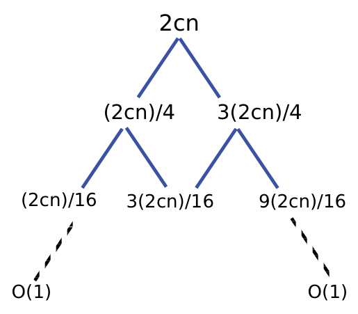

<!-- ===== PDF p1 ===== -->

<span style="color:#c0392b;">**讲次 6（Lecture 6）：随机化算法（Randomized Algorithms）**</span> <span style="color:#7f8c8d;">（Spring 2015，2015 春季学期）</span>

本讲大纲：
- 校验矩阵乘法（Check matrix multiplication）
- 快速排序（Quicksort）

<span style="color:#2471a3;">**[section]**</span> <span style="color:#00838f;">**随机化算法或概率算法（Randomized or Probabilistic Algorithms）**</span>

什么是随机化算法（randomized algorithm）？

- 生成一个随机数 $r \in \{1, \ldots, R\}$，并根据 $r$ 的值做出决策的算法。
- 对同样的输入、不同的执行（executions），随机化算法可能：
  - 运行不同的步数（Run a different number of steps）
  - 产生不同的输出（Produce a different output）

随机化算法可以大致分为两类——**Monte Carlo** 与 **Las Vegas**。

| Monte Carlo | Las Vegas |
|:---|:---|
| 总是多项式时间运行（runs in polynomial time always） | 期望多项式时间运行（runs in expected polynomial time） |
| 输出以高概率正确（output is correct with high probability） | 输出总是正确（output always correct） |

> <span style="color:#1e8449;">**[note] Note（译者注）:**</span> Monte Carlo（蒙特卡洛）与 Las Vegas（拉斯维加斯）的区分，本质上是在问一个工程问题：算法里的随机性把不确定性挪到了哪一侧——挪到答案上，还是挪到时间上。Monte Carlo（蒙特卡洛）把随机性兑现成「时间上界确定、答案带一个可量化的错误率」；Las Vegas（拉斯维加斯）把随机性兑现成「答案恒正确、运行时间是随机变量但期望受控」。这个二分不是为了分类而分类：它决定了算法能不能被嵌进更大的系统。只要上层要求「返回的答案必须对」，你就只能用 Las Vegas（拉斯维加斯），或者用 Monte Carlo（蒙特卡洛）加一个 verifier（验证器）把错误率洗掉。
>
> 机制上，两类的失败模式完全不同。Monte Carlo（蒙特卡洛）的失败是静默的：它照样返回，只是返回了一个错值，你必须额外知道错误率上界 $\delta$ 才能判断这个值能不能直接用。Las Vegas（拉斯维加斯）的失败是显式的：它要么给对的答案，要么就是慢，你能通过计数器或计时察觉。所以 Monte Carlo（蒙特卡洛）必须自带一个概率承诺（讲义里 Freivalds 给的是 $1/2$），Las Vegas（拉斯维加斯）必须自带一个期望承诺（随机化 quicksort（快速排序）的 $O(n \log n)$）。反过来，若你手上有一个检查器能在很小的时间里验证答案，把 Monte Carlo（蒙特卡洛）重复到验证通过，就把「错误风险」换成了「期望重试次数」，得到一个 Las Vegas（拉斯维加斯）算法——这是两类之间唯一通用的一向转换，反向没有免费午餐。
>
> 算一个具体例子。设 $n = 1000$，朴素 matrix multiplication（矩阵乘法）是 $n^3 = 10^9$ 次乘法。Freivalds 校验一次是 3 次「矩阵乘向量」，每次 $n^2$ 次运算，共 $3 \times 10^6$，错误概率上界 $1/2$。若独立跑 $k$ 次，错误概率降到 $2^{-k}$：$k = 10$ 给 $9.8 \times 10^{-4}$，$k = 20$ 给 $9.5 \times 10^{-7}$，$k = 30$ 给 $9.3 \times 10^{-10}$。二十次的代价是 $20 \times 3 \times 10^6 = 6 \times 10^7$，只有 $n^3$ 的百分之六，却把错误率压到百万分之一量级。这就是「用时间换确定性」的量化形态：多加 $k$ 倍验证代价，错误率指数下降——因为重复是独立的，错误率相乘而不是相加。另一侧，随机化 quicksort（快速排序）的期望比较次数是 $2n \ln n \approx 1.39\, n \log_2 n$，$n = 10^6$ 时约 $2.76 \times 10^7$ 次比较；最坏情形仍是 $\binom{n}{2} \approx 5 \times 10^{11}$，两者差四个数量级，但最坏情形出现的概率随 $n$ 指数变小，这就是「期望受控」的确切含义。
>
> 跨课程连接：6.042J 的 linearity of expectation（期望的线性性）与 indicator random variable（指示随机变量）是 Las Vegas（拉斯维加斯）类算法分析的唯一工具——quicksort（快速排序）的 $2n \ln n$ 就是把「第 $i$ 小与第 $j$ 小是否被比较」写成一个指示随机变量再求和，CLRS 第 5 章给了同一套推导。区别在于 6.042J 用它证明「存在一个划分」，而算法分析用它算「一次运行的期望代价」：前者是存在性，后者是随机变量的一次实现。CLRS 第 7 章把随机化 quicksort（快速排序）的期望分析写成定理（第 7.4 节），可以与本讲后面的偏执版本对照读：前者随机化 pivot（枢轴）的位置，后者随机化并拒收坏结果。再连到 CLRS 第 28 章 Matrix Operations：那一章关心解线性方程组与矩阵求逆的 $O(n^3)$ 主项，而本讲关心「不算也能验」——同一批矩阵运算，一侧问怎么算，一侧问怎么省掉算。
>
> 收束一句：判断一个新算法属于哪一类，只看两件事——输出是否恒正确、时间是否有确定性上界；两个答案组合出四种，只有两种有名字，剩下两种是没人愿意用的设计。

<span style="color:#2471a3;">**[section]**</span> <span style="color:#00838f;">**矩阵乘积（Matrix Product）**</span>

```math
C = A \times B
```

- 简单算法（Simple algorithm）：$O(n^3)$ 次乘法。
- **Strassen**：用 7 次乘法乘两个 $2 \times 2$ 矩阵：$O(n^{\log_2 7}) = O(n^{2.81})$
- **Coppersmith-Winograd**：$O(n^{2.376})$

> <span style="color:#1e8449;">**[note] Note（译者注）:**</span> 这条谱系的真正信息不是「谁把指数压得更低」，而是两个结构性事实：第一，matrix multiplication（矩阵乘法）的运算次数是一个可优化的计数，不是算法的固有属性；第二，这条曲线从 1969 年到 2024 年只从 $2.81$ 降到 $2.371$，半个世纪改进不到百分之十六——说明渐近路线的边际收益已经越来越薄，这也正是本讲把重心转向「验证」的现实动机。
>
> 先看 Strassen 为什么 7 次就够。把 $A, B$ 都切成 $2 \times 2$ 的块，$C$ 的四个块按定义要 8 次块乘法，每次块乘法本身又是规模 $n/2$ 的 matrix multiplication（矩阵乘法）。Strassen 的做法是先用块的加减造出 7 个中间量 $M_1, \ldots, M_7$，再用这 7 个量加减回 $C$ 的四个块。块加减只花 $O(n^2)$，比一次规模 $n/2$ 的块乘法（$\Theta(n^3/8)$ 量级）便宜得多，所以「用便宜加法换掉一次昂贵乘法」在代价上赚。代价结构一变，recurrence（递归式）就从 $T(n) = 8T(n/2) + \Theta(n^2)$ 变成 $T(n) = 7T(n/2) + \Theta(n^2)$；前者解出 $\Theta(n^3)$，后者解出 $\Theta(n^{\log_2 7}) = \Theta(n^{2.807})$。指数的来源是「每层子问题的个数」，而不是「每层做了多少算术」——这是理解一切分块快速算法的钥匙。
>
> 代入具体数看量级。$n = 1024 = 2^{10}$ 时，朴素是 $n^3 = 2^{30} \approx 1.07 \times 10^9$ 次乘法；Strassen 是 $n^{2.807} = 2^{10 \times 2.807} = 2^{28.07} \approx 2.8 \times 10^8$，比值约 $3.8$。但这只是「同单价乘法」下的比值，Strassen 的加减次数与递归调用常数都比朴素版大得多，所以真实交叉点要靠实测定：一般实现里 $n$ 要大到数百以上它才划算，小规模反而更慢——因为 $n \le 32$ 这一层加减的开销已经盖过省下的那次乘法。这就是「渐近更优、工程上要挑规模」的确切含义。
>
> 谱系本身按时间排列：1969 年 Strassen 给出 $2.807$；1990 年 Coppersmith 与 Winograd 给出 $2.376$；2012 年 Williams 用 refined laser method（精细激光法）到 $2.3729$；2021 年 Alman 与 Vassilevska Williams 到 $2.3728596$；2023 年 Duan、Wu、Zhou 在 FOCS 上到 $2.371866$；2024 年 Vassilevska Williams 等四人在 SODA 上到 $2.371552$；同年 Alman、Duan、Vassilevska Williams 等六人的 "More Asymmetry Yields Faster Matrix Multiplication" 到 $2.371339$。这些后续方法不再直接手写算法，而是把问题化成 tensor（张量）的幂与「非对称切片」，属于 algebraic complexity（代数复杂度）的路子；下界方面只知道 $\omega \ge 2$，连「能否做到 $\omega = 2$」都还没有定论。
>
> 跨课程连接：Strang 的 18.06 里，block multiplication（分块乘法）是讲矩阵乘法的标准视角，Strassen 的全部语法就是分块乘法加上块之间的线性组合；区别在于 Strang 关心分块之后矩阵的几何意义（列空间、秩、矩阵分解），而这里只数「块乘法被调用了几次」。再连 CLRS 第 28 章 Matrix Operations：那一章的 $O(n^3)$ 指的是解 $Ax = b$ 与矩阵求逆的算术量，而 Strassen 在书里被放在第 4 章 divide and conquer（分治）里当递归式的范例——这本书把「分块递归的算术优化」与「矩阵分解的数值线性代数」分成两处讲，恰好对应本讲的上半段与下半段：一侧是复杂度谱系，一侧是验证。
>
> 收束：这条曲线的教训是渐近上限已经贴着 $2.371$ 不动，工程上的赢面全在常数、cache 与并行；而本讲给出的另一次跳跃——从 $O(n^3)$ 的「算」到 $O(n^2)$ 的「验」——才是复杂度里少有的整数量级跃迁。顺带记住一个反差：加速 matrix multiplication（矩阵乘法）五十年只换来指数上百分之十几的改进，而换一个问法（改成验证）就直接省掉一个 $n$ 的因子。把指数差换成绝对量级会更直观：$n = 10^{6}$ 时 $n^{2.371}$ 约是 $1.7 \times 10^{14}$，而 $n^{3} = 10^{18}$，两者差约 5900 倍；换句话说，理论界为指数上 0.001 的改进写论文，工程界更愿意把常数优化 2 倍，两边其实在压同一个资源——乘法次数。

---

<!-- ===== PDF p2 ===== -->

<span style="color:#c0392b;">**矩阵乘积校验器（Matrix Product Checker）**</span>

给定 $n \times n$ 矩阵 $A, B, C$，目标是检查 $A \times B = C$ 是否成立。

**问题（Question）**：我们能做得比完整执行乘法更好吗？

我们将看到一个 $O(n^2)$ 的算法，它满足：
- 若 $A \times B = C$，则 $\Pr[\text{output} = \text{YES}] = 1$。
- 若 $A \times B \ne C$，则 $\Pr[\text{output} = \text{YES}] \le \frac{1}{2}$。

我们将假设矩阵中的元素属于 $\{0, 1\}$，且算术在 **mod 2** 下进行。

<span style="color:#2471a3;">**[section]**</span> <span style="color:#00838f;">**Freivalds 算法（Freivalds' Algorithm）**</span>

选择一个随机二进制向量（random binary vector）$r[1 \ldots n]$，使得对 $i = 1, \ldots, n$ 独立地有 $\Pr[r_i = 1] = \frac{1}{2}$。若 $A(Br) = Cr$，算法输出 **'YES'**；否则输出 **'NO'**。

**观察（Observation）**：该算法需要 $O(n^2)$ 时间，因为有 3 次「$n \times n$ 矩阵 × $n \times 1$ 矩阵」的乘法：$Br$、$A(Br)$ 与 $Cr$。

> <span style="color:#1e8449;">**[note] Note（译者注）:**</span> Freivalds 算法的设计问题可以精确表述为：给定三个 $n \times n$ 矩阵 $A, B, C$，判断 $A \times B = C$ 是否成立，能不能不把 $AB$ 算出来就作出判断。答案是能，代价是允许以 $1/2$ 的概率漏判（把不相等误判为相等），而把相等判成相等永远正确——这是 one-sided error（单边错误），错的只有一侧。
>
> 机制的关键一步是 associativity（结合律）。$A(Br) = (AB)r$ 对任何向量 $r$ 恒成立，所以我们先在 $O(n^2)$ 里算出 $Br$，再在 $O(n^2)$ 里算出 $A(Br)$，把结果与同样 $O(n^2)$ 的 $Cr$ 比较。若 $AB = C$，那么 $(AB)r = Cr$ 对所有 $r$ 成立，算法必答 YES——没有假阴性。若 $AB \ne C$，令 $D = AB - C \ne 0$，只有那些恰好落在 $D$ 的 kernel（零空间）里的 $r$ 会让 $Dr = 0$ 从而骗过检查；紧接着的正确性证明会给出「这样的 $r$ 至多占一半」。所以错误率上界不是估出来的，是数出来的：它等于「偶然落进零空间的概率」，而零空间是 $2^n$ 个二进制向量里的一个真子集，最多装一半。
>
> 算量级。$n = 2000$ 时朴素 matrix multiplication（矩阵乘法）是 $8 \times 10^9$ 次乘法；Freivalds 一次是 3 次「矩阵乘向量」，共 $3n^2 = 1.2 \times 10^7$，比值 $667$。若按 64 位字打包，把 64 个二进制分量塞进一个机器字、用按位与加 popcount 代替逐个加法，实际指令数还能再降一到两个数量级——这就是二进制情形下「矩阵乘向量」远比标量模型便宜的原因。取 $k = 10$ 次重复，代价 $1.2 \times 10^8$，错误率 $2^{-10} \approx 9.8 \times 10^{-4}$；取 $k = 40$，代价 $4.8 \times 10^8$（仍只有朴素计算的百分之六），错误率 $9.1 \times 10^{-13}$，到这一步错误率已经低于大多数工程场景关心的阈值。
>
> 这个「把矩阵等式降维成一个随机投影」的手法有名字，叫 fingerprinting（指纹化）。通用形态是：把要比较的两个大对象经过一个随机线性映射压成小对象，若小对象不等则大对象必不等（无假阴性），若小对象相等则以高概率大对象相等。同一模板在 CLRS 的字符串匹配里出现在 Rabin–Karp 上（把字符串看成多项式、模一个随机素数取指纹），在多项式恒等测试里出现在 Schwartz–Zippel 的思路里；区别是 Rabin–Karp 投到一个标量，Freivalds 投到一个向量，Schwartz–Zippel 投到一个多项式取值——三者都是「投影后比较」，只是投影的维度不同。
>
> 跨课程连接：Strang 的 18.06 里，$Dr$ 是线性映射 $D$ 在方向 $r$ 上的像，$D$ 可逆等价于对所有 $r$ 都有 $Dr \ne 0$；这里需要的只是弱得多的一句话——$D \ne 0$ 就保证至少有一个方向被抓到，而随机采样抓不到的概率有上界。区别在于线性代数问「零空间长什么样、维数多少」，随机化算法只问「随机撞进零空间的概率多大」，后者只需要计数，不需要求基。再连 CSAPP 第 6 章：$n \times n$ 矩阵按行连续存储时，$Br$ 是「对每一行做一次点积」，访存是顺序流式的；而真正算 $AB$ 是 $\Theta(n^3)$ 次访存，$n = 2000$ 时矩阵有 32 MB，远超 L3，几乎每次访问都掉到内存——所以 $3n^2$ 与 $n^3$ 的实际差距比运算次数字面上的 $667$ 倍还大。
>
> 收束：Freivalds 的价值在于它把「验证」从「重算一遍」里解放出来，而解放的钥匙只有一把——associativity（结合律）允许你把 matrix multiplication（矩阵乘法）的一部分推迟到一个向量上，从而用 $O(n^2)$ 买到关于 $O(n^3)$ 结论的高置信度。

---

<span style="color:#2471a3;">**[section]**</span> <span style="color:#00838f;">**正确性分析（Analysis of Correctness if $AB \ne C$）**</span>

<span style="color:#2471a3;">**[claim]**</span> 声明（Claim）：若 $AB \ne C$，则 $\Pr[ABr = Cr] \ge \frac{1}{2}$。

设 $D = AB - C$。我们的假设是 $D \ne 0$。显然，存在某个 $r$ 使得 $Dr \ne 0$。

我们的目标是证明**存在很多 $r$ 使得 $Dr \ne 0$**。具体地，对随机选取的 $r$，$\Pr[Dr \ne 0] \ge \frac{1}{2}$。

$D = AB - C \ne 0 \Rightarrow \exists\ i, j$ 使得 $d_{ij} \ne 0$。固定向量 $v$：除了 $v_j = 1$ 外其余坐标全为 0。$(Dv)_i = d_{ij} \ne 0$，意味着 $Dv \ne 0$。取算法可能选出的任意 $r$。我们考虑 $Dr = 0$ 的情形。令 $r' = r + v$。

由于 $v$ 除 $v_j$ 外处处为 0，$r'$ 与 $r$ 相同，除了 $r'_j = (r_j + v_j) \bmod 2$。于是 $Dr' = D(r + v) = Dr + Dv = 0 + Dv \ne 0$。我们看到 $r$ 与 $r'$ 之间存在**一一对应**（1 to 1 correspondence）：若 $r + v = r'' + v$，则 $r = r''$。这意味着：

```math
\text{使 } Dr' \ne 0 \text{ 的 } r' \text{ 的个数} \ge \text{使 } Dr = 0 \text{ 的 } r \text{ 的个数}
```

由此我们得出结论：$\Pr[Dr \ne 0] \ge \frac{1}{2}$。

> <span style="color:#1e8449;">**[note] Note（译者注）:**</span> pairing argument（配对论证）要解决的是「错误率上界到底是多少」这个定量问题，而它的做法里没有一次概率计算，只有一次 bijection（双射）计数——这是随机化证明里最容易被低估的模板：不需要 independence（独立性），不需要集中不等式，只需要一个把坏集合映射进好集合的 involution（对合）。
>
> 把机制拆成可检验的四步。第一步，设 $B = \{r : Dr = 0\}$ 是坏向量集合，$D \ne 0$ 保证存在 $d_{ij} \ne 0$，取 $v$ 为「只有第 $j$ 位是 1」的基向量，于是 $Dv$ 的第 $i$ 个分量等于 $d_{ij} \ne 0$，即 $Dv \ne 0$。第二步，定义映射 $\varphi(r) = r + v$（逐分量 mod 2）。因为 mod 2 下 $v + v = 0$，所以 $\varphi(\varphi(r)) = r$，$\varphi$ 是自己的逆，是双射。第三步，验证 $\varphi$ 把 $B$ 送进补集：若 $Dr = 0$，则 $D\varphi(r) = D(r+v) = Dr + Dv = 0 + Dv \ne 0$，所以 $\varphi(r) \notin B$；又 $\varphi$ 是双射，故 $|\varphi(B)| = |B|$ 且 $\varphi(B)$ 全部落在补集里，于是补集至少和 $B$ 一样大。第四步，总向量数是 $2^n$，$B$ 与其补集相加等于 $2^n$，结合「补集不小于 $B$」得 $|B| \le 2^{n-1}$，即 $\Pr[Dr = 0] \le 1/2$。全程只用了「$Dv \ne 0$」与「$v + v = 0$」两条，没有用到 $r$ 各分量相互独立的细节——只需要 $r$ 在 $2^n$ 个向量上均匀。
>
> 手算一个 $n = 2$ 的紧例，看清 $1/2$ 这个界不能改进。取 $D = \begin{pmatrix}1&0\\0&0\end{pmatrix}$ 在 mod 2 下，四个候选向量逐个代：$r = (0,0)$ 给 $Dr = (0,0)$，坏；$r = (1,0)$ 给 $(1,0)$，好；$r = (0,1)$ 给 $(0,0)$，坏；$r = (1,1)$ 给 $(1,0)$，好。好坏各两个，概率恰好 $1/2$。这说明若 $D$ 的秩为 1（零空间维数为 1），错误率正好是 $1/2$，配对论证给出的界是紧的，不是松估计。一般地，若 $D$ 的零空间维数为 $t$，坏向量恰有 $2^t$ 个，错误率恰为 $2^{t-n}$；配对论证只用「$t \le n-1$」一条就得到 $2^{-1}$，这正是为什么它给的是 $1/2$ 而不是更小的数——它对所有非零 $D$ 一视同仁，只用到「非零」这一个事实。
>
> 为什么 mod 2 在这里不可替换。若在实数上用 $\{0,1\}$ 向量，翻转一位要写成 $r - v$，$r + v$ 仍是对合但 $Dv$ 的符号与加法要对齐；更实际的问题是二进制向量在 mod 2 下恰好被 $v$ 完美分成 $2^{n-1}$ 对，计数干净到不需要任何不等式。mod 2 的好处就是 $v$ 自逆，让 $\varphi$ 一步成为对合。这就是为什么讲义一开始就把算术限定在 mod 2 下：不是数学上的必需，而是让界最干净的充分条件；换成实数字段，界仍成立（对称性论证），但推导要绕一圈。顺带看清为什么重复是有效的：每一轮都取全新的独立 $r$，漏判概率逐轮相乘，$k$ 轮之后就是 $2^{-k}$；这里的独立性是随手可得的，因为 $r$ 本来就是我们自己生成的随机数，不依赖输入。这也是 Monte Carlo（蒙特卡洛）类算法比 Las Vegas（拉斯维加斯）更容易「重复」的结构原因：它的随机性完全在算法手里，重跑只是掷新一轮骰子。
>
> 跨课程连接：6.042J 里有一个同构的技巧——若每个坏对象都能被一个映射配上一个不同的好对象，则坏对象不多于一半，这是 pigeonhole（抽屉原理）的逆向使用；区别是 6.042J 用它做存在性证明（存在一个好对象），这里用它给概率上界（随机命中的坏对象不超过一半）。再连 CLRS 第 5 章：那里用 indicator random variable（指示随机变量）算期望，是「线性加求和」；这里用 bijection（双射）算概率，是「计数加配对」。两种工具互补：期望类问题用指示变量，概率上界类问题用配对，前者不需要独立，后者不需要期望——两者需要的假设都极少，这正是它们能反复复用的原因。
>
> 收束成一句可复用的模板：想让坏不超过一半，就找一个把坏搬到好的对合；判据是「搬过去的像确实不在坏集合里」，工具是「映射是自己的逆」。

---

<!-- ===== PDF p3 ===== -->

<span style="color:#c0392b;">**快速排序（Quicksort）**</span>

分治算法，但**主要工作在分解（divide）步骤**而不是合并（combine）步骤。

像插入排序（insertion sort）一样**原地（in place）排序**，而不同于归并排序（mergesort，它需要 $O(n)$ 辅助空间）。

不同的变体（variants）：
- **基本版（Basic）**：平均情形下表现良好
- **基于中位数的枢纽选取（Median-based pivoting）**：使用中位数查找
- **随机版（Random）**：对所有输入在期望意义下都良好（Las Vegas 算法）

**快速排序的步骤：**
- **Divide（分解）**：在 $A$ 中选一个枢纽元素（pivot element）$x$，把数组划分为子数组：$L$（所有 $< x$ 的元素）、$G$（所有 $> x$ 的元素）、$E$（所有 $= x$ 的元素）。
- **Conquer（征服）**：递归排序子数组 $L$ 和 $G$。
- **Combine（合并）**：平凡（trivial）。

**基本快速排序（Basic Quicksort）**

围绕 $x = A[1]$ 或 $A[n]$（第一个或最后一个元素）作为枢纽：
- 依次从 $A$ 中移除每个元素 $y$
- 根据与枢纽 $x$ 的比较，把 $y$ 插入 $L$、$E$ 或 $G$
- 每次插入与移除需要 $O(1)$ 时间
- 划分步骤需要 $O(n)$ 时间
- 原地实现的细节：见 CLRS p.171

> <span style="color:#1e8449;">**[note] Note（译者注）:**</span> quicksort（快速排序）与 mergesort（归并排序）的对比，最有效的切法是问「三个步骤里哪一步花掉了全部工作量」。divide and conquer（分治）的骨架是 divide（分解）、conquer（递归征服）、combine（合并），但三步并不等价：mergesort（归并排序）把智慧放在 combine，quicksort（快速排序）把智慧放在 divide。这个重心的选择决定了两件工程事实：能不能 in place（原地），以及 cache 行为好不好。
>
> 先讲机制，即为什么 quicksort（快速排序）的 combine 可以无事可做。一次 partition（划分）结束时，数组被分成 $L$（全部小于 pivot（枢轴））、$E$（等于）、$G$（全部大于）三段，并且这三段已经按块排好序：$L$ 里每个元素都小于 $E$ 里每个元素，$E$ 里每个都小于 $G$ 里每个。递归把 $L$ 内部与 $G$ 内部各自排好之后，整段数组的顺序由这个跨段不变式直接保证，所以 combine 只是什么都不做。mergesort（归并排序）没有这个不变式：它的两半在递归前是乱序的，任何跨半比较都不知道对方元素的值，所以必须靠额外的 merge（归并）步骤在两半都排好之后重建顺序——先把次序造出来，代价是每层 $O(n)$ 的搬运。一句话对比：quicksort（快速排序）事前一刀切开，划分时就建立了跨段有序；mergesort（归并排序）事后两路归并，合并时才建立跨段有序。
>
> 再讲为什么这个重心差异导致 in place（原地）。partition（划分）只需两个指针从两端向中间扫、遇到逆序对就交换，写回的位置就是读出的位置，额外空间只是递归栈的 $O(\log n)$；merge（归并）则必须把两段有序序列交错写进另一块缓冲，因为读指针与写指针会在同一段区间上重叠，就地交错一定会覆盖尚未读取的数据。这不是实现懒，是结构性的：交错合并时无法保证「还没读的元素」不被「刚写下的元素」覆盖，除非缓冲区与源区间不相交。
>
> 算一个能感觉到的数。$n = 10^6$ 个 int32 元素是 4 MB 的数组。mergesort（归并排序）需要一块同样大小的 4 MB 缓冲；若实现里每层递归各申请自己的缓冲（常见的教科书写法），同时活着的缓冲最多可达 $O(\log n)$ 块，约 27 层乘以 4 MB 就是 108 MB 的峰值——这是「原地与否」在内存上的真实差距。quicksort（快速排序）的额外空间只有栈：期望递归深度约 $2 \ln n \approx 27.6$ 层，每帧按 48 字节算不到 1.4 KB。再换成 CSAPP 第 6 章的 cache 视角：4 MB 已经超过典型 L2（256 KB 到 2 MB），工作集翻倍意味着每层搬运都要重新从 L3 或内存取数，而 cache line（缓存行）是 64 字节，顺序流式访问与随机访问的命中率能差几十倍。所以 in place（原地）不只是省内存，它直接决定每层 $O(n)$ 的常数。
>
> 跨课程连接：CSAPP 第 6 章讲 memory hierarchy（存储层次）时反复强调「局部性决定实测常数」，第 3 章讲 swap 时的寄存器搬运与这里的划分交换是同一批指令；CLRS 第 7 章把 partition（划分）写成 $O(n)$ 的原地子程序，讲义引的 p.171 就是 Hoare 版划分。区别在于 CSAPP 关心「这段代码的访存模式落在哪一级」，CLRS 关心「这个子程序的比较次数」，两者相乘才是你实测看到的时间——这也是为什么标准库的排序实现要按元素大小与类型切换策略，而不是一套代码打天下。
>
> 收束：quicksort（快速排序）的「divide 重、combine 轻」不是风格选择，而是它能 in place（原地）的原因；而随机化要解决的，恰是这个设计留下的唯一软肋——pivot（枢轴）选坏了，划分就退化成 1 比 $n-1$。

---

<!-- ===== PDF p4 ===== -->

<span style="color:#c0392b;">**基本快速排序分析（Basic Quicksort Analysis）**</span>

若输入已排序或逆序排序，那么我们每次都在围绕最小或最大元素划分。这意味着 $L$ 或 $G$ 之一有 $n-1$ 个元素，另一个有 0 个。这给出：

```math
T(n) = T(0) + T(n-1) + \Theta(n) = \Theta(1) + T(n-1) + \Theta(n) = \Theta(n^2)
```

然而，该算法在**实际中的随机输入**上表现良好。

<span style="color:#2471a3;">**[section]**</span> <span style="color:#00838f;">**用中位数查找选择枢纽（Pivot Selection Using Median Finding）**</span>

可以用**秩/中位数选择算法**（rank/median selection algorithm，$\Theta(n)$ 时间）保证 $L$ 与 $G$ 平衡。下面的第一个 $\Theta(n)$ 用于枢纽选择，第二个用于划分步骤：

```math
T(n) = 2T\!\left(\frac{n}{2}\right) + \Theta(n) + \Theta(n) = \Theta(n \log n)
```

这个算法在实践中很慢（slow in practice），**输给归并排序**。

> <span style="color:#1e8449;">**[note] Note（译者注）:**</span> median-based pivoting（基于中位数的枢轴选取）看上去是「用一个更贵的 pivot（枢轴）换一个更好的分治」，真正的教训是：换来的收益是「最坏情形保证」，付出的代价是「每层都要再花一次线性时间做选择」，两笔账必须一起结算，才看得清它为什么在实践中输给 mergesort（归并排序）。
>
> 机制上先看它为什么必然慢，三条叠加。第一，median of medians（中位数之中位数）本身是递归算法：每 5 个元素一组、组内排序取中位数，再对这些中位数递归取中位数；它的常数按 CLRS 第 9 章的分析落在「每层约 $O(n)$ 但系数不小」——分组排序 5 元素本身要几十次比较，且要按 $n/5$ 的规模递归。第二，quicksort（快速排序）不是在根节点选一次 pivot（枢轴）就完事，每一层递归都要为每个子数组再选一次，所以这次 $O(n)$ 的选择会在 $O(\log n)$ 层上被重复，累计成本是「每层的 $O(n)$ 乘以层数」。第三，选择算法与划分各扫一遍数组，同一批数据被读两次，cache 局部性变差——用 CSAPP 第 6 章的语言说，两次流式扫描的总流量是单次的两倍，而两次之间数组已经从 L2 掉到 L3。
>
> 把常数具体化。设一次 partition（划分）需要 $n$ 次比较，一次 median of medians（中位数之中位数）按偏保守的口径算 $20n$ 次比较，而 CLRS 第 9 章给的数量级落在个位数到二十几倍之间，取决于实现与统计方式，这里取 20 当上界量级，那么每层总比较成本约 $21n$，$T(n) = 2T(n/2) + 21n$ 解出 $\Theta(21 n \log_2 n)$。随机化 quicksort（快速排序）的期望比较次数是 $2n \ln n = 1.386\, n \log_2 n$，mergesort（归并排序）是 $n \log_2 n$ 量级。三个数并排是 $21 : 1.386 : 1$，中位数版比随机化版慢 15 倍以上——这就是「渐近同为 $O(n \log n)$、实测差一个数量级以上」的算术来源。取 $n = 10^6$：$21 \times 10^6 \times \log_2 10^6 \approx 21 \times 10^6 \times 19.93 \approx 4.2 \times 10^8$ 次比较，随机化版约 $2.76 \times 10^7$，差 15 倍；按每次比较 10 ns 折算就是 4.2 秒对 0.28 秒。
>
> 跨课程连接：讲次 2 的 median of medians（中位数之中位数）出自 Blum、Floyd、Pratt、Rivest、Tarjan 五人 1973 年在 JCSS 上的 "Time bounds for selection"，CLRS 第 9 章把它写成 SELECT 子程序；区别在于那一讲的目标是「找出第 $k$ 小，一次」，$O(n)$ 就收工，本讲要它「每层都出场」，于是那个 $O(n)$ 的常数被乘上 $\log n$ 层，从看不见的常数变成决定胜负的常数。这条「同一子程序在不同嵌套深度下代价完全不同」的规律，与 CSAPP 第 5 章讲循环内层指令的常数如何被放大是同一个算术结构。
>
> 工程上的答案不是挑一个最优算法，而是造一个混合体：introsort（内省排序，Musser 1997）先按 quicksort（快速排序）走，用 median-of-three（三点取中）选 pivot（枢轴），当递归深度超过约 $2 \log_2 n$ 时改用 heapsort（堆排序）兜底，子数组小到阈值以下改用 insertion sort（插入排序）——三段拼接同时拿到「平均快、最坏 $O(n \log n)$、小数组常数低」。Java 7 起基本类型数组用 DualPivotQuicksort（双 pivot 快速排序，Yaroslavskiy 2009），是同一思路的双 pivot 版本。它们的共同点是用「廉价的启发式加兜底」代替「昂贵的最优选择」：兜底机制牺牲一点平均性能换最坏情形的保险，而保险只在罕见情况下触发，均摊成本几乎为零。
>
> 收束：median-based pivoting（基于中位数的枢轴选取）在教科书里的位置是「证明最坏情形能做到 $O(n \log n)$」，而不是「应该这么写代码」；判断一个算法值不值得用，要同时看渐近、常数与实现代价，少看一样都会误判。

<span style="color:#2471a3;">**[section]**</span> <span style="color:#00838f;">**随机化快速排序（Randomized Quicksort）**</span>

$x$ 从数组 $A$ 中**随机**选择（每次递归时都做一次随机选择）。

对所有输入数组 $A$，**期望时间**为 $O(n \log n)$。该算法的分析见 CLRS p.181–184；我们将分析它的一种变体。

<span style="color:#2471a3;">**[section]**</span> <span style="color:#00838f;">**「偏执」快速排序（"Paranoid" Quicksort）**</span>

```
Repeat（重复）
    选择枢纽为 A 的随机元素
    执行划分 Partition
Until（直到）
    结果划分满足 |L| ≤ (3/4)|A| 且 |G| ≤ (3/4)|A|
Recurse on L and G（递归处理 L 和 G）
```

🎥 *Devadas 在视频中[解释「偏执」名字的由来]*："This quicksort is paranoid in the sense that it's going to be afraid of getting unbalanced partitions, and it's going to keep trying to get balanced partitions."（翻译：这个快速排序之所以「偏执」，是因为它害怕得到不平衡的划分，于是会不断重试直到获得平衡划分。）——算法不再接受任何划分结果，而是**坚持要求**两边都不超过 $\frac{3}{4}n$，否则重掷枢轴。

---

<!-- ===== PDF p5 ===== -->

<span style="color:#c0392b;">**「偏执」快速排序分析（"Paranoid" Quicksort Analysis）**</span>

让我们定义「好枢纽」（good pivot）与「坏枢纽」（bad pivot）：

- **好枢纽（Good pivot）**：$L$ 和 $G$ 的大小都 $\le \frac{3}{4}n$。
- **坏枢纽（Bad pivot）**：$L$ 或 $G$ 之一的大小 $> \frac{3}{4}n$（即有一边过大）。



> <span style="color:#7f8c8d;">[原图说明] 原页附图：把数组按枢纽位置分为 bad / good / bad 三段——左边 $\frac{n}{4}$ 与右边 $\frac{n}{4}$ 是「坏枢纽」位置（会导致某边 > 3n/4），中间 $\frac{n}{2}$ 是「好枢纽」位置。</span>

我们看到，一个枢纽是好的概率 $> \frac{1}{2}$。

设 $T(n)$ 是对任意规模为 $n$ 的数组的**期望运行时间上界**。$T(n)$ 由以下部分组成：
- 排序左子数组所需时间
- 排序右子数组所需时间
- 获得一次好调用（good call）所需的迭代次数。把划分步骤的成本记为 $c \cdot n$。

**期望（Expectations）**

```math
T(n) \le \max_{\frac{n}{4} \le i \le \frac{3n}{4}} \left( T(i) + T(n - i) \right) + E(\#\text{iterations}) \cdot cn
```

现在，由于好枢纽的概率 $> \frac{1}{2}$，有 $E(\#\text{iterations}) \le 2$。

> <span style="color:#7f8c8d;">[原图说明] 原页附图：期望代价的树状示意——根层 $2cn$，好枢纽概率 $>1/2$ 使下一层出现 $2cn/4$ 与 $3(2cn)/4$ 等分支，逐层递推，最终 $O(1)$。图注列出各层分支的期望代价。</span>

> <span style="color:#1e8449;">**[note] Note（译者注）:**</span> 偏执版本的设计动作只有一句话：把「运气」换成「拒收」。它不接受任何一次 partition（划分），只接受满足 $|L| \le \frac{3}{4}n$ 且 $|G| \le \frac{3}{4}n$ 的那一次，其余结果整份丢掉、重选 pivot（枢轴）。这一步把随机化 quicksort（快速排序）的分析从「期望上的平均」变成「每次递归都有确定的缩减比例」，代价是多付几何级数的划分成本。
>
> 先把好 pivot（枢轴）的概率算准。设数组按大小排好位置 $1, \ldots, n$，选到位置 $i$ 的元素作 pivot（枢轴）时，较小一侧大小是 $i - 1$、较大一侧是 $n - i$。要求两侧都不超过 $\frac{3}{4}n$，即 $i - 1 \le \frac{3}{4}n$ 且 $n - i \le \frac{3}{4}n$，等价于 $\frac{n}{4} \le i \le \frac{3n}{4}$。这个区间里约有 $\frac{n}{2}$ 个位置，所以好概率 $p \ge \frac{n/2}{n} = \frac{1}{2}$；讲义写严格大于 $\frac{1}{2}$，是把端点与「至多含等号」算进去之后的说法，用 $p = \frac{1}{2}$ 当下界只会让结论更保守，不影响渐近。顺带看清门槛与概率的联动：若把门槛从 $\frac{3}{4}$ 收到 $\frac{2}{3}$，好区间变成 $\frac{n}{3}$ 到 $\frac{2n}{3}$，好概率掉到约 $\frac{1}{3}$，期望重试次数涨到 3——门槛越严，每次的划分越平衡，但重试越多，这是一条可以连续调的先验权衡。
>
> 再看重试的代价。每次尝试相互独立，因为 pivot（枢轴）是均匀随机选出来的，成功概率 $p$，失败次数服从 geometric distribution（几何分布），期望尝试次数是 $1/p \le 2$。所以「拿到一次好划分」的期望成本是 $2cn$，其中 $cn$ 是一次 partition（划分）的成本。尾部也可控：连续 $k$ 次失败的概率是 $(1-p)^k \le 2^{-k}$，$k = 10$ 就是约千分之一，那时浪费的工作是 $10cn$，而正常路径只花 $2cn$——尾部确实存在，但被指数压低，且尾部追加的成本与 $n$ 的一次方同阶，不会把总复杂度推高。这个「拒收率约一半」的结论还是可实测的预言：跑一百万次 partition（划分），统计被拒收的比例，若好概率真是 $1/2$，拒收率应在 $0.5$ 附近，其标准差约 $\sqrt{0.25/10^{6}} = 5 \times 10^{-4}$——几十行代码就能验证，这是把注里的概率论证落到实验上的最短路径。
>
> 代入 $n = 10^6$，把 $c$ 归一化成「一次 partition（划分）等于 $10^6$ 次操作」。期望每层成本 $2cn = 2 \times 10^6$。树高沿最长路径算：每层最多缩到 $\frac{3}{4}$，解 $n \left(\frac{3}{4}\right)^h = 1$ 得 $h = \log_{4/3} n = \frac{\ln 10^6}{\ln(4/3)} = \frac{13.8155}{0.28768} \approx 48.0$ 层。总代价约 $2cn \times h = 2 \times 10^6 \times 48 = 9.6 \times 10^7$ 次操作。对照基本 quicksort（快速排序）在已排序输入上的退化 $T(n) = T(n-1) + n$，总和 $n^2/2 = 5 \times 10^{11}$——两者差约 5000 倍。这就是「用重试过滤坏情形」买到的东西：把最坏情形从平方拉回对数线性，代价只是因子 2 与更高的常数。
>
> 跨课程连接：geometric distribution（几何分布）的期望是 $1/p$，这条在 6.042J 的期望章节与 Bertsekas 概率论教材里都有推导（首次成功的等待时间），把它当「重试次数」用是随机化算法最常见的算术；区别在于 6.042J 里它是一道概率习题，这里它是复杂度的乘子——$2cn$ 这个数字本身就是把概率结论翻译成时间。同一模板在讲次 7 的 skip list（跳表）里用在「层数」上：每次抛硬币决定是否再升一层，期望层数 $O(\log n)$，也是几何分布；区别是 skip list 的重试没有成本（多一层指针而已），而这里每次重试要多付一次 $O(n)$ 的 partition（划分），所以这里的期望尝试次数直接乘进时间复杂度。
>
> 收束成一条可复用的判据：若你能廉价地判定「这次结果够不够好」，就用重试把坏结果挡在门外；挡门的代价是几何期望，收益是每一层都有确定的缩减比例。

---

<!-- ===== PDF p6 ===== -->

<span style="color:#c0392b;">**「偏执」快速排序分析（续）**</span>

```math
T(n) \le T\!\left(\frac{n}{4}\right) + T\!\left(\frac{3n}{4}\right) + 2cn
```

我们在图中看到：无论沿哪条分支走到底，树的高度至多为 $\log_{\frac{4}{3}}(2cn)$。在每一层，我们总共做 $2cn$ 的工作。因此，期望运行时间为 $T(n) = \Theta(n \log n)$。

> <span style="color:#1e8449;">**[note] Note（译者注）:**</span> 收尾的 recurrence（递归式）价值不在它解出 $O(n \log n)$，而在于它给出一条可判定的分水岭：每次缩减是「乘一个固定分数」还是「减去一个固定量」，决定了结果是 $n \log n$ 还是 $n^2$。这条判据比 master theorem（主定理）更基础，因为主定理只覆盖「所有子问题同规模」的情形，而这里两个子问题规模是 $\frac{n}{4}$ 与 $\frac{3n}{4}$，根本套不进去。
>
> 先把树高算清。最长路径每层取较大的一侧，规模按 $\frac{3}{4}$ 递减：$n\left(\frac{3}{4}\right)^h \le 1$ 给出 $h \le \log_{4/3} n = \frac{\log_2 n}{\log_2(4/3)} \approx 2.41 \log_2 n$。递归树不是满的，但每一层各节点的规模之和不超过 $n$（每次分裂把 $n$ 拆成 $i$ 与 $n-i$，和守恒），所以每层总成本不超过 $2cn$，乘上树高得 $T(n) \le 2cn \log_{4/3} n$。反过来看，若两个子问题的规模之和小于 $n$（例如两个 $\frac{n}{3}$），每层总量就按几何级数收缩，总代价连 $n \log n$ 都用不完；所以真正需要 $\Theta(n \log n)$ 工作量的情形，恰好是每层几乎都用满 $n$ 的那些。这里真正的机关是「层之和守恒」这一步：它让不平衡只影响树高，不影响每层总量，两个效应分离，于是只需算树高。
>
> 代入数字感觉底数的效应。$n = 10^9$ 时，平衡情形（底数 2）树高是 $\frac{9 \ln 10}{\ln 2} = \frac{20.723}{0.6931} \approx 29.9$ 层；偏执版（底数 $\frac{4}{3}$）树高是 $\frac{20.723}{0.28768} \approx 72.0$ 层。比值 $\frac{72.0}{29.9} = 2.41$，与 $1/\log_2(4/3)$ 完全一致。也就是说，把最差缩减比从 $\frac{1}{2}$ 放松到 $\frac{3}{4}$ 的代价是树高乘 2.41，不是常数级的灾难——这正是偏执策略敢用 $\frac{3}{4}$ 而不是 $\frac{1}{2}$ 的算术依据：门槛定得松，好 pivot（枢轴）的概率就更大，重试次数下降，而树高只涨 2.41 倍。门槛 $\alpha$、好概率约 $1-2\alpha$、树高约 $1/\log_2\frac{1}{1-\alpha}$，三个量可以一起调，这是该设计的连续参数。
>
> 对照减法式退化。$T(n) = T(n-1) + cn$ 逐步展开是 $c(1 + 2 + \cdots + n) = \frac{cn^2}{2}$；取 $n = 10^4$、$c = 1$ 得 $5 \times 10^7$，而 $n \log_2 n = 10^4 \times 13.29 = 1.33 \times 10^5$，差 376 倍；$n = 10^6$ 时差到 $7.5 \times 10^4$ 倍。所以「每层只掉一个元素」不是稍微慢一点，而是阶的变化。这条判据在别处反复出现：欧几里得算法用减法版时，最坏输入是相邻 Fibonacci 数，步数按 $n$ 的指数增长，而取模版步数是 $O(\log n)$；二分搜索每次把区间减半，是乘法式的极端；而线性扫描找最大值是加法式，$n$ 步——但每步只有 $O(1)$，所以总代价仍是线性。这说明判据只对「每层成本与规模成正比」的递归有效，用错地方会误判。
>
> 跨课程连接：CLRS 第 4 章讲 recurrence（递归式）时给出三种方法——代换法、递归树法、master theorem（主定理）；本讲这个式子只能用递归树法（或更一般的 Akra–Bazzi 型结论），因为子问题规模不等。区别在于主定理的前提是 $T(n) = aT(n/b) + f(n)$ 里所有子问题同尺寸，而这里 $a = 2$、两个子问题的 $b$ 不同，主定理直接失效，这是「公式有前提」最典型的例子。再连 6.006 的分治讲次：那里也画递归树，但多半是平衡的，树高就是 $\log n$；本讲把树高换成 $\log_{4/3} n$，只是把「平衡假设」替成「最长路径步数」，其余推导一模一样，包括每层总量乘以层数那一步。
>
> 收束：判断一个 divide and conquer（分治）会不会退化成平方，只看两件事——缩减是乘性的还是减性的、每层成本是否与规模同阶；前者决定层数是对数还是线性，后者决定「层数乘层成本」这个乘积有多大。

---

<!-- ===== PDF p7 ===== -->

<span style="color:#7f8c8d;">**MIT OpenCourseWare**</span>

<span style="color:#7f8c8d;">http://ocw.mit.edu</span>

<span style="color:#7f8c8d;">**6.046J / 18.410J 算法设计与分析（Design and Analysis of Algorithms）**</span>

<span style="color:#7f8c8d;">Spring 2015（2015 春季学期）</span>

<span style="color:#7f8c8d;">有关引用这些材料的信息或我们的使用条款（Terms of Use），请访问：http://ocw.mit.edu/terms。</span>
