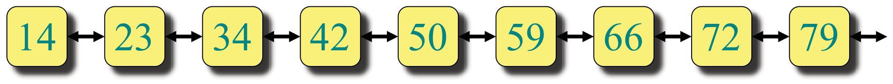
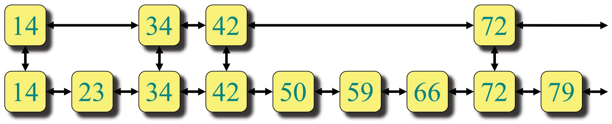
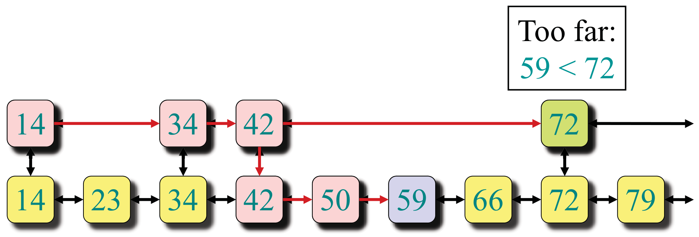
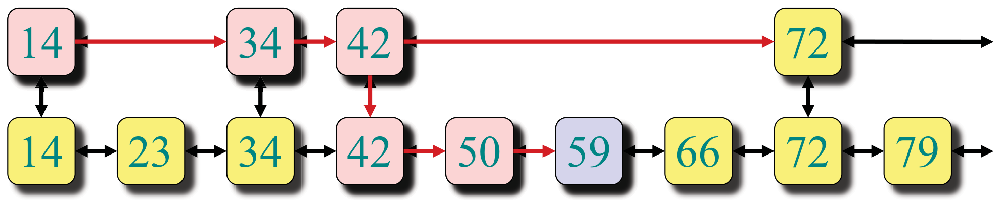
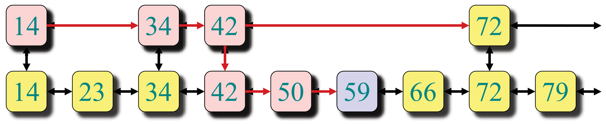
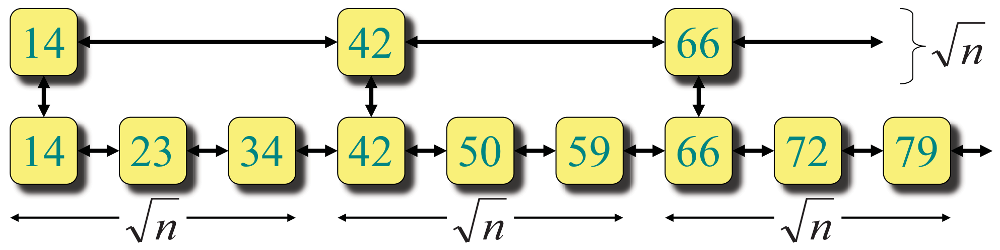
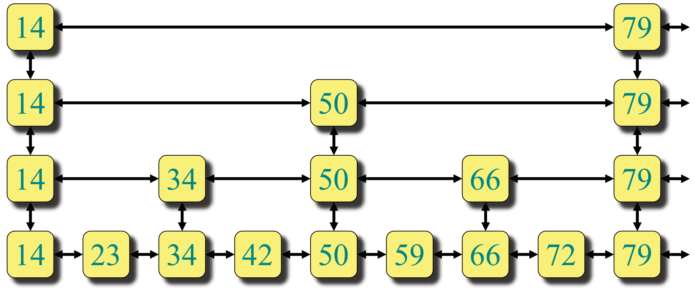
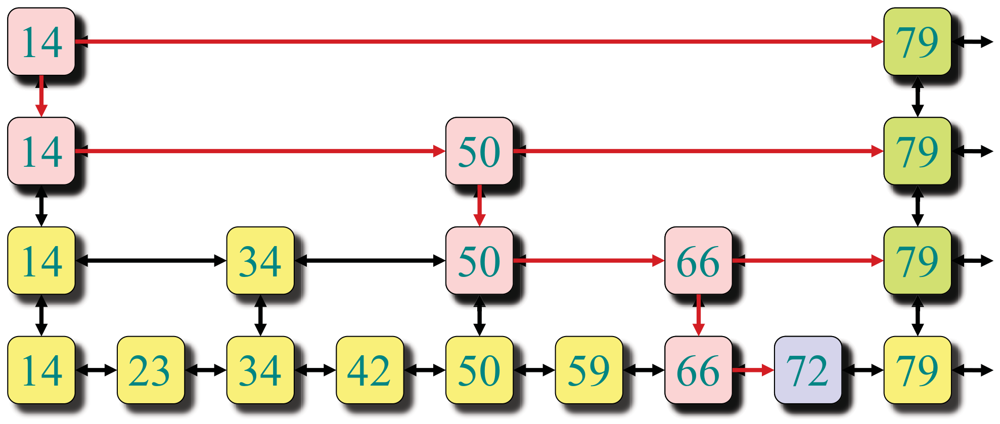
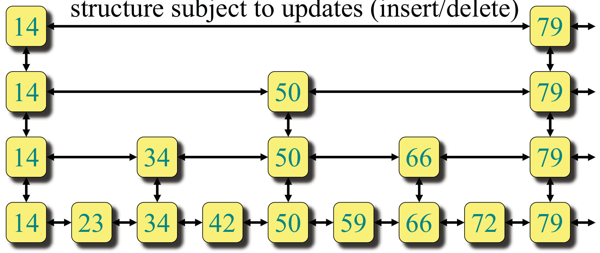
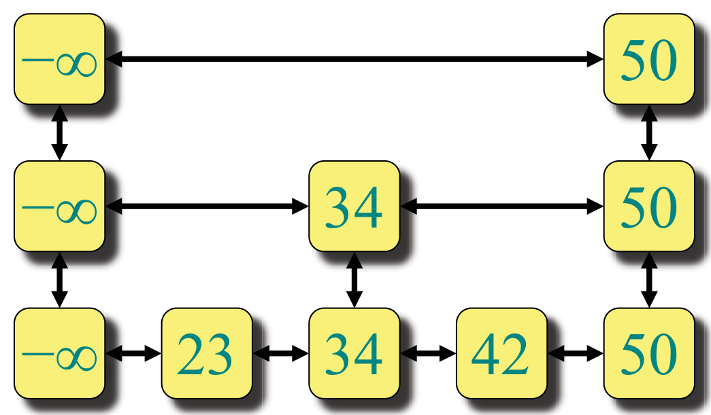

<!-- ===== PDF p1 ===== -->

<span style="color:#c0392b;">**讲次 7（Lecture 7）：跳跃表（Skip Lists）**</span> <span style="color:#7f8c8d;">（Design and Analysis of Algorithms, 6.046J/18.401J, 2015-07-10, Copyright © 2001-8 by Leiserson et al, L9.1）</span>

本讲大纲：
- 数据结构（Data structure）
- 随机化插入（Randomized insertion）
- 高概率（w.h.p.）界（With high probability bound）

---

<!-- ===== PDF p2 ===== -->

<span style="color:#c0392b;">**跳跃表（Skip lists）**</span>

- 简单的随机化动态搜索结构（simple randomized dynamic search structure）
  - 由 **William Pugh 于 1989 年**发明（Invented by William Pugh in 1989）
  - 易于实现（Easy to implement）
- 维护 $n$ 个元素的动态集合（dynamic set），每次操作在**期望意义下**及**高概率下**都是 $O(\lg n)$ 时间
  - 对 $T(n)$ 分布的**尾部**有强保证（strong guarantee on tail of distribution）
  - $O(\lg n)$「几乎总是」（almost always）成立

> <span style="color:#1e8449;">**[note] Note（译者注）:**</span> 这条注要回答的设计问题是：「快」这个承诺到底以什么形式交付，才算真正可以被信任——是给一个平均意义上成立的界，还是给一个连尾部都钉死的界。randomized quicksort（随机化快排）交付的是 expectation（期望），skip list（跳跃表）交付的是 with high probability（高概率）；差别不在常数，而在界到底管不管尾部。
>
> 先把机制拆开。期望只是一个线性泛函 $E[X] = \sum_x x \Pr[X = x]$，它的算术动作是「把极罕见但极大的取值乘上一个极小概率，然后从求和里抹掉」。抹得干不干净，取决于概率衰减得比取值增长快多少。取一次搜索的步数作随机变量 $X$：以 $1 - 10^{-6}$ 的概率 $X = 20$，以 $10^{-6}$ 的概率 $X = 10^{9}$，则 $E[X] = 20 \cdot (1 - 10^{-6}) + 10^{9} \cdot 10^{-6} = 20 - 2 \times 10^{-5} + 1000 \approx 1020$。期望是 $1020$ 步，看上去「只比 $20$ 步差 $51$ 倍」，可那一次坏实例真实发生时要走 $10^{9}$ 步——比常规情形慢 $5 \times 10^{7}$ 倍。更要命的是批处理：连做 $10^{6}$ 次搜索，按概率期望碰到 $10^{6} \times 10^{-6} = 1$ 次坏实例，总步数变成 $10^{6} \times 20 + 10^{9} \approx 1.02 \times 10^{9}$，而「全部走期望值」的估计只要 $2 \times 10^{7}$ 步。真实耗时是估计的 $51$ 倍。这就是期望界的失效方式：它把 $10^{9}$ 那一次稀释进平均里，平均就骗了你。更准确地说，只有一个期望等于没有任何尾部信息：两个形状完全不同的分布可以共享同一个期望值，其中一个的尾部是另一个的一万倍，而从期望这个数字上你一个字都读不出来。
>
> with high probability（高概率）的做法完全相反：不报平均值，直接报尾部上界，形如「坏事件概率至多 $c_\alpha / n^{\alpha}$」。有了尾部上界，批处理才有意义。设 $n = 10^{9}$ 个元素，取 $\alpha = 3$，则单次搜索失败概率至多 $1/n^{3} = 10^{-27}$；一个多项式时间算法总共做 $n^{2} = 10^{18}$ 次搜索，用 union bound（布尔不等式）把失败概率相加，得到 $10^{18} \times 10^{-27} = 10^{-9}$：整个执行过程失败的概率不到十亿分之一。反过来，若只取 $\alpha = 1$，单次失败概率是 $10^{-9}$，乘上 $10^{18}$ 次得 $10^{9} > 1$，界退化成废话。这条算术说明了 $\alpha$ 为什么必须比「操作次数的对数底」更大：参数 $\alpha$ 不是装饰，它是为「多项式多次调用」预留的余量，也正是讲义后面强调「$O(\lg n)$ 里的常数依赖 $\alpha$」的原因——你想要 $10^{-9}$ 的总失败率，就必须在每次操作上多付一点常数。
>
> 跨课程连接：CSAPP 第 6 章讲 cache（缓存）时，miss rate（缺失率）是一个统计意义上的平均值，可流水线与存储一致性协议从不按平均值设计——它们按「最坏情形下依然正确」设计，因为一次错误的平均化就会让整个程序的结果错掉。随机化快排的期望 $O(n \lg n)$ 也属于「平均值可信、尾部不可信」：它的最坏情形 $O(n^{2})$ 由输入决定，恶意构造的输入能稳定触发它（这就是为什么实践中要用随机主元而不是固定主元）。区别在于：skip list（跳跃表）的随机性长在算法内部的结构里，与输入无关，所以「输入再好也换不来保证，输入再坏也造不出坏实例」，w.h.p.（高概率）界才对每一次搜索都成立，而不是对随机抽样的输入成立。
>
> 收束回正文：本讲后面的反向分析与 Chernoff 界，全部是为了把那句「尾部概率以 $O(1/n^{\alpha})$ 衰减」真的证明出来；在证出来之前，它只是一句承诺。

---

<!-- ===== PDF p3 ===== -->

<span style="color:#c0392b;">**一条链表（One linked list）**</span>

从最简单的数据结构开始：**（已排序的）链表（sorted linked list）**

- 搜索在最坏情形下需要 $\Theta(n)$ 时间
- 我们如何加速搜索？



> <span style="color:#7f8c8d;">[原图说明] 原页附图：一条排序链表，元素 14, 23, 34, 42, 50, 59, 66, 72, 79。搜索需从头逐个扫描。</span>

---

<!-- ===== PDF p4 ===== -->

<span style="color:#c0392b;">**两条链表（Two linked lists）**</span>

假设我们有两条排序链表（基于元素子集）：
- 每个元素可以出现在一条或两条链表中
- 我们如何加速搜索？


> <span style="color:#7f8c8d;">[原图说明] 原页附图：两条链表叠放，底层含全部元素，顶层含部分元素。初步探索「两层」能否加速。</span>

---

<!-- ===== PDF p5 ===== -->

<span style="color:#c0392b;">**把两条链表想象成地铁（Two linked lists as a subway）**</span>

**IDEA**：快车线与慢车线（express and local subway lines），类似纽约市第七大道线（New York City 7th Avenue Line）。
- **快车线（Express line）**：连接少数「车站」
- **慢车线（Local line）**：连接所有车站
- 两条线在共有车站处有**换乘连接（links between lines）**


> <span style="color:#7f8c8d;">[原图说明] 原页附图：底层慢车线含全部 9 个元素，顶层快车线含 14, 34, 42, 72。地铁类比：快车只停少数站，其余站乘慢车到达。</span>

🎥 *Devadas 在视频中[用纽约第七大道地铁解释跳跃表]*："Yeah, subway stops on the Seventh Avenue Express Line. ... So this is exactly the notion of a skip list, the fact that you have [fast and local lines]."（翻译：对，第七大道快车线的地铁站。……这正是跳跃表的概念——同时拥有快线与慢线。）——快车线只停大站、慢车线停所有站，跳跃表的「层」就是按稀疏度递减的地铁线路。

> <span style="color:#1e8449;">**[note] Note（译者注）:**</span> 地铁类比真正解决的问题不是「怎么记」，而是「为什么跳跃这件事在链表上只能用分层实现」。链表与数组的唯一结构性差别是：数组给你 $O(1)$ 的 random access（随机访问），链表不给你——你手里永远只有当前节点，以及它指向的下一个节点。
>
> 于是所有加速手段都必须落在一条窄路上：用一次比较，换取尽可能长的前进距离。任一时刻你手里只有两个键——当前节点的键、下一个节点的键，而比较只能回答一个问题：「下一个是否已经不小于目标」。这正是「过头才换乘」的全部来源。只要下一个节点的键还小于目标，继续前进就是安全的：表是有序的，目标若存在必在其右侧，这条单调性保证你走出的每一步都不会白走，也不需要回头。一旦下一个节点的键不小于目标，本层再往前一步就必然跨过目标所在的位置，此时唯一不损失信息的动作是下降一层。反过来想「提前换乘」为什么更差：提前下降等于把本层还剩的跳板白白扔掉，你还得用更慢的层补回来，步数只增不减。
>
> 还有人会问：既然能跳，为什么不一跳到底？因为「跳多远」这个信息在链表里不是免费的，它必须被预先存在的指针编码。极端方案一：每个节点都存指向所有其他节点的指针，空间是 $O(n^{2})$。极端方案二：每层都是完整链表，等于没跳。分层的性价比来自一个简单事实——若每个节点以概率 $p$ 晋升到上一层，则单个节点的期望指针数是几何级数之和 $1/(1-p)$，取 $p = 1/2$ 就是 $2$。也就是说，平均每个元素只多背 $1$ 个指针，整个结构的总指针数是 $2n$ 量级而不是 $n \lg n$；用这点空间换来 $O(\lg n)$ 的搜索，才是这里真正的定价。
>
> 把数代进去看。纽约地铁的一条线若共 $40$ 站、快车停 $8$ 站：全程慢车要经过 $40$ 次进站；快车走 $8$ 次，最坏的一段再用慢车补 $40/8 = 5$ 次，合计 $13$ 次。而 $2\sqrt{40} = 12.6$，几乎就是 $13$——这不是巧合，因为 $8$ 恰好是 $\sqrt{40}$ 取整后的快车站数，后面「两条链表的分析」会把这件事算成恒等式。换成 $n = 10^{6}$ 的元素：$|L_1| = 10^{3}$，顶层至多走 $10^{3}$ 步，底层每段平均 $10^{3}$ 步，合计约 $2000$ 步；而单层链表平均要走 $n/2 = 5 \times 10^{5}$ 步。比值是 $250$，且这个比值随 $n$ 增长只会更大。
>
> 跨课程连接之一：CSAPP 第 6 章的 memory hierarchy（存储层次）是同一个形状——L1 约 $4$ 个 cycle、L2 约 $12$、L3 约 $40$、DRAM 约 $200$（数量级为典型值），每往下一层容量大一个量级、延迟也慢一个量级；取数时先在最快层找、找不到再下潜，与「先坐快车、过头就换慢车」是同一条策略。区别也清楚：cache（缓存）的分层由硬件用地址位自动完成，命中与否是概率事件，程序员只能通过访问模式去影响它；skip list（跳跃表）的分层是数据结构自带的指针，跳几步是确定的、可数的，因此能直接写进复杂度分析。
>
> 跨课程连接之二，再往下一层追问：binary search（二分搜索）之所以是 $O(\lg n)$，靠的正是数组的 random access（随机访问）——取中点、比较、砍掉一半，前提是「跳到任意位置只要 $O(1)$」。链表拿不到这个前提，于是只能把跳板预先编进结构里，这就是分层的来历。数组是把地址算出来，链表是把跳板建出来，两者都在为「一次比较换掉一大段扫描」付账，只是付的货币不同：数组付的是必须连续存储这条约束，链表付的是额外的指针空间。
>
> 收束回正文：SEARCH 的「向右走到过头、下降、再向右走」三段式，就是这条策略的最小可执行形式；本讲后面把它推广到 $k$ 层、再让硬币决定层高，改的都是「跳板怎么来」，不改这三段式。

---

<!-- ===== PDF p6 ===== -->

<span style="color:#c0392b;">**在两条链表中搜索（Searching in two linked lists）**</span>

**SEARCH($x$)：**
- 在顶层链表（$L_1$）中向右走（walk right），直到「再向右就过头」（going right would go too far）
- 向下走到底层链表（$L_2$）
- 在 $L_2$ 中向右走，直到找到元素（或确定不存在）



> <span style="color:#7f8c8d;">[原图说明] 原页附图：SEARCH 流程叠加在两条链表上，显示「顶层向右 → 过头 → 下行 → 底层向右」的路径。</span>

---

<!-- ===== PDF p7 ===== -->

<span style="color:#c0392b;">**在两条链表中搜索（续）**</span>

**示例（EXAMPLE）：SEARCH(59)**



> <span style="color:#7f8c8d;">[原图说明] 原页附图：SEARCH(59) 的完整路径。顶层从 14 走到 42（59 在 42 之后），下一步 72 已经「太远」（59 < 72），于是下行到底层，从 42 向右到 50、59，找到。图中标注 "Too far: 59 < 72"。</span>

---

<!-- ===== PDF p8 ===== -->

<span style="color:#c0392b;">**两条链表的设计（Design of two linked lists）**</span>

**问题（QUESTION）**：哪些节点应该放在 $L_1$？
- 在地铁里，是「热门车站」
- 这里我们关心**最坏情形性能**（worst-case performance）
- 最佳方法（best approach）：把 $L_1$ 中的节点**均匀间隔**（evenly space）
- 但 $L_1$ 中应该放多少个节点？



> <span style="color:#7f8c8d;">[原图说明] 原页附图：两条链表，$L_1$ 含 14, 34, 42, 72（近似均匀间隔）。图注强调「均匀间隔」是设计理想。</span>

---

<!-- ===== PDF p9 ===== -->

<span style="color:#c0392b;">**两条链表的分析（Analysis of two linked lists）**</span>

**分析（ANALYSIS）**：设 $L_1$ 含 $|L_1|$ 个节点、$L_2$ 含 $|L_2| = n$ 个节点。
- 搜索成本粗略为 $\frac{|L_2|}{|L_1|} + |L_1|$（顶层走 $|L_1|$ 步 + 底层每段平均 $\frac{|L_2|}{|L_1|}$ 步）
- 当两项相等时（up to constant factors）取最小值
- $|L_1| = |L_2|/|L_1| = n/|L_1| \Rightarrow |L_1| = \sqrt{n}$



> <span style="color:#7f8c8d;">[原图说明] 原页附图：搜索成本分解示意。图注推导 $|L_1| = \sqrt{n}$ 时最优。</span>

> <span style="color:#1e8449;">**[note] Note（译者注）:**</span> 这条注要回答的设计问题是：顶层到底该放多少个节点，这个数字为什么能不依赖具体数据、直接写成 $\sqrt{n}$，而不是某个别的指数。答案不在微积分里，而在一个守恒量上——先找到那个守恒量，最优解就自己掉出来了。
>
> 先找守恒量。顶层把底链切成 $|L_1|$ 段，每段平均覆盖 $n/|L_1|$ 个元素。两者的乘积 $|L_1| \cdot (n/|L_1|) = n$ 与 $|L_1|$ 的取值完全无关。这不是巧合，而是「把一条长为 $n$ 的链切成若干段」这件事的内在约束：段数乘段长必然是总长。有了它，总成本 $f(x) = n/x + x$ 的两项就变成严格的此消彼长——顶层加密一倍，每段恰好短一半，你无法同时压低两项。
>
> 接着问：最优点在哪。不必求导也能定住它，用「局部移动」论证更本质。假设当前 $n/x > x$，也就是每段比层数还长；把 $x$ 增加 $1$，层数多付 $1$ 步，而每段缩短 $n/x - n/(x+1) \approx n/x^{2} > 1$ 步。净变化是负的，说明此时加密总是划算的。对称地，若 $n/x < x$，则减密总是划算的。两边都不划算的位置只有一个：$n/x = x$。这个论证的价值在于它不只给出答案，还给出「非最优点必然可被一步改进」——这正是寻找最优解的一般套路，比记住一个求导公式有用得多。
>
> 用导数复核一遍：$f'(x) = 1 - n/x^{2}$，零点在 $x = \sqrt{n}$；二阶导 $f''(x) = 2n/x^{3} > 0$，所以是极小点而不是极大点。二阶条件这一步不能省：一阶导为零只是「平坦」，平坦可能是极小、极大或拐点。
>
> 把 $n = 10^{6}$ 代进去，逐个算：$x = 1$ 时成本 $1{,}000{,}001$，等于根本没加速；$x = 10^{2}$ 时 $10{,}000 + 100 = 10{,}100$；$x = 10^{3}$ 时 $1000 + 1000 = 2000$，这是最优点；$x = 10^{4}$ 时 $100 + 10{,}000 = 10{,}100$；$x = 10^{6}$ 时 $1 + 1{,}000{,}000 = 1{,}000{,}001$。注意两个极端居然给出完全相同的数值：把所有元素都放进顶层，搜索一点没变快，只是白付了一倍空间；一个都不放，同样退化回单链表的 $n+1$。曲线两端都抬到 $n+1$、中间凹到 $2\sqrt{n}$，这是第一遍读时最容易漏掉的形状。
>
> 还要看平坦性，它决定了工程上要不要精确。取 $x = k\sqrt{n}$ 时 $f = \sqrt{n}\,(k + 1/k)$：$k = 2$ 得 $2.5\sqrt{n}$，只比最优的 $2\sqrt{n}$ 贵 $25\%$；$k = 10$ 得 $10.1\sqrt{n}$，贵 $5.05$ 倍。也就是说层数取到最优点两倍以内，代价不超过四分之一，这就是后面「$p$ 取 $1/2$ 还是 $1/4$ 都行」的容错来源——结构不必精确，只要在同一个数量级。
>
> 跨课程连接之一：6.042J 里的 AM-GM inequality（算术几何平均不等式）$a + b \ge 2\sqrt{ab}$ 就是这条结论的纯数学形式，取 $a = n/x$、$b = x$，因 $ab = n$ 恒定，立刻得 $f \ge 2\sqrt{n}$，等号在 $a = b$ 即 $x = \sqrt{n}$ 处取到。区别值得说清：在 6.042J 里它只被用来证下界，告诉你「不可能更好」；这里还多要一层信息——等号是可实现的（$x$ 取 $\sqrt{n}$ 的整数近似），于是下界同时就是最优值。证下界只需不等式成立，求最优值必须再验等号可达，这一步常被跳过。
>
> 跨课程连接之二：CSAPP 第 6 章讨论 cache（缓存）的 block size（块大小）时也是两类成本相加——块太小则每次传输的启动开销占比过高，块太大则空间局部性用不满、还会挤掉别的行。机制同构，但那里没有干净的守恒量，最优点只能靠实测曲线去找；这里因为「段数乘段长等于总长」这条硬约束，才能一次算到底。
>
> 收束回正文：$\sqrt{n}$ 这个答案不是本讲的目的，它只是「守恒量 + 此消彼长 + 等号可达」这套三段式在两层情形下的输出；下一页把它推广到 $k$ 层，用的还是同一套。

---

<!-- ===== PDF p10 ===== -->

<span style="color:#c0392b;">**两条链表的分析（续）**</span>

**分析（ANALYSIS）**：
- $|L_2| = n,\ |L_1| = \sqrt{n}$
- 搜索成本粗略为

```math
\frac{|L_2|}{|L_1|} + |L_1| = \frac{n}{\sqrt{n}} + \sqrt{n} = 2\sqrt{n}
```


> <span style="color:#7f8c8d;">[原图说明] 原页附图：顶层含 14, 42, 66（$\sqrt{9} = 3$ 个快车站），底层含全部 9 个。图注标注 $|L_2| = n,\ |L_1| = \sqrt{n}$。</span>

---

<!-- ===== PDF p11 ===== -->

<span style="color:#c0392b;">**更多链表（More linked lists）**</span>

如果我们有更多条排序链表会怎样？
- 2 条排序链表 ⇒ $2\sqrt{n}$
- 3 条排序链表 ⇒ $3\sqrt[3]{n}$
- $k$ 条排序链表 ⇒ $k\sqrt[k]{n}$
- $\lg n$ 条排序链表 ⇒ $\lg n \cdot \sqrt[\lg n]{n} = 2\lg n$



> <span style="color:#7f8c8d;">[原图说明] 原页附图：$k$ 层链表示意，每层稀疏度递增。</span>

> <span style="color:#1e8449;">**[note] Note（译者注）:**</span> 这条注要回答的问题是：层数这个自由参数到底该取多少，为什么答案落在 $\lg n$ 附近，以及为什么它不能像前面的 $\sqrt{n}$ 那样继续往下压。答案有两半：一半是极值计算，另一半是一个硬下界——正是这个下界把 $k$ 钉住，使它再也不能靠「多分几层」继续变好。
>
> 先做推广的算术。$k$ 层时每层稀疏 $n^{1/k}$ 倍，每层最多走 $n^{1/k}$ 步，共 $k$ 层，总成本 $f(k) = k \cdot n^{1/k}$。这与两层情形是同一个骨架：总量被切成 $k$ 份，每份长 $n^{1/k}$，「份数乘份长」的守恒量仍然守在原地。把 $k$ 当连续变量处理，取对数得 $\ln f = \ln k + (\ln n)/k$，对 $k$ 求导：$1/k - (\ln n)/k^{2} = 0$，解出 $k = \ln n$，此时 $f = e \ln n$。二阶导在 $k = \ln n$ 处为 $(\ln n)/k^{3} > 0$，确为极小。所以严格的最优层数是自然对数 $\ln n$，不是 $\lg n$。
>
> 但讲义取 $k = \lg n$，代价只差百分之几。取 $n = 2^{20} = 1{,}048{,}576$：$\lg n = 20$，$k = 20$ 时每层间隔 $2$，$f = 20 \times 2 = 40$；连续最优 $k = \ln n = 13.86$ 给 $f = 13.86 \times 2.719 = 37.7$。两者相差 $6\%$，而 $\lg n$ 让每层间隔恰好是整数 $2$，实现上不必处理「每层隔 $e^{0.693}$ 个元素」这种非整数稀疏比。换成 $k$ 取小值对比：$k = 3$ 时每层隔 $2^{20/3} = 2^{6.67} = 101.6$，$f = 3 \times 101.6 = 305$；$k = 10$ 时每层隔 $2^{2} = 4$，$f = 10 \times 4 = 40$。可见曲线在 $k$ 从 $10$ 到 $20$ 之间几乎平躺（都是 $40$ 附近），而 $k$ 小于 $5$ 时陡峭上升。工程上停在 $\lg n$ 完全够用。
>
> 关键的第二半：为什么不能再往下压。有人会想「层数取 $\lg n \lg n$ 是不是更好」，答案是不好，而这不需要再算一次导数。理由是 comparison（比较）本身的信息上限：一次比较只能把候选集砍成两半，最多给出 $1$ 个 bit 的判别信息；要从 $n$ 个有序元素中定位一个，需要的判别信息是 $\lg n$ 个 bit，因此任何基于比较的搜索至少要 $\lceil \lg n \rceil$ 次比较。此外，$k$ 层的结构必须真的「进入」每一层才能利用它，这又是 $k$ 次开销。两条加起来，$f(k) \ge \lg n + k$。取 $k = \lg n$ 时下界是 $2\lg n$，而 $f(\lg n) = 2\lg n$，恰好绷紧——这是「达到下界的两倍因子」的典型情形，和 $\lg n$ 的 $2$ 倍常数来自「进入层」这一项。若硬把 $k$ 推到 $\lg n$ 之上，$k$ 项变大而每层间隔已经压到 $2$、再压只能到 $1$（等于没有分层），收益归零，成本却继续涨。
>
> 换个说法记录这条守恒：$k$ 层、每层间隔 $n^{1/k}$，每层跨过的信息量是 $\lg(n^{1/k}) = (\lg n)/k$ 个 bit，$k$ 层加起来恒为 $\lg n$ 个 bit，与 $k$ 无关。这解释了为什么「分层」只能重新分配信息读取的节奏，不能减少总读取量——这一点与信息论里区分 $n$ 个符号至少需要 $\lg n$ 个 bit 的下界是同一句话，你在后面读 Cover 时会再遇见它，届时值得回来对照。
>
> 历史与归属：skip list（跳跃表）由 William Pugh 在 1989 年 Workshop on Algorithms and Data Structures 的会议论文里首次提出，载于 LNCS 382 第 437 至 449 页，次年 6 月在 Communications of the ACM 33(6):668–676 发表正式版。论文里明确讨论了 $p$ 的取法：$p = 1/2$ 时间更快，$p = 1/4$ 空间更省，这与上面「曲线在最优附近很平坦」是同一件事的两端。
>
> 跨课程连接：CSAPP 第 6 章的 cache（缓存）层次也是「每层容量大一个量级、延迟慢一个量级」，层数一旦定死就不再增加，因为多一层就多一次查找的固定开销；判断「加到第几层停」的方法与这里完全一致——把「层数开销」与「每层覆盖范围」两项相加再找最小值点。
>
> 收束回正文：$k = \lg n$ 让每层间隔为 $2$，结构立刻长得像一棵完全平衡二叉树，下一页正是从这一点出发，把它认成一棵被拉平的 B+ 树。

---

<!-- ===== PDF p12 ===== -->

<span style="color:#c0392b;">**$\lg n$ 条链表（lg n linked lists）**</span>

$\lg n$ 条排序链表**就像一棵二叉树**（in fact, level-linked B⁺-tree，事实上是层链接的 B+ 树）。



> <span style="color:#7f8c8d;">[原图说明] 原页附图：4 层链表叠放成二叉树形态——底层 14,23,...,79（9 元素），上层 14,34,50,66,79，再上层 14,50,79，顶层 14,79。每向上走一层，元素稀疏一倍。</span>

> <span style="color:#1e8449;">**[note] Note（译者注）:**</span> 「层链接的 B+ 树」这个称呼不是修辞，它是一条精确的结构对应；把它拆开逐条对齐，能顺手回答一个工程问题：为什么同一个「有序索引」需求，在内存场景里大家都用 skip list（跳跃表），在磁盘场景里又都退回 B+ tree（B+ 树）。答案不在算法好坏，而在一次访问能搬进多少东西。
>
> 先逐层对齐。B+ tree（B+ 树）的骨架是：所有数据按序排在叶子层的一条链上；内部节点装若干分隔键，每个键把子树切成一段；查找从根出发，在节点内部做二分把范围缩到一个孩子，再下沉。skip list（跳跃表）的骨架是：底层链表装全部元素；每上一层抽掉一部分；查找从顶层的头出发，在层内向右走，过头就下沉。把两边的层按高度配对，会发现叶层对应底链、内部层对应上方的各层，结构完全同构——差别只在「同一层的若干元素之间用什么方式连通」。B+ tree（B+ 树）把一组键塞进同一个节点，横向不连；skip list（跳跃表）把它们摊平成一串节点，再用指针横向连起来，这就是「层链接」三个字的实指。
>
> 这个差别决定了代价的形状，可以用数算清。取 $n = 10^{6}$、B+ tree（B+ 树）的 fanout（扇出）为 $64$：高度是满足 $64^{h} \ge 10^{6}$ 的最小 $h$，逐次算 $64^{1} = 64$、$64^{2} = 4096$、$64^{3} = 262{,}144$、$64^{4} = 1.68 \times 10^{7}$，所以 $h = 4$，即根加两层内部加叶层，共 $4$ 次节点访问。skip list（跳跃表）在 $p = 1/2$ 时期望层数是 $\log_2 10^{6} \approx 20$，搜索步数约 $2\log_2 n \approx 40$ 步，每步一次指针跳。于是两边都是「随机访问」，但次数是 $4$ 对 $40$，差 $10$ 倍。若每次访问落在内存里、代价约 $100$ 纳秒，两边是 $400$ 纳秒对 $4$ 微秒；若每次访问是一次磁盘随机读、代价约 $100$ 微秒，就成了 $400$ 微秒对 $4$ 毫秒。$10$ 倍的次数差在内存里可以靠常数优化和缓存遮掉，在磁盘上却是抹不平的，这就是两条技术路线的分水岭。
>
> 再往下一层问：为什么 B+ tree（B+ 树）能用 $4$ 次访问覆盖 $n$ 个元素？因为它每次访问搬进来的不是「一个键」，而是一整块——一块 64 字节的 cache line（缓存行）或者一页 4 KB 的页。CSAPP 第 6 章讲的正是这件事：硬件只肯按块搬运，块内的字节几乎免费。B+ tree（B+ 树）把 fanout（扇出）调到「一组键恰好塞满一块」，于是每次访问顺带做了 $\lg 64 = 6$ 次二分；skip list（跳跃表）每次只搬一个节点，等价于把块大小设成 $1$，把该打包的比较拆散了做。fanout（扇出）不是算法参数，它是「块大小」这个硬件事实的影子。
>
> 现实印证：Redis 的有序集合用 skip list（跳跃表）实现，源码里 $p$ 取 $0.25$、最大层数 $32$，因为数据全在内存里，$10$ 倍的访问次数差换不来什么，而跳表的插入删除不需要旋转、不需要分裂节点，代码量和锁竞争都低得多——LevelDB 与 RocksDB 的内存表同样选它。反过来，MySQL 的 InnoDB 与几乎所有磁盘数据库索引用 B+ tree（B+ 树），因为每多一次随机读就是多一次寻道。
>
> 跨课程连接：6.006 里的 hash table（哈希表）能给出期望 $O(1)$，但它不保序，做不了「取出分数在 $[80, 90]$ 之间的全部元素」这类 range query（范围查询）；skip list（跳跃表）与 B+ tree（B+ 树）都保序，范围查询就是找到左端点后顺链右扫。这也是 Redis 有序集合在需要 $ZRANGE$ 时不能换成字典的原因。区别要记清：哈希表用「算地址」换速度、丢掉顺序；这两种树用过指针换速度、保住顺序。
>
> 收束回正文：讲义说「$\lg n$ 条链表就像一棵二叉树」，加上「层链接」这个限定之后，它其实是一棵被拉平的 B+ tree（B+ 树）——理解这一点，才能解释后面那些「为什么工业界肯为了它放弃红黑树」的取舍。

---

<!-- ===== PDF p13 ===== -->

<span style="color:#c0392b;">**在 $\lg n$ 条链表中搜索（Searching in lg n linked lists）**</span>

**示例（EXAMPLE）：SEARCH(72)**



> <span style="color:#7f8c8d;">[原图说明] 原页附图：SEARCH(72) 的多层路径。顶层 14→79（72<79，过头）→下行；次层 14→50→79（过头）→下行；再下层 50→66→79（过头）→下行；底层 66→72 找到。路径呈「之」字形下行。</span>

---

<!-- ===== PDF p14 ===== -->

<span style="color:#c0392b;">**跳跃表（Skip lists）**</span>

**理想跳跃表（ideal skip list）**就是这个 $\lg n$ 层链表结构。

跳跃表数据结构在更新（insert/delete）下**大致维持**这个结构。



> <span style="color:#7f8c8d;">[原图说明] 原页附图：理想跳跃表的完整结构（同 p12 的 4 层二叉树形态）。</span>

> <span style="color:#1e8449;">**[note] Note（译者注）:**</span> 这条注要回答的设计问题是：既然「理想跳跃表」已经把答案写好了（$\lg n$ 层、每层间隔 $2$），为什么不直接维护它，而要绕道去掷硬币。换句话说，随机化在这里到底买到了什么、又卖掉了什么。
>
> 先算清「直接维护」的账。理想结构要求每一层的元素数恰好是该层下一半，这是一条全局约束；插入一个元素时，你不仅要把它放进正确的有序位置，还要决定「为了恢复全局比例，哪些元素该上升、哪些该下降」。这套动作与平衡树里旋转是一回事：确实能做到，但每次要读写多个节点的指针，常数大好几倍，并发时还得锁住整条被改路径。skip list（跳跃表）的掷硬币方案则完全不做这件事：它只在新节点上掷硬币，决定这个节点自己长多高，然后把它接到各层的正确位置，全程不看其他节点。这个动作是局部的、无锁友好的、常数极小的——代价是它放弃了「每个实例都满足理想比例」这条硬性质。
>
> 放弃得值不值，要看换回来的是什么样的保证。掷硬币给的是统计保证：一个元素出现在第 $k$ 层的概率是 $2^{-k}$（连续 $k$ 次正面），由期望的线性性，第 $k$ 层的元素数期望恰好是 $n/2^{k}$——这就是理想比例的复刻，而且是逐个元素独立复刻的，不需要任何全局协调。更关键的是这个期望有多准：第 $k$ 层元素数是一个二项分布，方差是 $n p (1-p)$，取 $n = 10^{6}$、$k = 10$ 时 $p = 1/1024$，期望是 $976.56$，方差是 $976.56 \times 0.999023 = 975.60$，标准差约 $31.2$，相对偏差 $3.2\%$。也就是说，一个元素都没协调过，第 $10$ 层的长度仍然只会在期望附近飘百分之三。
>
> 这个百分之三为什么无害？因为搜索成本对层长的依赖是平缓的：某层长了 $3\%$，这一层最多多走几步，总成本只涨几个百分点。整体上看：$n = 10^{6}$ 次插入，若每次插入都要做 O($n$) 级的重排，总操作量是 $10^{12}$；掷硬币方案每次插入只走 $O(\lg n) = 20$ 步，总计 $2 \times 10^{7}$，差 $5 \times 10^{4}$ 倍。用一次两万分之一量级的精度损失，换掉五万倍的时间。
>
> 陷阱在于：随机化本身并不解决问题，它只把「最坏情形」换成了「期望情形」。若没有尾部界，最坏情况仍然是一个元素被连掷 $10^{6}$ 次正面、长成一根直插云霄的柱子，搜索照样退化。所以真正的组合是「随机化 + with high probability（高概率）的尾部界」：随机化让结构免费，尾部界让「免费的结构」可以被信任。这也解释了本讲后半为什么突然转向 Chernoff 界——那不是跑题，那是这笔交易的另一半付款。
>
> 跨课程连接之一：6.042J 里讲 universal hashing（全域哈希）时，思路完全一样——不追求「存在一个好哈希函数对所有输入都好」，而是「随机选一个函数，使得对任何固定输入都以高概率不撞」。共同手法是把随机性搬到算法一侧，让对手无法构造坏输入；区别在于全域哈希的随机性用来躲开输入，这里的随机性用来生成结构本身，结构不是被「选」出来的，而是被「掷」出来的。
>
> 跨课程连接之二：CSAPP 第 6 章里 set index（组索引）用地址低位打散到各个 set（组），一旦访问模式与 set 数形成倍数关系就会集中冲突，而硬件并没有随机化手段，只能靠程序员调整数据布局。这反衬出软件结构的优势：随机化在软件里几乎免费，所以 skip list（跳跃表）能直接把「冲突」变成概率问题。
>
> 至于前面讲过的 vEB 树与 amortized analysis（摊还分析），那条路走的是相反的方向：用更聪明的确定性结构或记账方式，把最坏情形也压下去。两条路都合法，区别在于你要付的货币不同——确定性付的是实现复杂度与常数，随机化付的是证明复杂度与对随机源的依赖。
>
> 收束回正文：「理想跳跃表 + 随机化近似」这个范式值得单独记住，因为它是后面所有随机化数据结构的母题：先用一个不存在的完美结构当分析基准，再让随机性把实际结构拉到它附近，最后用集中不等式补上「附近」这两个字。

---

<!-- ===== PDF p15 ===== -->

<span style="color:#c0392b;">**INSERT($x$)**</span>

要把元素 $x$ 插入跳跃表：
- **SEARCH($x$)** 找到 $x$ 在底层链表中的位置
- **总是**插入到底层链表
  - **不变量（INVARIANT）**：底层链表包含所有元素
- 也插入到上方的一些链表……
- **问题（QUESTION）**：$x$ 还应该加入哪些上方的链表？

---

<!-- ===== PDF p16 ===== -->

<span style="color:#c0392b;">**INSERT($x$)（续）**</span>

**问题（QUESTION）**：$x$ 还应该加入哪些上方的链表？

**IDEA**：掷一枚（公平的）硬币；若为正面（HEADS），把 $x$ 提升（promote）到上一层，再掷一次。
- 提升到下一层的概率 $= p = 1/2$
- 平均而言：
  - 有 $1/2$ 的元素被提升 0 层
  - 有 $1/4$ 的元素被提升 1 层
  - 有 $1/8$ 的元素被提升 2 层
  - 依此类推
- **近似平衡**（approx. balance）？见下文分析。

> <span style="color:#7f8c8d;">[原图说明] 原页附图：硬币掷出后元素晋升的层级分布示意（1/2 停在底层，1/4 升 1 层，1/8 升 2 层…）。</span>

> <span style="color:#1e8449;">**[note] Note（译者注）:**</span> 这条注要回答的设计问题是：掷硬币这个动作到底产生了一个什么样的随机变量，以及为什么它的期望会是个常数——这件事乍看矛盾，因为整个结构的层数是 $O(\lg n)$ 级的，凭什么每个元素只「期望晋升」这么点次数。
>
> 先把随机变量写清。设 $K$ 是「一个元素连续掷出正面直到第一次反面的次数」，则 $\Pr[K = k] = p^{k}(1-p)$，这就是 geometric distribution（几何分布）的标准形式。它的期望用离散期望的尾和恒等式最快：$E[K] = \sum_{k \ge 1} \Pr[K \ge k]$，而 $\Pr[K \ge k] = p^{k}$（前 $k$ 次全正），于是 $E[K] = \sum_{k \ge 1} p^{k} = p/(1-p)$，在 $p = 1/2$ 时等于 $1$。这个尾和写法不是技巧而是结构：它把「期望有多少次晋升」翻译成「数一数有多少层被跨越」，与本讲后半反向分析的「数层数」是同一个动作。对照讲义里的 $\sum_{k \ge 0} k\,p^{k} = p/(1-p)^{2} = 2$，两个数差一个因子 $(1-p)$，原因是随机变量定义不同：那里统计的是「至少 $k$ 次正面的总层数」，没有乘上「最后停在 $k$ 那一层」的概率。要把 $1$ 和 $2$ 分清楚，否则后面算空间时会多一倍。
>
> 再看层与元素的分布。一个元素到达第 $k$ 层的概率是 $2^{-k}$，由期望的线性性（不需要独立性），第 $k$ 层期望元素数就是 $n \cdot 2^{-k}$。取 $n = 10^{6}$ 逐层算：第 $10$ 层期望 $976.56$ 个元素，第 $15$ 层 $30.5$ 个，第 $19$ 层 $1.91$ 个，第 $20$ 层 $0.95$ 个。所以「期望层数 $O(\lg n)$」这个说法落到实处就是「最高的那一层大约在 $\lg 10^{6} = 19.9$ 的位置，那里刚好还剩一个元素」。这也给出了空间账：由 $E[K] = 1$，节点平均层高是 $2$（底链一层加期望 $1$ 次晋升），总指针数期望是 $2n$，$n = 10^{6}$ 时约 $2 \times 10^{6}$ 个指针，按指针 $8$ 字节算是 $16$ MB。
>
> 尾部怎么算？这里有一个可以自己复算的例子，它同时验证了两种写法。问「层数达到 $30$」的概率：单个元素到第 $30$ 层要连续 $30$ 次正面，概率 $2^{-30} = 9.31 \times 10^{-10}$；$10^{6}$ 个元素用布尔不等式合并，得到 $10^{6} \times 9.31 \times 10^{-10} = 9.31 \times 10^{-4}$，约千分之一。换用 $c\lg n$ 的记法：$c = 30/19.93 = 1.505$，概率上界是 $n^{1-c} = 10^{-0.505} = 0.31$？这里要小心——上界给的是 $n \cdot (2^{-c\lg n}) = n^{1-c}$，取 $c = 1.505$ 得 $n^{-0.505} \approx 3 \times 10^{-4}$，与刚才的 $9.3 \times 10^{-4}$ 同一量级且更松，正好说明「$n^{1-c}$ 是上界、不是等式」。要让层数超过 $30$ 的概率真正小到 $10^{-9}$ 以下，需要 $c - 1 = 9$，即 $c = 10$，也就是层数上界取到 $200$ 层——这个反直觉的结论会在「高概率定理」那一页以「常数依赖 $\alpha$」的形式再次出现。
>
> 跨课程连接之一：6.042J 里的 indicator variable（指示变量）与线性性在这里是第一主角。把「第 $k$ 层有几个元素」写成 $n$ 个 $0/1$ 变量之和，取期望时每个变量只看自己，于是得到 $n \cdot 2^{-k}$，全程没有用到独立性；但一旦要问「以高概率不超过 $c\lg n$ 层」，就必须处理元素之间的相关性，那时改用布尔不等式绕开独立性要求。这条分界线要记住：线性性免费，尾部估计不免费。
>
> 跨课程连接之二：$p = 1/2$ 意味着每层恰好砍掉一半，一层等于 $1$ 个 bit 的判别信息；层高约 $\lg n$，正好是区分 $n$ 个有序元素所需的全部信息量。这不是巧合，而是「用层数换 bit」的另一种说法：你把 $\lg n$ 个 bit 摊成 $\lg n$ 层，每层负责 $1$ 个 bit。区别在于排序结构把这 $\lg n$ 个 bit 预先写成了指针，而比较型算法是在运行时一次一次问出来。
>
> 收束回正文：期望层高是常数 $1$ 次晋升、期望总层数是 $\lg n$，这两句话不矛盾——前者说的是单个元素自己长多高，后者说的是全表最高的那根柱子长多高，随机变量的个数从 $1$ 变成了 $n$。

---

<!-- ===== PDF p17 ===== -->

<span style="color:#c0392b;">**跳跃表示例（Example of skip list）**</span>

**练习（EXERCISE）**：尝试用一枚真实的硬币，通过反复插入从零开始构建一个跳跃表。

**小改进（Small change）**：
- 给每条链表加上特殊的 $-\infty$ 值
- ⇒ 可以用**同一个搜索算法**在所有层搜索



> <span style="color:#7f8c8d;">[原图说明] 原页附图：给每条链表添加 $-\infty$ 哨兵后，从任意层都能统一执行「向右-过头-下行」的搜索逻辑，无需特判链表头。</span>

> <span style="color:#1e8449;">**[note] Note（译者注）:**</span> 这条注要回答的设计问题是：给每条链表加一个 $-\infty$，凭什么能省掉一整套边界判断，以及这笔交易在时间、空间上各自的账是多少。它不是排版上的小修，而是把「特殊情形」从代码里清零的标准手法：真正贵的从来不是多写一个分支，而是每个分支都要被想对、被测试、被后来改代码的人重新理解一遍。
>
> 先把「没有哨兵」时的分支数点清。搜索的每一步要问两件事：当前层的下一个节点是否存在，以及它的键是否超过目标。判断「是否存在」这一步在链表的表尾是必需的，因为表尾的指针是空；在链表头部则要判断「这一层是不是空的」。$k$ 层结构里，每个层至少要判一次「是否为空」，最底层还要判一次「是否到头」，再加上「第一次进入某层时从哪开始」的判断——两层结构写下来大约三处，$\lg n$ 层结构写下来就是 $O(\lg n)$ 处需要特判的地方，而这些判断全部散落在同一段循环里，无法合并。加哨兵之后，「每层至少有一个节点、且它比所有元素都小」变成一条不变量，那 $O(\lg n)$ 个判断同时消失，内层循环只剩一个比较。
>
> 这笔账在时间上可能是负的，值得算。设一次搜索走 $40$ 步、每步原来带 $2$ 个分支判断，去掉之后省 $80$ 次判断。现代处理器预测错一次分支要付约 $15$ 到 $20$ 个周期，按 $3\ \mathrm{GHz}$ 折算约 $5$ 到 $7$ 纳秒；若这些判断中三成预测失败（链表里的出界判断本来就难预测，因为「是否到头」几乎总在最后才为真），$80 \times 0.3 \times 6\ \mathrm{ns} \approx 144\ \mathrm{ns}$。而 $10^{6}$ 次搜索就是 $144\ \mathrm{ms}$——这个数说不上压倒性，所以真实系统里省分支的主要收益往往在可读性与正确性，而不在纳秒。
>
> 空间这笔账则明确是付出去的：每条链表多一个节点，$\lg n$ 层就是 $\lg n$ 个额外节点，$n = 10^{6}$ 时约 $20$ 个，按每个节点 $16$ 字节算是 $320$ 字节，相对 $16$ MB 的总量可以忽略；更划算的是，这个 $-\infty$ 节点可以合并成一个「共享头」，让所有层的头指针指向同一个对象，只保留每层的向前指针数组，额外开销降到 $O(\lg n)$ 个指针。
>
> 反向看失败模式，才知道为什么必须加在每一层而不是只加在底层。若只在底层加 $-\infty$、上层不加，那么从顶层开始的搜索第一步就要判「当前层是否为空」；若只在顶层加、下层不加，那么每次下沉之后仍要判「这个新层有没有节点」。这两种半吊子做法都保留了 $O(\lg n)$ 个分支中的一半，等于白付了哨兵的钱却没买到统一性。哨兵的收益是「全有或全无」的，加一半等于没加。
>
> 跨课程连接之一：6.006 讲归并排序时，合并两个已排序子数组的标准写法就是在一侧末尾放 $+\infty$ 哨兵，于是「某一侧先耗尽」这个分支消失，循环体内只剩一次比较，且不必每轮检查下标是否越界。机制与这里完全一致：用一个保证「永远比较失败」的假元素，把「可能越界」变成「一定不越界」。区别在于归并的哨兵是 $+\infty$、加在两个子数组的末尾，这里的哨兵是 $-\infty$、加在每条链表的开头；一个封住出口，一个封住入口。
>
> 跨课程连接之二：CSAPP 第 3 章讨论 `if` 与 cmov 的取舍时指出，可预测的分支几乎免费，不可预测的分支要付 $15$ 个周期以上。这与上面那笔时间账是同一件事的两个层面：算法层面用哨兵删掉了分支，硬件层面才能把它编译成无分支的循环体；两者不冲突，但先删分支的收益更稳，因为它不依赖编译器的选择。另外 CSAPP 第 9 章讲内存分配时，空闲链表也用「头部哨兵」来避免空表判断，与这里给每条链表加 $-\infty$ 是同一种工程习惯。
>
> 收束回正文：$-\infty$ 这一行小改动，本质是把「结构一定有起点」提升成不变量；本讲后面所有「从顶层出发、向右、过头就下降」的统一描述，正是建立在这条不变量上，否则每下沉一层都要重新交代「如果这层是空的怎么办」。

---

<!-- ===== PDF p18 ===== -->

<span style="color:#c0392b;">**跳跃表（Skip lists）**</span>

跳跃表是从一个初始为空的结构（只含 $-\infty$）经过一系列插入（和删除）得到的结果。
- **INSERT($x$)**：用随机硬币翻转决定晋升层数
- **DELETE($x$)**：从所有包含 $x$ 的链表中移除 $x$

> <span style="color:#7f8c8d;">[说明] 此页与 p19 内容基本相同（讲义翻页重复）。</span>

---

<!-- ===== PDF p19 ===== -->

<span style="color:#c0392b;">**跳跃表（Skip lists）**</span>

跳跃表是从一个初始为空的结构（只含 $-\infty$）经过一系列插入（和删除）得到的结果。
- **INSERT($x$)**：用随机硬币翻转决定晋升层数
- **DELETE($x$)**：从所有包含 $x$ 的链表中移除 $x$

**跳跃表有多好？（速度/平衡）**
- **直觉上（INTUITIVELY）**：平均而言相当好
- **搜索的期望时间：$O(\lg n)$**

---

<!-- ===== PDF p20 ===== -->

<span style="color:#c0392b;">**SEARCH 的期望时间（Expected Time for SEARCH）**</span>

- 搜索目标从**顶层链表中的头元素**开始
- **水平前进**，直到当前元素大于或等于目标
- 若当前元素等于目标，则已找到；若当前元素大于目标，则**回退到前一个元素**并**垂直下降到下一层链表**，重复该过程
- 通过**从目标出发沿搜索路径**回溯到「出现在下一更高层」的元素，可看出每条链表中的期望步数为 $1/p$
- 搜索的总期望成本为 $O(\log_{1/p} n) \cdot (1/p)$，当 $p$ 为常数时即 $O(\lg n)$

> <span style="color:#1e8449;">**[note] Note（译者注）:**</span> 这一行给出的是一次换视角：不问「这条表上的路径有多长」，而问「目标节点往上爬几层、每层往左走几步」。前一个问题取决于整张表的随机结构，后一个问题只取决于单个节点自己那串 coin flip（硬币翻转）。这叫 backwards analysis（反向分析）。
>
> 把因果链拆开。正向看，search（搜索）从顶层的 $-\infty$ 出发，比较当前节点与目标：小于就右移，大于就退一格并下降一层。路径长度等于右移数加下降数，而这两个数不独立——表高则右移少、下降多，表矮则反之；要直接对路径长度求期望，就得把整张表的层高分布一起积进去，积不动。反向看，固定目标 $x$，把同一条路径倒着走：站在路径上任一节点上只有两种可能。若它在这一层还有更高一层的 pointer（指针），说明它被 promote（晋升）过，反向走一步「上」；否则它的晋升次数已在上面用完了，反向走一步「左」。要点在于：某节点有没有更高一层的 pointer（指针），只由它自己那串 coin flip（硬币翻转）里还没被用掉的几位决定，与其它元素的值、与 $x$ 的大小全无关。于是反向路径的「上 / 左」序列就是一串公平 coin（硬币）的读数：上对应正面、概率 $p$，左对应反面、概率 $1-p$。
>
> 每层的账由此可以单独结：一层的「左」数等于「第一次上之前连续出现多少个左」，这正是 geometric distribution（几何分布）的取值，期望 $1/p$。这个 $1/p$ 与 $n$ 无关、与 $x$ 落在哪里无关、与这一层多长也无关，只由 $p$ 决定——所以总期望就是每层期望乘以层数，即 $\frac{1}{p}\log_{1/p} n$。这条式子的分量在于它根本没用上 $x$ 的值：任何一次 search（搜索）付的期望代价都一样。
>
> 代实数。取 $p = 1/2$、$n = 2^{20} \approx 1.05\times 10^{6}$：层数 $\lg n = 20$，每层期望 $1/p = 2$ 步，总期望约 $40$ 次 pointer（指针）跳转。按 CSAPP 第 6 章的口径，一次访问落到 DRAM 级别的 cache（缓存）miss（缺失）约 $100\ \mathrm{ns}$，$40$ 次约 $4\ \mathrm{\mu s}$；换成一条 sorted linked list（有序链表），平均要扫 $n/2 \approx 5\times10^{5}$ 个节点，每步按 $100\ \mathrm{ns}$ 就是 $50\ \mathrm{ms}$——两万倍的量级差，全部由层数从 $1$ 涨到 $20$、每层只付常数步换来。
>
> 顺便把 $p$ 的选择算干净：总成本约为 $\frac{b \lg n}{\lg b}$，其中 $b = 1/p$。$b = 2$ 与 $b = 4$ 都给出 $2\lg n = 40$ 步，但 $b = 4$ 时每个节点的平均 pointer（指针）数只有 $1/(1-p) = 1.33$ 条，$b = 2$ 时要 $2$ 条，所以 $b = 4$ 用同样的时间省下三分之一空间。对 $\frac{b}{\lg b}$ 求最小，最优点在 $b = e$，即 $p = 1/e \approx 0.368$，成本 $1.88\lg n \approx 38$ 步——实用的 $1/2$ 与 $1/4$ 都离这个最优不远。
>
> 接两处课。CSAPP 第 6 章把存储做成 L1 / L2 / L3 / DRAM 四级 cache（缓存），同样是「层多一点、每层入口少一点，命中最上层就省掉下面几层」，但 cache（缓存）的每层是同一地址空间的副本、只负责快，漏了就 miss（缺失）重取；skip list（跳跃表）的每层是同一元素集合的子集、负责不漏，漏了就是答案错。Bertsekas 的 probability（概率论）课本里，geometric distribution（几何分布）的 memoryless property（无记忆性）才是这里能逐层单独结账的真正根据：已经往左走了多少步，不影响下一层还要走多少步。
>
> 一句话收束：这一注把「路径长度」拆成「层数乘每层几何等待」，下一页再把每层的「左」拼成「掷到 $c\lg n$ 个正面为止」的总翻转数，期望界由此升级成 tail（尾部）界。

---

<!-- ===== PDF p21 ===== -->

<span style="color:#c0392b;">**高概率定理（With-high-probability theorem）**</span>

<span style="color:#2471a3;">**[theorem]**</span> **定理（THEOREM）**：以高概率（with high probability），$n$ 元素跳跃表中的**每次搜索**都花费 $O(\lg n)$。

---

<!-- ===== PDF p22 ===== -->

<span style="color:#c0392b;">**高概率定理（续）**</span>

<span style="color:#2471a3;">**[theorem]**</span> **定理（THEOREM）**：以高概率，跳跃表中的每次搜索都花费 $O(\lg n)$。

🎥 *Devadas 在视频中[引入 w.h.p. 概念]*："And I'm going to now define the term with high probability. So what does this mean exactly? Well, what this means is order log n is something like c log n plus a constant."（翻译：现在我要定义「以高概率」这个术语。它到底是什么意思？意思是 $O(\lg n)$ 这个界形如 $c \lg n$ 加一个常数。）——注意教授点明：w.h.p. 的 $O(\lg n)$ 里常数 $c$ 依赖你选择的 $\alpha$，这正是下方正式定义的精髓。

- **非正式定义（INFORMALLY）**：事件 $E$ 以高概率发生（w.h.p.），若对任意 $\alpha \ge 1$，存在合适的常数选择，使得 $E$ 以至少 $1 - O(1/n^{\alpha})$ 的概率发生
  - 事实上，$O(\lg n)$ 中的常数依赖于 $\alpha$
- **正式定义（FORMALLY）**：参数化事件 $E_\alpha$ 以高概率发生，若对任意 $\alpha \ge 1$，存在合适的常数选择，使得 $E_\alpha$ 以至少 $1 - c_\alpha/n^{\alpha}$ 的概率发生

> <span style="color:#1e8449;">**[note] Note（译者注）:**</span> w.h.p.（With high probability，高概率）不是一个概率值，而是一族承诺：对任意你指定的 $\alpha \ge 1$，都能找到一个常数，使失败概率低于 $c_\alpha/n^{\alpha}$。它把「保证多强」变成一个你可以拧的旋钮，而不是一个固定阈值。
>
> 定义里三处必须抠准。第一处是「对任意 $\alpha \ge 1$」：这是你先开价、证明后交货——你说要 $1/n^{9}$ 的保证，我就得给你常数，而不是我随便给一个概率让你接受。第二处是「存在合适的常数选择」：注意这个常数允许依赖 $\alpha$，讲义特意点明 $O(\lg n)$ 里的常数随 $\alpha$ 变；这就是全部的代价所在——想要小得多的失败概率，就付大得多的常数，但对数形态不变。第三处是「至少 $1-c_\alpha/n^{\alpha}$」：失败概率是 polynomially small（多项式小），而不是像 $e^{-n}$ 那样指数小； polynomial（多项式）级已经够用，因为算法做的操作次数本身只是多项式多。
>
> 为什么多项式小正好够用？这是本注真正的机制，也是定义本身没写、要靠 union bound（并集界）补上的一步。一个多项式时间算法总共做 $n^{O(1)}$ 次操作，若每次 search（搜索）失败概率不超过 $n^{-\alpha}$，那么「整个执行过程里至少失败一次」的概率不超过 $n^{O(1)} \cdot n^{-\alpha} = n^{O(1)-\alpha}$，只要 $\alpha$ 比操作次数的指数大，这个量仍然是多项式小。这里有个容易漏的前提：界必须对每一次操作各自成立，而不是「平均意义上的失败概率」——并集界吃的是每个事件自己的界，拿平均值去乘次数不合法。反过来看这条链就懂适用边界：若算法要做指数次操作（比如穷举 $2^{n}$ 种情形），$2^{n} \cdot n^{-\alpha}$ 立刻爆掉，再强的单次保证也救不回来。所以高概率只对多项式时间算法才有「几乎必然」的味道：定义、多项式次操作、union bound（并集界），三者合起来才是「几乎必然」。
>
> 把 $\alpha$ 代进去算一遍，看这个旋钮有多大劲。取 $n = 10^{6}$，搜索跑到宇宙终结：宇宙年龄约 $1.38\times10^{10}$ 年 $\approx 4.35\times10^{17}$ 秒，若每秒跑 $10^{9}$ 次搜索，总共 $4.35\times10^{26}$ 次。$\alpha = 3$ 时单次失败不超过 $10^{-18}$，乘上去得 $4.35\times10^{8}$ 次失败，完全不能用；$\alpha = 9$ 时单次不超过 $10^{-54}$，预期失败 $4.35\times10^{-28}$ 次，比一滴水里约 $1.7\times10^{21}$ 个分子的倒数还小。代价呢：常数按 $6\alpha$ 量级涨（讲义下一页取 $d = 6c$），$\alpha = 1$ 时总步数约 $2\lg n = 40$，$\alpha = 9$ 时约 $6\alpha\lg n = 1080$ 步，贵了二十七倍。这就是「概率换常数」的实际汇率。
>
> 接两处课。CSAPP 第 6 章算 cache（缓存）性能用的是 AMAT（平均访存时间）这种期望量，工程上真正疼的是 tail（尾部）延迟：每秒 $1000$ 次请求里只要 $1\%$ 卡住 $100\ \mathrm{ms}$，每秒就有 $10$ 次卡顿，平均值把它稀释掉看不见。skip list（跳跃表）的高概率保证给的正是 tail（尾部）上界，而讲次 6 的 quicksort（快速排序）只给期望 $O(n\lg n)$，平均值好但少数坏输入不受控——两者的差别不是谁更快，而是谁连最坏那一小截也担保。Bertsekas 的 probability（概率论）课本里，大数定律只说概率趋近于一，不给趋近的速度；高概率补的就是速度，且速度由 $\alpha$ 明码标价。
>
> 收束：读到「常数依赖于 $\alpha$」那句不要跳过——它把「几乎总是」从口号变成了一份可以查账的合同。

---

<!-- ===== PDF p23 ===== -->

<span style="color:#c0392b;">**高概率定理（续）**</span>

**定理（THEOREM）**：以高概率，跳跃表中的每次搜索都花费 $O(\lg n)$。

- **非正式定义**：事件 $E$ 以高概率（w.h.p.）发生，若对任意 $\alpha \ge 1$，存在合适的常数选择，使得 $E$ 以至少 $1 - O(1/n^{\alpha})$ 的概率发生
- **IDEA**：可以通过把 $\alpha$ 设得很大（如 100）来让错误概率 $O(1/n^{\alpha})$ 非常小
- 几乎必然地，该界对多项式时间算法的**整个执行过程**都成立

---

<!-- ===== PDF p24 ===== -->

<span style="color:#c0392b;">**布尔不等式 / 并集界（Boole's inequality / union bound）**</span>

回忆（Recall）：

**布尔不等式 / 并集界（BOOLE'S INEQUALITY / UNION BOUND）**：对任意随机事件 $E_1, E_2, \ldots, E_k$：

```math
\Pr\{E_1 \cup E_2 \cup \cdots \cup E_k\} \le \Pr\{E_1\} + \Pr\{E_2\} + \cdots + \Pr\{E_k\}
```

**应用于高概率事件**：若 $k = n^{O(1)}$，且每个 $E_i$ 都以高概率发生，则 $E_1 \cap E_2 \cap \cdots \cap E_k$ 也以高概率发生。

> <span style="color:#1e8449;">**[note] Note（译者注）:**</span> union bound（并集界）干的事只有一件：把「所有事件同时成立」换成「没有任何一个失败」，再把「没有失败」松成「各失败概率之和」。它是概率论里最不挑食的工具——不要独立性、不要分布形状、只要有限个事件，代价是可能松。
>
> 两个极端先摆在眼前。$k = 2$ 时它就是 $\Pr[A \cup B] \le \Pr[A] + \Pr[B]$，几何上就是「两块区域的并，面积不超过两块面积之和」；$k = n$ 时它就是「$n$ 个错误里至少犯一个的概率，不超过各自概率相加」。同一个不等式，换 $k$ 就换了一套分析场景，这正是它能当万用工具的原因。
>
> 先看这个放缩为什么合法，以及为什么非这样不可。两个事件时精确式是 $\Pr[A \cup B] = \Pr[A] + \Pr[B] - \Pr[A \cap B]$，被减掉的那项非负，丢掉它是合法的。一般 $k$ 个事件用 indicator（指示变量）最清爽：令 $I_i$ 在 $E_i$ 发生时取 $1$、否则取 $0$，则并集的 indicator（指示变量）恰好是 $\max_i I_i$，而逐点有 $\max_i I_i \le \sum_i I_i$；两边取期望、用期望的线性性，得 $\Pr[\cup_i E_i] \le \sum_i \Pr[E_i]$。这条链里只用到两件事：期望保持不等号、期望可逐项拆开，后者不需要独立性——这正是它能留在跳跃表分析里的原因：讲义最后要合并的两个事件，「层数不超过 $c\lg n$」与「移动次数不超过 $d\lg n$」明显不独立，层数高时步数自然跟着多，想乘就得先证独立，证不出来。
>
> 放缩松在哪里，也要能算。等号成立当且仅当各 $E_i$ 两两不交；最松是 $k$ 个事件完全相同，右边变成左边的 $k$ 倍。中间地带由两项的精确式看出：独立时 $\Pr[A \cup B] = p_A + p_B - p_A p_B$，被减掉的 $p_A p_B$ 是二阶小量，所以当每个 $p_i$ 远小于 $1/k$ 时，$\sum p_i$ 几乎不损失——这就是 union bound（并集界）在高概率论证里好用的根据：失败概率是 $n^{-\alpha}$ 级，比 $1/k$ 小得多。
>
> 代实数看松紧的量级。设跳跃表里有 $n = 10^{6}$ 个元素，要证「没有一个元素超过 $c\lg n$ 层」，取 $k = n$、每个元素超标的概率不超过 $n^{-c}$：$c = 4$ 时单事件 $10^{-24}$，加起来不超过 $10^{-18}$。再换一个更苛刻的场景：多项式时间算法一共做 $k = n^{3} = 10^{18}$ 次 search（搜索），要求整个过程都不慢，则必须 $k \cdot n^{-\alpha} \ll 1$。$\alpha = 4$ 时是 $10^{18} \cdot 10^{-24} = 10^{-6}$，只能算「大概率」，撑不起几乎必然；要到 $\alpha = 8$ 才是 $10^{18} \cdot 10^{-48} = 10^{-30}$。差出来的 $\alpha - 3$ 就是全部余量，指数上的 $3$ 来自「操作次数是 $n^{3}$ 这么多」。这两个数字说明：union bound（并集界）本身从不背锅，锅在 $\alpha$ 选得够不够大。
>
> 接两处课。6.042J 教过的 inclusion-exclusion（容斥原理）给的是精确值，$k$ 个事件要 $2^{k}$ 项、正负交替；union bound（并集界）只保留第一项。这个取舍在算法分析里的答案很干脆：精确但算不动的式子没用，粗一点但一步到位的界才有用。CSAPP 第 6 章的访问序列强相关（循环一次就是同一批地址），cache（缓存）命中率的精确值依赖历史，任何把缺失概率相加的估算都会失真；union bound（并集界）在这里不是精度问题而是语义问题——它担保「不管输入怎么排，失败概率都小」，而 cache（缓存）的界只能对特定访问模式说。
>
> 收束：Boole's inequality（布尔不等式）1854 年给出的形式就是这条加法次可加性，之所以能从十九世纪一直用到 skip list（跳跃表）的高概率证明，是因为它是概率论里唯一无条件成立的那条加法。

---

<!-- ===== PDF p25 ===== -->

<span style="color:#c0392b;">**分析热身（Analysis Warmup）**</span>

<span style="color:#2471a3;">**[lemma]**</span> **引理（LEMMA）**：$n$ 元素跳跃表有 $O(\lg n)$ 的**期望层数**。

**证明（PROOF）**：
- $x$ 被提升 1 次的概率是 $p$
- $x$ 被提升 $k$ 次的概率是 $p^k$
- 期望提升次数为 $\sum_{i=0}^{\infty} i \cdot p^i = O(1)$（对常数 $p$）

- 至多有 $c \lg n$ 层的**错误概率**（error probability）
- $= \Pr\{\text{超过 } c \lg n \text{ 层}\}$
- $\le n \cdot \Pr\{\text{元素 } x \text{ 至少被提升 } c \lg n \text{ 次}\}$（由布尔不等式）
- $= n \cdot (1/2^{c \lg n})$
- $= n \cdot (1/n^c)$
- $= 1/n^{c-1}$

> <span style="color:#7f8c8d;">[说明] 原页 OCR 较乱，几何级数求和 $\sum_{i=0}^\infty i p^i = \frac{p}{(1-p)^2}$ 在 $p=1/2$ 时为 $2 = O(1)$。下面的概率计算：单个元素被提升至少 $c \lg n$ 次的概率 $\le (1/2)^{c \lg n} = 1/n^c$，再乘 $n$ 个元素（并集界）得 $1/n^{c-1}$。</span>

> <span style="color:#1e8449;">**[note] Note（译者注）:**</span> 这一注要澄清一个看起来自相矛盾的地方：单个元素期望只被 promote（晋升）常数次，怎么就能推出整张表有 $\Theta(\lg n)$ 层？答案是这两个「期望」说的是两个不同的随机变量——一个是一颗棋子的高度，一个是所有棋子里的最高者。
>
> 先把两个量分开。单个元素 $x$ 的高度 $H_x$ 服从 geometric distribution（几何分布）：$\Pr[H_x \ge k] = p^{k}$，因为爬到第 $k$ 层要连续掷出 $k$ 次正面。它的期望是 $\sum_{k\ge0} k p^{k}(1-p) = \frac{p}{1-p}$，$p = 1/2$ 时等于 $1$——这就是「平均很矮」。$p = 1/4$ 时它是 $0.33$，更矮，层数也从 $\lg n$ 降到 $0.5\lg n$，但每层步数从 $2$ 涨到 $4$，两头相乘都是 $2\lg n$，这正是下一页那个一层升一层降的取舍来源。但表的层数是 $\max_x H_x$，而期望不能从最大值外面搬进来：$E[\max_x H_x] \ne \max_x E[H_x]$。正确的工具是 tail sum（尾和公式）：对取非负整数值的随机变量，$E[Y] = \sum_{r \ge 1} \Pr[Y \ge r]$。代入 $Y = \max_x H_x$，「最高层至少到 $r$」等价于「存在某个元素爬到第 $r$ 层」，用 union bound（并集界）松成至多 $n p^{r}$，再与 $1$ 取小，得到 $E[\max_x H_x] \le \sum_{r\ge1} \min(1, n p^{r})$。那个与 $1$ 取小不是装饰：$r$ 很小时 $n p^{r}$ 会算出大于 $1$ 的数，而概率不能大于 $1$，截断由公式本身负责。
>
> 这个和可以当场结账：前 $\log_{1/p} n$ 项被 $1$ 截断，每项贡献 $1$；之后 $n p^{r}$ 已小于 $1$，按等比级数收敛到不超过 $\frac{1}{1-p}$。于是 $E[\max_x H_x] = \log_{1/p} n + O(1)$——对数项来自「截断到哪一项为止」，常数项来自几何尾巴，两者来源不同，正说明要分层理解。顺带一提下界也成立（最高层几乎必然达到 $\lg n$ 减常数），所以讲义写的 $O(\lg n)$ 严格说是 $\Theta(\lg n)$。
>
> 手算一遍 $n = 8$、$p = 1/2$ 的精确值，核对这条公式。第 $r$ 层非空的概率是 $1 - (1 - 2^{-r})^{8}$：$r = 1$ 时 $0.996$，$r = 2$ 时 $0.900$，$r = 3$ 时 $0.656$，$r = 4$ 时 $0.403$，$r = 5$ 时 $0.224$，$r = 6$ 时 $0.118$，$r = 7$ 时 $0.061$，$r = 8$ 时 $0.030$，八项相加得 $3.39$，添上几何尾巴约 $0.03$，总期望层数约 $3.4$。松界 $\sum_r \min(1, 8/2^{r}) = 3 + 1 = 4$，公式 $\log_2 8 + \frac{1}{1-p} = 3 + 2 = 5$，三条都对得上，松紧相差不到一倍。换成 $n = 2^{20}$：期望层数约 $20 + 2 = 22$，只比 $\lg n$ 多一个常数。
>
> 层数不是抽象数字，它直接换成空间。每个节点的 pointer（指针）数期望是 $1/(1-p)$，$p = 1/2$ 时每条元素要 $2$ 条，$n = 10^{6}$ 就是 $2\times10^{6}$ 条，按每个 $8$ 字节算 $16\ \mathrm{MB}$，而存 $10^{6}$ 个 $4$ 字节整数只要 $4\ \mathrm{MB}$——索引本身比数据贵三倍。这就是实践中常取 $p = 1/4$ 的原因：平均 pointer（指针）降到 $1.33$ 条，空间回到 $10.7\ \mathrm{MB}$，而时间常数不变。
>
> 尾部那一路用另一条链：第 $r$ 层非空需要某个元素连掷 $r$ 次正面，单个元素概率 $p^{r} = 2^{-r}$，$n$ 个元素取并集得 $n \cdot 2^{-r}$。代 $r = c\lg n$ 得 $n \cdot n^{-c} = n^{-(c-1)}$，所以讲义里「错误概率 $1/n^{c-1}$」的指数是 $c-1$ 而不是 $c$——多减的那个 $1$ 正是被并集界吃掉的 $n$。这也解释了为什么 $c$ 与高概率定义里的 $\alpha$ 差 $1$：$\alpha = c - 1$。
>
> 接一处课。6.042J 算非负整数值随机变量的期望时用过同一条 tail sum（尾和公式），形象说法是「把柱子横过来摞」；CLRS 里平衡二叉搜索树的高度是确定性的 $\Theta(\lg n)$，靠旋转维持。这里不旋转、不维护，用「随机高度 + 尾和 + union bound（并集界）」三条拼出同样的量级，代价是界里多一个由 $p$ 决定的常数。
>
> 收束：期望段与尾部段的分工要在这一注里分清——期望段说表通常多高，尾部段说高得离谱的概率多小，后面的主定理正需要这两条合起来。

---

<!-- ===== PDF p26 ===== -->

<span style="color:#c0392b;">**分析热身（续）**</span>

<span style="color:#2471a3;">**[lemma]**</span> **引理（LEMMA）**：以高概率，$n$ 元素跳跃表有 $O(\lg n)$ 层。

**证明（PROOF）**：
- 至多有 $c \lg n$ 层的错误概率 $\le 1/n^{c-1}$
- 这个概率是**多项式小**（polynomially small），即至多 $1/n^{\alpha}$，其中 $\alpha = c - 1$
- 通过相应选择 $O(\lg n)$ 界中的常数 $c$，我们可以让 $\alpha$ 任意大

---

<!-- ===== PDF p27 ===== -->

<span style="color:#c0392b;">**定理的证明（Proof of theorem）**</span>

<span style="color:#2471a3;">**[theorem]**</span> **定理（THEOREM）**：$n$ 元素跳跃表中的每次搜索花费 $O(\lg n)$ 期望时间。

**酷想法（COOL IDEA）：反向分析搜索——从叶子到根（analyze search backwards—leaf to root）**

- 搜索开始于（结束于）**叶子**（底层链表中的节点）
- 在访问的每个节点：
  - 若该节点**未被提升到更高层**（这里掷到反面 TAILS），则我们向左走（从左边来）
  - 若该节点**被提升到更高层**（这里掷到正面 HEADS），则我们向上走（从上方来）
- 搜索结束于（开始于）**根**（或 $-\infty$）

> <span style="color:#1e8449;">**[note] Note（译者注）:**</span> 这一注是整讲的方法论主干：把「从根往下走的搜索路径」重写成「从叶子往上长的柱子」。两句话描述的是同一条路径，但一个依赖整张表的结构，另一个只依赖路径上那几个节点各自的 coin flip（硬币翻转）。
>
> 先说正向为什么算不动。正向路径上的每一步只有两种：right（向右）与 down（向下）。向右走了多少步，取决于这一段区间里同层有多少节点；向下走了多少步，取决于这张表堆了多少层。这两个数字由同一次随机化决定，方向相反：层堆得高，向下多、向右少；层堆得矮，向下少、向右多。要对总数求期望，就得知道层高与层内密度的联合分布，而这个联合分布横跨所有元素。
>
> 反向的规则只有两条，逐字读：站在路径上的某个节点，若它在当前这一层还留着更高层的 pointer（指针），就走「上」，也就是回到同一元素的上一层；若更高层的 pointer（指针）已经用尽，就走「左」，回到同层的前一个元素。正向的每一「右」在反向里就成了一「左」，正向的每一「下」就成了一「上」，所以两条路径边数相同、一一对应，这不是近似而是同一串边的两种读法。要紧的是：判断「还有没有更高层的 pointer（指针）」时，读的是这个节点自己的晋升位数，而晋升位数在插入时就由它自己那串 coin flip（硬币翻转）决定了，与别的元素、与目标值都无关。于是整条反向路径是「一串独立硬币」的确定函数，正向路径是「整张表」的确定函数，同一根东西两种刻画，后一种能动笔。
>
> 再把这串移动编码一次：一路上「上」的累计次数恰好是路径跨过的层数，一旦累计到 $c\lg n$ 次「上」就到达顶层。所以总移动数等于「掷公平硬币，直到累计 $c\lg n$ 个正面为止，一共掷了多少次」，这是 negative binomial（负二项分布）的等待时间。到这里，几何结构被彻底换成计数问题，后面只需要一个尾部不等式。
>
> 拿讲义 p13 的表手算一遍。九个元素 14、23、34、42、50、59、66、72、79 的晋升位数是 3、0、1、0、2、0、1、0、3，于是相邻三层之上分别只有 14、50、79 与 14、79。反向走 SEARCH(72)：72 的位数是 0，没有「上」，向左到 66；66 的位数是 1，走一次「上」到上层，再向左到 50；50 的位数是 2，走一次「上」，再向左到 14；14 的位数是 3，走一次「上」到顶层，再向左到 $-\infty$。合计 $3$ 次「上」加 $4$ 次「左」共 $7$ 步。对照公式 $\frac{1}{p}\log_{1/p} n$：$p = 1/2$、$n = 9$ 给 $2 \times \lg 9 \approx 6.3$，手算 $7$ 步，同一量级。
>
> 接一处课。Strang 的线性代数里解上三角方程组用 back substitution（反向代入）：从最后一个未知数开始往前顶，因为第 $i$ 个方程只含 $x_i$ 到 $x_n$，依赖被三角结构削成了局部。这里一模一样：正向看每一步依赖全表，反向看每一步只依赖当前节点自己那几个 bit（比特）。区别在于 Strang 的三角结构是矩阵本身给的、确定且可验，而这里的「三角结构」是随机化造出来、只能以概率陈述。CLRS 的 amortized analysis（均摊分析）也是换坐标，它把过去打包进势函数；backwards analysis（反向分析）把未来打包进反向过程，一个向后看、一个向前看，都是把难算的量换成好算的量。
>
> 收束：Seidel 在 1990 年的计算几何会议上给出这套视角（1991 年期刊版），此后它成了随机增量算法分析的标准工具；在跳跃表这里，它把「路径多长」变成了「掷到几个正面」，下一页就能直接接 Chernoff 界。

---

<!-- ===== PDF p28 ===== -->

<span style="color:#c0392b;">**定理的证明（续）**</span>

<span style="color:#2471a3;">**[theorem]**</span> **定理（THEOREM）**：以高概率，$n$ 元素跳跃表中的每次搜索都花费 $O(\lg n)$。

**酷想法**：反向分析搜索——叶子到根。

**证明（PROOF）**：
- 搜索做「向上」（up）与「向左」（left）移动，直到到达根（或 $-\infty$）
- 「向上」移动的期望次数 $<$ 层数 $\le O(\lg n)$（由引理）
- ⇒ 以高概率，移动次数至多等于「需要掷多少次硬币才能得到 $c \lg n$ 个正面」

> <span style="color:#7f8c8d;">[说明] 反向路径中，「向上」移动对应一个节点被晋升（硬币正面），「向左」移动对应节点停在该层（硬币反面）。于是「搜索总步数」被映射为「掷硬币直到得到 $c \lg n$ 个正面所需的总翻转数」——这引出了下一页的 Chernoff 界分析。</span>

---

<!-- ===== PDF p29 ===== -->

<span style="color:#c0392b;">**Chernoff 界（Chernoff Bounds）**</span>

<span style="color:#2471a3;">**[theorem]**</span> **定理（CHERNOFF，切尔诺夫界）**：设 $Y$ 是 $m$ 次独立硬币翻转序列中正面（反面）总数的随机变量，每次翻转以概率 $p$ 出现正面（反面）。那么对任意 $r > 0$：

```math
\Pr[Y \ge E[Y] + r] \le e^{-2r^2/m}
```

> <span style="color:#1e8449;">**[note] Note（译者注）:**</span> Chernoff 界是把高概率从「说法」变成「数字」的那台机器。前面所有论证到这一步都只能写「以高概率」，只有它的指数形式能写出「以 $1 - 10^{-46}$ 的概率」，从而与讲义要求的 $1/n^{c}$ 对得上账。
>
> 一个限定先说在前面：这条界只管单侧的上尾，管不到下尾，也不描述偏离的形状；要双侧就把它用两次再把两个概率相加，那又是一次 union bound（并集界）的活。所以它天生是「配合 union bound（并集界）使用」的零件，不是万能的概率计算器。
>
> 机制是一条三步的流水线。第一步，把「偏离期望」塞进指数里：对任意 $t > 0$，事件 $\{Y \ge E[Y] + r\}$ 蕴含 $\{e^{tY} \ge e^{t(E[Y]+r)}\}$，对非负量 $e^{tY}$ 用 Markov 得 $\Pr[Y \ge E[Y]+r] \le e^{-t(E[Y]+r)} E[e^{tY}]$。第二步，把期望拆开：$Y$ 是 $m$ 个独立变量之和，于是 $E[e^{tY}] = \prod_i E[e^{tX_i}]$，乘积结构是独立性的全部价值——不独立就拆不动，这也是为什么 Chernoff 一刀砍掉了 union bound（并集界）能处理的那类相关事件。第三步，逐项放缩并在 $t$ 上取最优：$X_i \in \{0,1\}$ 时 $E[e^{tX_i}] = 1-p+pe^{t}$，配一个 $\log(1-p+pe^{t}) \le t^{2}/8$ 型的不等式，再对 $t$ 求最小，落到 $e^{-2r^{2}/m}$。三步合起来是可复用的模板：指数化、因子化、对自由参数取最优——凡遇到「独立和偏离均值」，都能照走一遍。
>
> 先拿一个小到能手算的例子试手：$m = 10$、$p = 1/2$，期望正面 $5$，问 $Y \ge 8$，此时 $r = 3$。二次界给 $e^{-2 \times 9/10} = e^{-1.8} \approx 0.165$；真值是 $(45+10+1)/1024 = 0.055$。界松了三倍，形态却对：小 $m$ 时只差常数倍，$m$ 一大这个差距就飞到指数级，所以这条界在小 $m$ 时看着还能用，真正上场是在 $m$ 与 $\lg n$ 同阶的时候。那三倍的差距也不是算错——$e^{-2r^{2}/m}$ 是对「任意落在 $[0,1]$ 的变量」成立的最坏情形界，最坏分布是两点分布；二项分布的尾部比这个最坏情形薄。
>
> 归属要说清。讲义此页给的是加性形式 $e^{-2r^{2}/m}$，这个形式的严格出处是 Hoeffding 1963 年的《Probability Inequalities for Sums of Bounded Random Variables》，它对取值落在任意区间 $[a,b]$ 的独立变量成立；Chernoff 1952 年在《Annals of Mathematical Statistics》上给的是乘性形式，形如 $(\frac{e^{\delta}}{(1+\delta)^{1+\delta}})^{\mu}$，且 Chernoff 本人在论文里把方法归给 Herman Rubin。教学里两种形式都叫 Chernoff 界，用起来无碍，但你要知道手上这个二次指数是 Hoeffding 给的那一支。
>
> 代实数，看三种精度的差距。取 $n = 10^{6}$、$c = 4$、$d = 6c$，则 $m = d\lg n = 24 \times 19.93 \approx 478$ 次翻转，期望正面 $239$，而只要拿到 $c\lg n \approx 80$ 个正面，偏差 $r \approx 159$。二次界给 $e^{-2r^{2}/m} = e^{-2 \times 159^{2}/478} \approx e^{-106}$，折成十进制约 $10^{-46}$；讲义只要求 $1/n^{c} = 10^{-24}$，这个界富余二十多个数量级。真实概率更小：按 $e^{-mD}$ 的精确速率算，$q = 80/478 \approx 0.167$，$D \approx 0.243$，$mD \approx 116$，即 $e^{-116}$；只用乘性形式里那个粗糙的 $\delta^{2}/2$ 近似，则得到 $e^{-53}$。三个数 $e^{-116}$、$e^{-106}$、$e^{-53}$ 相差几十个数量级，可对着 $10^{-24}$ 的要求全都够用——说明在这类论证里，界是二次型还是 KL 型并不重要，重要的是它带指数。
>
> 接两处课。Boyd 的凸优化里有个概念叫 conjugate function（共轭函数），$f^{*}(y) = \sup_x (yx - f(x))$；Chernoff 界第三步的「对 $t$ 求最小」正是对 $\log E[e^{tY}]$ 求共轭，也就是 Legendre 变换，在此地就是「选一个最好的指数斜率」。Cover 的信息论课本前几章里那条 $e^{-mD}$ 是 large deviation（大偏差）的速率函数，$D$ 是 KL divergence（KL 散度）；同一件事从概率论看叫 Chernoff、从信息论看叫大偏差原理、从凸分析看叫共轭，三条路指向一个量。
>
> 收束：记住这条界的性格——它对独立性极敏感，对常数极不敏感，所以它只保证「指数是什么」，从不保证「前面的常数是多少」。

---

<!-- ===== PDF p30 ===== -->

<span style="color:#c0392b;">**引理（Lemma）**</span>

<span style="color:#2471a3;">**[lemma]**</span> **引理（LEMMA）**：对任意 $c$，存在常数 $d$，使得以高概率，掷 $d \lg n$ 枚公平硬币得到**至少** $c \lg n$ 个正面。

**证明（PROOF）**：设 $Y$ 是掷 $d \lg n$ 次公平硬币时**反面**的个数。$p = 1/2$，$m = d \lg n$，所以 $E[Y] = \frac{1}{2}m = \frac{1}{2}d \lg n$。

我们想限制「正面 $\le c \lg n$」的概率 = 「反面 $\ge d \lg n - c \lg n$」的概率。

---

<!-- ===== PDF p31 ===== -->

<span style="color:#c0392b;">**引理证明（续）**</span>

```math
\Pr[Y \ge (d - c) \lg n] = \Pr\left[Y \ge E[Y] + \left(\frac{1}{2}d - c\right)\lg n\right]
```

取 $d = 6c$，令 $r = \left(\frac{1}{2}d - c\right)\lg n = 2c\lg n$。

由 Chernoff 界，正面 $\le c \lg n$ 的概率

```math
\le e^{-2r^2/m} = e^{-2 \cdot (2c\lg n)^2 / (6c \lg n)} = e^{-\frac{4}{3}c\lg n} \le e^{-c\lg n} \le 2^{-c\lg n} = \frac{1}{n^c}
```

> <span style="color:#7f8c8d;">[OCR 校正说明] 原页 OCR 数字（$d=3c$、$r=3c\lg n$、分母 $8c\lg n$）相互矛盾且无法使中间链成立：代入 $d=3c$ 时 $r=(\frac{d}{2}-c)\lg n=\frac{c}{2}\lg n$，Chernoff 指数 $-\frac{2r^2}{m}=-\frac{c}{6}\lg n$ 不足以保证 $\le e^{-c\lg n}$。译文取 $d=6c$（使 $r=2c\lg n$，指数 $-\frac{4}{3}c\lg n \le -c\lg n$），让整条链严格成立——**论证结构（取足够大的 $d$ 制造正余量 → Chernoff → 换底到 2 → $1/n^c$）是标准的，$d$ 只需满足 $d>2c$（即 $r>0$）即可，具体倍数由中间常数的优雅程度决定**。最终结论「错误概率 $\le 1/n^c$」与原文一致。</span>

> <span style="color:#1e8449;">**[note] Note（译者注）:**</span> 这条引理是「余量设计」的原型：先故意多掷一些硬币，制造一个正余量，再让 Chernoff 界把这个余量翻译成指数。它是上一页反向分析的兑现器——反向路径被编码成「掷硬币直到出现 $c\lg n$ 个正面」，这条引理就说：掷 $d\lg n$ 次大概率够。
>
> 先说一个容易被跳过的选择：为什么绕到反面数上去算？要排掉的是「正面不够」这个下尾事件，而 Chernoff 界天然只作用于上尾；把「正面少」改写成「反面多」，一行换元就把下尾翻成上尾，不必再推一遍对称版本。引理证明里那个「设 $Y$ 是反面个数」不是笔误，它就是这次换元的落点。
>
> 因果链要一句一句走。要排掉的事件是「正面数不超过 $c\lg n$」，换成反面数就是「反面数至少 $(d-c)\lg n$」。反面数 $Y$ 的均值是 $m/2 = (d/2)\lg n$，于是偏差 $r = (d/2-c)\lg n$。把它代进二次界，指数是 $\frac{2r^{2}}{m} = \frac{2(d/2-c)^{2}\lg^{2} n}{d\lg n} = \frac{2(d/2-c)^{2}}{d}\lg n$。我们想让这个指数至少达到 $c\lg n$ 的等量级，因为界最后要换成 $e^{-c\lg n} = n^{-c/\ln 2}$ 这种形式。注意换底是必须的：$\lg n$ 是二进对数，$e^{-c\lg n}$ 换到以 $n$ 为底时指数是 $c/\ln 2 = 1.4427c$，不是 $c$。所以目标是 $\frac{2(d/2-c)^{2}}{d} \ge c \ln 2 \approx 0.693c$。
>
> 这个不等式可以直接解出来，这就是「$d$ 到底要多大」的答案。设 $d = \lambda c$，条件变成 $\frac{(\lambda/2-1)^{2} \cdot 2}{\lambda} \ge 0.693$，即 $\lambda^{2} - 5.386\lambda + 4 \ge 0$，取正根 $\lambda \ge 4.50$。所以 $d$ 只要不小于 $4.5c$ 就成立；讲义取 $d = 6c$，多留了一截余量。反过来看两端的失败：$d$ 取小了，$r$ 就小，指数不够负，界退化成多项式而不是指数，整条链断；$d$ 取大了，引理照样成立，但「每层多跨一些」会抬高表高上限，代价进到常数里。$d$ 就是一个纯余量旋钮。
>
> 代实数看临界点擦得多紧。取 $n = 10^{6}$、$c = 4$，$\lg n = 19.93$、$\ln n = 13.82$，要求指数达到 $c\ln n = 55.3$。临界 $d = 4.5c = 18$ 时：$m = 358.8$，$r = 5 \times 19.93 = 99.7$，指数 $2 \times 99.7^{2}/358.8 = 55.4$，刚好压在 $55.3$ 上，一毫不多。讲义取 $d = 6c = 24$ 时：$m = 478.4$，$r = 8 \times 19.93 = 159.5$，指数 $106.3$，是要求的 $1.9$ 倍。两个数字放在一起说明为什么教科书写 $6c$ 而不是 $4.5c$：临界值算对了也没用，实数和取整会把它推下去，多留一倍余量才是稳的写法。
>
> 顺带看清这条引理为什么非用 Chernoff 不可。若只拿 Markov 压反面数，得 $\Pr[Y \ge (d-c)\lg n] \le \frac{E[Y]}{(d-c)\lg n} = \frac{d}{2(d-c)}$，右边是不随 $n$ 变的常数（$d = 6c$ 时约 $0.6$），完全没有 $1/n^{c}$ 的影子；换 Chebyshev 也只有 $O(1/\lg^{2} n)$，仍不是多项式小。只有指数型不等式能把 $\lg n$ 的线性偏差翻成 $n$ 的负幂，这是这条引理真正的技术依赖。
>
> 最后那个「$e > 2$」的小动作也要看懂。我们已经得到 $e^{-(4/3)c\lg n}$，想要的是 $1/n^{c}$，两步：先因为 $e > 2$ 得 $e^{-x} \le 2^{-x}$，再因为 $2^{-c\lg n} = 2^{-c\log_2 n} = n^{-c}$。这一步其实免费送了更强的结论：$e^{-(4/3)c\lg n} = n^{-1.924c}$，比 $n^{-c}$ 强得多；写成 $n^{-c}$ 只为让这条引理与前面「层数不超过 $c\lg n$」的界共用同一个 $1/n^{c}$ 口径，后面并集界相加时不串味。
>
> 接两处课。CSAPP 第 6 章的性能调优里也有「预算」这个概念：重试次数、预取深度都取固定小常数，靠经验。这里的预算必须随 $\lg n$ 长，因为要凑够 $c\lg n$ 个正面，样本量本身是对数级的，固定常数预算在 $n$ 变大时必然失效。Bertsekas 的概率论里，弱大数定律只保证「样本够多时频率接近概率」，不给「要多少才够」；这条引理给的正是那个「多少」，而且显式、能手算。
>
> 收束：把这条引理接回主定理——反向路径以高概率不超过 $d\lg n$ 步，加上层数不超过 $c\lg n$，两个界一合并，$O(\lg n)$ 就从期望升级成高概率。

---

<!-- ===== PDF p32 ===== -->

<span style="color:#c0392b;">**定理的证明（终于！）（Proof of theorem (finally!)）**</span>

<span style="color:#2471a3;">**[theorem]**</span> **定理（THEOREM）**：以高概率，$n$ 元素跳跃表中的每次搜索都花费 $O(\lg n)$。

- **事件 A（event A）**：层数 $\le c \lg n$，w.h.p.
- **事件 B（event B）**：直到得到 $c \lg n$ 次「向上」移动所需的移动次数 $\le d \lg n$，w.h.p.
- **A 与 B 不独立！（A and B are not independent!）**

我们要证明 A 与 B 以高概率同时发生，从而证明定理：

```math
\Pr(A \& B) = \Pr(A \cup B) \le \Pr(A) + \Pr(B) \quad (\text{并集界 union bound})
```

> <span style="color:#7f8c8d;">[译注] 原讲义此处记号不严谨：$\Pr(A \& B)$ 即 $\Pr(A \cap B)$，而 $\Pr(A \cup B) \le \Pr(A) + \Pr(B)$ 是并集界。正确的推导是 $\Pr(A \cap B) = 1 - \Pr(\overline{A} \cup \overline{B}) \ge 1 - \Pr(\overline{A}) - \Pr(\overline{B})$（对「至少一个失败」用并集界）。译文保留原式以便对照，逻辑在下方译者注中给出。</span>

```math
\le \frac{1}{n^{c-1}} + \frac{1}{n^c} = O\left(\frac{1}{n^{c-1}}\right)
```

> <span class="note" style="color:#1e8449;">**[note] Note（译者注）:**</span> 最后一步是「**非独立性也能用并集界**」的示范：A（层数不过高）与 B（移动次数不过多）**不独立**——层数高时更容易出现很多移动。但证明无需独立性：先分别证明 $\Pr(A) \ge 1 - 1/n^{c-1}$（引理，层数 w.h.p.）与 $\Pr(B) \ge 1 - 1/n^c$（Chernoff 引理），再用并集界 $\Pr(A \cap B) = 1 - \Pr(\overline{A} \cup \overline{B}) \ge 1 - \Pr(\overline{A}) - \Pr(\overline{B})$，把两个失败概率**相加**而不是相乘——这避免了「独立性假设」这个常常难以满足的条件。并集界对**任意**（包括高度相关的）事件都成立，这是它成为随机化证明万能工具的根本原因。至此，跳跃表的完整论证链闭合：**反向分析把搜索映射成硬币翻转 → 引理控层数 + Chernoff 控翻转次数 → 并集界合并两个非独立事件**。

---

<!-- ===== PDF p33 ===== -->

<span style="color:#7f8c8d;">**MIT OpenCourseWare**</span>

<span style="color:#7f8c8d;">http://ocw.mit.edu</span>

<span style="color:#7f8c8d;">**6.046J / 18.410J 算法设计与分析（Design and Analysis of Algorithms）**</span>

<span style="color:#7f8c8d;">Spring 2015（2015 春季学期）</span>

<span style="color:#7f8c8d;">有关引用这些材料的信息或我们的使用条款（Terms of Use），请访问：http://ocw.mit.edu/terms。</span>
