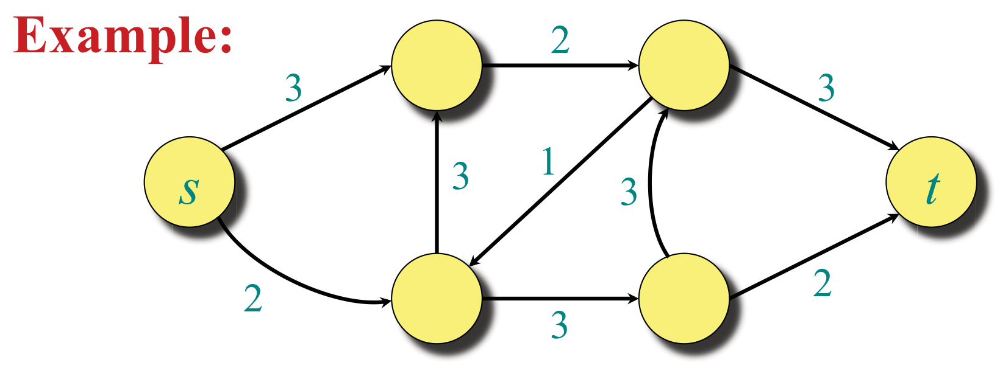
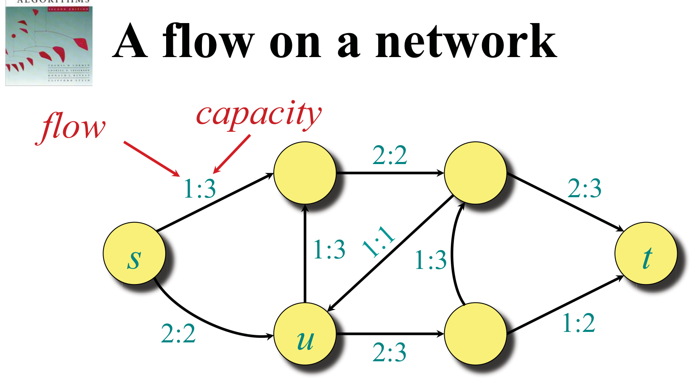
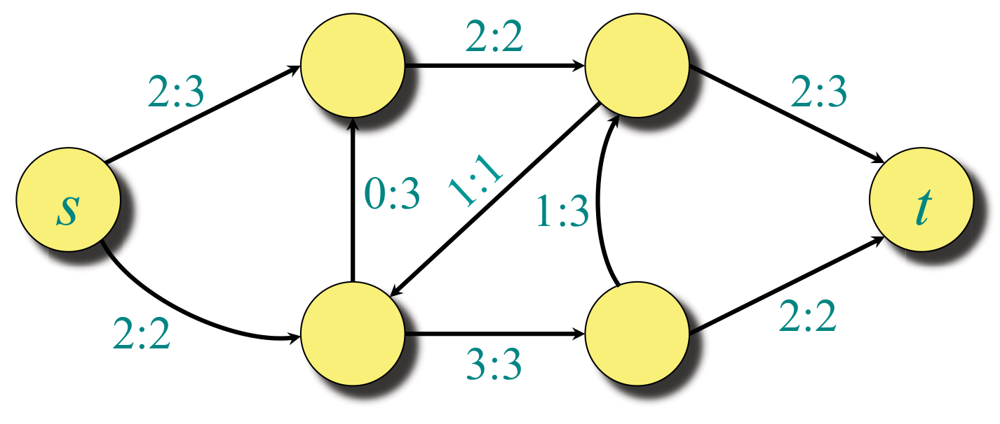
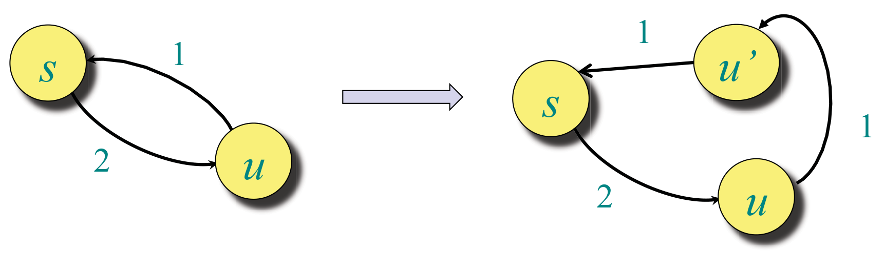
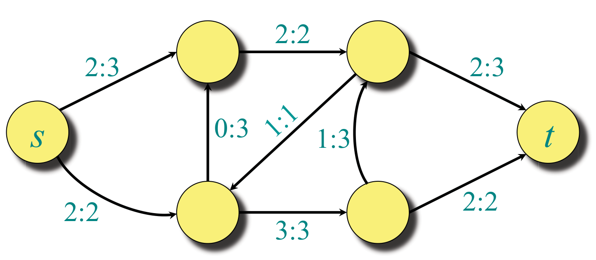
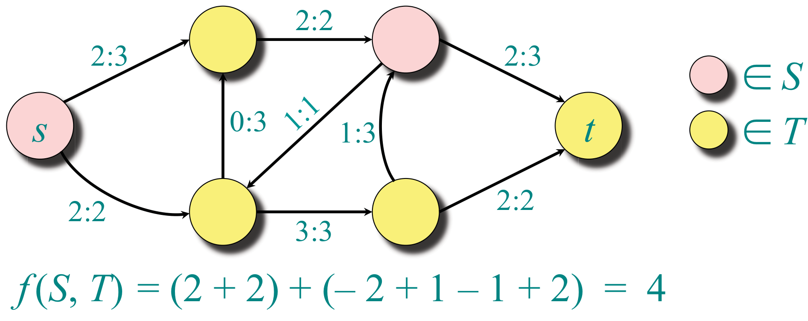
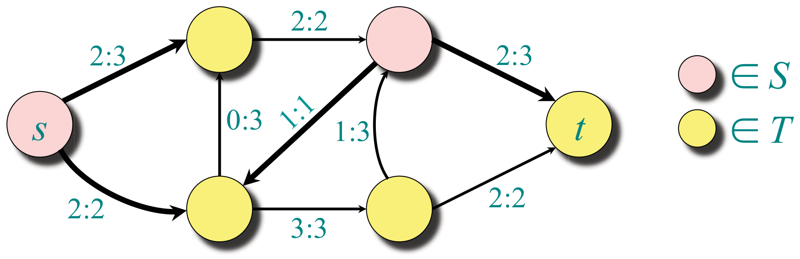
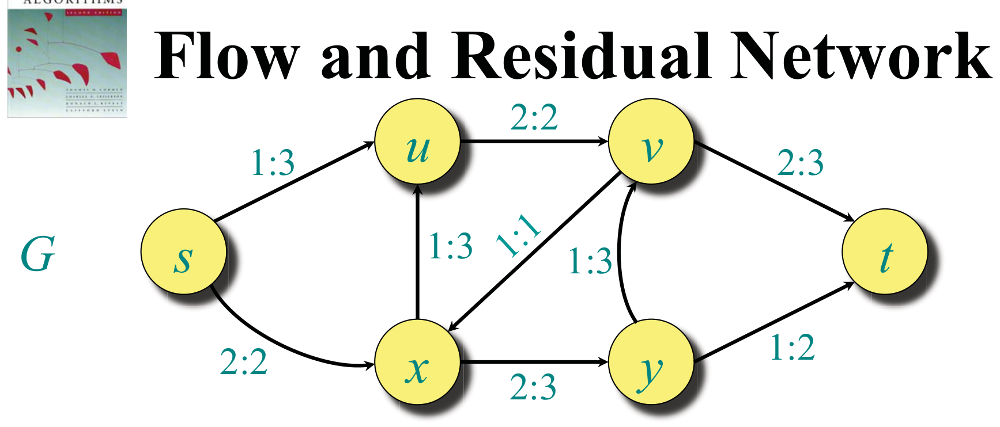
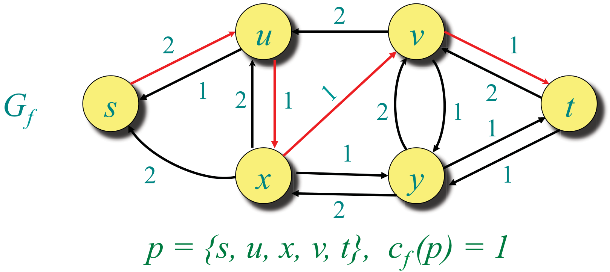
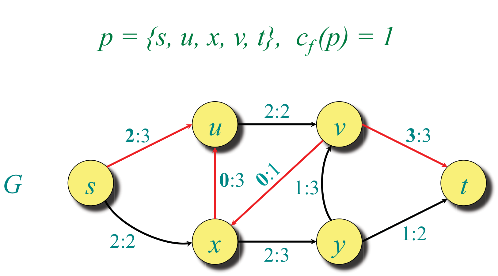

<!-- ===== PDF p1 ===== -->

<span style="color:#c0392b">**讲次 13（Lecture 13）：网络流（Network Flow）**</span> <span style="color:#7f8c8d;">（Design and Analysis of Algorithms, 6.046J/18.401J, © 2001–15 by Leiserson et al, L13.1）</span>

本讲大纲：
- 流网络（Flow networks）
- 最大流问题（Maximum-flow problem）
- 割（Cuts）
- 残量网络（Residual networks）
- 增广路径（Augmenting paths）
- 最大流最小割定理（Max-flow min-cut theorem）
- Ford-Fulkerson 算法（Ford Fulkerson algorithm）

---

<!-- ===== PDF p2 ===== -->

<span style="color:#c0392b">**流网络（Flow networks）**</span>

<span style="color:#2471a3;">**[definition]**</span> **定义（Definition）**：**流网络**（flow network）是一个有向图 $G = (V, E)$，带两个**特殊顶点**：**源（source）** $s$ 与**汇（sink）** $t$。每条边 $(u, v) \in E$ 有**非负容量（nonnegative capacity）** $c(u, v)$。若 $(u, v) \notin E$，则 $c(u, v) = 0$。



> <span style="color:#7f8c8d;">[示例说明] 原页附图：一个流网络示例（源 $s$、汇 $t$，边权为容量 1–3）。</span>

> <span style="color:#1e8449;">**[note] Note（译者注）:**</span> 这一页要回答的设计问题是：把一个「水管网络」写成数学对象时，最少需要哪几个字段；以及那两个看似随意的约定（容量非负、缺边容量记零）为什么不是随手写下的。
>
> 先拆字段。一个 flow network（流网络）只有四样东西：顶点集 $V$、有向边集 $E$、两个被点名的顶点 source（源）与 sink（汇）、以及每条边上的 capacity（容量）。四样里只有 capacity 带数值，所以「这是一个流网络」这句话真正承载物理含义的部分只有它。capacity 的语义不是「管道里现在有多少水」，而是「每单位时间最多能通过多少水」。这个「每单位时间」是整讲的第一个关键：若把 capacity 读成总量，一条边流过 3 之后就永久报废，问题会退化成一次性的 packing（装箱）；正因为它是 rate（速率），同一条边才可以在不同时刻被反复使用，「最大流」才可以是关于稳态的陈述而不是关于历史累积的陈述。速率语义一旦定下，后面所有加法（两条并行边的容量相加、一条路径的容量取最小）才有统一量纲。
>
> 再看两条约定。第一条，capacity 非负。为什么不能让容量取负？因为容量扮演的是上界，而上界的含义是「不许超过」；一个负数上界配上「流允许取负」的斜对称约定会立刻自相矛盾：$f(u,v) \le c(u,v) < 0$ 与 $f(u,v) = -f(v,u) \ge -c(v,u)$ 互相打架，连零流都不再合法。非负是让「零流总是可行解」成立的最小条件，而「零流可行」又是后面所有增量算法能起步的前提——Ford-Fulkerson 的第一行就是全体置零。
>
> 第二条，不存在的边容量记为零。这不是偷懒，而是为了让求和式里不出现分支判断。写 $f(u,v) \le c(u,v)$ 时，若 $(u,v)$ 不在 $E$ 内而 $c$ 未定义，这个不等式就得先判断边在不在，公式变成带条件的写法；一旦约定缺边容量为零，capacity 就成了完整的 $|V| \times |V|$ 表格，边集只用来标记「哪些格子非零」。这一步把图论语言换成了矩阵语言，后面的残量网络继承同一个约定，$c_f(v,u) = c(v,u) - f(v,u)$ 才可以直接对不存在的边求值。
>
> 算一个能复核的数。设四个顶点 $s, a, t$ 与一条旁路：$s \to a$ 容量 $5\ \mathrm{Mb/s}$，$a \to t$ 容量 $3\ \mathrm{Mb/s}$，$s \to t$ 容量 $1\ \mathrm{Mb/s}$，其余方向不存在。割 $(\{s,a\},\{t\})$ 的容量是 $3 + 1 = 4$；割 $(\{s\},\{a,t\})$ 的容量是 $5 + 1 = 6$。任何一个流都不超过 4，而「$s \to a \to t$ 送 3、$s \to t$ 送 1」恰好凑出 4，所以 maximum flow（最大流）为 $4\ \mathrm{Mb/s}$。这个数的量级意味着：传 1 MB 文件需 $8\ \mathrm{Mbit} / 4\ \mathrm{Mb/s} = 2\ \mathrm{s}$。若把中间那条边升到 $5\ \mathrm{Mb/s}$，最大流变成 6，同一文件只需 $1.33\ \mathrm{s}$——改善全部来自被卡住的那条边，源与汇的容量一动没动。
>
> 跨课程连接：CS144 里一条 TCP 连接的实际吞吐由路径上最窄的一段链路决定，这与此处「最小割容量决定最大流」是同一件事，区别在于 CS144 面对分组、队列与丢包，容量是统计意义上的平均速率，而这里假设容量确定且流可无限细分。CLRS 第 26 章 26.1 节给出同一套定义，区别在于 CLRS 显式区分 positive flow（正流）与 net flow（净流），本讲从净流出发，因此允许 $f(u,v)$ 取负。6.042J 的图论部分把图定义为「顶点集加边集」，流网络只是给边集挂了一个非负权函数，抽象层次相同，差别在于这个权是上界而不是距离或代价。
>
> 收束回正文：流网络之所以值得单独定义，是因为它把「上界」这一个概念抽出来做成图上的权，此后所有问题都变成「在这组上界下把某个量推到多大」——这个句式的变体会在网络流、匹配、对偶三处反复出现。

---

<!-- ===== PDF p3 ===== -->

<span style="color:#c0392b">**网络上的流（A flow on a network）**</span>



> <span style="color:#7f8c8d;">[示例说明] 原页附图：流网络上的一个流，边标注「flow:capacity」（流:容量），如 1:3、2:2、2:3、1:3、1:2、2:3、1:3、2:2。</span>

**流守恒（Flow conservation）**（类似基尔霍夫电流定律 Kirchoff's current law）：
- 流入 $u$ 的流是 $2 + 1 = 3$。
- 流出 $u$ 的流是 $1 + 2 = 3$。

🎥 *Devadas 在视频中[用守恒律解释流]*："So you're going to have law of conservation associated with this commodity that's flowing, be water, or cars, or people."（翻译：你会有一条与正在流动的「商品」相关的守恒定律——无论是水、车还是人。）——流守恒适用于任何「物质流」：水、车流、人流，中间节点不增不减。

**直觉（INTUITION）**：把流视为**速率（rate）**，而不是数量（quantity）。

> <span style="color:#1e8449;">**[note] Note（译者注）:**</span> 这一页真正给出的不是定义，而是一句判据：flow（流）是 rate（速率），不是 quantity（数量）。四个字决定了守恒律为什么在这里必须成立，而不是「顺便也成立」。
>
> 把两种读法并排摆起来看。若 $f(u,v)$ 是「从 $u$ 运到 $v$ 的累计件数」，那么守恒就只是统计口径问题：一批货到了中转站可以先堆在仓库里，等明天再发，累计数当然不需要相等。若 $f(u,v)$ 是「每秒从 $u$ 运到 $v$ 的件数」，中转站就必须在每一秒都做到进多少出多少——因为一旦进入速率大于离开速率，剩下的部分必然要停留在中继节点上。停留就是累积，累积就要求有 storage（存储），而存储容量有限，满了就只能丢弃。所以 conservation（守恒）在这个模型里不是自然律，而是一条可实现性条件：它精确地刻画了「网络能长期稳态运行」所需要的最小假设。
>
> 这个区别可以直接算出来。设 $s \to u$ 的容量为 $5\ \mathrm{Mb/s}$，$u \to t$ 的容量为 $3\ \mathrm{Mb/s}$，两者都按上限跑。进入 $u$ 的速率是 $5\ \mathrm{Mb/s}$，离开的是 $3\ \mathrm{Mb/s}$，净流入 $2\ \mathrm{Mb/s}$，即 $0.25\ \mathrm{MB/s}$。若 $u$ 的缓冲为典型的小型路由器队列 $16\ \mathrm{KB}$，则 $16 \times 1024 / (0.25 \times 10^{6}) \approx 0.066\ \mathrm{s}$，也就是 66 毫秒后队列排满，此后到达的分组开始被丢弃；若缓冲给到 $1\ \mathrm{MB}$，则能撑 $4\ \mathrm{s}$。同一个「流入减流出」的差值，配上不同缓冲容量，得到从几十毫秒到几秒完全不同的行为——这说明守恒不是可有可无的修饰，而是决定系统在稳态下可否长期工作的分界线。
>
> 再前进一步：为什么守恒必须写成「对所有 $v$ 求和为零」而不是逐条边配平？因为速率是可以在节点内部任意分流的：进来 5，可以 2 走这条、3 走那条。逐边配平只在度为 1 的节点上才有意义，求和为零才是对所有分流方式的统一约束。这也解释了为什么后面的证明里能用「整行求和为零」这种线性代数式的手法：守恒约束在数学上就是一张矩阵的行和条件，与具体怎么分配无关。
>
> 跨课程连接：Kirchhoff's current law（基尔霍夫电流定律）说的是同一件事，区别在于电荷不会消失、导线也几乎不储能，所以它在那里是物理定律，在这里是可实现性假设；一旦允许丢包，守恒就被打破，最大流的模型只描述上限而不描述真实行为。CSAPP 第 11 章讲 socket 时，`send` 成功返回只表示字节进了内核发送缓冲区，缓冲区满时 `send` 会阻塞或部分返回，这一层「缓冲吸收差值」的机制与上面 $u$ 节点的队列是同一个角色。CS144 里的 bufferbloat 现象则给出反面教训：缓冲给得太大，差值能撑很久，于是延迟被拉长到数百毫秒，守恒在账面上没破，用户体验却已经坏了。
>
> 收束回正文：正因为 $f$ 是速率，最大流问题才可以被读成「稳态下最多每秒送多少」；也正因为守恒是可实现性条件，后面每一条增广都必须保持它——否则算出来的「流」根本不是任何真实系统能跑出来的配置。

---

<!-- ===== PDF p4 ===== -->

<span style="color:#c0392b">**最大流问题（The maximum-flow problem）**</span>

**最大流问题**：给定流网络 $G$，求 $G$ 上的**最大价值的流**（flow of maximum value）。



> <span style="color:#7f8c8d;">[示例说明] 原页附图：一个达到最大流的网络，边标注 flow:capacity（如 2:3、2:2、2:3、1:3、2:2、3:3、0:3、2:2）。图中最大流的价值为 4。</span>

---

<!-- ===== PDF p5 ===== -->

<span style="color:#c0392b">**流网络假设（Flow network Assumptions）**</span>

**假设（Assumption）**：若边 $(u, v) \in E$ 存在，则 $(v, u) \notin E$。
**假设（Assumption）**：不存在自环边（self-loop edges）$(u, u)$。



> <span style="color:#7f8c8d;">[原图说明] 原页附图：若存在反向边 $(u, s)$（原假设 $u \to s$ 与 $s \to u$ 方向冲突），可通过引入辅助顶点 $u'$ 消除：把反向边拆成 $u \to u' \to s$ 两条边。图注展示这种变换。</span>

> <span style="color:#1e8449;">**[note] Note（译者注）:**</span> 这两条假设要回答的是一个很具体的问题：为什么教材宁可先限制图的长相，也不肯一开始就处理最一般的有向图？答案是这两条假设换来的是「一条边对应一个变量」这个性质的干净版本，而所有失败的情形都可以用一次多项式规模的变换补回来。
>
> 先看第一条。若 $(u,v)$ 与 $(v,u)$ 同时存在，那么净流约定 $f(u,v) = -f(v,u)$ 就要求：同一个数字既要服务「从 $u$ 到 $v$ 送了多少」，又要服务「从 $v$ 到 $u$ 送了多少」。这个数字必须同时满足两个上界，即 $-c(v,u) \le f(u,v) \le c(u,v)$。数学上完全写得下去，但代价是「容量约束」从逐边的单侧不等式变成一条双侧不等式，所有「逐项放缩」的证明（比如 $f(S,T) \le c(S,T)$）都要重新处理负向那一半。教科书的选择是：与其让每个证明都多带一层情况分析，不如先保证 $f$ 只有一个方向可走，让放缩退化成最朴素的逐项比较。
>
> 第二条更简单。自环 $(u,u)$ 上的流被斜对称强制为零：$f(u,u) = -f(u,u)$ 推出 $f(u,u) = 0$。既然它恒为零，它既不消耗任何其他边的容量，也不参与任何割的容量，删掉它对所有 $s$-$t$ 割与所有流没有任何影响。留着它只是多一个永远为零的变量。
>
> 关键的还原手段是拆点。以 $s, a, t$ 三点、两条双向链路为例：$c(s,a) = 3$、$c(a,s) = 2$、$c(a,t) = 4$、$c(t,a) = 1$。对两条反向边各插入一个辅助顶点，记作 $a'$ 与 $t'$：把 $a \to s$ 换成 $a \to a'$ 与 $a' \to s$，两条容量都取 2；把 $t \to a$ 换成 $t \to t'$ 与 $t' \to a$，两条容量都取 1。变换后顶点数从 3 变 5，边数从 4 变 6，且没有任何一对反向边同时存在。
>
> 为什么拆完不会改变最大流？两个方向都要说明，这才是完整论证。一个方向是「新图不弱于原图」：把原网络任何一个流里 $(a,s)$ 上的流量原封不动放到 $a \to a' \to s$ 两条边上，各边的容量约束与所有原始顶点的守恒都不变。另一个方向是「新图不强于原图」：设新图的某个流在 $a \to a'$ 上送 $x$、在 $a' \to s$ 上送 $y$，则中间点 $a'$ 只有这两条边，而它既不是源也不是汇，守恒要求 $x = y$；于是两条边的流量必然相等，可以原样合并回一条 $a \to s$。两个方向合起来，最大值相等。注意这个论证依赖的正是「插入的顶点不是 $s$ 也不是 $t$」——若辅助点被误当成源或汇，守恒就不对它生效，合并这一步立刻失效，这也是这类变换里最容易写错的地方。
>
> 跨课程连接：6.042J 的图论先区分 simple graph（简单图）与 multigraph（多重图），再把一般情形归约到简单情形，这里做的是同一件事的一个有向版本，区别在于 6.042J 的归约只关心结构，而这里还要求「变换后最大流的值保持不变」，多了一条数值层面的可逆性要求。CLRS 第 26 章 26.1 节给出同样的两条假设，并在习题里让你验证拆点构造，措辞与这里几乎一致。证明策略模板上，这类手法可以命名为「规范化后求解」：先把输入改造成满足附加条件的形式，证明改造前后答案不变，然后只在干净形式上做证明——它的适用前提是改造本身不能丢掉信息，而「可逆映射」正是这个前提的可检验版本。
>
> 收束回正文：这两条假设不是对现实的简化，而是对记号系统的整理；遇到双向链路时，你带去计算的是拆点后的图，而不是在证明里逐个补上双向的分支。

---

<!-- ===== PDF p6 ===== -->

<span style="color:#c0392b">**净流（Net Flow）**</span>

<span style="color:#2471a3;">**[definition]**</span> **定义（Definition）**：$G$ 上的一个**（净）流（net flow）**是满足下列条件的函数 $f : V \times V \to \mathbb{R}$：
- **容量约束（Capacity constraint）**：对所有 $u, v \in V$，$f(u, v) \le c(u, v)$。
- **流守恒（Flow conservation）**：对所有 $u \in V - \{s, t\}$，$\sum_{v \in V} f(u, v) = 0$。
- **斜对称（Skew symmetry）**：对所有 $u, v \in V$，$f(u, v) = -f(v, u)$。

> <span style="color:#7f8c8d;">[说明] CLRS 区分「正流（positive flows）」与「净流（net flows）」；在满足我们假设的流网络上两者等价。</span>

> <span style="color:#1e8449;">**[note] Note（译者注）:**</span> 这一页的三条公理不是三条互相独立的要求，而是把一个矩阵的三类性质分别命名：逐元素上界、行和为零、转置取负。看清这一点，后面所有关于流的代数化简都不需要再回忆定义。
>
> 逐条落位。capacity constraint（容量约束）是逐元素比较：$f(u,v) \le c(u,v)$ 对每个格子成立，它限制的是「单个格子的绝对值不能超过给定上界」。flow conservation（流守恒）是行和比较：把第 $u$ 行所有格子加起来必须为零，它限制的是「一整行的总账」，与每个格子具体多大无关。skew symmetry（斜对称）是整张矩阵的比较：$f$ 的转置等于 $-f$，它限制的是「右上角和左下角互为镜像」这一全局结构。三类性质作用在不同层级上，所以它们互不蕴含，缺一条就有一类性质失去约束。
>
> 为什么必须走净流这条路而不是正流？设想允许「$u \to v$ 送 2、$v \to u$ 送 1」同时成立的正流表述。这两个数在物理上是两条不同管道各走各的，但在这套假设下 $u \to v$ 与 $v \to u$ 不能同时存在，**任何「反着送」都必须写成负值**。于是「送 2 反向 1」只能记成净流 $f(u,v) = 1$，而那 2 与 1 的分配细节在模型里根本不存在。这不是简化，而是模型的表达能力本身如此：它只记录净效果，不记录历史。
>
> 斜对称还有一个立刻可用的推论：取 $u = v$，得 $f(u,u) = -f(u,u)$，故 $f(u,u) = 0$。自环自动归零，与上一页「无自环」假设彼此吻合——两条路走到同一个结论，说明这套公理彼此是协调的。
>
> 算一张具体的表。取 $V = \{s, a, b, t\}$，令 $f(s,a) = 2$、$f(s,b) = 2$、$f(a,b) = 1$、$f(a,t) = 1$、$f(b,t) = 3$，其余格子由斜对称补全。列成矩阵后逐行求和：$s$ 行为 $0 + 2 + 2 + 0 = 4$；$a$ 行为 $-2 + 0 + 1 + 1 = 0$；$b$ 行为 $-2 - 1 + 0 + 3 = 0$；$t$ 行为 $0 - 1 - 3 + 0 = -4$。四个行和里中间两个为零，恰好是守恒在说话；首尾两行是 $+4$ 与 $-4$，互为相反数，恰好是「总量既不能凭空产生也不能凭空消失」。整张表所有格子相加为零，这又是斜对称的直接后果。于是这张表用三句话概括了全部内容：非对角格子在容量内、中间行和为零、全表元素之和为零。
>
> 跨课程连接：Strang 的线性代数里，一张网络的 incidence matrix（关联矩阵）$B$ 每列对应一条边、每行对应一个顶点，元素取 $+1$ 与 $-1$ 表示方向；把边上的流排成向量 $x$，则 $Bx$ 的第 $u$ 个分量正好是「$u$ 的净流出」。这里的守恒条件 $f(u,V) = 0$ 就等价于 $Bx$ 在中间节点上为零，是同一个式子的两种写法。区别有两处：其一，Strang 的 $B$ 只记录「有没有这条边」，权重在 $x$ 里；本讲把容量也挂在顶点对上，所以容量约束与守恒约束作用在同一张表的不同性质上。其二，Strang 关心的是 $Bx = 0$ 的解空间维数（也就是零空间的含义），本讲关心的是「在逐元素上界下把 $s$ 到 $t$ 的总量做大」，是一个带约束的优化而不是解方程。
>
> 收束回正文：把流当矩阵看，最大的好处是后面每个引理都只需说清「这一步用了哪条性质」——上界、行和、还是转置——而不是重新回去翻定义。

---

<!-- ===== PDF p7 ===== -->

<span style="color:#c0392b">**记号（Notation）**</span>

<span style="color:#2471a3;">**[definition]**</span> **定义（Definition）**：流 $f$ 的**价值（value）**，记为 $|f|$，由下式给出

```math
|f| = \sum_{v \in V} f(s, v) = f(s, V)
```

**隐式求和记号（Implicit summation notation）**：算术公式中使用的集合表示对该集合元素求和。
- **示例——流守恒**：$f(u, V) = 0$ 对所有 $u \in V - \{s, t\}$。

> <span style="color:#1e8449;">**[note] Note（译者注）:**</span> 这一页做了一件看似纯记号的事，实际上是在换对象：把 $f$ 从「顶点对到实数」的函数，提升成「顶点集对到实数」的函数。升级之后，守恒、割流量、流价值三种陈述共享同一套语法，这才是后面证明能写得那么短的原因。
>
> 先看这次升级的定义方式。对单个点写 $f(u,v)$，是查表；对集合写 $f(S,T)$，约定为把所有 $u \in S$、$v \in T$ 的格子加起来。这一步合法的理由不是「记号好看」，而是求和本身对集合的并运算可加：若 $X$ 与 $Y$ 不相交，那么把 $X$ 与 $Y$ 合并再求和，等于各自求和再相加。这条可加性把「集合」变成了可以代数运算的对象，于是 $f$ 就有了双线性：对第一个参数可加（由定义直接得到），对第二个参数也可加（同理由定义直接得到）。
>
> 为什么价值要定义在源上，而不定义在别的顶点？因为守恒约束恰好豁免了源与汇。对任何中间点 $u$，行和恒为零，写出来就是一句空话「零等于零」，不含任何信息；只有源与汇的行和不为零，那里才留有「总量」这个数。所以 $|f| = f(s,V)$ 不是随便挑了一个顶点，而是全网络仅有的两个「不守恒点」之一。选汇也一样，这就预告了下面那个定理：两个不守恒点的读数必然互为相反数。
>
> 还要提醒一个记号陷阱：$|f|$ 不是绝对值。竖线在这个语境里是沿用「大小」的惯例，用来表示流的 value（价值），它的取值可以为零，但不会为负——因为一旦松开容量约束它才可能为负，而容量非负把这个可能堵住了。读文献时看到 $|f|$ 要立刻读成「流价值」，不要读成「模」。
>
> 算一遍。沿用四个顶点 $s, a, b, t$，令 $f(s,a) = 2$、$f(s,b) = 2$、$f(a,t) = 1$、$f(b,t) = 3$、$f(a,b) = 1$，其余为零。则 $f(s,V) = f(s,s) + f(s,a) + f(s,b) + f(s,t) = 0 + 2 + 2 + 0 = 4$；另一边 $f(V,t) = f(s,t) + f(a,t) + f(b,t) + f(t,t) = 0 + 1 + 3 + 0 = 4$。两个数相等不是巧合，而是守恒把中间两行的账做平之后的必然结果。注意求和里那三个零项：$f(s,s)$ 与 $f(t,t)$ 由斜对称归零，$f(s,t)$ 因为这条边不存在、容量为零，流也只能为零。隐式求和记号的价值就在这儿——它让你写 $f(s,V)$ 时不必逐个记住哪些项必然是零，而是事后一次性看出来。
>
> 若把它写成矩阵语言，$f(u,V)$ 就是第 $u$ 行的行和，也就是用行向量乘全一列向量。这个对应关系很有用：凡是「对某个集合求和」的式子，都可以转写成一次矩阵乘法，而矩阵乘法天然带着结合律与线性性，于是「先拆集合再求和」这类操作就变成了「先分解矩阵再乘」。本讲的引理几乎全是这一招的具体实例。
>
> 跨课程连接：CLRS 第 26 章 26.1 节用的是显式双重求和 $\sum_{u \in S}\sum_{v \in T} f(u,v)$，与本讲的隐式写法等价，区别只在书写成本：显式写法在只有一两个集合时更清楚，隐式写法在需要连续做集合代数（拆 $V$、拆 $S$、合并再合并）时短得多，代价是读者必须自己记住「集合参数等于求和」。6.042J 里处理计数问题时也用过同类缩写，那里的习惯是「对集合求和」写成一个大符号加集合下标，思路一致。线性代数课上你把「行和」写成 $A \mathbf{1}$，那是同一件事的第三种写法。
>
> 收束回正文：这一页真正交付的是三个可互换的读法——函数值、求和、行和；后面的引理在三种读法之间来回切换，哪一种最省字就用哪一种。

---

<!-- ===== PDF p8 ===== -->

<span style="color:#c0392b">**流的简单性质（Simple properties of flow）**</span>

<span style="color:#2471a3;">**[lemma]**</span> **引理（Lemma）**：
- $f(X, X) = 0$，
- $f(X, Y) = -f(Y, X)$，
- 若 $X \cap Y = \emptyset$，则 $f(X \cup Y, Z) = f(X, Z) + f(Y, Z)$。

<span style="color:#2471a3;">**[theorem]**</span> **定理（Theorem）**：$|f| = f(V, t)$。

**证明（Proof）**：

```math
\begin{aligned}
|f| &= f(s, V)\\
&= f(V, V) - f(V-s, V) \quad (\text{省略花括号})\\
&= f(V, V-s)\\
&= f(V, t) + f(V, V-s-t)\\
&= f(V, t)
\end{aligned}
```

> <span style="color:#1e8449;">**[note] Note（译者注）:**</span> 这段五行推导值得逐行标注归因，因为它示范了一个可以反复套用的模板：把求和池重排，让大部分项相互抵消，最后只在少数项上使用真正的结构假设。整段证明里「守恒」只出场一次，其余四次都是集合代数——这个分工是本条注要传达的核心。
>
> 第一行是定义，$|f| = f(s,V)$，没有任何推理成分。第二行做的是把 $V$ 拆成 $\{s\}$ 与 $V - s$ 两部分：因为 $f(s,V) = f(\{s\},V)$，而 $\{s\}$ 与 $V-s$ 不相交且并为 $V$，由第一参数的可加性，$f(V,V) = f(\{s\},V) + f(V-s,V)$，移项即得。这一步纯粹是集合分解，与守恒毫无关系——这是最容易误标的地方，许多人一看到 $f(V,V)$ 就以为在用它守恒，其实它只是「把整体拆成两半再减回去」。
>
> 第三行把 $f(V,V)$ 消成零。依据是斜对称：$f(V,V)$ 里每一对 $(u,v)$ 与 $(v,u)$ 同时出现且符号相反，成对抵消。这是全篇唯一用到「转置取负」的地方，也是为什么结论对任何流都成立，而不只是对最大流成立。
>
> 第四行再把 $V - s$ 拆成 $\{t\}$ 与 $V - s - t$，同样只用可加性。到这里为止，已经把 $|f|$ 变成了「流入汇的量」加上「流入其余中间点的量」两块。
>
> 第五行才动用守恒：对每个中间点 $u$，$f(u,V) = 0$；把这些零加起来，得到 $f(V - s - t,\, V) = 0$。注意这里用的是一个求和，而不是把每个 $u$ 单独处理——因为左边的第一参数是集合，逐点为零就等价于整块为零，这正是隐式求和记号省下的工作量。于是最后一块消失，只剩 $f(V,t)$。
>
> 算一遍中间值，确保每一步都对得上。仍取四点网络：$f(s,a) = 2$、$f(s,b) = 2$、$f(a,b) = 1$、$f(a,t) = 1$、$f(b,t) = 3$。第一行得 4。第二行：$f(V,V) = 0$，$f(V-s,V) = f(a,V) + f(b,V) + f(t,V) = 0 + 0 + (-4) = -4$，相减得 $0 - (-4) = 4$，与第一行一致。第三行得 $f(V, V-s) = 4$。第四行拆成 $f(V,t) + f(V,\{a,b\})$，其中 $f(V,t) = 4$；后者为 $f(s,\{a,b\}) + f(a,\{a,b\}) + f(b,\{a,b\}) + f(t,\{a,b\}) = (2+2) + (0+1) + (-1+0) + (0-3) = 4 + 1 - 1 - 3 = 0$。两块相加仍是 4，中间那块确实归零，而且是靠中间两个点的守恒与首尾两点的相互抵消共同做到的。这一行是全证明的缩影：四个部分各自不为零，加起来恰为零。
>
> 这个模板可以命名成「池化重排加零项消去」。它的通用形态是：把要算的量写进一个更大的求和池里，用对称性让成对的项抵消，用局部约束让某一块整体归零，剩下的就是目标。它与 6.042J 里的 double counting（双重计数）同源——那里是把同一批对象按两种口径各数一遍，再把两边的表达式相等；这里是按两个集合划分各算一遍，再把已知为零的块扔掉。区别在于双重计数的桥梁是「同一个总数」，这里的桥梁是「同一个函数 $f$ 对两类参数的取值」。
>
> 跨课程连接：CLRS 第 26 章 26.1 节的引理给出同一个结论，用的是显式双重求和与逐项移项，读起来长一些但每一步都看得见；本讲的短写法把移项工作藏进了记号可加性里，速度换来了「必须记住符号约定」的负担。线性代数里对应的说法是：$f(s,V)$ 是第 $s$ 行的行和，全部行和为零，所以任一行可以写成其余行之和的相反数——这就是「行和为幅角」的矩阵版本。
>
> 收束回正文：结论 $|f| = f(V,t)$ 说的是流不会在途中凭空增减；而证明结构说的是更强的经验——这类等式几乎都由「拆分、抵消、局部归零」三步构成，看到三个集合运算就能想起整套流程。

---

<!-- ===== PDF p9 ===== -->

<span style="color:#c0392b">**流入汇的流（Flow into the sink）**</span>



> <span style="color:#7f8c8d;">[示例说明] 原页附图：同一最大流网络，标注 $|f| = f(s, V) = 4$ 且 $f(V, t) = 4$——验证「源流出 = 汇流入」。</span>

---

<!-- ===== PDF p10 ===== -->

<span style="color:#c0392b">**割（Cuts）**</span>

<span style="color:#2471a3;">**[definition]**</span> **定义（Definition）**：流网络 $G = (V, E)$ 的**割（cut）** $(S, T)$ 是 $V$ 的一个**划分（partition）**，使得 $s \in S$ 且 $t \in T$。若 $f$ 是 $G$ 上的流，则**跨越割的流（flow across the cut）**是 $f(S, T)$。



> <span style="color:#7f8c8d;">[示例说明] 原页附图：一个割 $(S, T)$，$S$ 含源侧顶点、$T$ 含汇侧顶点。计算 $f(S, T) = (2 + 2) + (-2 + 1 - 1 + 2) = 4$——跨越割的净流恰等于流价值。</span>

> <span style="color:#1e8449;">**[note] Note（译者注）:**</span> cut（割）这个概念的作用是把「全局最大化」换成一个「截面读数」问题：不再问整张网络能送多少，而是问「把网络用一刀切成两半，跨过刀口的净流量是多少」。这一步的价值在于，截面读数对任何流都相同，却有不同容量——于是「找最大流」被翻译成「找最紧的那一刀」，而后者是个有限枚举。
>
> 先看两个约束为什么不能省。定义要求 $s \in S$ 且 $t \in T$，即刀口必须把源和汇分到两边。若允许两者同侧，那么取 $S = V$、$T$ 为空，$f(S,T)$ 就成了空求和，恒等于零，读数彻底失去信息；取 $S = \{s\}$ 之外的其他划分也可能把整条主流包在内部，读数同样为零。加上这条约束之后，任何从 $s$ 到 $t$ 的流量都必然要穿过刀口一次，读数才不会退化成常数零。
>
> 另外要盯住「净」这个字。$f(S,T)$ 是求和，而求和里的每一项带符号：从 $S$ 流向 $T$ 的边贡献正值，从 $T$ 流回 $S$ 的边贡献负值。所以一个割的读数不是「跨过的总量」，而是「跨过的净量」。这一点在下一张幻灯片算具体数时最容易被算错。
>
> 算一个完整的例子。取四点网络：$c(s,a) = 3$、$c(s,b) = 2$、$c(a,b) = 1$、$c(a,t) = 2$、$c(b,t) = 3$，并设流为 $f(s,a) = 3$、$f(s,b) = 2$、$f(a,b) = 1$、$f(a,t) = 2$、$f(b,t) = 3$。检查守恒：$a$ 进 3、出 $1 + 2 = 3$；$b$ 进 $2 + 1 = 3$、出 3。所以 $|f| = 5$。现在枚举全部四个割（源固定在内、汇固定在外，共 $2^{4-2} = 4$ 个）：取 $S = \{s\}$，$f(S,T) = 3 + 2 = 5$；取 $S = \{s,a\}$，$f(S,T) = f(s,b) + f(a,b) + f(a,t) = 2 + 1 + 2 = 5$；取 $S = \{s,a,b\}$，$f(S,T) = 2 + 3 = 5$；只有 $S = \{s,b\}$ 这个割要小心，$T = \{a,t\}$，求和里含三项正项与一项负项：$f(s,a) + f(b,t) + f(b,a) = 3 + 3 + (-1) = 5$。四个割读数全部是 5，而它们的容量分别是 $5, 5, 5, 8$。这个对照很有说服力：读数全相同，容量有高有低，最小值 5 恰好等于流价值。
>
> 还有一个容易混淆的点：割的读数是关于某个流的，容量是关于网络本身的。同一个割对不同流可以给出不同读数（只要那些流的价值不同），而容量只有一个，与流无关。所以讨论「最小割」时容量是常数，不需要指定流；而讨论「任意割的读数」时必须先说清是哪个流。许多教材把这两句话放在同一段里，读的时候要自己拆开，否则会误以为最小割也依赖流。
>
> 顺便看清枚举规模。$s$ 与 $t$ 的位置已经固定，剩下的 $|V| - 2$ 个顶点各自独立地选边，所以割的总数是 $2^{|V|-2}$。四点是 4 个，六点是 16 个，二十点是 $2^{18}$ 约 26 万个——这解释了为什么最小割不能靠直接枚举求：规模一大就指数爆炸，必须借最大流算法间接得到。
>
> 跨课程连接：CLRS 第 23 章 23.2 节的 cut property（割性质）也建立在顶点二分上，但用法完全相反——那里割是用来挑出「跨越刀口的最轻那条边」并保证它属于某棵最小生成树，衡量对象是单条边的权重；这里衡量的是整个刀口的净流量，关心的是「有没有一刀特别紧」。6.042J 的 bipartite graph（二分图）同样给出一个二划分，区别有两点：二分图要求所有边都跨越两侧，而这里的割允许两侧内部有大量边；二分图的划分不带源汇定点，而这里的划分必须把 $s$ 与 $t$ 分开。
>
> 收束回正文：割提供的是观察角度而不是算法本身；先有「任何流在每个刀口上读数相同」这个事实，才有后面「容量最小的刀口正好等于最大流」的结论。

---

<!-- ===== PDF p11 ===== -->

<span style="color:#c0392b">**流价值的另一种刻画（Another characterization of flow value）**</span>

<span style="color:#2471a3;">**[lemma]**</span> **引理（Lemma）**：对任何流 $f$ 与任何割 $(S, T)$，我们有 $|f| = f(S, T)$。

**证明（Proof）**：

```math
\begin{aligned}
f(S, T) &= f(S, V) - f(S, S)\\
&= f(S, V)\\
&= f(s, V) + f(S-s, V)\\
&= f(s, V)\\
&= |f|
\end{aligned}
```

> <span style="color:#1e8449;">**[note] Note（译者注）:**</span> 这个引理是上一页定理的加强版：上一页说「源侧的读数等于汇侧的读数」，这一页说「任何截面的读数都等于流价值」。加强之后，你获得了一种自由——不必在源那里量，可以挑一个最方便的截面去量，而读数不会变。
>
> 先把四行推导逐行归因。第一行 $f(S,T) = f(S,V) - f(S,S)$ 是集合拆分：$T$ 与 $S$ 不相交且并为 $V$，所以 $f(S,V) = f(S,S) + f(S,T)$，移项即得。第二行把 $f(S,S)$ 消掉，依据是斜对称在集合层面的形式——$S$ 内每一对 $(u,v)$ 与 $(v,u)$ 同时出现且符号相反，成对抵消。到这里为止，用掉的只有「可加」与「斜对称」，与守恒无关。
>
> 第三行拆 $V$，把 $S$ 写成 $\{s\}$ 与 $S - s$ 的并：$f(S,V) = f(s,V) + f(S-s,V)$。这里要注意 $S$ 一定含 $s$（割的定义），所以 $S - s$ 是一个合法的差集，且不含源。第四行把 $f(S-s,V)$ 归零，依据才是守恒——$S-s$ 里每个顶点都是中间点，行和为零，而集合上的求和等于逐点求和，整块自然为零。第五行用定义 $|f| = f(s,V)$ 收尾。
>
> 归因的意义在于：这个引理看起来是「守恒律的宏观版本」，其实守恒只承担了四步中的一步。真正的骨架是「拆分两次、消掉对角、扔掉中间块」——与上一页那道题是同一个模板，只是拆的集合从 $V$ 换成了 $S$。
>
> 算一遍，并且故意用三个不同的截面来验证。取五点网络：$c(s,a) = 4$、$c(s,b) = 3$、$c(a,b) = 2$、$c(a,c) = 4$、$c(b,c) = 1$、$c(c,t) = 5$，流为 $f(s,a) = 4$、$f(a,c) = 4$、$f(s,b) = 1$、$f(b,c) = 1$、$f(c,t) = 5$，其余为零。检查守恒：$a$ 进 4、出 4；$b$ 进 1、出 1；$c$ 进 $4 + 1 = 5$、出 5，全部平衡，且 $|f| = f(s,V) = 4 + 1 = 5$。第一个截面取 $S = \{s\}$：读数为 $4 + 1 = 5$，容量 $4 + 3 = 7$。第二个取 $S = \{s,a\}$：读数 $f(s,b) + f(a,b) + f(a,c) = 1 + 0 + 4 = 5$，容量 $3 + 2 + 4 = 9$。第三个取 $S = \{s,a,b\}$：读数 $f(a,c) + f(b,c) = 4 + 1 = 5$，容量 $4 + 1 = 5$。三次读数相同而容量从 7 降到 5。最后这个截面就是最紧的一刀，它的读数与容量恰好相等，这不是我挑出来的巧合，而是「流已最大」的判据提前显形。
>
> 为什么要强调「读数是净量」？看第二个截面：$a$ 到 $b$ 的边容量 2 而流量为零，如果误把「跨过刀口的所有边容量」当成读数，会得到 9，与 5 相差很远。净量的定义排除了这种误读：只有真正带着量穿过刀口的边才计数，其余边无论容量多大都不进入读数。
>
> 跨课程连接：CSAPP 第 11 章讲 socket 时有一句等价的话——写进连接与读出的字节数相同，中间的内核缓冲区不增不减；那里的「截面」只有一处，所以这个事实显得平凡，而这里截面可以任意选，事实才显出力量。CLRS 第 26 章 26.2 节把这个引理作为推论给出，并立刻用它推出「任何流不超过任何割的容量」，措辞一致。证明策略上，这条引理值得记成模板「任意代表性」：先证明某个量对任意对象都取同一值，然后解题时只计算最容易算的那一个——这与函数式编程里「先证不变量、再挑最简单的状态验算」是同一种省力方法。
>
> 收束回正文：任何割的读数都等于流价值，于是「流价值」不再依赖你从哪里看，只依赖流本身；这一句把源汇两点的局部事实升级成整张网络的不变量。

---

<!-- ===== PDF p12 ===== -->

<span style="color:#c0392b">**割的容量（Capacity of a cut）**</span>

<span style="color:#2471a3;">**[definition]**</span> **定义（Definition）**：割 $(S, T)$ 的**容量（capacity）**是 $c(S, T)$。



> <span style="color:#7f8c8d;">[示例说明] 原页附图：同一割，计算容量 $c(S, T) = (3 + 2) + (1 + 3) = 9$——与流 $f(S,T)=4$ 对比，容量 ≥ 流。</span>

> <span style="color:#1e8449;">**[note] Note（译者注）:**</span> 这一页定义的是 capacity of a cut（割的容量），它和上一页的流读数长得几乎一样，只差一件事：求和里没有负项。这个差别看似只是「少了个减号」，实际上决定了全部上界论证能不能成立——如果给容量也补上斜对称，后面那句「任何流不超过任何割」立刻变成错的。
>
> 先把两种求和并排放。流读数 $f(S,T)$ 的求和域是 $S \times T$，但每一项的符号由流本身决定，反向流动以负值形式藏在里面；容量之和 $c(S,T)$ 的求和域同样是 $S \times T$，而容量全部非负，于是整个和恒为非负。注意反向边 $(v,u)$（其中 $v \in T$、$u \in S$）根本不在求和域内——不是因为它的容量被减掉了，而是因为它的起点不在 $S$ 里，压根没被枚举到。这个区别最容易被误读成「减掉了反向容量」，其实什么都没减。
>
> 为什么不能给容量加斜对称？试一个具体反例。设网络只有两个顶点 $s, a$，加上一条边 $s \to a$ 容量 3，一条边 $a \to s$ 容量 100（先不管无反向边假设，只为看清代数后果）。取割 $S = \{s\}$。按正向求和，$c(S,T) = 3$，与「任何流不超过 3」完全相容。若强行定义「净容量」为 $c(s,a) - c(a,s) = 3 - 100 = -97$，那么上界变成 $-97$，而零流的价值是 0，$0 \le -97$ 是假命题——上界直接崩了。崩的根源是：容量是「能通过多少」的上限，上限不存在「反向抵消」这回事，两个方向的通行能力互相独立，不存在一个减出来的净值。
>
> 换一个物理解释更直观。一根管道直径 10 厘米，你说它「能过 10」，这与有没有反向管道毫无关系；如果旁边也有一根 6 厘米的，你不会说这根管道的有效直径是 4。容量描述的是单向吞吐能力，所以求和只能是单向和。流的处境不同：模型里同一对顶点之间只有一条边（无反向边假设），「反着送」必须借用同一个变量取负值，于是净流天然带符号、天然会抵消。
>
> 算一个对照。沿用四点网络 $c(s,a) = 3$、$c(s,b) = 2$、$c(a,b) = 1$、$c(a,t) = 2$、$c(b,t) = 3$，取割 $S = \{s,b\}$。正向边是 $s \to a$（3）与 $b \to t$（3），和为 6；反向边是 $a \to b$（1），它不在求和域内。所以 $c(S,T) = 6$，而同一割的读数 $f(S,T) = f(s,a) + f(b,t) + f(b,a) = 3 + 3 - 1 = 5$。两个数差 1，差值恰好等于那条反向边上的流量——这正是「净流被反向流抵掉、容量不抵」的具体体现。再看割 $S = \{s,a,b\}$，正向边只有 $a \to t$（2）与 $b \to t$（3），$c(S,T) = 5$，读数也是 5，两者相等。这说明「容量与读数相等」不是常态，而是最紧那一刀的特征；一般割上容量严格大于读数。
>
> 顺带把「最小割」的规模感觉建立起来：割的个数是 $2^{|V|-2}$，容量在这些割上取值，最小者记为 $c_{\min}$。上一段的例子里四个割容量分别为 $5, 8, 5, 5$，最小的那个 5 与最大流 5 相等——最小割不是一个需要特殊构造的对象，它就在枚举里，只是枚举本身太贵，需要靠算法间接找到。
>
> 跨课程连接：CS144 里 ADSL 线路的下行常是 $8\ \mathrm{Mb/s}$、上行只有 $1\ \mathrm{Mb/s}$，两个方向的能力相差八倍且互不相干，这正是「容量没有斜对称」的现实版本；如果你按净容量建模，会得到 $7\ \mathrm{Mb/s}$ 这样一个两个方向都不成立的数字。CLRS 第 26 章 26.2 节的定义与此处一致，并明确指出容量只对从 $S$ 出发的边求和。区别在于 CLRS 保留允许多重边的写法，本讲依赖无反向边假设，求和域更干净。
>
> 收束回正文：容量是单向和、流是净量，二者只在「最紧的那一刀」上重合；这个重合点就是整个最大流最小割定理要证明存在的东西。

---

<!-- ===== PDF p13 ===== -->

<span style="color:#c0392b">**最大流价值的上界（Upper bound on the maximum flow value）**</span>

<span style="color:#2471a3;">**[theorem]**</span> **定理（Theorem）**：任何流的价值被任何割的容量**限制在上方**。

**证明（Proof）**：

```math
|f| = f(S, T) = \sum_{u \in S} \sum_{v \in T} f(u, v) \le \sum_{u \in S} \sum_{v \in T} c(u, v) = c(S, T)
```

> <span style="color:#1e8449;">**[note] Note（译者注）:**</span> 这一行不等式要回答的是：我们凭什么说「最大流不超过最小割」？答案朴素得几乎让人怀疑——因为逐条边都不超过容量，而有限项逐项比较可以相加。价值在这句话的另一面：它说明这个上界不需要任何精妙结构，它对每一对「流与割」同时成立，因此对最大流与最小割也成立。
>
> 拆开看放缩链。第一步用上一页的引理把 $|f|$ 换成 $f(S,T)$，这是等号，不损失。第二步把 $f(S,T)$ 展开成求和域 $S \times T$ 上的累加。第三步逐项用容量约束 $f(u,v) \le c(u,v)$：这里用的是不等式的可加性——若每个 $a_i \le b_i$，则 $\sum a_i \le \sum b_i$，对有限项总成立。第四步把和式认作 $c(S,T)$ 的定义。四步里，只有第三步用了结构假设，而且只用了容量约束这一条：不需要守恒，不需要斜对称，也不需要无反向边。这就是为什么它对任何流都成立：即使你手上那个流根本不是可行解（不守恒），只要它逐条不超容量，不等式照样成立——当然不守恒的东西我们不叫流，但可以看到这个上界弱得有多稳。
>
> 等号什么时候成立？把逐项比较倒推：总和相等当且仅当每一项都取等。对 $S$ 到 $T$ 的每条边要求 $f(u,v) = c(u,v)$，也就是全部饱和；对 $T$ 回 $S$ 的每条边要求流量为零。这两个条件合起来，恰好就是下一张幻灯片里「最紧的一刀」的代数刻画。记住这个等号条件，因为证明最大流最小割定理的第三条等价命题时，正是要证明「无增广路径」会自动让这两个条件同时成立。
>
> 算一遍。取五点网络 $c(s,a) = 4$、$c(s,b) = 3$、$c(a,b) = 2$、$c(a,c) = 4$、$c(b,c) = 1$、$c(c,t) = 5$，流为 $f(s,a) = 4$、$f(a,c) = 4$、$f(s,b) = 1$、$f(b,c) = 1$、$f(c,t) = 5$。价值 $|f| = 5$。取割 $S = \{s,a\}$，容量 $3 + 2 + 4 = 9$，不等式给出 $5 \le 9$，松了 4；取割 $S = \{s,a,b\}$，容量 $4 + 1 = 5$，不等式给出 $5 \le 5$，取等。同一个流配不同割，上界的紧松差 4。这个数字的意义是：随手上界的用处有限，只有最紧的那个才有判别力；而定理的内容正是「这个最紧的上界一定能被某个流达到」。
>
> 从优化角度看，这一页其实是弱对偶。所谓 linear programming（线性规划）问题，指最大化（或最小化）一个线性目标、约束是一组线性不等式；给每个约束配一个非负的乘子，把这些约束按乘子加权相加，就得到另一个线性规划，称为 dual（对偶）问题，原来的那个叫 primal（原始）问题。weak duality（弱对偶）说：对偶问题的任何可行解都给出原始问题的一个界，方向由「最大化配最小化」决定；strong duality（强对偶）说两边最优值相等。把最大流写成 primal：变量是每条边的流，目标是 $f(s,V)$ 最大化，约束是逐边容量与非源汇节点的守恒；把每个守恒约束配一个顶点势、每个容量约束配一个边权，消元之后剩下的东西长得正好是「选一个割使其容量最小」。于是「任何流不超过任何割」就是弱对偶，「最大流等于最小割」就是强对偶。这一步不需要你接受任何新工具：只要承认「把一组不等式按非负系数加权相加，得到的仍是不等式」，弱对偶就是这句话的重复。
>
> 跨课程连接：大二上计划的 convex optimization（凸优化，Boyd 教材前五章）会把对偶作为主线之一，那里你会看到同一个论证被写成拉格朗日函数的形式；CLRS 第 29 章讲线性规划，也会重述弱对偶与强对偶，但不会把它接到最大流上，中间的桥梁要自己搭。与讲次 1 里 P 与 NP 的关系异曲同工：那里是「任何解都能快速验证」这一半容易、「存在快速算法」这一半难；这里是「任何流不超过任何割」容易、「存在流恰好顶到割」难。
>
> 收束回正文：这半边的证明只有一行，价值不在难度而在方向——它把「求最大值」这个开放问题压成了「证明某个上界可达」，后续所有工作都围绕后半句展开。

---

<!-- ===== PDF p14 ===== -->

<span style="color:#c0392b">**残量网络（Residual network）**</span>

<span style="color:#2471a3;">**[definition]**</span> **定义（Definition）**：设 $f$ 是 $G = (V, E)$ 上的流。**残量网络**（residual network）$G_f(V, E_f)$ 是「**严格正残量容量**」的图：

```math
c_f(u, v) = c(u, v) - f(u, v) > 0
```

$E_f$ 中的边可以**容纳更多流**。

若 $(v, u) \notin E$，则 $c(v, u) = 0$，但 $f(v, u) = -f(u, v)$。

$|E_f| \le 2|E|$。

> <span style="color:#1e8449;">**[note] Note（译者注）:**</span> residual network（残量网络）要回答的问题是：给定当前流，还剩多少改进余地，以及这些余地该画成什么图。它的设计目标只有一个——让「增广」变成「在新图上找一条普通路径」，从而把带约束的优化问题降级成一次图搜索。
>
> 先看单条边的账。对每条边 $(u,v)$，residual capacity（残量容量）定义为 $c_f(u,v) = c(u,v) - f(u,v)$，含义直白：容量减去已用，剩下多少还能再送。麻烦的是反方向。按定义要在 $(v,u)$ 上算 $c(v,u) - f(v,u)$，而 $(v,u)$ 通常不存在、容量为零；此时靠前面那条「缺边容量记零」的约定，第一项取 0；再靠斜对称 $f(v,u) = -f(u,v)$，第二项等于负的已送量；两项相减得 $c_f(v,u) = 0 - (-f(u,v)) = f(u,v)$。于是反向残量恰好等于正向已送量：你送过去多少，就能撤回多少。
>
> 这一步值得停下来看清它的分量。撤销能力不是额外设计的机制，而是两条既有约定的自动产物：没有「缺边容量为零」，反向格子无法求值；没有斜对称，反向残量需要另立定义，而两者一旦都在，撤销就免费出现了。这也是为什么前面那些看似烦人的约定值得认真对待——它们在残量网络这里连本带利还回来。
>
> 还有一个筛子：只有严格正的残量才进图。因为残量为零意味着这一步走不通，留在图里只会让搜索多绕路；残量为负在可行流上不可能出现，因为那等价于超容量。筛完之后边数满足 $|E_f| \le 2|E|$：每条原边最多贡献正向与反向两条残量边，且其中至少一条可能被筛掉。
>
> 完整算一遍。取四点网络：$c(s,a) = 3$、$c(s,b) = 2$、$c(a,b) = 1$、$c(a,t) = 2$、$c(b,t) = 3$，当前流 $f(s,a) = 2$、$f(s,b) = 2$、$f(a,t) = 2$、$f(b,t) = 2$、$f(a,b) = 0$，价值 4。逐格算残量：$s \to a$：$3 - 2 = 1$，反向 $a \to s$ 得 2；$s \to b$：$2 - 2 = 0$，被筛掉，反向 $b \to s$ 得 2；$a \to t$：$2 - 2 = 0$，被筛掉，反向 $t \to a$ 得 2；$b \to t$：$3 - 2 = 1$，反向 $t \to b$ 得 2；$a \to b$：$1 - 0 = 1$，反向 $b \to a$ 得 0。汇总后 $E_f$ 共 7 条边：$(s,a)$ 容量 1、$(a,s)$ 容量 2、$(b,s)$ 容量 2、$(t,a)$ 容量 2、$(b,t)$ 容量 1、$(t,b)$ 容量 2、$(a,b)$ 容量 1。原图 5 条边，上界 $2 \times 5 = 10$，实测 7 条，没有超界。现在在图上看：$s \to a \to b \to t$ 这条路径的残量是 $1, 1, 1$，瓶颈 1，说明还能再送 1 个单位，把价值推到 5。而 $s \to b$ 已经被筛掉，说明原来那条直接送 $b$ 的路已经满了，唯一出路是走 $a$ 再转到 $b$。
>
> 有个容易误解的地方：残量图里的反向边不代表「现实里多了一条反向管道」。它纯粹是记账用的格子，用来表示「如果我愿意把之前送过去的量收回来，能收多少」。把它当成真实边会导出错误结论，比如误以为网络有了双向能力。
>
> 跨课程连接：CSAPP 里事务与锁的回滚日志是同一个思路——不是禁止改，而是记录每个改动以便反向执行；区别在于回滚日志追求的是「撤销到旧状态」，残量网络追求的是「在保留部分改动的前提下重新分配」。CLRS 第 26 章 26.2 节给出同样的定义，并特别强调 $|E_f| \le 2|E|$ 这条界，因为它决定了每次搜索的开销只比原图大常数倍。线性代数上看，残量就是两矩阵相减 $c - f$，而反向部分由斜对称自动补全——这也解释了为什么实现里通常不必显式存 $c_f$，直接存 $c$ 与 $f$ 两张表按需相减即可。
>
> 收束回正文：残量网络把「还剩多少」与「能撤回多少」合并成一张图，于是「改进当前流」这件事从修改一堆带约束的变量，变成了在图上找一条路径。

---

<!-- ===== PDF p15 ===== -->

<span style="color:#c0392b">**流与残量网络（Flow and Residual Network）**</span>



> <span style="color:#7f8c8d;">[示例说明] 原页附图：左图为原网络 $G$（边标注 flow:capacity），右图为对应的残量网络 $G_f$（边标注残量容量 1 或 2）。残量网络包含「正向剩余容量」与「反向可退容量」两类边。</span>

---

<!-- ===== PDF p16 ===== -->

<span style="color:#c0392b">**增广路径（Augmenting paths）**</span>

<span style="color:#2471a3;">**[definition]**</span> **定义（Definition）**：$G_f$ 中**任何从 $s$ 到 $t$ 的路径**都是 $G$ 中关于 $f$ 的**增广路径（augmenting path）**。沿增广路径 $p$ 可以把流价值增加 $c_f(p) = \min_{(u,v) \in p} \{ c_f(u, v) \}$。



> <span style="color:#7f8c8d;">[示例说明] 原页附图：残量网络 $G_f$ 中的一条增广路径 $p = \{s, u, x, v, t\}$，其瓶颈容量 $c_f(p) = 1$。</span>

> <span style="color:#1e8449;">**[note] Note（译者注）:**</span> 这一页把「怎么改进」写成了两条可执行的规则：在残量图上找一条从 $s$ 到 $t$ 的路径，然后沿它整条一起加，加的量取路径上最小的那个残量。两条规则合起来给出一个判据——只要残量图上还有一条 $s$ 到 $t$ 的路径，当前流就一定不是最大。
>
> 先说为什么「有路径就能加」。路径上的每条边残量都为正，意味着单独看每条边都还有空间；把同一个小量 $\delta$ 加到整条路径的每条边上，每条边增加的量都不超过自己的残量，于是容量约束不破。再看守恒：路径中间每个点恰好有一条进、一条出，加进去的与加出去的相抵，守恒也不破。两个约束同时保住，说明「沿路径加」这个操作把可行解映射成可行解——这是所有增量算法的第一要素。
>
> 再说为什么取最小值。这里的结构是串联而不是并联：一条链路的每一段必须同时通过这份流量，任何一段不够，整条就过不去。所以能通过的量等于各段能力的下确界，也就是路径上残量的最小值，这个数在网络流里叫 bottleneck（瓶颈）。若取最大值，最窄那段就爆了；若取平均值，最窄那段同样爆。只有最小值是「所有段都满足」的最大可能值。
>
> 增广的写法有一个巧妙之处：不需要分正向与反向两种情况。统一规则是「对路径上每条残量边 $(x,y)$，令 $f(x,y)$ 增加 $\delta$」。若 $(x,y)$ 是正向残量边（原图就有这条边），那就是常规加流；若 $(x,y)$ 是反向残量边（原图只有 $(y,x)$），由于斜对称，$f(x,y)$ 增加 $\delta$ 等价于 $f(y,x)$ 减少 $\delta$，自动实现了退流。一条公式同时表达前进与后退，这是把斜对称用在实现层面的好处。
>
> 算一遍。沿用上一页的四点网络与当前流 $f(s,a) = 2$、$f(s,b) = 2$、$f(a,t) = 2$、$f(b,t) = 2$、$f(a,b) = 0$，价值 4。残量图上 $s \to a \to b \to t$ 的残量依次是 1、1、1，瓶颈为 1。沿它增广后：$f(s,a)$ 从 2 变 3，$f(a,b)$ 从 0 变 1，$f(b,t)$ 从 2 变 3，其余不动。验算守恒：$a$ 进 3、出 $1 + 2 = 3$；$b$ 进 $2 + 1 = 3$、出 3；都平衡。价值从 4 升到 5。再算新的残量：$s \to a$ 剩 0（被筛掉），$a \to t$ 剩 0（被筛掉），$b \to t$ 剩 0（被筛掉），$s \to b$ 剩 0，只剩反向边，于是残量图上 $s$ 出不去任何一条正向边，$t$ 不可达。价值 5 就是最大流，而最早被卡住的三条边容量恰好都是满的。这个结局用一句话概括：最大流时残量图上必有一条「刀口」，所有从 $s$ 可达的顶点构成一侧，另一侧就是汇。
>
> 关于瓶颈的量级感觉：若这条网络是三条各 $10\ \mathrm{Mb/s}$ 的串行链路，瓶颈就是 $10\ \mathrm{Mb/s}$，不是 $30$；串行链路的吞吐由最慢那段决定，这与 CS144 里「端到端吞吐被最窄链路卡住」完全一致。而并联的两条 $10\ \mathrm{Mb/s}$ 链路瓶颈仍是 10，但总吞吐可达 20——求和与取小分别对应并联与串联，这两种组合方式在最大流里同时出现，这正是它比单纯的最短路问题丰富的地方。
>
> 跨课程连接：CLRS 第 26 章 26.2 节把这条路径称为 augmenting path（增广路），并把 $\delta$ 记作 $c_f(p)$，与本页记号一致。与 6.006 里的最短路对比最有启发：最短路沿路径是把边权加起来，关心的是总量；这里沿路径是取边权的最小值，关心的是短板。同一个「从 $s$ 出发逐层扩展」的图搜索骨架，只是把「累加」换成了「取小」，得到的对象就从路径长度变成了路径吞吐。区别还在于残量图的边是动态的：每增广一次，整张图的边权都变，而最短路问题里权重是给定的、不变的。
>
> 收束回正文：增广路径把「改进」这个词具体化成一个可判定的对象——存在这样一条路径，就还有改进；不存在，就说明已经到顶了。下一张幻灯片要解释的正是「增广之后为什么有些边反而变小了」，那是同一条公式的另一面。

---

<!-- ===== PDF p17 ===== -->

<span style="color:#c0392b">**增广后的流网络（Augmented Flow Network）**</span>



> <span style="color:#7f8c8d;">[示例说明] 原页附图：沿 $p = \{s, u, x, v, t\}$（$c_f(p) = 1$）增广后的网络 $G$。边标注 flow:capacity（如 2:3、2:2、3:3、1:3、1:2、2:3、0:3、2:2）。最大流价值为 4。</span>

**注意（Note）**：有些边上的流**减小了**（decreased）。

> <span style="color:#1e8449;">**[note] Note（译者注）:**</span> <span style="color:#1e8449">**[note] Note（译者注）:**</span> 「有些边上的流减小了」这句话看起来与「增广」二字矛盾，其实恰恰是同一套规则的自然结果。要看清它，得先承认一件事：残量图上的边是记账方向，不是管道方向。路径上一条反向残量边 $(b,a)$ 表示的不是「新铺了一条从 $b$ 到 $a$ 的管道」，而是「之前从 $a$ 送到 $b$ 的那份量，现在准备收回来」。
>
> 按统一规则 $\delta$ 加到路径每条残量边上：若路径经过 $(b,a)$，则 $f(b,a)$ 增加 $\delta$；而斜对称告诉我们 $f(a,b) = -f(b,a)$，于是 $f(a,b)$ 自动减少 $\delta$。所以「流减小」不是额外规定，是同一条加法规则在另一侧格子的读数。
>
> 为什么非得允许减小？因为贪心选路没有全局视野。看一个最小规模的反例，五条边容量全为 1：$s \to a$、$s \to b$、$a \to b$、$a \to t$、$b \to t$。第一轮若随手挑了 $s \to a \to b \to t$，瓶颈为 1，增广后 $a \to b$ 饱和。此时若不允许退流，残量图上 $s$ 只剩 $s \to b$、$b$ 只剩已被占满的 $b \to t$，$a$ 只剩 $b \to t$ 这条走不通的路，$s$ 到 $t$ 再无通路，算法停在价值 1。但这个网络的最大流是 2：$s \to a \to t$ 与 $s \to b \to t$ 各送 1。第一轮那条路径把唯一的「过桥边」$a \to b$ 用掉了，而它本不该被用。
>
> 允许退流之后，一切都救得回来。第一轮结束后残量图里出现容量为 1 的反向边 $b \to a$。第二轮找 $s \to b \to a \to t$：三段残量分别是 1、1、1，瓶颈 1。增广得到 $f(s,b) = 1$、$f(b,a) = 1$、$f(a,t) = 1$，而 $f(b,a) = 1$ 读成 $f(a,b) = -1$？不对——要小心，$f(a,b)$ 原本是 1，加上 $-1$ 变成 0，正好回到「这条边没用过」的状态。最终 $f(s,a) = 1$、$f(a,t) = 1$、$f(s,b) = 1$、$f(b,t) = 1$、$f(a,b) = 0$，价值 2，达到最大。整个过程里唯一「减小」的量就是 $f(a,b)$ 从 1 掉到 0，而它的减小换来的是总价值翻倍。
>
> 把这个例子按比例放大，就得到下一张幻灯片要用的最坏情况：把五条边容量都改成 $C$，若每轮只增广 1，则要 $2C$ 轮才能爬到 $2C$。取 $C = 10^6$，就是两百万次增广；每次增广都要在残量图上做一次搜索，如果搜索代价按边数算，总代价是 $2 \times 10^6 \times 5$ 量级，约一千万步。一个只有五个顶点的问题要跑一千万步，这个反差说明「找增广路径的策略」而不是「增广本身」才是复杂度的真正变量。
>
> 换个角度理解「减小」：它等价于重新路由。原本走 $a \to b$ 的那份流，被改道成 $a \to t$，空出来的 $b$ 容量用来接 $s \to b$ 的新流。物理上没有任何东西倒流，只是分配方案换了。用记账语言说，$f(a,b)$ 从 1 退回 0 不是「把水抽回来」，而是「取消一条原本就不该下的指令」。这与 CS144 里路由收敛时出现的「短暂回退再前进」是同一类现象，区别在于那里的度量是端到端延迟，这里的度量是总吞吐。6.006 讲回溯法时也有同构的结构：先做选择，失败后撤销，再试另一支；区别是回溯法的撤销需要显式记录现场，而这里的撤销被编码进了残量图的边容量里，不需要额外的栈。
>
> 收束回正文：流可以减小，是因为残量图记录的是「还能改多少」而不是「管道通向哪」；正是这条记录让 Ford-Fulkerson 不必预先聪明——它可以走得笨，只要肯回头。

---

<!-- ===== PDF p18 ===== -->

<span style="color:#c0392b">**最大流最小割定理（Max-flow, min-cut theorem）**</span>

<span style="color:#2471a3;">**[theorem]**</span> **定理（Theorem）**：以下三命题**等价**：
1. 对某个割 $(S, T)$，$|f| = c(S, T)$。
2. $f$ 是最大流。
3. $f$ 没有增广路径。

**证明（Proof）**：下次再讲（Next time!）

> <span style="color:#1e8449;">**[note] Note（译者注）:**</span> 这个三命题等价是整个讲义的中枢。它的证明是一个环：每条箭头单独看都不难，难的是三条箭头接起来之后，把一个「优化的最优性」问题变成了一个「图的连通性」问题——这正是能让算法落地的关键一步。
>
> 第一条箭头从 1 到 2：若某个割上 $|f| = c(S,T)$，而上一页已证任何流不超过任何割的容量，那么这个流已经顶到了所有可能的上界，只能是最大流。这条箭头不需要守恒之外任何东西，是纯粹的比较。
>
> 第二条箭头从 2 到 3：若 $f$ 还有增广路径，沿它送瓶颈那么多，价值严格增大，与「最大」矛盾。注意这里用的是「严格」：瓶颈为正，所以增量严格为正。这条箭头是反证法，把一个「不存在性」的结论转成「若存在则矛盾」。
>
> 第三条箭头从 3 到 1，是全部内容里最需要构造的一步。假设 $f$ 已无增广路径，在残量图 $G_f$ 上从 $s$ 出发做可达性搜索，令 $S$ 为所有可达顶点的集合。三个观察依次成立。第一，$s \in S$，因为零步可达；第二，$t \notin S$，否则就存在一条 $s$ 到 $t$ 的残量路径，那正是增广路径，与假设矛盾；第三，看跨过这个割的每一类边。
>
> 对从 $S$ 指向 $T$ 的边 $(u,v)$：若它的残量 $c_f(u,v) > 0$，那么从可达的 $u$ 能再走一步到 $v$，$v$ 也该可达，与 $v \in T$ 矛盾。所以这类边的残量全部为零，即 $f(u,v) = c(u,v)$，全部饱和。对从 $T$ 指回 $S$ 的边 $(v,u)$：若它上面有流 $f(v,u) > 0$，则由残量公式 $c_f(u,v) = f(v,u) > 0$，同样让 $u$ 走到 $v$，矛盾。所以这类边的流量全部为零。把两条合起来：$f(S,T)$ 的求和里，正向项每个都等于容量，反向项每个都是零，于是 $f(S,T) = c(S,T)$。再由「任何割的读数等于流价值」，得 $|f| = c(S,T)$。
>
> 这两条条件必须都成立才能得等号。若只有饱和而反向边有流，求和里会有负项把总账扣下去，得到严格小于；若只有反向为零而正向边没饱和，求和会小于容量。也就是说，可达集同时强迫了「上界取等」和「无扣减」两件事，而这个强迫完全来自「再多走一步就到」这样一个朴素事实。
>
> 算一遍。取上一节那个四点网络，容量 $c(s,a) = 3$、$c(s,b) = 2$、$c(a,b) = 1$、$c(a,t) = 2$、$c(b,t) = 3$，最终流 $f(s,a) = 3$、$f(a,t) = 2$、$f(a,b) = 1$、$f(s,b) = 2$、$f(b,t) = 3$，价值 5。此时残量图里 $c_f(s,a) = 0$、$c_f(s,b) = 0$，从 $s$ 一步都走不出去，于是 $S = \{s\}$。算这个割：$c(\{s\},\{a,b,t\}) = 3 + 2 = 5$，与价值相等。注意这里 $S$ 只有一个元素，构造出来的割正是最平凡的那个，而它恰好最紧——这不是运气，而是「所有出边都饱和」的直接后果。
>
> 跨课程连接：把二分图的最大匹配写成网络流，是这条定理最常用的一次落地。取二分图两侧的顶点集 $L$ 与 $R$，加源连所有 $L$ 点、所有 $R$ 点连汇、原图的边从 $L$ 指向 $R$，全部容量取 1。此时整数流与匹配一一对应：每条被用的边代表一次配对，容量 1 保证每个点只被用一次。最大流等于最大匹配。再把可达集 $S$ 拿回来：把 $L$ 中不在 $S$ 的点、以及 $R$ 中在 $S$ 的点合起来，得到的顶点集恰好覆盖所有边，且点数等于匹配数。这就是 Kőnig 定理的内容（Dénes Kőnig 于 1931 年证明，Egerváry 同年独立得到更一般的加权版本），它是最大流最小割在单位容量二分图上的特例，而不是另一套独立理论。6.042J 里 Philip Hall 于 1935 年给出的 Hall's theorem（霍尔定理）讲的是「存在完美匹配」的充要条件，用的是集合族覆盖条件，与这里的割视角可以互推：霍尔条件不成立时，找出一族不满足条件的集合，它的邻域并恰好构成一个容量不足的割。区别在于霍尔定理回答存在性，这里回答的是定量最优值。
>
> 收束回正文：三等价把「最大」这个需要比较所有可行解的性质，翻译成「残量图上 $t$ 不可达」这个只看一次连通性的性质；翻译一旦完成，算法就有了终点判据。

---

<!-- ===== PDF p19 ===== -->

<span style="color:#c0392b">**Ford-Fulkerson 最大流算法（Ford-Fulkerson max-flow algorithm）**</span>

**算法（Algorithm）**：

```
f[u, v] ← 0 for all u, v ∈ V
while 存在关于 f 的增广路径 p（在 G 中）
    do 用 cf(p) 增广 f
```

> <span style="color:#1e8449;">**[note] Note（译者注）:**</span> 这段伪代码一共三行，它体现的是「骨架与策略分离」：循环结构本身已经保证了正确性，剩下的全部自由度都在「怎么找增广路径」这一句里，而复杂度完全由这一句决定。
>
> 先验正确性，分三件事。第一件是可行性：每轮从不变量「当前流可行」出发，沿残量路径加 $\delta$，前面已经论证过容量约束与守恒都不破，所以不变量保持。第二件是单调性：$\delta$ 等于瓶颈，是正数，所以价值每轮严格增加。第三件是终止性：若容量全为整数，则每轮的 $\delta$ 至少为 1，而价值有上界（任何割的容量都是界），所以轮数不超过该上界的数值。这三件事合起来，算法必然在有限步后停下；停下时残量图上无 $s$ 到 $t$ 路径，由最大流最小割定理的第三条等价命题，当前流就是最大流。注意终止性论证里「整数」这个前提不能省：容量若是无理数，某些路径选择会让 $\delta$ 逐轮变小、和收敛而不达到，算法确实可能不终止。教科书为了避开这个麻烦才统一假设整数（或先乘以公倍数化整）。
>
> 再看策略的价值。用第四节那个五条边容量全为 $C$ 的小网络：$s \to a$、$s \to b$、$a \to b$、$a \to t$、$b \to t$。若每轮都挑那条经过 $a \to b$ 的「坏路径」再靠反向边纠正，则每轮只增广 1，价值从 0 爬到 $2C$ 需要 $2C$ 轮。取 $C = 10^6$，就是两百万轮；每轮要在 5 条边、10 条残量边上搜索一遍，总工作量约 $10^7$ 步。这个数不算大，但它揭示的问题很严重：顶点只有 4 个，边只有 5 条，容量数值一变，轮数跟着线性涨，算法复杂度依赖输入中的数值而不只是规模。这类复杂度称为与数值有关，一旦容量用 64 位整数表示，最坏情形就可能不可接受。
>
> 改进的办法是固定策略。若规定每次都用广度优先搜索取「边数最少」的残量路径，就得到 Edmonds–Karp 算法，由 Jack Edmonds 与 Richard Karp 于 1972 年提出，Yefim Dinitz 在 1970 年独立得到相近结果。它把增广轮数压到 $O(VE)$，每次搜索 $O(E)$，总时间 $O(VE^2)$。回到上面那个例子：$V = 4$、$E = 5$，轮数上界 $4 \times 5 = 20$，总时间上界 $20 \times 5 = 100$ 步，与「两百万轮」相差四个数量级。这个差距不是常数因子，而是「依赖数值」与「只依赖规模」两种复杂度观的分水岭。
>
> 为什么按最短路径挑就能压住轮数？直觉是：每轮至少让一条边饱和，而一条边饱和之后要再变成不饱和，路径长度必须严格变长；路径长度最多从 1 涨到 $V$，所以每条边最多被「饱和—解饱和」有限次。这个计数把总轮数锁在 $VE$ 量级。这里不必记住完整证明，但要记住这个机制的形状：用长度这把尺子给轮数编号。
>
> 历史与归属：Ford–Fulkerson 方法由 L. R. Ford Jr. 与 D. R. Fulkerson 在 1956 年发表于 Canadian Journal of Mathematics 第 8 卷，题为 Maximal Flow Through a Network；同一年 P. Elias、A. Feinstein 与 C. E. Shannon 在 IRE Transactions on Information Theory 上独立给出了最大流最小割定理。它之所以常被称作 method（方法）而不是 algorithm（算法），正是因为「怎么找增广路径」留白——留白使它能容纳多种具体实现，也使它单独拿出来讲复杂度时没有确定答案。
>
> 跨课程连接：CLRS 第 26 章 26.2 节给出同一份伪代码，26.3 节把策略固定后分析 Edmonds–Karp；区别在于 CLRS 用的是「边数最少」的定义并配套一套引理，而本讲只点出这个分层结构。模板上与 6.006 里「二叉搜索树加上平衡策略才得到对数界」同构：基本骨架本身正确，性能全由额外约定决定。BFS 本身在 CSAPP 与 6.006 里都写过，这里只是把它用在残量图上，边权全部视为 1。
>
> 收束回正文：Ford–Fulkerson 提供的是一个正确性容器，往里放不同的搜索策略就得到不同的算法；这也是为什么后面讲 push-relabel（预流推进）时会说它换的是完全不同的容器。

---

<!-- ===== PDF p20 ===== -->

<span style="color:#7f8c8d;">**MIT OpenCourseWare**</span>

<span style="color:#7f8c8d;">http://ocw.mit.edu</span>

<span style="color:#7f8c8d;">**6.046J / 18.410J 算法设计与分析（Design and Analysis of Algorithms）**</span>

<span style="color:#7f8c8d;">Spring 2015（2015 春季学期）</span>

<span style="color:#7f8c8d;">有关引用这些材料的信息或我们的使用条款（Terms of Use），请访问：http://ocw.mit.edu/terms。</span>
