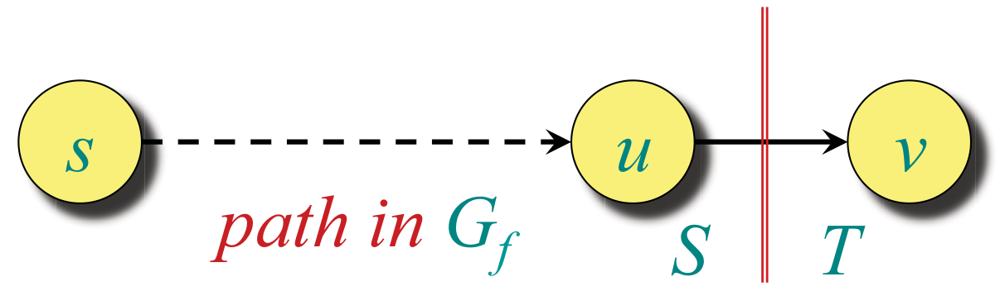
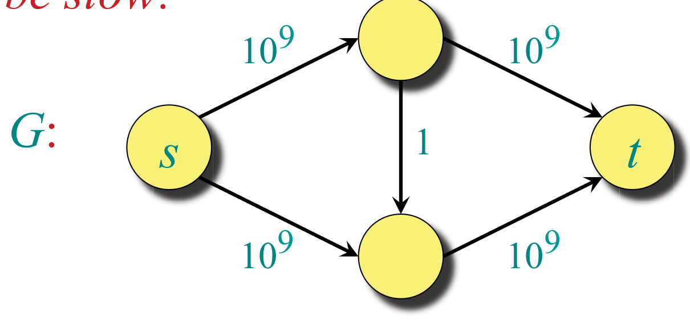
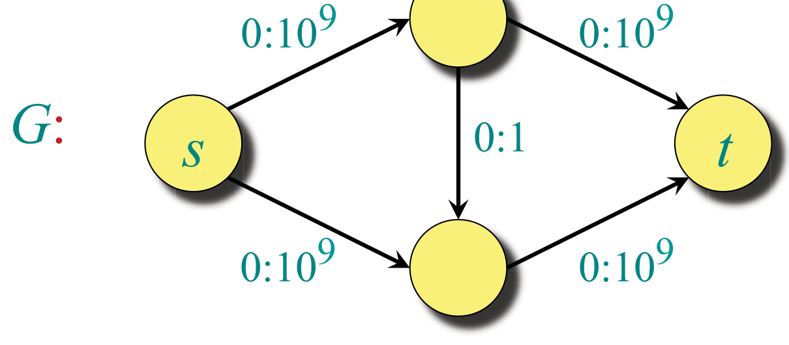
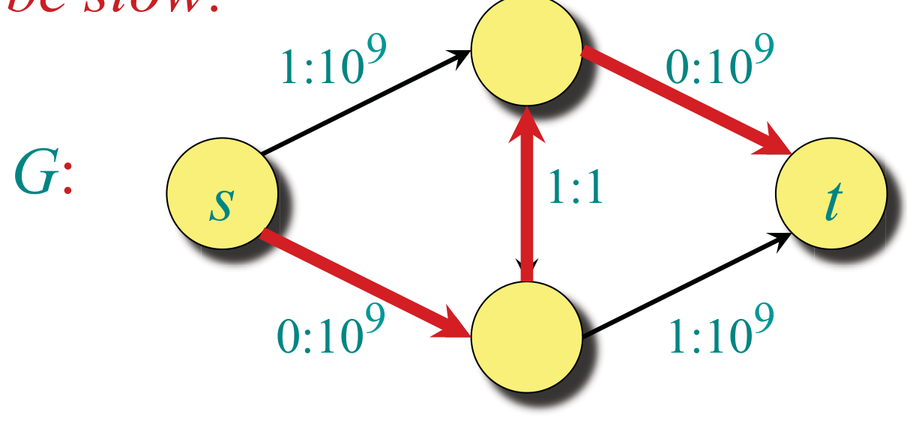
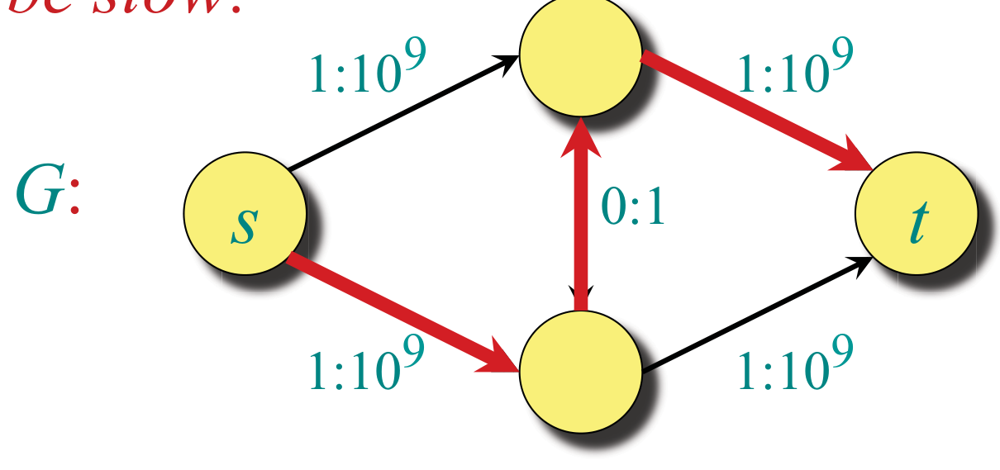
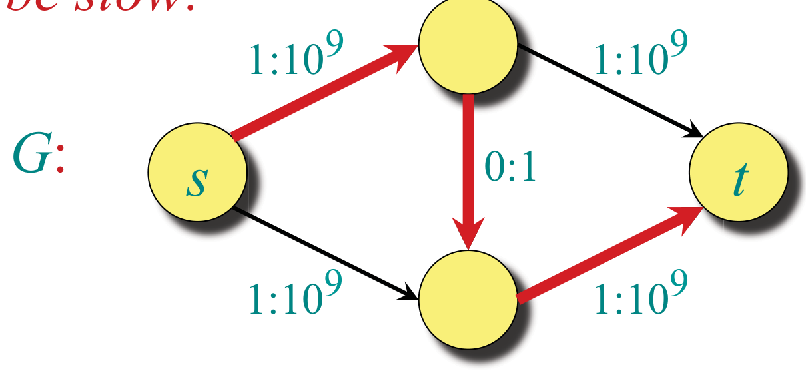
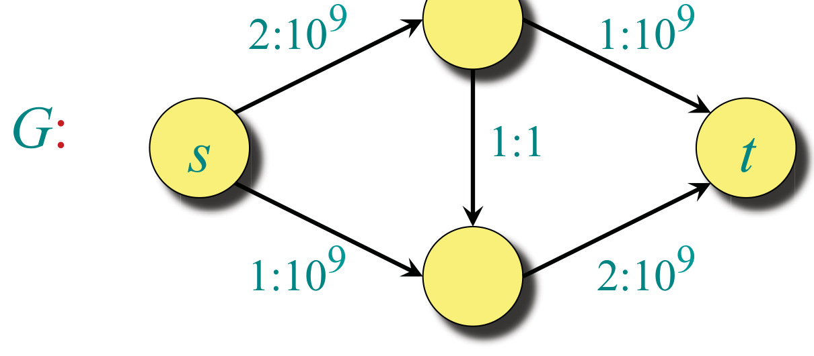

<!-- ===== PDF p1 ===== -->

<span style="color:#c0392b">**讲次 14（Lecture 14）：网络流与应用（Network Flow & Applications）**</span> <span style="color:#7f8c8d;">（Design and Analysis of Algorithms, 6.046J/18.401J, © 2001–15 by Leiserson et al, L14.1）</span>

本讲大纲：
- 回顾（Review）
- 最大流最小割定理（Max-flow min-cut theorem）
- Edmonds-Karp 算法（Edmonds Karp algorithm）
- 流整性（Flow Integrality）
- 第二部分：应用（Part II: Applications）

---

<!-- ===== PDF p2 ===== -->

<span style="color:#c0392b">**回顾讲次 13（Recall from Lecture 13）**</span>

- 流价值（Flow value）：$|f| = f(s, V)$。
- 割（Cut）：$V$ 的任意划分 $(S, T)$，使得 $s \in S$ 且 $t \in T$。
- **引理（Lemma）**：对任意割 $(S, T)$，$|f| = f(S, T)$。
- **推论（Corollary）**：对任意割 $(S, T)$，$|f| \le c(S, T)$。
- **残量图（Residual graph）**：图 $G_f = (V, E_f)$，其残量容量严格为正 $c_f(u, v) = c(u, v) - f(u, v) > 0$。
- **增广路径（Augmenting path）**：$G_f$ 中任何从 $s$ 到 $t$ 的路径。
- **增广路径的残量容量（Residual capacity of an augmenting path）**：$c_f(p) = \min_{(u,v) \in p} \{ c_f(u, v) \}$。

> <span style="color:#1e8449;">**[note] Note（译者注）:**</span> 这一页在补一笔具体的债：讲次 13 把三等价陈述摆出来之后只写了「Proof. Next time!」，留下一句空承诺。要看清这一页为什么必须存在，得先把两个方向的强弱分开算账 —— weak duality（弱对偶）是一条几乎免费的恒等式，strong duality（强对偶）是一个必须动手构造的存在性命题，两者的难度不在一个量级。
>
> 先说 weak duality（弱对偶）为什么免费。对任意 feasible flow（可行流）与任意 cut（割），有两条事实同时成立：其一是 flow conservation（流守恒）把所有内部顶点的净出流压成零，于是从 $S$ 流到 $T$ 的净量恰好等于源点的净出流，也就是 flow value（流价值）；其二是每条边上的 flow（流）不超过它的 capacity（容量），于是这个净量不超过跨割边的容量之和。两步都不需要算法参与，只要定义成立。结论是：任何一条流都是任何一条割的下界，任何一条割都是任何一条流的上界 —— 两组数被夹在两个方向上，但夹逼本身不保证两侧会碰头。
>
> strong duality（强对偶）说的是另一件事：这两组数的上确界与下确界相等，即 maximum flow（最大流）的流价值等于 minimum cut（最小割）的容量。这是一个「两侧同时取到」的命题，不能由恒等式推出，必须证明。Ford–Fulkerson 之后近七十年的理论工作，大半都在回答它的各种变体：什么时候等号成立、怎么在多项式时间内找到两侧的最优解、capacity（容量）取实数时还成不成立。
>
> 现在把数代进去看夹逼长什么样。取四个顶点 $s, a, b, t$，capacity（容量）为 $c(s,a)=3$、$c(s,b)=2$、$c(a,b)=1$、$c(a,t)=2$、$c(b,t)=3$。设一条流：$s\to a$ 送 3、$a\to b$ 送 1、$a\to t$ 送 2、$s\to b$ 送 2、$b\to t$ 送 3。验 flow conservation（流守恒）：$a$ 收 3、放出 $1+2=3$；$b$ 收 $2+1=3$、放出 3。这条流的 flow value（流价值）是 5。
>
> 割一，$S=\{s\}$：cut capacity（割容量）$3+2=5$，净流 $3+2=5$。割二，$S=\{s,a\}$：跨割边是 $s\to b$（2）、$a\to b$（1）、$a\to t$（2），容量 5，净流 $2+1+2=5$。割三，$S=\{s,a,b\}$：跨割边 $a\to t$（2）、$b\to t$（3），容量 5，净流 5。三条割全部取等。这不是巧合：下一段会证明，只要没有 augmenting path（增广路），那条按可达性造出来的 cut（割）必然取等。
>
> 但请注意这个例子无法排除一种情形：所有 cut capacity（割容量）都大于等于 6，而 maximum flow（最大流）只有 5。weak duality（弱对偶）对它无话可说。所以 strong duality（强对偶）的信息量全在「排除这种情形」上，而排除的手段是把不可达性变成一个具体的 cut（割）—— 这正是下一页的动作。
>
> 跨课程连接一：CLRS 第 26 章把同样内容拆成 26.1（flow network（流网络）的定义与两条引理）、26.2（Ford–Fulkerson method（福特与富尔克森的方法））、26.3（max-flow min-cut theorem（最大流最小割定理））。讲义这一页对应 26.1 的 Lemma 26.4 与 Corollary 26.5，区别只在记号：CLRS 把净流写成对跨割边的双重求和，讲义把它缩写成 $f(S,T)$。
>
> 跨课程连接二：LP duality（线性规划对偶）。就地解释一下这是什么：把一个优化问题写成「线性目标加线性约束」的形式，它的对偶是给每条约束配一个权重、把所有约束加权求和得到的新问题 —— 对偶问题的最优值总是不小于原问题的，这是 weak duality（弱对偶）；当约束结构足够好时两者相等，这是 strong duality（强对偶）。maximum flow（最大流）可以写成这样的线性规划：变量是每条边上的 flow（流），约束是 capacity（容量）上限与内部顶点的 flow conservation（流守恒）。任取一条 cut（割），把割两侧的约束加权相加，就得到这个线性规划的一个上界，而这个上界正是 $c(S,T)$。于是 cut（割）就是 LP duality（线性规划对偶）里那个对偶问题的可行解，minimum cut（最小割）是它的最优解。
>
> 区别在于：LP duality（线性规划对偶）是覆盖全部线性约束的普遍定理，max-flow min-cut theorem（最大流最小割定理）只是它在网络结构上的一次具体化 —— 前者给你工具，后者给你实例。你在 convex optimization（凸优化）的 Boyd 教材前五章里会先看到普遍版本，再回头看这一页，会发现网络流是它最干净的案例：约束矩阵是全幺模的，所以对偶最优解自动落在整数点上，不需要额外的取整步骤。
>
> 收束一句：本页要补的不是新的数学事实，而是把一个「显然成立的上界」升级成「两侧同时取到的等式」，升级的唯一工具是下一页那条从 residual graph（残量图）里直接捞出来的 cut（割）。

---

<!-- ===== PDF p3 ===== -->

<span style="color:#c0392b">**Ford-Fulkerson 最大流算法（Ford-Fulkerson max-flow algorithm）**</span>

**算法（Algorithm）**：

```
f[u, v] ← 0 for all u, v ∈ V
while 存在关于 f 的增广路径 p（在 G 中）
    do 用 cf(p) 增广 f
```

---

<!-- ===== PDF p4 ===== -->

<span style="color:#c0392b">**最大流最小割定理（Max-flow, min-cut theorem）**</span>

<span style="color:#2471a3;">**[theorem]**</span> **定理（Theorem）**：以下三命题**等价**：
1. 对某个割 $(S, T)$，$|f| = c(S, T)$。
2. $f$ 是最大流。
3. $f$ 没有增广路径。

**证明（Proof）**：
- **(1) ⇒ (2)**：由于对任意割 $(S, T)$ 都有 $|f| \le c(S, T)$，假设 $|f| = c(S, T)$ 意味着 $f$ 是最大流。
- **(2) ⇒ (3)**：若存在增广路径，流价值就能增加，与 $f$ 的最大性（maximality）矛盾。

> <span style="color:#1e8449;">**[note] Note（译者注）:**</span> 三等价的前两个方向确实平凡，但「平凡」不等于「废话」—— 它们各自依赖一条不同的结构假设，把假设抽掉其中一个方向立刻就假。这条注把两条假设拆开写清，再给一个中间状态的具体数字，让 (2) 蕴含 (3) 的逆否命题落地。
>
> 先看 (1) 蕴含 (2)。要证的链条是：若存在 cut（割）$(S,T)$ 使 $|f|=c(S,T)$，则 $f$ 是 maximum flow（最大流）。论证只用到 weak duality（弱对偶）的一句话：对任意 feasible flow（可行流）$f'$ 与任意 cut（割）都有 $|f'| \le c(S,T)$。把 $c(S,T)$ 换成 $|f|$，得到 $|f'| \le |f|$ 对一切 $f'$ 成立，于是 $f$ 最大。这里的关键结构是：$c(S,T)$ 是图的一个常数，与 $f'$ 无关。若这个上界本身依赖被比较的对象，论证立刻崩掉 —— 很多错误证明就栽在这一步，把「对所有 $f'$ 都成立的上界」偷换成「依赖 $f'$ 的界」。
>
> 再看 (2) 蕴含 (3)。这是反证：若 residual graph（残量图）$G_f$ 中存在一条从 $s$ 到 $t$ 的 augmenting path（增广路）$p$，令 $\delta = c_f(p) > 0$，沿 $p$ 把每条边的 flow（流）加上 $\delta$（反向边减去 $\delta$），得到新流 $f'$，则 $|f'| = |f| + \delta > |f|$，与 $f$ 的最大性矛盾。两个细节值得单独拎出来：其一，$\delta > 0$ 来自 residual graph（残量图）的定义 —— 它只保留残量容量严格为正的边，所以 $c_f(p)$ 一定是正数；其二，$f'$ 必须仍然可行，capacity（容量）约束由 $\delta \le c_f(e)$ 保证，flow conservation（流守恒）由「整条路一起加减」保证。
>
> 把一个非最优的中间状态代进去算。仍用上面那张图：$c(s,a)=3$、$c(s,b)=2$、$c(a,b)=1$、$c(a,t)=2$、$c(b,t)=3$。现在取一条流 $f$：$s\to a$ 送 2、$a\to t$ 送 2、$s\to b$ 送 2、$b\to t$ 送 2，$a\to b$ 不用。flow value（流价值）是 4。
>
> 算 residual graph（残量图）：$s\to a$ 还剩 $3-2=1$；$a\to t$ 剩 $2-2=0$；$s\to b$ 剩 $2-2=0$；$b\to t$ 剩 $3-2=1$；$a\to b$ 容量 1、流 0，剩 1；反向边是 $a\to s$（残量 2）、$b\to s$（残量 2）、$t\to a$（残量 2）、$t\to b$（残量 2）、$b\to a$（残量 0）。
>
> breadth-first search（广度优先搜索）从 $s$ 出发：$s\to a$ 残量 1，可达 $a$；从 $a$ 沿 $a\to b$ 残量 1，可达 $b$；从 $b$ 沿 $b\to t$ 残量 1，可达 $t$。找到 augmenting path（增广路）$s\to a\to b\to t$，$\delta = \min(1,1,1) = 1$。增广后 $s\to a$ 变 3、$a\to b$ 变 1、$a\to t$ 保持 2、$s\to b$ 保持 2、$b\to t$ 变 3，flow value（流价值）升到 5。这就是 (3) 失效时 (2) 必然失效的实证：(2) 蕴含 (3) 的真正内容等价于它的逆否命题「有 augmenting path（增广路）就不再是 maximum flow（最大流）」，而后者是可以手工一步步执行的。
>
> 跨课程连接一：这套「普通方向免费、深刻方向收费」的结构，在 6.042J 的 partially ordered set（偏序集）里以最小上界的面貌出现过：全体 feasible flow（可行流）是一个集合，全体 cut capacity（割容量）是它的上界集合，minimum cut（最小割）是这个上界集合的下确界。weak duality（弱对偶）说上确界不超过下确界，strong duality（强对偶）说两者相等。区别：偏序集的一般理论不保证上确界一定取到（有理数集里 $\sqrt{2}$ 就取不到），而这里网络结构保证它取到，还是由一个具体算法算出来的。
>
> 跨课程连接二：CLRS 第 26 章把这页的两条论证写成 Lemma 26.4 与 Lemma 26.5（对应讲义回顾清单的前两条），Theorem 26.6 才是三等价。讲义把三等价拆到两页，是因为它要留出位置给那个唯一困难的方向 —— 这个排版选择本身就在传递信息。
>
> 跨课程连接三：与 Bellman–Ford 的负环判定同型。最短路里「无负环就有最短路」，网络流里「无 augmenting path（增广路）就有 minimum cut（最小割）」，两者的深刻方向都用同一个套路：从反例的失败方式出发，构造一个可达集，再从可达集的边界读出一个对象。区别是读出的东西不同：Bellman–Ford 从「还能松弛」读出一个负环，Ford–Fulkerson 从「不能再增广」读出一条 cut（割）。
>
> 收束：两个平凡方向的价值不在结论，而在它们把三条性质串成一条链，让唯一困难的方向成为整条链的瓶颈，从而可以集中火力对付它。

---

<!-- ===== PDF p5 ===== -->

<span style="color:#c0392b">**证明（续）（Proof continued）**</span>

- **(3) ⇒ (1)**：假设 $f$ 没有增广路径。定义

```math
S = \{ v \in V : G_f \text{ 中存在从 } s \text{ 到 } v \text{ 的路径} \}
```

并令 $T = V - S$。观察到 $s \in S$ 且 $t \in T$，因此 $(S, T)$ 是一个割。

考虑任意顶点 $u \in S$ 与 $v \in T$：



> <span style="color:#7f8c8d;">[原图说明] 原页附图：残量网络 $G_f$ 中从 $s$ 到 $u$ 的路径示意，$u \in S$、$v \in T$。图注强调「$G_f$ 中的路径」。</span>

我们必须有 $c_f(u, v) = 0$，因为若 $c_f(u, v) > 0$，则 $v \in S$，而非假设的 $v \in T$。于是 $f(u, v) = c(u, v)$，因为 $c_f(u, v) = c(u, v) - f(u, v)$。对所有 $u \in S$ 与 $v \in T$ 求和得 $f(S, T) = c(S, T)$，又因为 $|f| = f(S, T)$，定理得证。

> <span style="color:#1e8449;">**[note] Note（译者注）:**</span> 这段论证的价值不在结论而在方法：它不是「存在一个 cut（割）」的存在性证明，而是「跑一次 breadth-first search（广度优先搜索）就把这个 cut（割）造出来」的构造性证明。把它拆开能看到四层结构 —— 可达集的定义、$t$ 不在集内、跨割边的饱和性、求和。任何一层被跳过，证明就不完整。
>
> 第一层，定义 $S = \{v \in V : G_f \text{ 中存在从 } s \text{ 到 } v \text{ 的路径}\}$，其中 $G_f$ 是 residual graph（残量图）。这是一个可以直接用算法算出的集合：从 $s$ 做一次广度优先搜索，凡被访问到的顶点都进 $S$。它没有被挑选，它被算出来 —— 这一点决定了整段证明是构造性的而非存在性的。
>
> 第二层，$t \notin S$。理由是这一段的前提：$f$ 没有 augmenting path（增广路），而 augmenting path（增广路）就是 residual graph（残量图）里从 $s$ 到 $t$ 的路，若 $t \in S$ 就直接矛盾。同时 $s \in S$（零长路），于是 $(S, T)$ 满足 cut（割）的定义要求：$s \in S$、$t \in T$、$T = V - S$。这一层看着像废话，其实是把「算法失败」转译成「结构对象」的那一步，缺了它后面全是空转。
>
> 第三层，跨割边的饱和性。取任意 $u \in S$、$v \in T$。若 $c_f(u,v) > 0$，则 $v$ 通过残量边 $(u,v)$ 从 $s$ 可达，$v \in S$，矛盾。所以 $c_f(u,v) = 0$。由残量容量的定义 $c_f(u,v) = c(u,v) - f(u,v)$ 得 $f(u,v) = c(u,v)$：每条从 $S$ 指向 $T$ 的边都达到 saturated（饱和）状态。这一层是整段证明的支点，也是唯一用到数学的关节。
>
> 第四层，求和。这里有一个常被略过的细节：还要证明反向边满足 $f(v,u) = 0$（$u \in S$、$v \in T$）。因为若 $f(v,u) > 0$，则残量边 $(u,v)$ 的残量就是 $f(v,u) > 0$，又回到第三层的矛盾。所以 $f(S,T) = \sum_{u \in S, v \in T} f(u,v) - \sum_{u \in S, v \in T} f(v,u) = c(S,T) - 0 = c(S,T)$。配合回顾里那条恒等式 $|f| = f(S,T)$，得到 $|f| = c(S,T)$。
>
> 把数代进去跑一遍。用前面那张图的 maximum flow（最大流）：$s\to a$ 送 3、$a\to b$ 送 1、$a\to t$ 送 2、$s\to b$ 送 2、$b\to t$ 送 3，flow value（流价值）是 5。residual graph（残量图）里正向边全部耗尽：$s\to a$ 剩 0、$s\to b$ 剩 0、$a\to b$ 剩 0、$a\to t$ 剩 0、$b\to t$ 剩 0；反向边全部是正整数：$a\to s$ 残 3、$b\to s$ 残 2、$b\to a$ 残 1、$t\to a$ 残 2、$t\to b$ 残 3。
>
> 从 $s$ 做 breadth-first search（广度优先搜索）：$s$ 的两条出边残量都是 0，一步都出不去。于是 $S = \{s\}$，$T = \{a,b,t\}$。跨割边 $s\to a$、$s\to b$ 的 capacity（容量）分别是 3 与 2，流也都是 3 与 2，全部饱和。$c(S,T) = 5 = |f|$。cut（割）找到了，等式成立，整个过程只花了看两条边的时间。
>
> 再跑一个反面对照：取 flow value（流价值）为 4 的那个中间状态（$s\to a$ 2、$a\to t$ 2、$s\to b$ 2、$b\to t$ 2）。residual graph（残量图）有 $s\to a$ 残 1、$a\to b$ 残 1、$b\to t$ 残 1，广度优先搜索从 $s$ 会一路走到 $t$，于是 $S = V$、$T = \emptyset$，$t$ 跑进了 $S$，$(S,T)$ 根本不成其为 cut（割）。这正好照出前提的必要性：没有 augmenting path（增广路）这个条件是造出 cut（割）的许可证，缺了它什么都拿不到。
>
> 跨课程连接一：6.042J 的连通关系。在无向图里连通是一个等价关系，可达集就是等价类，取了 $s$ 的那个类就是整个类。但在有向的 residual graph（残量图）里，可达性不满足对称性，所以从 $s$ 可达只能得到「包含 $s$ 的一个下闭集」，不是整个等价类。正是这种不对称，让 $S$ 成为 $V$ 的真子集，也就是一个真正切开的 cut（割）。若图里全是双向边、可达性恰好对称，$S$ 要么是 $V$ 要么只剩孤立点，cut（割）就退化了 —— 等价关系太强，强到切不开东西。
>
> 跨课程连接二：CLRS 第 26 章 Theorem 26.6 用的是逐字相同的构造，但 CLRS 多写了一条：「对 $u \in S$、$v \in T$，有 $f(u,v) = c(u,v)$ 且 $f(v,u) = 0$」。讲义这一页只写了第一条，第二条省略了。省略的代价是：只有两条同时成立，$f(S,T)$ 才等于 $c(S,T)$ 而不只是小于等于。这条细节值得在脑子里补上，因为它是 sum 那一步能不能落地的关键。
>
> 跨课程连接三：这套「从失败模式反推一个结构」的手法，在 CSAPP 第 6 章 cache 的冲突失效分析里以另一种面貌出现：当两个地址反复互相驱逐，可以从「每次都不命中」这一失败模式反推出「它们映射到同一 cache set（缓存组）」这一结构事实。区别在于反推出的东西：那里是硬件的地址映射规则，这里是图的一个 cut（割）。同一个推理形状，一个用在硬件诊断，一个用在证明。
>
> 收束：max-flow min-cut theorem（最大流最小割定理）的困难方向，本质上是把「优化失败（无法继续增广）」翻译成「结构对象（最小割）」的一次翻译，翻译用的字典就是 residual graph（残量图）上的可达性。

---

<!-- ===== PDF p6 ===== -->

<span style="color:#c0392b">**Ford-Fulkerson 最大流算法（续）**</span>

**算法**：

```
f[u, v] ← 0 for all u, v ∈ V
while 存在关于 f 的增广路径 p（在 G 中）
    do 用 cf(p) 增广 f
```

**可能很慢（Can be slow）**：


> <span style="color:#7f8c8d;">[原图说明] 原页附图：一个 4 顶点网络 $G$（$s \to u, s \to v, u \to v, u \to t, v \to t$），各边容量为 $10^9$ 或 $1$（如 $s \to u$ 容量 $10^9$、$u \to v$ 容量 $1$ 等）。这是展示 Ford-Fulkerson 最坏情形的经典例子。</span>

---

<!-- ===== PDF p7 ===== -->

<span style="color:#c0392b">**Ford-Fulkerson 最坏情形演示（Can be slow）**</span>



> <span style="color:#7f8c8d;">[图注说明] 原页附图：4 顶点网络 $G$ 的流状态第 1 帧，边标注 0:10⁹、0:10⁹、0:10⁹、0:1、0:10⁹（初始零流）。</span>

---

<!-- ===== PDF p8 ===== -->

<span style="color:#c0392b">**Ford-Fulkerson 最坏情形演示（续）**</span>


> <span style="color:#7f8c8d;">[图注说明] 原页附图：流状态第 2 帧，边标注 0:10⁹、0:10⁹、0:10⁹、0:1、0:10⁹（与 p7 相同——演示从空流开始）。</span>

---

<!-- ===== PDF p9 ===== -->

<span style="color:#c0392b">**Ford-Fulkerson 最坏情形演示（续）**</span>


> <span style="color:#7f8c8d;">[图注说明] 原页附图：流状态第 3 帧，边标注 1:10⁹、0:10⁹、1:10⁹、1:1、0:10⁹（沿第一条增广路径送 1 单位）。</span>

---

<!-- ===== PDF p10 ===== -->

<span style="color:#c0392b">**Ford-Fulkerson 最坏情形演示（续）**</span>



> <span style="color:#7f8c8d;">[图注说明] 原页附图：流状态第 4 帧，边标注 1:10⁹、0:10⁹、1:10⁹、1:1、0:10⁹（与 p9 相同）。</span>

---

<!-- ===== PDF p11 ===== -->

<span style="color:#c0392b">**Ford-Fulkerson 最坏情形演示（续）**</span>



> <span style="color:#7f8c8d;">[图注说明] 原页附图：流状态第 5 帧，边标注 1:10⁹、1:10⁹、1:10⁹、0:1、1:10⁹（沿第二条增广路径送 1 单位，注意 $u \to v$ 的流回落为 0）。</span>

---

<!-- ===== PDF p12 ===== -->

<span style="color:#c0392b">**Ford-Fulkerson 最坏情形演示（续）**</span>



> <span style="color:#7f8c8d;">[图注说明] 原页附图：流状态第 6 帧，边标注 1:10⁹、1:10⁹、1:10⁹、0:1、1:10⁹（与 p11 相同）。</span>

---

<!-- ===== PDF p13 ===== -->

<span style="color:#c0392b">**Ford-Fulkerson 最坏情形演示（续）**</span>


> <span style="color:#7f8c8d;">[图注说明] 原页附图：流状态第 7 帧，边标注 2:10⁹、1:10⁹、2:10⁹、1:1、1:10⁹（又沿第一条路径送 1 单位）。</span>

---

<!-- ===== PDF p14 ===== -->

<span style="color:#c0392b">**Ford-Fulkerson 最坏情形演示（续）**</span>



> <span style="color:#7f8c8d;">[图注说明] 原页附图：流状态第 8 帧，边标注 2:10⁹、1:10⁹、2:10⁹、1:1、1:10⁹。最终标注：**在一个只有 4 个顶点的图上进行了 20 亿次迭代！**（2 billion iterations on a graph with 4 vertices!）</span>

🎥 *Devadas 在视频中[强调最坏情形的荒谬]*："So 2 billion iterations for a graph with four vertices. Now that's performance for you."（翻译：所以，对一个只有 4 个顶点的图，要 20 亿次迭代。这可真够「高效」的。）——讽刺语气点出：Ford-Fulkerson 若增广路径选得不好（每次只增广 1 单位、路径反复震荡），复杂度可以极差——这正是下一节 Edmonds-Karp 要修复的。

> <span style="color:#1e8449;">**[note] Note（译者注）:**</span> 这个只有 4 个顶点的反例要说明的是一件比「慢」更严重的事：Ford–Fulkerson method（福特与富尔克森的方法）根本没定义复杂度，因为它不指定 augmenting path（增广路）怎么选。任何关于它复杂度的说法，都隐含地先补了一条选择策略。
>
> 把图的构造摊开。四个顶点 $s, u, v, t$。五条边：$s\to u$ 的 capacity（容量）是 $10^9$、$s\to v$ 是 $10^9$、$u\to v$ 是 $1$、$u\to t$ 是 $10^9$、$v\to t$ 是 $10^9$。注意 $u\to v$ 是唯一的窄口，capacity（容量）只有 1，而左右两侧都是十亿量级的宽管道。
>
> 现在选一条坏路：$s\to u\to v\to t$。增广量 $\delta = \min(10^9, 1, 10^9) = 1$ —— 被中间那条窄边卡死，只送出去 1 单位。增广后 $u\to v$ 饱和，residual graph（残量图）里出现反向边 $v\to u$，残量 1。
>
> 下一步换另一条坏路：$s\to v\to u\to t$。$\delta = \min(10^9 - 1, 1, 10^9) = 1$，又只送 1 单位。这一次 $v\to u$ 饱和，$u\to v$ 恢复残量 1。两次一循环，净增 2，图的状态回到与开始时同构的位置 —— 只是两条主干边各多了 1 单位 flow（流），瓶颈边来回翻转。
>
> 算总量：这张图的 maximum flow（最大流）是 $2\times 10^9$ —— $s$ 的两条出边合计 $2\times 10^9$，$t$ 的两条入边合计也是 $2\times 10^9$，瓶颈不在任何单条边上，而在 $u$ 与 $v$ 之间的那对反向边被交替使用。每次循环净增 2，所以需要 $10^9$ 次循环，也就是 $2\times 10^9$ 次 augmentation（增广）。
>
> 为什么这件事荒谬而不只是慢：图的规模是 4 个顶点、5 条边，而运行步数与 capacity（容量）的数值成正比，不与图的规模成正比。这类复杂度叫 pseudo-polynomial（伪多项式）—— 输入写成二进制，$10^9$ 只占约 30 比特，五条边加起来不过 150 比特，而算法要跑二十亿步。所以这个作为 method（方法）存在的东西连多项式时间都不算，除非另行限定 capacity（容量）很小。
>
> 这里要把 method（方法）与 algorithm（算法）分开。method（方法）是一个反复做同一件事直到做不动的模板：不断找 augmenting path（增广路）、不断增广，直到找不到为止。algorithm（算法）必须指定每一步怎么选，并且给出复杂度上界。Ford–Fulkerson method（福特与富尔克森的方法）的正确性（由 max-flow min-cut theorem（最大流最小割定理）保证终止于 maximum flow（最大流））与它的复杂度是两件独立的事：前者对任何选择策略都成立，后者对不同策略天差地别。
>
> 跨课程连接一：CSAPP 第 6 章 cache 的 conflict miss（冲突失效）。两个地址映射到同一个 cache set（缓存组），交替访问时每次都 miss，哪怕整个 cache 大面积空闲。这里被共享的资源就是 $u$ 与 $v$ 之间那条容量 1 的边，交替使用就每次只榨出 1 单位。区别很重要：cache 的映射由硬件的地址位切片决定，程序改不了冲突；maximum flow（最大流）的瓶颈却可以靠换路径绕开 —— 只要选一条不走 $u\to v$ 的路（比如直接 $s\to u\to t$），一次就能送 $10^9$，两轮结束。
>
> 跨课程连接二：单源最短路的两种算法。Bellman–Ford 每轮把所有边松弛一遍、共 $V-1$ 轮；Dijkstra 每次取距离最小的点、每个点只处理一次。两种算法做的单步操作是同一件事（松弛一条边），差别全在遍历顺序上，结果一个是 $O(VE)$、一个加堆之后是 $O(E\log V)$。这里也是同一个形状：单步操作（沿一条路增广）不变，路径选择策略决定复杂度。
>
> 跨课程连接三：这与 CSAPP 第 5 章那句「编译器不改变算法的渐进阶」是同一枚硬币的两面。那里说常数因子优化有上限，因为阶段由算法决定；这里说同一个正确性证明可以对应完全不同的复杂度，因为证明只约束最终到达，不约束用了多久。两句话合起来就是：正确性是性质，复杂度是代价，二者可以被同一段代码分别满足到完全不同的程度。
>
> 修复方案正是下一页的 Edmonds–Karp：把选择策略固定成「总选最短的 augmenting path（增广路）」，用 breadth-first search（广度优先搜索）实现。选最短不是启发式，它给出一条可证的单调性引理，把二十亿次压成 $O(VE)$ 次增广。换一句话说，这一页的病态输入是 Edmonds–Karp 的动机说明书。
>
> 收束：这一页的存在意义不在展示一个病态输入，而在把正确与高效分离成两个独立问题，让后续所有算法改进都有了明确的目标 —— 不动正确性，只动选择。

---

<!-- ===== PDF p15 ===== -->

<span style="color:#c0392b">**Edmonds-Karp 算法（Edmonds-Karp algorithm）**</span>

**Edmonds 与 Karp** 注意到：许多人对 Ford-Fulkerson 的实现都沿**广度优先增广路径（breadth-first augmenting path）**增广——即 $G_f$ 中从 $s$ 到 $t$ 的**最短路径**（每条边权重为 1）。这些实现总是运行得相对较快。

由于广度优先增广路径可以在 $O(E)$ 时间内找到，他们的分析——它给出了最大流问题的**第一个多项式时间界**——聚焦于**限制增广次数**。（在独立工作中，**Dinic** 也给出了多项式时间界。）

> <span style="color:#1e8449;">**[note] Note（译者注）:**</span> Edmonds–Karp 的那个洞察看上去平淡得像一句废话：用 breadth-first search（广度优先搜索）找 augmenting path（增广路）。它之所以能救场，不是因为「广搜更快」，而是因为「最短路」这四个字带来一条可证的单调性引理 —— 把「路径怎么选」这件自由的事变成了受约束的事，复杂度才有定义。
>
> 先定义势函数。设 $\delta_f(v)$ 为 residual graph（残量图）$G_f$ 中从 $s$ 到 $v$ 的最短路边数，不可达时记为 $\infty$。注意这个量随 flow（流）变化，所以下标必须带 $f$，它是状态的函数，不是图的不变量。
>
> 单调性引理：增广一次之后，新的残量图 $G_{f'}$ 满足 $\delta_{f'}(v) \ge \delta_f(v)$ 对一切 $v$ 成立。也就是说，最短路只会变长，绝不会变短。
>
> 为什么？反证。假设存在某个顶点第一次使距离严格变小，取其中距离最小的那个 $v$。在 $G_{f'}$ 里 $v$ 有一名前驱 $u$，满足 $\delta_{f'}(u) = \delta_{f'}(v) - 1$。由于 $v$ 是第一个变小的点，$\delta_{f'}(u) \ge \delta_f(u)$。若边 $(u,v)$ 在 $G_f$ 里就存在，则 $\delta_f(v) \le \delta_f(u) + 1 \le \delta_{f'}(u) + 1 = \delta_{f'}(v)$，与「变小」矛盾。所以问题只能出在新出现的边上 —— 而新边只可能来自被增广路径上某条边的反向，其方向必然是「由远指近」的，走它只会绕回更短的距离。两条分支都矛盾，引理成立。
>
> 从引理推出增广次数。每次增广至少让路径上一条边饱和，即从 residual graph（残量图）里消失。这条边何时回来？只有等它的反向边被用上，而反向边被用上的前提是 $\delta$ 发生严格增加。$\delta$ 是整数、上界 $V-1$，所以一条边最多饱和 $V$ 次。总共 $E$ 条边，故增广次数不超过 $VE$。每次 breadth-first search（广度优先搜索）是 $O(E)$，总复杂度 $O(VE^2)$。
>
> 现在算两个具体规模的数。取 $V = 100$、$E = 1000$：增广次数上界是 $VE = 10^5$，每次广搜扫 1000 条边，总共约 $10^8$ 次边操作。对比 4 顶点反例里的 $2\times 10^9$ 次增广 —— 规模大了 25 倍，步数反而少了 20 倍。再取 $V = 200$、$E = 2000$：$VE = 4\times 10^5$ 次增广、每次 2000 步，约 $8\times 10^8$ 步，仍是同一量级。这个界的可贵之处在于它完全不看 capacity（容量）的数值 —— 把 $10^9$ 改成 $10^{18}$，界一个数都不变。
>
> 这里必须强调「最短路」三个字的不可替代性。若允许任意 augmenting path（增广路），$\delta$ 可以减小（20 亿次反例里发生的正是这件事：走了 $s\to u\to v\to t$ 之后，$s\to v$ 的距离从 1 仍为 1，但 $u$ 的距离从 1 变成 2，接着又被打回 1，来回震荡），单调性崩溃，$O(VE)$ 的增广次数界随之蒸发。所以这不是「广搜恰好也行」，而是「只有最短路类策略才拿得到这个界」。
>
> 跨课程连接一：CLRS 22.2 的 breadth-first search（广度优先搜索）会算出每个顶点的层号 $d[v]$ 与一棵广搜树，而 CLRS 26.2 的 Edmonds–Karp 分析正是把 $d[v]$ 当成势函数来用。区别在于：22.2 的 $d[v]$ 是静态图上的常数，26.2 的 $\delta_f(v)$ 随 residual graph（残量图）演化，所以要多证一条单调性。
>
> 跨课程连接二：CSAPP 第 11 章 TCP 的 congestion window（拥塞窗口）慢启动。窗口每经过一个往返时延就翻一倍，所以从 1 涨到上限只需 $\log_2$ 个往返。这里是「每一轮至少让一条边永久退出」的摊还论证 —— 两者共享同一个思想骨架：用一个只增不减（或只减不增）的量，把可能无界的循环压成多项式轮数。
>
> 跨课程连接三：这与 6.042J 的 amortized analysis（摊还分析）是同一套记账法。那里给每个操作记一笔账，证明总账有界；这里给每条边记「最多饱和 $V$ 次」的额度，把逐次增广的费用平摊到边上，得出总数界。区别：摊还分析通常处理数据结构的操作序列，这里处理的是算法迭代序列。
>
> 历史一句带过，因为它解释了一个常见困惑：Dinic 的 1970 年论文在时间上早于 Edmonds–Karp 的 1972 年论文，前者用 layered network（分层网络）加 blocking flow（阻塞流）把界做到 $O(V^2E)$。所以今天讲「第一个多项式时间界」时，严格说应把功劳分给两个人，讲义原文那句「在独立工作中 Dinic 也给出了多项式时间界」是忠实的，只是按时间顺序 Dinitz 更早。
>
> 收束：这一页真正教的东西不是「用广搜」，而是「给自由选择加一条可证的约束，让复杂度从不可谈论变成可谈论」。

---

<!-- ===== PDF p16 ===== -->

<span style="color:#c0392b">**至今最好（Best to date）**</span>

- **Edmonds-Karp 最大流算法**运行在 $O(VE^2)$ 时间。
- 广度优先搜索需 $O(E)$ 时间
- 最坏情形下 $O(VE)$ 次增广
- 到 **2011 年为止**渐近最快的最大流算法，由 **King、Rao 与 Tarjan** 提出，运行在 $O\left(VE \log_{\frac{E}{V \lg V}} V\right)$ 时间。
- 最近 **Orlin** 提出了一个 $O(VE)$ 时间的算法！
- 一个变体使用快速矩阵乘法

> <span style="color:#1e8449;">**[note] Note（译者注）:**</span> 这一页那张谱系表看起来像年表，实际上是两类复杂度之间的分界线：一边是 pseudo-polynomial（伪多项式）—— 界里带 capacity（容量）的数值；另一边是 strongly polynomial（强多项式）—— 界只看 $V$ 与 $E$，跟 capacity（容量）的数值彻底无关。所有改进都在把右边的指数往下压，但更重要的是先把左边排除掉。
>
> 先把每一档的界摆清。Ford–Fulkerson 的最坏情形是 $O(E\cdot U)$，$U$ 是最大 capacity（容量），每次增广至少推进 1 个单位。Edmonds–Karp 是 $O(VE^2)$，因子 $U$ 被彻底消掉。Dinic 用 layered network（分层网络）与 blocking flow（阻塞流），$O(V^2E)$。Goldberg–Tarjan 的 push-relabel（预流推进）换了思路：不再要求中间状态处处守恒，而是允许「进入多于流出」，把多余的 flow（流）沿高度标号往汇点推，$O(V^2\sqrt{E})$。King–Rao–Tarjan 于 1994 年发表 $O\left(VE\log_{\frac{E}{V\lg V}}V\right)$。Orlin 于 2013 年给出 $O(nm + m^{31/16}\log^2 n)$，在稀疏图上就是 $O(nm)$，写成本讲记号即 $O(VE)$。
>
> 为什么 $O(E\cdot U)$ 不算多项式？因为输入的表示长度是 $O(E\log U)$，而算法步数是 $O(E\cdot U)$，两者差着一个 $U/\log U$ 的因子，这个因子随数值指数增长。输入写 $10^9$ 只用 30 比特，算法却要 $10^9$ 步 —— 这就是 pseudo-polynomial（伪多项式）这个名字的由来：它看起来像多项式（关于数值），实际不是（关于输入长度）。
>
> 把三个具体的界代进去比较。取 $V = 10^3$、$E = 5\times 10^3$、$U = 10^9$。Ford–Fulkerson：$E\cdot U = 5\times 10^3 \times 10^9 = 5\times 10^{12}$ 步。Edmonds–Karp：$VE^2 = 10^3 \times 2.5\times 10^7 = 2.5\times 10^{10}$ 步。Orlin：$VE = 5\times 10^6$ 步。按每步 1 纳秒折算，分别是约 5000 秒、25 秒、5 毫秒。同一个图，三个数量级的差距层层叠起来共六个数量级 —— 这就是为什么复杂度不是学术装饰。
>
> 讲义的措辞值得注意。它说「到 2011 年为止渐近最快的是 King、Rao 与 Tarjan」，然后说「最近 Orlin 提出了 $O(VE)$ 的算法」。按发表时间，King–Rao–Tarjan 那篇是 1994 年刊出的，讲义写作是 2015 年，所以「最近」指 2013 年的 Orlin 没问题；而「到 2011 年为止」这个截止点的具体出处我没有逐字核实，标为待查。这类时间表述在讲义里常被略写，读的时候要对年份保持警觉。
>
> 拓展前沿一条：2022 年 Chen、Kyng、Liu、Peng、Probst Gutenberg、Sachdeva 六人给出了几乎线性时间的最大流算法，界是 $m^{1+o(1)}$，用近线性的 Laplacian 方程组求解器作为引擎。这条线的意义在于把 maximum flow（最大流）与数值线性代数接了起来 —— 图的 Laplacian 是一个稀疏对称半正定矩阵，解它的线性系统等价于在图上做某种势能计算。你在 18.065 里会反复见到这种「图与矩阵互为对偶」的视角：矩阵是图的一种编码，图的算法可以是矩阵的算法。
>
> 跨课程连接一：讲次 6 的矩阵乘法。那里的核心量是乘法指数 $\omega$，目前最好约 2.372，界的形式是 $O(n^{\omega})$。讲义这一页说「一个变体使用快速矩阵乘法」，指的就是把 maximum flow（最大流）归约成若干次矩阵乘法，于是界写成 $O(V^{\omega})$ 一类的形式。两者共用同一个 $\omega$，所以矩阵乘法的任何改进都会同步搬进最大流的界里。区别：矩阵乘法是纯代数问题，最大流是组合问题，连接两者的桥是「把流量守恒写成线性方程组」。
>
> 跨课程连接二：CLRS 第 26 章把 Ford–Fulkerson 放在 26.2，把 push-relabel（预流推进）单独放在 26.4 与 26.5（relabel-to-front（重标号到前）），正是因为后者不是 augmenting path（增广路）框架的变体，而是另一套范式。讲义这一页的谱系把两种范式混在一行里排，看的时候要自己分组：前四档属于 augmenting path（增广路）族与它的分层变体，第五档开始换范式。
>
> 跨课程连接三：这与最短路算法的谱系同构。Bellman–Ford $O(VE)$、Dijkstra 加二叉堆 $O(E\log V)$、加 Fibonacci 堆 $O(V\log V + E)$、Fredman–Tarjan 的 $O(E\log\log V)$ 一路把对数因子往下压 —— 同一个模式：先消掉对数值的依赖，再逐步抠对数因子，最后逼近下界。
>
> 收束一句：这一页真正要给的不是那张表的记忆，而是「先分范式、再看阶、最后看依赖什么参数」这三步读法。

---

<!-- ===== PDF p17 ===== -->

<span style="color:#c0392b">**流整性（Flow Integrality）**</span>

- **声明（Claim）**：假设流网络有**整数容量**。那么最大流将是**整数值**的。

**证明（Proof）**：先在所有边上设流为 0。使用 Ford-Fulkerson。初始时、以及在每一步，Ford-Fulkerson 都会找到一条残量容量为整数的增广路径。因此，算法过程中所有边上的流值始终保持**整数**（integral）。

> <span style="color:#1e8449;">**[note] Note（译者注）:**</span> 这条定理只有一句话：capacity（容量）全为整数时，maximum flow（最大流）的 flow value（流价值）与每条边上的 flow（流）都可以取整数。注意动词是「可以」而不是「必然」—— 它保证存在一个整数最优解，不保证所有最优解都是整数。这个区别决定了它能不能用来做归约。
>
> 证明是归纳，三步就完。
>
> 基础：第 0 步所有边 flow（流）为 0，是整数。
>
> 归纳假设：第 $k$ 次增广结束后，所有边上的 flow（流）都是整数。
>
> 归纳步：residual graph（残量图）的残量容量 $c_f(u,v) = c(u,v) - f(u,v)$ 是两个整数之差，仍是整数；于是任意 augmenting path（增广路）的瓶颈 $\delta = c_f(p)$ 是正整数；增广时每条边上的 flow（流）加或减 $\delta$，仍是整数。故第 $k+1$ 步后仍全是整数。
>
> 算法终止于「无 augmenting path（增广路）」，那一刻的流由 max-flow min-cut theorem（最大流最小割定理）保证是 maximum flow（最大流），而它一路都是整数，结论成立。整个证明没有任何技巧，但它依赖三个前提同时成立，缺一个就断。
>
> 微妙点一，存在与所有的区别。如果只看定义，一个整数 capacity（容量）的网络完全可以拥有一条取分数的 feasible flow（可行流），比如把每条边的 flow（流）都乘以二分之一，守恒与 capacity（容量）约束照样满足。定理说的是「算法产出的那一条」是整数，不是「所有 feasible flow（可行流）都整数」。
>
> 微妙点二，整性依赖「增广量恰好取 $c_f(p)$」这条规则。若某实现保守地只增广一半，整性立刻丢掉（除非 $c_f(p)$ 恰好是偶数）。所以整性不是 flow network（流网络）本身的性质，而是「满额增广」这条操作规则与整数输入共同保证的性质 —— 换一套增广规则，定理就不成立。
>
> 微妙点三，capacity（容量）取无理数时这个论证全盘失效，而且失效的方式比「取不到整数」严重得多：Ford–Fulkerson 可能不终止，其流价值序列的极限严格小于 maximum flow（最大流）。文献里有一类专门的构造，让算法每轮只推进一个越来越小的量，收敛到一个次优值。所以整数这个前提是承重墙，不是顺手加的装饰。
>
> 代一个具体例子。取网络 $s\to a$ capacity（容量）4、$s\to b$ capacity（容量）6、$a\to t$ capacity（容量）4、$b\to t$ capacity（容量）6，另加一条 $a\to b$ capacity（容量）3。
>
> 第 1 轮走 $s\to a\to t$，$\delta = \min(4,4) = 4$，两条边的 flow（流）各变 4。
>
> 第 2 轮走 $s\to b\to t$，$\delta = \min(6,6) = 6$，两条边的 flow（流）各变 6。
>
> 第 3 轮找不到 augmenting path（增广路）：$s$ 的两条出边都饱和了。maximum flow（最大流）是 10，各边 flow（流）依次是 4、6、4、6、0，全是整数。若把 $s\to b$ 与 $b\to t$ 的 capacity（容量）从 6 改成 5，maximum flow（最大流）变 9，仍是整数；若某条边改成 $2.5$，maximum flow（最大流）可能是 $6.5$ —— 这时定理就不作保证了。
>
> 跨课程连接一：6.042J 的 Hall's theorem（霍尔定理）。二部图存在完美匹配，当且仅当任意 $k$ 个左顶点的邻域至少包含 $k$ 个顶点。这条定理可以完全由 max-flow min-cut theorem（最大流最小割定理）加流整性推出：把匹配写成每条边 capacity（容量）为 1 的 flow network（流网络），flow value（流价值）等于匹配数；流整性保证每条边上的 flow（流）只能是 0 或 1，也就是一个真正的 matching（匹配）而不是「半个人」；而 minimum cut（最小割）的结构恰好对应 Hall 条件里那个邻域不够大的缺陷集。三条结果其实是同一条定理的三个面。
>
> 跨课程连接二：CLRS 第 26 章把整性写成 Corollary 26.7，证明几乎逐字相同，基石是 Lemma 26.2（capacity（容量）约束）与 Lemma 26.3（flow conservation（流守恒））。区别：CLRS 的表述把它放在 max-flow min-cut theorem（最大流最小割定理）之后，作为推论；讲义放在应用之前，作为下一节的地基 —— 位置不同，用途的指向也不同。
>
> 跨课程连接三：CSAPP 第 6 章的 cache line 对齐。地址必须按 64 字节对齐，那是硬件的自然粒度；流整性说的是网络流的自然粒度是 1 个单位。两者都是离散性保证，区别在于：cache 的对齐是设计要求（指令跨行会拆成两次访问，代价翻倍），流整性是代数推论（整数减整数还是整数），前者靠规定，后者靠结构。
>
> 收束：这条定理的价值不在它本身多难，而在于它给归约发了一张通行证 —— 任何把组合问题编码成整数 capacity（容量）流网络的做法，都能保证取回一个整数解，而不是一个需要额外取整、取整后还可能不可行的分数解。

---

<!-- ===== PDF p18 ===== -->

<span style="color:#c0392b">**应用（Applications）**</span>

- **棒球淘汰（Baseball Elimination）**
- **二分匹配（Bipartite Matching）**
- **流整性**对把这些问题归约到最大流**至关重要**（important to reducing these problems to max flow）！
- 棒球淘汰的更多说明见 L14 附加讲义（additional notes）

> <span style="color:#1e8449;">**[note] Note（译者注）:**</span> 这一页只点了两个名字，但它们背后是同一个动作：把一个组合问题翻译成 flow network（流网络），解一次 maximum flow（最大流），再把整数解翻译回原问题。三步里任何一步断掉，应用就失效，所以每步的「为什么成立」必须写清。
>
> 第一个应用，bipartite matching（二分图匹配）。问题是：给定左右两个点集与一张允许配对的表，求最大的不冲突配对数量。
>
> 构造：源 $s$ 到每个左顶点一条 capacity（容量）为 1 的边；每个允许的配对一条 capacity（容量）为 1 的边；每个右顶点到汇 $t$ 一条 capacity（容量）为 1 的边。
>
> 为什么等价：任何 feasible flow（可行流）都满足每个左顶点最多流出 1 单位、每个右顶点最多流入 1 单位，这正好是「每个点最多配一次」；反过来，任何一个 matching（匹配）都对应一条 flow（流），每条配对边送 1 单位。
>
> 为什么 flow（流）一定对应真匹配：靠流整性。每个顶点的进出量都是整数，而 capacity（容量）上界是 1，所以每条边上的 flow（流）只能是 0 或 1，不会出现「配了半个人」这种在原始问题里无意义、在 flow（流）世界里合法的解。
>
> 代一个具体例子。四个学生 P、Q、R、S 与四个职位 1、2、3、4。允许配对表：P 只能去 1 与 2；Q 只能去 1 与 2；R 只能去 3；S 只能去 3。
>
> 手算 maximum matching（最大匹配）：P 去 1、Q 去 2、R 去 3，S 无位可去，结果是 3。
>
> 用 minimum cut（最小割）看缺陷在哪里。取 $S' = \{s, R, S, 3\}$、$T' = \{P, Q, 1, 2, 4, t\}$。跨割边是 $s\to P$（capacity（容量）1）、$s\to Q$（capacity（容量）1）、$3\to t$（capacity（容量）1），cut capacity（割容量）是 3。于是 maximum flow（最大流）不超过 3，而前面已经构造出 3，取等。这条 cut（割）的结构直白地说明了缺陷：R 与 S 抢同一个职位 3。
>
> 用 Hall 条件复核一遍：取左点集 $X = \{R, S\}$，它的邻域是 $\{3\}$，$|X| = 2$ 大于 1，违反 Hall's theorem（霍尔定理），所以不存在完美匹配。三种语言说的是同一件事。
>
> 第二个应用，baseball elimination（棒球淘汰）。问题是：给定每队的胜场、负场与剩余赛程表，判断某队是否已经数学上不可能拿到第一。
>
> 判据：设目标队为 A，A 全胜后最多 $W_A + R_A$ 场。把每场不含 A 的剩余比赛变成一个节点；源到比赛节点一条 capacity（容量）等于该场比赛场数的边；比赛节点到两个参赛队各一条 capacity（容量）为无穷的边；队伍节点到汇一条 capacity（容量）等于 $(W_A + R_A) - W_x$ 的边。若 maximum flow（最大流）小于不含 A 的比赛总场数，则 A 被淘汰。
>
> 为什么这个判据对：flow（流）代表「这些剩余比赛的胜利怎么分配」。队伍到汇的 capacity（容量）是它还能容纳的胜场数；若分配不下，说明存在一个队伍子集，它们之间的剩余比赛数超过了子集内所有队伍能容纳的胜场数 —— 这些比赛无论怎么打，总要把某人推过 A 的上限。
>
> 代一个具体例子。
>
> A：胜 20，剩余 4 场（对 B 1 场、对 C 1 场、对 D 2 场）。
>
> B：胜 24，剩余 4 场（对 A 1 场、对 C 3 场）。
>
> C：胜 23，剩余 4 场（对 A 1 场、对 B 3 场）。
>
> D：胜 18，剩余 2 场（对 A 2 场）。
>
> 先核对表的自洽性：每场贡献两个队伍场次，A 得 $1+1+2=4$、B 得 $1+3=4$、C 得 $1+3=4$、D 得 2，合计 14，即 7 场；逐场列出 A 对 B 1、A 对 C 1、A 对 D 2、B 对 C 3，合计 7，对上。
>
> A 全胜后是 24 场。不含 A 的剩余比赛只有 B 与 C 之间的 3 场。
>
> 队伍能容纳的胜场：B 是 $24 - 24 = 0$，C 是 $24 - 23 = 1$，D 与这 3 场无关。
>
> 于是 3 场比赛要装进总 capacity（容量）为 $0+1 = 1$ 的两个容器，不可行：maximum flow（最大流）只有 1 小于 3，A 被淘汰。
>
> 手算交叉验证：B 与 C 之间的 3 场无论怎么分，两者的胜场总和至少增加 3；而它们加起来只能容纳 1 场。矛盾，所以至少一队要超过 24 场。
>
> 跨课程连接一：这两个应用共享的不是算法，而是缺陷集。bipartite matching（二分图匹配）的 Hall 条件、baseball elimination（棒球淘汰）的联合天花板、max-flow min-cut theorem（最大流最小割定理）里的 cut（割），是同一件事的三种语言：都指「某个子集的需求超过了它的供给」。这就是为什么一个算法能同时解决两个表面毫无相似性的问题 —— 它们的瓶颈同构。
>
> 跨课程连接二：CLRS 第 26 章末尾同样讨论了这两个应用，并归到同一个立场：maximum flow（最大流）是归约的通用目标。
>
> 跨课程连接三：与 6.042J 的图论部分对照，那里把 matching（匹配）定义成「边集的一个子集，任意两条不共端点」；这里把同一个对象写成「整数流」。区别在视角：集合视角看见结构，流视角看见算法。
>
> 收束：这两页真正的收获不是两个具体算法，而是一条可复用的归约配方 —— 先找出「什么东西的容量是有限的」，再让它成为边，最后让流整性把连续解掰回离散解。

---

<!-- ===== PDF p19 ===== -->

<span style="color:#7f8c8d;">**MIT OpenCourseWare**</span>

<span style="color:#7f8c8d;">http://ocw.mit.edu</span>

<span style="color:#7f8c8d;">**6.046J / 18.410J 算法设计与分析（Design and Analysis of Algorithms）**</span>

<span style="color:#7f8c8d;">Spring 2015（2015 春季学期）</span>

<span style="color:#7f8c8d;">有关引用这些材料的信息或我们的使用条款（Terms of Use），请访问：http://ocw.mit.edu/terms。</span>
