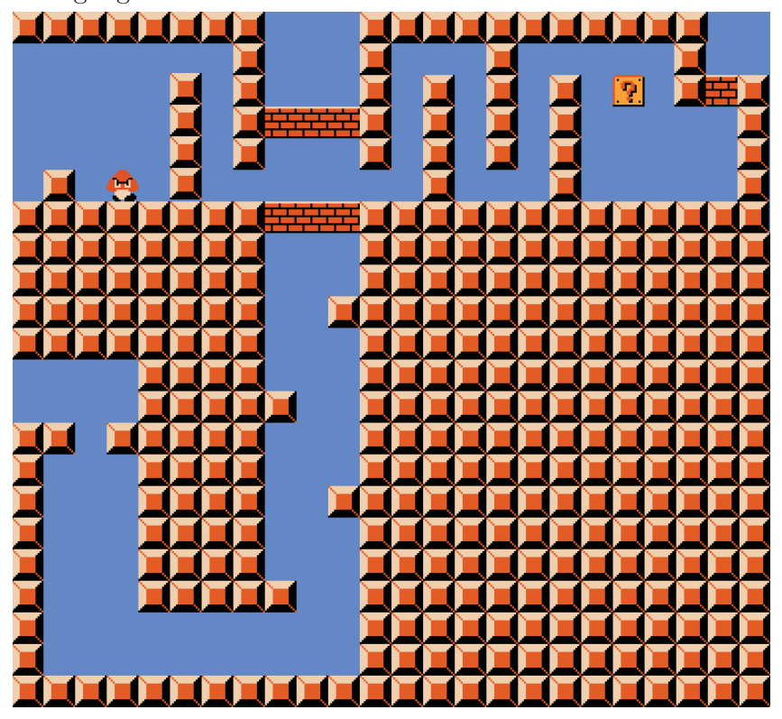

<!-- ===== PDF p1 ===== -->

<span style="color:#c0392b">**讲次 16（Lecture 16）：NP 完全性（NP-Completeness）**</span> <span style="color:#7f8c8d;">（Spring 2015，2015 春季学期）</span>

本讲将讨论 **NP 完全性（NP-Completeness）**。本讲大纲如下：

- **NP 困难性与 NP 完全性（NP-hardness and NP-completeness）**
- **3SAT**
  - **Super Mario Brothers**（超级马里奥兄弟）
  - **三维匹配（3 Dimensional Matching, 3DM）**
    - **子集和（Subset Sum，弱 weak）**
      - **划分（Partition，弱）**
        - **矩形装箱（Rectangle Packing，弱）**
    - **4-Partition（强 strong）**
      - **矩形装箱（Rectangle Packing，强）**
        - **拼图（Jigsaw Puzzles）**

<span style="color:#c0392b">**NP 困难问题与 NP 完全问题（NP-Hard and NP-Complete problems）**</span>

今天，我们讨论 NP 完全性。回顾 **6.006** 中的内容：

- **P** = 可在**多项式时间（polynomial time）**内求解的问题集合。若问题规模为 $n$，该问题应在 $n^{O(1)}$ 内求解。
- **NP** = 可在**非确定性多项式时间（nondeterministic polynomial time）**内求解的**判定问题（decision problems）**集合。这些问题的输出是 YES 或 NO 答案。**非确定性（Nondeterministic）**指的是：一个解可以从**多项式多个选项**中在 $O(1)$ 时间内被**猜出（guessed）**。如果**任意一个猜测**是 YES 实例，那么非确定性算法就会做出那个猜测。

在这种非确定性模型中，我们可以假设**所有猜测都先完成**。这等价于：为 YES 答案寻找一个**多项式时间的验证器（verifier）**，接受**多项式规模的证书（certificates）**。注意，**YES 输入与 NO 输入之间存在不对称性（asymmetry）**。

- 一个问题 $X$ 是 **NP 完全的（NP-complete）**，当且仅当 $X \in NP$ **且** $X$ 是 NP 困难的（NP-hard）。

> <span style="color:#1e8449;">**[note] Note（译者注）:**</span> 这里把 6.006 的 P/NP 定义**形式化**了：P 要求 $n^{O(1)}$（任何常数次多项式都算），NP 则允许「**先猜后验**」——算法可以先用 $O(1)$ 时间从多项式多个候选中「猜」一个解，再在多项式时间里验证。**关键洞见**（讲义下一句）：把所有猜测移到最前面之后，非确定性算法就变成一个「**验证器 + 证书**」对——certificate（证书）就是那串猜测（如一组变量的赋值），verifier（验证器）在多项式时间内检查它是不是合法解。这解释了为什么 NP 以 **decision problem（判定问题）** 为定义：证书验证的对象只能是有明确答案的问题。
>
> 🎥 *Devadas 开场的口头禅*："Polynomial good exponential bad."（翻译：多项式好，指数坏。）注意「若任意猜测为 YES 就选择该猜测」意味着 NP 只承诺「YES 实例有证书」；对 NO 实例，可能根本没有多项式规模的证书可给。
>
> 先把「猜」的因果链拆开。nondeterministic（非确定性）算法的形态是：每一步有若干个合法分支，只要**存在**一条分支走到接受状态，整个算法就判 YES。把这条路径上的分支选择按时间顺序排成一串比特，就得到一次完整的猜测序列；它受运行步数限制，而步数被限定在多项式内，所以这串比特也是多项式长。于是「存在一条接受路径」这句话，可以原封不动地改写成「存在一个多项式长度的字符串，交给确定性的检查程序，检查程序在多项式时间内回答接受」。前一句的存在量词关于路径，后一句的存在量词关于字符串，一一对应，谁也没有多出力量。这就是「猜」不算作弊的理由：猜到的字符串一旦被写下来，谁拿它去验都能独立复核，不必相信猜的人。反过来，若某个猜测必须依赖前面验证的中间结果，它就不是「先猜后验」的形态，这个等价立刻失效——这正是定义强调「所有猜测都先完成」的原因。
>
> 接着看定义为什么锁死在 decision problem（判定问题）上。certificate（证书）的语义是「这个实例的答案是 YES，这就是证据」，它必须能被一个谓词检验成真或假。若原问题是优化问题（如问「最短路径有多长」），证书就得是一整条路径外加一份最优性证明；改成判定版本「是否存在长度不超过 $k$ 的路径」之后，证书退化成一条具体路径，验证只需沿路径累加边长并与 $k$ 比较，线性时间即可。NP 完全性理论的全部传递性都建立在「同一个实例集合被判成 YES 或 NO」之上，答案一旦是多值的，归约的保答案条件就写不出来。
>
> 最后是 asymmetry（不对称性）。NP 只承诺 YES 一侧有短证书：给出一个满足赋值，就能把 3SAT 的 YES 钉死。而对 NO 一侧，我们能给出的最自然证据是「所有赋值都不满足」，那是一份指数长的清单。这并非聪明是否够用的问题，而是定义本身没有为 NO 提供结构——把 NP 的定义逐字取反，得到的不是 NP 的补，而是一个新的类 coNP（补类），至今没有人证明 NP 与 coNP（补类）相等。
>
> 代个数看看这条分界线有多硬。取 $n = 100$ 个变量、$m = 400$ 条子句的 3SAT 实例。暴力判定要枚举 $2^{100} \approx 1.27 \times 10^{30}$ 种赋值，每种扫 400 条子句，约 $5.1 \times 10^{32}$ 次子句检查；设机器每秒做 $10^{9}$ 次，需要 $5.1 \times 10^{23}$ 秒，约 $1.6 \times 10^{16}$ 年，而宇宙年龄约 $1.4 \times 10^{10}$ 年，差六个数量级。反过来，若有人把一组赋值递给你，验证只需 400 次子句检查，在每秒 $10^{9}$ 次的机器上是 $4 \times 10^{-7}$ 秒。同一个实例，求解与验证的成本比约为 $10^{30}$，这个比值就是「P 与 NP 之间那条没人跨过去的沟」在具体数字上的样子。
>
> 跨课程连接：CSAPP 第 6 章讲 cache（缓存）时，命中与不命中本身就是一个 decision problem（判定问题）——给出地址，判它的 tag（标记）是否在块里；而「设计一个让所有访问都命中的替换策略」则是求解，两者难度完全不同，这与此处的「检查易、寻找难」是同一副骨架。区别在于 cache（缓存）的判定只需常数次比较，而 3SAT 的判定在规模上是线性、求解是指数。
>
> 一句话收束：非确定性不是一台更快的机器，而是一种记账方式——它把「找到解」的成本记在猜的一侧，把「确认解」的成本记在验的一侧；复杂度理论只对后一侧收费，因为只有后一侧能被写成多项式。

> <span style="color:#1e8449;">**[note] Note（译者注，P vs NP）:**</span> 「P 是否等于 NP」是理论计算机科学**最重要且尚未解决**的问题，也是 Clay 数学研究所 Millennium Prize Problems（千禧年七大难题）之一（奖金 100 万美元，与庞加莱猜想、黎曼猜想并列）。直觉上问的是：**能快速验证答案的问题，是否一定能快速求解**？
>
> 把这句话拆成量词就看清楚了。一个问题在 NP 里，意味着存在一个多项式长的 certificate（证书）使 verifier（验证器）通过；在 P 里，意味着一个确定性算法能直接算出答案，不让任何人猜。所以 P = NP 的断言是：凡「存在短证书」可判的，都有「直接构造」的判定程序。这两类量词的强度本来不同——存在量词允许你跳过构造直接检查，构造量词要求你一步步写出来——P 与 NP 之争就是在问，这种强度差是否真实存在。
>
> 若 P $\neq$ NP（绝大多数人相信如此），后果立刻落到工程上：public-key cryptography（公钥密码学）的安全性就架在这条沟上。RSA 的困难性假设是「大整数分解没有多项式算法」，而分解在 NP 里——给两个因子就是证书，验一次乘法即可——所以只要分解真是 NP 完全的，P $\neq$ NP 就意味着分解无法被快速求解。反过来，P = NP 会让所有建立在 one-way function（单向函数）上的协议一夜之间失去依据。这也是为什么这个问题值一百万美元：它不是一个学术谜题，而是整座密码学大厦的地基是否牢靠的问题。
>
> 普遍相信 P $\neq$ NP，主要靠两条证据。第一条是经验的：几十年来无数人对成千上万个 NP 完全问题找多项式算法，一个都没找到，而这些问题的形态千差万别（图上的、数上的、几何的），同时全军覆没很难用运气解释。第二条是结构的：所有 NP 完全问题通过 reduction（归约）连成一张网，只要其中一个掉进 P，整张网都掉进 P；这种「一荣俱荣」的拓扑让「它们全部偶然变易」变得极不可信。
>
> 但相信不等于证明，并且我们已经知道有两条路走不通。第一条叫 relativization（相对化）障碍，来自 Baker、Gill 与 Solovay 1975 年的结果：存在谕示 A 使 P$^{A}$ = NP$^{A}$，也存在谕示 B 使 P$^{B} \neq$ NP$^{B}$，而任何只依赖「模拟 + 对角化」的证明技巧在两种谕示下都同样成立，于是它不可能分辨 P 与 NP。第二条叫 natural proof（自然证明）障碍，来自 Razborov 与 Rudich 1994 年的结果：二十世纪八十年代那些成功的 circuit lower bound（电路下界）证明有一个共同骨架——用一个容易判定、且在随机函数上大概率成立的性质把困难函数筛出来；而若这样的性质存在，它本身就能攻破 pseudorandom generator（伪随机生成器），从而使 P $\neq$ NP 与世界相信的密码学假设相冲突。
>
> 代个数感受量级。设多项式算法的常数因子是 $10^{6}$ 次操作，每次 1 纳秒。$n = 60$ 时 $n^{3} \cdot 10^{6} = 2.16 \times 10^{11}$ 次操作，约 216 秒；而枚举 $2^{60} \approx 1.15 \times 10^{18}$ 种可能，每种花 1 纳秒，需要 $1.15 \times 10^{9}$ 秒，约 36.5 年。把 $n$ 提到 200：$200^{3} \cdot 10^{6} = 8 \times 10^{12}$ 次，约 2.2 小时；而 $2^{200} \approx 1.6 \times 10^{60}$ 纳秒，约 $5 \times 10^{42}$ 年，是宇宙年龄的 $3.6 \times 10^{32}$ 倍。一个多项式次数之差，就让两种机器的能力完全失去可比性。
>
> 跨课程连接：CSAPP 第 3 章把程序翻译成指令序列，等于把「程序」变成一张有限的状态转移表；Cook 的证明正是沿着这张表铺开——图灵机的每一步占一行，整条计算历史是一张多项式大小的表格，表格每个格子写成一个布尔变量，约束写成子句，于是一台机器连同它的运行被压成了一个布尔公式。区别在于 CSAPP 关心这张表省不省空间，即 cache（缓存）的局部性；而复杂度理论关心这张表有几个格子，因为格子数就是归约出来的公式规模。
>
> 一句话收束：这个问题与本讲的 reduction（归约）互为表里——reduction（归约）是唯一能把「一个问题难」翻译成「另一个问题也难」的工具，而 P vs NP 是所有这类翻译最终指向的那个未解命题。

---

<!-- ===== PDF p2 ===== -->

<span style="color:#c0392b">**NP 完全性（续）**</span>

- 一个问题 $X$ 是 **NP 困难的（NP-hard）**，如果 **每个** 问题 $Y \in NP$ 都能归约（reduce）到 $X$。
  - 若 $P = NP$，则 $X \notin P$。
- 从问题 $A$ 到问题 $B$ 的**归约（reduction）**是一个**多项式时间算法**，把问题 $A$ 的输入转换为问题 $B$ 的**等价输入**。等价（Equivalent）意味着：对原输入与转换后的输入，问题 $A$ 与问题 $B$ 必须输出**相同的 YES 或 NO 答案**。
  - 若 $B \in P$，则 $A \in NP$
  - 若 $B \in NP$，则 $A \in NP$
  - 若 $A$ 是 NP 困难的，则 $B$ 是 NP 困难的。

我们可以通过以下步骤证明一个问题 $X$ 是 NP 完全的：

1. **证明 $X \in NP$**：通过找出一个非确定性算法来证明 $X \in NP$，或给出一个针对证书的合法**验证器（verifier）**。
2. **证明 $X$ 是 NP 困难的**：从已知的 NP 完全问题 $Y$ 归约到 $X$。这是充分的，因为所有问题 $Z \in NP$ 都能归约到 $Y$，而该归约表明 $Y$ 的输入可以被改造成 $X$ 的输入，从而推出 $X$ 是 NP 困难的。一个**完整的归约（complete reduction）**必须演示以下性质：
   - (a) 给出从 $Y$ 输入到 $X$ 输入的多项式时间转换。
   - (b) 若 $Y$ 的答案是 YES，则 $X$ 的答案是 YES。
   - (c) 若 $X$ 的答案是 YES，则 $Y$ 的答案是 YES。

最后，**图件（gadget）**把一个输入问题中的特征转换为输出问题中的特征。

> <span style="color:#1e8449;">**[note] Note（译者注，归约的三个推论与两处笔误）:**</span> reduction（归约）是整讲的**主轴工具**，它的三条推论把「难易关系」沿归约方向传递：**易则更易**（$B \in P \Rightarrow A \in P$）、**成员性传递**（$B \in NP \Rightarrow A \in NP$）、**难则更难**（$A$ 是 NP 困难 $\Rightarrow B$ 也 NP 困难）。
>
> 先验第一条的机制，因为它是复合算法的算术。若 $A \le_p B$ 且 $B$ 有多项式算法，判 $A$ 的办法是：先花多项式时间把 $A$ 的输入变换成 $B$ 的输入，再在变换后的输入上跑 $B$ 的算法。两段都是多项式，复合仍是多项式。这里有个容易忽略的细节：次数会相乘，而不是取最大。设变换把规模 $n$ 放大到 $n^{2}$，而 $B$ 的算法是三次方，那么在放大后的规模 $n^{2}$ 上要花 $(n^{2})^{3} = n^{6}$ 步，总代价 $n^{2} + n^{6}$，量级 $n^{6}$。取 $n = 1000$，$n^{2} = 10^{6}$，$B$ 那一步要 $10^{18}$ 次操作，设每次 1 纳秒就是 $10^{9}$ 秒、约 31.7 年。这个数字提醒你：多项式并不等于实际能跑，只等于站在理论分界线的内侧。
>
> 现在处理两处**原讲义笔误**。**①** 第一条写的是「若 $B \in P$，则 $A \in NP$」——逻辑上虽然成立（$P \subseteq NP$，故 $A \in P \subseteq NP$），但这种弱化没有信息量；按归约的用途，这里应是想说更强的「若 $B \in P$，则 $A \in P$」。对照后面两条的对称性（一条关于 NP 上界、一条关于 NP 困难下界），第一条显然是少了「$A \in P$」这半句。**②** NP 困难定义下那条「若 $P = NP$，则 $X \notin P$」自相矛盾：若 $P = NP$，则 NP 完全问题 $X \in NP = P$，必有 $X \in P$；正确的表述是「若 $P \neq NP$，则 $X \notin P$」，因为否则 $X \in P$ 会让所有 $Y \in NP$ 通过 reduction（归约）也跟着进 P，反过来逼迫 $P = NP$。
>
> **方向感**要抓牢：我们想证明 $X$ 难，就**从已知难的问题 $Y$ 归约到 $X$**，记作 $Y \le_p X$，让 $X$ 继承 $Y$ 的困难性。方向反了会怎样？举例说：若从 Super Mario 关卡归约到 3SAT，只能得出「马里奥不比 3SAT 难」——而我们早就知道这一点，因为任何 NP 问题都不比 3SAT 难，这句话没有新信息。真正的归约是 3SAT 到马里奥关卡：把公式的每个变量做成一段不可逆的岔路，每个子句做成一道闸门，于是「公式可满足」逼出「关卡可通」，「关卡可通」又逼出「公式可满足」。
>
> 还有一个常被跳过的条件：(a) 要求转换本身是多项式时间。若允许指数时间的转换，reduction（归约）就变成万能工具——你可以用指数时间把 $A$ 的全部实例枚举一遍、把答案预先算好再查表，于是任何问题都能归约到任何问题，NP 困难性立刻失去意义。这条限制不是修饰，而是整个理论的承重墙。
>
> 步骤 (b)(c) 合起来是「$Y$ 有解 $\iff$ $X$ 有解」，保证 reduction（归约）的**双向保答案**。只证 (b) 的失效方式很具体：若 $Y$ 是 YES 而 $X$ 是 NO，一个 YES 实例会被映射成无解实例，归约把可解性丢了；只证 (c) 时反过来，一个 NO 实例会落到 YES 实例上，于是可以借 $X$ 的 YES 伪造 $Y$ 的 YES。只有两侧都堵住，答案才真正等价，这也是每讲归约都要把 (b)(c) 分别写出来的原因。
>
> 跨课程连接：CSAPP 第 2 章讲有符号数与无符号数的相互转换，转换本身保持同一串位、只改变解释规则，这与 reduction（归约）的「保持答案、改变形态」是同一手法；区别在于 CSAPP 的转换是线性时间的逐位重解释，而归约允许把规模放大到多项式次，甚至平方级。
>
> 一句话收束：三条推论不是三条孤立性质，而是同一个复合论证的三个侧面——把「归约 + 求解器」拼起来看，定理就一眼可见。

<span style="color:#c0392b">**3SAT**</span>

3SAT 在 1971 年被 **Cook** 发现是 NP 完全的。

<span style="color:#2471a3;">**[definition]**</span> **定义 1（Definition 1）·3SAT**：给定一个布尔公式，形如

```math
(x_1 \lor x_3 \lor \bar{x}_6) \land (\bar{x}_2 \lor x_3 \lor \bar{x}_7) \land \ldots
```

是否存在对变量取 **True 或 False** 的赋值，使得整个公式求值为 True？

> <span style="color:#1e8449;">**[note] Note（译者注，Cook-Levin 定理）:**</span> 精确的历史是：**Cook（1971）**在论文 *The complexity of theorem proving procedures*（STOC 会议，第 151–158 页）中证明了 Boolean satisfiability（布尔可满足性问题）SAT 是 NP 完全的；**Karp（1972）**随后在 *Reducibility among combinatorial problems*（Plenum，第 85–103 页）中给出 **21 个 NP 完全问题**的清单（含 3SAT、3DM、子集和等本讲主角），并正式引入 polynomial-time many-one reduction（多项式时间多一归约）这一如今的标准概念；两人分别获得 1982 年与 1985 年的 Turing Award（图灵奖）。讲义说「3SAT 由 Cook 在 1971 年发现 NP 完全」在**精神上正确**（Cook 的证明直接适用于 SAT），若想精确，应说「SAT 由 Cook 证明 NP 完全，3SAT 由 Karp 通过 reduction（归约）证明」。这是**第一个**被证明 NP 完全的「自然」问题，被称作 **Cook-Levin 定理**。
>
> 这条定理在方法论上的分量，比它在历史上的名气更大。整讲的归约链条必须有一个起点：若所有 NP 完全性都靠「从别的 NP 完全问题归约过来」来证，那就永远需要一个第一次，而这第一次不能靠归约。Cook-Levin 就是那个第一次——它把「任何 NP 问题」这四个字摊开成一台图灵机，再把图灵机的运行摊开成一个公式，中间不借用任何已有的 NP 完全问题。
>
> 具体做法是搭一张 tableau（格局表）。设那台 nondeterministic（非确定性）图灵机在长度 $n$ 的输入上跑 $T(n)$ 步，纸带上最多用到 $S(n)$ 个格子，工作字母表大小记为 $c$。格局表是 $T \times S$ 的二维网：第 $t$ 行第 $s$ 列存「第 $t$ 步时第 $s$ 个格子的符号」，另加一个「读写头在哪里」的标记。然后给每个格子配一组布尔变量，把三件事写成子句：第一，每格至少有一个符号、至多一个符号；第二，相邻两行必须符合转移函数——若第 $t$ 步读写头在某格，则第 $t+1$ 行该格及其左右邻居的取值被转移表唯一决定；第三，第一行必须是输入，最后一行必须处于接受状态。三组约束全是局部的，每条都能写成常数长度的子句，于是子句数是 $O(T \cdot S)$，变量数是 $O(T \cdot S \cdot c)$。因为 $T$ 与 $S$ 都是 $n$ 的多项式，整份公式也是 $n$ 的多项式，归约的规模条件由此成立。
>
> 代个数。取 $T(n) = n^{2}$、$S(n) = n$、$c = 10$，$n = 100$：格局表有 $10^{4} \times 100 = 10^{6}$ 个格子，变量约 $10^{7}$ 个，子句约 $10^{7}$ 条。生成这样一份 3SAT 实例，在每秒写 $10^{8}$ 条子句的机器上要 0.1 秒；而要判定它，暴力要枚举 $2^{10^{7}}$ 种赋值，这个数有三百多万位十进制数字。归约的意义正在这里：它把「证明这台机器接受某输入」这件无从下手的事，换成「解一个具体规模的公式」这件规模可数的事，难度没有消失，只是被完整地搬运过去。
>
> Levin 在 1973 年（俄文原稿更早，1971 年已成文）独立得到同一结论，定理因此冠两人的名字。跨课程连接：CSAPP 第 3 章把一行 C 代码翻译成指令序列，本质是把「程序」展开成「机器状态的时间序列」；tableau（格局表）正是这条序列的数学版本，只是把寄存器与内存统一成了纸带格子。区别在于 CSAPP 关心序列有多长（处理器性能），而 Cook 关心序列有多宽——格子的总数决定了公式的规模，也就决定了 reduction（归约）是不是多项式。
>
> 一句话收束：Cook-Levin 给的不是一个具体问题的答案，而是一把尺子——有了这把尺子，Karp 的 21 个问题才可能被逐个量出来，归约之网才可能从一点长成一片。

---

<!-- ===== PDF p3 ===== -->

<span style="color:#c0392b">**3SAT（续）**</span>

我们注意到，一个**文字（literal）**形如 $\{x_i, \bar{x}_i\}$，文字的两种形式都对应同一个变量 $x_i$。一个**子句（clause）**由 **3 个文字的 OR** 组成，一个**公式（formula）**是子句的 **AND**。

**3SAT ∈ NP**，因为我们可以为证书创建一个验证器。对 3SAT 的一个给定实例，一个证书对应每个变量的一组赋值列表，验证器可以计算该实例是否被满足（即能否求值为真）。因此验证器是多项式时间的，证书是多项式长度的。

重要的是要注意：这个验证器**只保证一个 3SAT 实例是可验证的（verifiable）**。要确保一个 3SAT 实例**不可**验证（即答案应为 NO），算法必须检查**每一个**变量赋值——这无法在多项式时间内完成。

**3SAT 也是 NP 困难的**。我们给出这个结论的一些直觉。考虑 NP 中的任意问题。因为它属于 NP，存在一个求解该问题的非确定性多项式时间算法，或一个检查解的验证器。验证器是一个算法，可以**实现为一个电路（circuit）**。现在，这个电路由 **AND、OR 和 NOT** 门组成，可以表示为一个公式。这个公式可以转换为 3SAT 形式（每个子句有 3 个文字），且与原公式等价。因此 NP 中的所有问题都可以转换为 3SAT，原问题的输入与转换后 3SAT 的输入等价，故 3SAT 是 NP 完全的。

> <span style="color:#1e8449;">**[note] Note（译者注，验证器直觉）:**</span> 「3SAT ∈ NP」的 verifier（验证器）很朴素：certificate（证书）就是一组赋值（$x_1 = \text{T}, x_2 = \text{F}, \ldots$），verifier（验证器）逐个子句检查「是否至少有一个文字为真」——线性时间完成。为什么这样就是 NP？因为 nondeterministic（非确定性）算法可以**先猜**这组赋值（猜 $O(n)$ 个比特），再跑这个 verifier（验证器）；若存在一组能通过的赋值，非确定性猜测保证会选到它。
>
> 🎥 *Devadas 用「朋友证明」的比喻讲透了验证与求解的区别*："Your friend claims this 3SAT formula is satisfiable... they give you the guesses. And then you don't have to be convinced that those are the right guesses, you can check that it's the right guess. You can compute this formula in linear time."（翻译：你朋友声称这个 3SAT 公式可满足……他把猜测给你，你不必先相信这些猜测是对的，而是可以检查它是不是对的——在线性时间内算出这个公式。）
>
> 机制上，这条承诺依赖两个界限。第一，certificate（证书）的长度必须是多项式的：verifier（验证器）要在多项式时间内读完它，如果证书本身指数长，读都读不完，验证就不成立。第二，verifier（验证器）必须真的只用证书与实例，不能偷看别的东西——否则「验证」就退化成「自己重算一遍」，P 与 NP 的区分随之消失。这两条把 NP 钉在一个很窄的位置上：它比 P 宽，宽在允许另一个人先把答案告诉你；它比「什么都能验」窄，窄在只对 YES 承诺。
>
> 不对称的后果值得单独说一遍。coNP（补类）里的问题要求 NO 实例有短证书，例如「这个公式不可满足」——目前已知的最短形式就是列出全部 $2^{n}$ 种赋值逐一否证，没有更紧凑的写法。于是「可满足」与「不可满足」这两个看起来对称的问题，在证书尺度上一个短、一个长。这解释了为什么 NP 与 coNP（补类）是否相等至今未决：若相等，每个 NO 实例也该有一份短证书，而我们连它长什么样都想象不出来。
>
> 还有一个常被误读的点：verifier（验证器）不能先知道答案再反推。给定实例与一组赋值，检查很快；给定实例，反推那组赋值没有任何已知捷径——这正是「求解」与「检查」的分野，也是算法课把优化问题改写成判定问题时真正保留的东西：不是答案本身，而是答案可被独立检验的结构。
>
> 代个数。取 $n = 30$ 个变量、$m = 120$ 条子句的 3SAT 实例。暴力判定要做 $2^{30} \approx 1.07 \times 10^{9}$ 组赋值，每组扫 120 条子句，约 $1.29 \times 10^{11}$ 次子句检查；每秒 $10^{9}$ 次的话要 129 秒。验证一侧：拿一组赋值，扫 120 条子句、每条最多看 3 个文字，最多 360 次比较，在每秒 $10^{9}$ 次的机器上是 $3.6 \times 10^{-7}$ 秒。比值约 $3.6 \times 10^{8}$——仅仅 30 个变量，验证就已经比求解快三亿倍；把 $n$ 提到 100，这个比值会跳到 $10^{30}$ 量级。
>
> 跨课程连接：6.042J 讲数理逻辑时区分过「证明」与「检查证明」——前者需要灵感，后者只是一个机械的真值计算；NP 正是把这条区分搬到了算法世界，把「灵感」交给猜测、把「检查」写成 verifier（验证器）。区别在于 6.042J 的证明是给人读的符号串，长度不受限；NP 的 certificate（证书）必须是多项式长的字符串，要能被机器在多项式时间内读完。
>
> 一句话收束：verifier（验证器）之所以成为 NP 的定义性工具，是因为它把一个关于「存在」的陈述变成了一段任何人都能重放的检查过程。

> <span style="color:#1e8449;">**[note] Note（译者注，NP 困难直觉 = Cook-Levin 核心）:**</span> 这一段「NP 困难」的直觉其实是 **Cook-Levin 定理证明的骨架**，三步分别是 circuit（电路）化、公式化与 3-化，每一步都是对前一步的一次压缩：把「运行」压成「门」，把「门」压成「子句」，把「长子句」压成「三个文字」。
>
> 第一步的合法性来自一个事实：verifier（验证器）是一段多项式时间的程序，而任何多项式时间的程序都能展开成一个多项式大小的 boolean circuit（布尔电路）——每个基本运算（比较、加法、与、或）对应几个 gate（门），控制流展开成选择器。这一步之所以成立，是因为程序的执行步数有多项式上界，而每一步能碰到的数据量有界，所以展开出的 gate（门）数也有多项式上界。
>
> 第二步把 circuit（电路）翻译成 formula（公式）：给每个 gate（门）的输出引一个变量，再为每个 gate（门）写一组 clause（子句），约束「输出等于输入的组合」。以与门为例，输出 $o = a \wedge b$ 等价于三条子句 $(a \vee \bar{o}) \wedge (b \vee \bar{o}) \wedge (\bar{a} \vee \bar{b} \vee o)$：前两条说「任一输入为假则输出为假」，第三条说「两输入为真则输出为真」。这种逐个 gate（门）建约束的写法叫 Tseitin 编码，关键好处是每个 gate（门）只产生常数条 clause（子句），整份公式的规模与 circuit（电路）同阶，不会爆炸。
>
> 第三步把每条 clause（子句）压到三个 literal（文字）以内。长度为 $k > 3$ 的 clause（子句）不能直接切成每三个一组，那样会丢掉「至少一个为真」的语义。正确做法是引入 $k-3$ 个 auxiliary variable（辅助变量）$y_1, \ldots, y_{k-3}$，写成 $(l_1 \vee l_2 \vee y_1) \wedge (\bar{y}_1 \vee l_3 \vee y_2) \wedge \ldots \wedge (\bar{y}_{k-3} \vee l_{k-1} \vee l_k)$。验一下：若某个 $l_i$ 为真，把 $y_1, \ldots, y_{i-2}$ 全设假、其后的全设真，每条 clause（子句）都被满足；反之若所有 $l_i$ 为假，则每条 clause（子句）都要求「前一个 $y$ 假则后一个 $y$ 真」，链条一路传下去，末条要求 $y_{k-3}$ 为真、首条要求 $y_1$ 为假，全部条件同时无解。auxiliary variable（辅助变量）不引入新解，只把长 clause（子句）切短，satisfiability（可满足性）因此被完整保留。
>
> 算一下规模。取 $k = 5$ 的 clause（子句）$(l_1 \vee l_2 \vee l_3 \vee l_4 \vee l_5)$：需要 $5-3 = 2$ 个 auxiliary variable（辅助变量）$y_1, y_2$，产出 $5-2 = 3$ 条三 literal（文字）的 clause（子句）：$(l_1 \vee l_2 \vee y_1)$、$(\bar{y}_1 \vee l_3 \vee y_2)$、$(\bar{y}_2 \vee l_4 \vee l_5)$。再取一个含 1000 个 gate（门）、每个 gate（门）两个输入的 circuit（电路）：变量数约 1000 加输入个数，每个 gate（门）的约束产出 3 条 clause（子句），共约 3000 条，生成时间与输出规模都是 $O(1000)$。
>
> 反方向的规律是：压得越短不一定越难。若把 clause（子句）压到两个 literal（文字），得到的 2SAT 反而落在 P 里——它等价于一张蕴含图上的强连通分量检查，用 Tarjan 算法线性时间可解。3 是这条难易曲线的拐点：三个 literal（文字）的表达力足够编码任意 circuit（电路），两个就不够。这也是整门课从 3SAT 出发而不是从 2SAT 出发的原因。
>
> 跨课程连接：CSAPP 第 4 章用 HCL（硬件控制语言）描述处理器，一句 `bool eq = (a && b) || (!a && !b);` 就是一条门级电路，与本处的 circuit（电路）是同一个对象；区别在于 CSAPP 关心 gate（门）延迟与时钟周期，Cook 关心 gate（门）的个数——因为个数就是公式规模，而规模必须是多项式，reduction（归约）才成立。
>
> 一句话收束：三步压缩的本质是把「计算」翻译成「约束」——gate（门）是计算的原子，clause（子句）是约束的原子，而 3SAT 恰好是约束的最简形式，于是任何计算都能被问成「这组约束有解吗」。

---

<span style="color:#c0392b">**Super Mario Brothers**</span>

[Aloupis, Demaine, Guo, Viglietta 2014]

我们通过给出一个从 3SAT 的归约来证明 **Super Mario Brothers 是 NP 困难的**。这个版本的 Super Mario Brothers 被**推广到任意的 $n \times n$ 屏幕大小**，因此我们去掉对屏幕上物品数量的限制。我们有如下问题定义：

<span style="color:#2471a3;">**[definition]**</span> **定义 2（Definition 2）·Super Mario Brothers**：给定一个 Super Mario Brothers 的关卡，我们能**进入下一关**吗？

因为我们从 3SAT 归约，给定一个 3SAT 实例，我们必须生成一个与该 3SAT 实例对应的 Super Mario Brothers 关卡。

我们通过为 3SAT 公式中的**每个变量构造图件（gadget）**来构造关卡，如图 1 所示。Mario 从岩架上跳下，**无法跳回**。他可以选择向左或向右落下，分别对应把该变量赋值为 **True 或 False**。关卡的其余部分被设计成**这个选择无法被撤销**。

我们还为子句创建如下**图件**。在为给定变量选择赋值后，Mario 会访问所有具有相同文字值的子句图件，

---

<!-- ===== PDF p4 ===== -->

**图 1（Figure 1）**：Super Mario Brothers 的图件。



> <span style="color:#7f8c8d;">[图注说明] 原页附图（© Nintendo. All rights reserved）：Super Mario Brothers 的三个图件——(a) 变量图件（variable gadget）：Mario 从高处跳下、落入一个不可逆的选择通道，向左 = False、向右 = True；(b) 子句图件（clause gadget）：进入后可释放一颗星星；(c) 交叉图件（crossover gadget）：两条通道交叉而不连通，防止 Mario 在非允许处切换图件。</span>

> <span style="color:#7f8c8d;">© Nintendo. All rights reserved. 此内容被排除在我们的 Creative Commons 许可之外。更多信息见 http://ocw.mit.edu/fairuse。</span>

<!-- ===== PDF p5 ===== -->

<span style="color:#c0392b">**Super Mario Brothers（续）**</span>

然后移动到下一个变量图件。通过访问一个子句，Mario 可以**释放一颗星星（star）**。最后，在访问完所有变量图件后，Mario 必须**重新穿过**子句图件。如果该子句图件之前被访问过，就会有一颗星星可用，他可以穿过火焰；否则，他将无法穿过该子句图件而**死亡**。

因此，**通关等价于在第二遍穿过所有子句图件**。Mario 只有在这些子句都**被某个变量赋值满足**的情况下，才能穿过所有子句图件。遍历各个变量图件的动作对应于 3SAT 公式的解，所以如果 Mario 能通关，我们就有了 3SAT 问题的解。

最后一个需要的图件是**交叉图件（crossover gadget）**。它确保 Mario **不会在不允许的情况下**在变量图件与子句图件之间切换。所有这些图件的总大小都在归约所需的**多项式规模**内。

因此，**Mario 能通关，当且仅当**原来的 3SAT 公式可满足。于是我们从 3SAT 完成了归约，**Super Mario Brothers 是 NP 困难的**。

> <span style="color:#1e8449;">**[note] Note（译者注，Super Mario 归约的设计哲学）:**</span> 这个归约是「用游戏机制实现约束满足」的范例，三种 gadget（图件）各司其职：variable gadget（变量图件）负责选值——不可逆的下落等于一旦选定无法反悔；clause gadget（子句图件）负责检查——第一遍访问时释放一颗 star（星星）；crossover gadget（交叉图件）负责布线——让两条通道相交而不连通。
>
> 🎥 *Devadas 在现场画图讲变量图件*："Here's Mario... Once Mario is down here, if you check the jump height, you cannot get back up to here. So this is like a one way. Once you're down here, you have a choice: should I fall to the left or fall to the right?"（翻译：这是 Mario……一旦他落到这里，你检查跳跃高度就会发现他跳不回上面——这是单向的。落到这里后他要选择：往左掉还是往右掉？）——「单向 + 二选一」正是布尔变量的几何化身。
>
> 「第二遍穿越」是这里最关键的机制。第一遍 Mario 只能访问与当前赋值同向的子句入口，每访问一个就点亮一颗 star（星星）；第二遍要从头到尾穿过所有子句图件，只有点亮的入口才能过火。这一步把「所有子句各自为真」这个合取式变成了物理约束：任何一条子句没被点亮，对应闸门就关着，Mario 死在那里。为什么必须两遍而不是一遍？一遍的话 Mario 走完全程就结束了，无法强制「所有子句都被覆盖」；两遍让他必须先把赋值全部选完、再去验收，顺序与 3SAT 的语义完全对齐。
>
> 算一下规模。取 $3$ 个变量、$2$ 条子句的公式，例如 $(x_1 \vee x_2 \vee \bar{x}_3) \wedge (\bar{x}_1 \vee x_2 \vee x_3)$。每个 variable gadget（变量图件）约 $20 \times 20 = 400$ 格，3 个共 1200 格；每个 clause gadget（子句图件）约 $10 \times 10 = 100$ 格，2 个共 200 格；变量与子句最多 $3 \times 2 = 6$ 个交叉位置，每个 crossover gadget（交叉图件）约 400 格，共 2400 格。总规模约 3800 格，全部可在 $O(n \cdot m)$ 时间内画出。放大到 $n = 100$、$m = 400$：交叉位置 $4 \times 10^{4}$ 个，每处 400 格就是 $1.6 \times 10^{7}$ 格，仍是多项式，reduction（归约）合法。
>
> 为什么必须有 crossover gadget（交叉图件）？因为变量与子句的连接关系是一张任意图——每个变量要连到它出现的每一条子句，而这张图一般不平面。若关卡只能提供平面布线，两类图件就无法无交叉地摆放，信号会串。crossover gadget（交叉图件）用两条通道交错叠放的办法绕开限制：Mario 从 A 通道进入只能从 A 通道出去，从 B 进入只能从 B 出去，无法中途换线。它把「平面画不出」变成「平面画得出」，代价是常数倍格数。
>
> 这种封装还带来一个可算的后果：每个 gadget（图件）只通过固定的几个出入口与外界交互，总规模就是各部分的线性组合。设每个 variable gadget（变量图件）占 $v$ 格、每个 clause gadget（子句图件）占 $c$ 格、每个 crossover gadget（交叉图件）占 $x$ 格，则总格数为 $n v + m c + n m x$，对 $n$ 与 $m$ 都是多项式。取 $v = 400$、$c = 100$、$x = 400$、$n = m = 100$：得到 $40000 + 10000 + 4 \times 10^{6}$，约 $4 \times 10^{6}$ 格，秒级即可生成。
>
> 跨课程连接：CSAPP 第 6 章讲 cache（缓存）时，一次写会使命中行失效，之后必须回内存重取——这种「一次性消费」的语义与这里的 star（星星）完全同构：星只能放一次，放完就记为已访问。区别在于 cache（缓存）的失效由别的处理器被动触发，而这里的失效由 Mario 的行走路线主动决定，而路线本身就是那组赋值。
>
> 一句话收束：关卡不是比喻，它就是那份 3SAT 公式的另一种写法——玩家在屏幕上做的每个选择，逐字对应一个变量的取值。

<span style="color:#c0392b">**三维匹配（3 Dimensional Matching, 3DM）**</span>

<span style="color:#2471a3;">**[definition]**</span> **定义 3（Definition 3）·3DM**：给定两两不相交（disjoint）的集合 $X$、$Y$、$Z$，各含 $n$ 个元素，以及三元组集合 $T \subseteq X \times Y \times Z$，是否存在子集 $S \subseteq T$，使得 $X \cup Y \cup Z$ 中的**每个元素**恰好出现在 $S$ 中**一个**三元组 $s \in S$ 里？

**3DM ∈ NP**：给定一个证书（列出候选的三元组列表），验证器可以检查每个三元组都属于 $T$，且 $X \cup Y \cup Z$ 的每个元素恰好在一个三元组中。

**3DM 也是 NP 完全的**，通过一个从 3SAT 的归约。我们为变量和子句构造图件。

变量 $x_i$ 的**变量图件**如图所示。只能选择**红色或蓝色**三角形：红色三角形对应真文字（true literal），蓝色三角形对应假文字（false literal）。否则，就会出现重叠，或某些内部元素无法被覆盖。每个变量图件有一个「**$2n_{x_i}$ 轮（wheel）**」，其中 $n_{x_i}$ 对应 $x_i$ 在公式中的**出现次数**。

子句 $x_i \land \bar{x}_j \land x_k$ 的**子句图件**如图所示。子句图件中每个变量三角形内**不共享的点（dot）**，也是该变量图件中的**单个点**。

> <span style="color:#7f8c8d;">[原图说明] 原页正文引用了 3DM 的变量图件与子句图件配图（原文标注「displayed in the picture」），但重排版 PDF 中未包含这些图（仅 p4 的 Super Mario 图件有实际图片）。以下翻译保留文字描述，图形请参照原始视频/讲义。</span>

那么，如果我们将 $x_i$ 设为真，就取走变量图件中**所有红色假三角形**，留下一个**蓝色真三角形**用于覆盖子句图件。然而，这仍可能留下 $\bar{x}_j$ 和 $x_k$ 未被覆盖，所以我们需要一个**垃圾回收（garbage collection）图件**，如下图所示。这种图件有 $\sum_x n_x$ 个，因为有 $n_x$ 个变量图件中**多余的元素**将不会被覆盖。然而，在剩余元素中，每个子句会覆盖其中一个，因此剩余的需要用**垃圾回收子句**来覆盖。

---

<!-- ===== PDF p6 ===== -->

<span style="color:#c0392b">**3DM（续）**</span>

因此，如果 3SAT 公式存在一个解，我们可以通过选择 3DM 中与变量值对应的点来找到 3DM 问题的解。如果我们有一个 3DM 解，我们可以把它映射回 3SAT 的满足赋值。因此，我们的归约是完整的，**3DM 是 NP 困难的**。

> <span style="color:#1e8449;">**[note] Note（译者注，3DM 图件的三角结构）:**</span> 3DM 的归约展示了「选择 + exact cover（精确覆盖）」这个模板，而它与你在 6.042J 学过的二分图匹配只差一个维数——这个差别正是本讲最锋利的一刀。
>
> 变量图件用红蓝三角形二选一编码真与假。核心是那个 wheel（轮）：变量 $x_i$ 的 wheel（轮）有 $2n_{x_i}$ 个顶点，其中 $n_{x_i}$ 个代表它作为正文字出现的位置、$n_{x_i}$ 个代表它作为负文字出现的位置。为什么必须成对？因为 3DM 要求每个元素**恰好**被覆盖一次：若只给 $n_{x_i}$ 个顶点，那么无论选真还是选假都会留下一个「无主顶点」，它只有一种覆盖方式，这个变量就没有选择了；给 $2n_{x_i}$ 个顶点，选真恰好覆盖正侧、留下负侧，选假恰好反过来，两侧都有东西剩下，选择才是自由的。留下的那一半也不是白留的，它们必须被子句图件或垃圾图件吃掉，这就把「哪一个文字为真」的信息传递到了子句。
>
> 子句图件用共享点把三个文字连起来：只要该子句里有一个文字对应的变量赋值「留下了它的点」，这个点就能被子句图件的一个三角形覆盖。这是合取式在集合语言里的等价形式——「至少一个文字为真」翻译成「至少一个点被留下」。
>
> **垃圾回收**图件处理的是一笔账。设变量总出现次数 $\sum_i n_{x_i} = N$，则变量侧共贡献 $2N$ 个内部顶点；无论怎么选，变量三角形恰好覆盖 $N$ 个，剩 $N$ 个必须被后续图件吃掉。每条子句至多吃掉一个点，所以子句至多贡献 $m$ 次覆盖，剩下的 $N - m$ 个只能由垃圾图件补。取 $N = 6$、$m = 4$：子句吃掉 4 个，垃圾补 2 个。账不平就没有完美覆盖——这正是归约正确性的全部内容。
>
> 还有一点容易被忽略：exact cover（精确覆盖）要求「恰好一次」，而 3SAT 只要求「至少一个文字为真」，这两个量词怎么对上？靠的是点数守恒——若某个点被覆盖两次，说明同一个元素被两个三元组同时用掉，总账立刻超出，覆盖就不成立。所以「恰好一次」在这里不是额外的强条件，而是「选出的三角形互不重叠」的自然表达，与「每条子句至少有一个真文字」是同一件事的两面。
>
> 跨课程连接：6.042J 里的二分图 perfect matching（完美匹配）在 P 里，用增广路径反复翻转交错路即可，$n$ 个顶点、$m$ 条边的图做到 $O(nm)$；而三分图的完美匹配是 NP 完全的。为什么多一维就跳档？二维的增广路径论证依赖「交错路首尾相接可以整体翻转」这个局部修复动作，而三维的三角形没有这样的翻转结构，你无法局部修补一个冲突而不破坏别处。这条「二维可翻、三维不可翻」的界线，比任何公式都更能说明 3DM 为什么难。
>
> 一句话收束：这套「变量选边、子句验证、垃圾回收」与 Super Mario 的「变量图件、子句图件、交叉图件」是同一个模板的两种外壳，学会一种就看见另一种。

<span style="color:#c0392b">**子集和（Subset Sum）**</span>

<span style="color:#2471a3;">**[definition]**</span> **定义 4（Definition 4）·Subset Sum**：给定 $n$ 个整数 $A = \{a_1, a_2, \ldots, a_n\}$ 和一个目标总和 $t$，是否存在子集 $S \subseteq A$ 使得

```math
\sum_{a_i \in S} a_i = t
```

**子集和问题是 NP 完全的**。它属于 NP，因为验证器只需在多项式时间内检查给定的子集是 $A$ 的子集且其总和等于目标值。

它通过一个从 **3DM** 的归约证明是 NP 困难的。把数字看作以 **$b = 1 + \max_i n_{x_i}$** 为基数的表示。那么三元组 $(x_i, x_j, x_k)$ 可以写成基 $b$ 下的形式 $000100100001000 = b^i + b^j + b^k$，其中第一个 1 对应 $i$，第二个对应 $j$，第三个对应 $k$。目标总和

```math
t = 111111111111111 = \sum_i b^i
```

这防止任何 1 发生**碰撞（colliding）**，从而确保每个元素恰好被使用一次：多个 1 对应「重复使用某个元素」，而基数足够大，使得没有更小的数字之和能拼出下一个 $b$ 的幂。这完成了归约。

事实上，**子集和问题只是弱 NP 困难的（weakly NP-hard）**。$t$ 的位数是 $O(n)$。这意味着归约中使用的数字的值是**输入的指数级**，使该问题成为弱 NP 困难的。**强 NP 困难（strongly NP-hard）**的问题必须只使用输入规模**多项式**大小的数值。

这也意味着该问题可以用**伪多项式（pseudopolynomial）算法**求解。

> <span style="color:#1e8449;">**[note] Note（译者注，基 b 编码与弱 NP 困难）:**</span> 3DM 到子集和的 reduction（归约）本质是「用大数编码选择」：每个元素（3DM 中 $X \cup Y \cup Z$ 的每个点）占据一个 base（基数）$b$ 下的一个数位，每个三元组变成一个「在三个位上各放一个 1」的数，目标是「所有位都是 1」的数 $\sum_i b^{i}$。
>
> 为什么这样编码能保住答案？关键在于加法在 base（基数）表示里是逐位进行的，只要任何一位的和不超过 $b - 1$，就不会发生进位，每一位的账可以独立地看。取 $b = 1 + \max_i n_{x_i}$，其中 $n_{x_i}$ 是元素在全部三元组里出现的最大次数：任一位置上最多叠加 $n_{x_i}$ 个 1，而 $n_{x_i} < b$，所以永远不进位。「每个位上恰好一个 1」于是精确地等价于「每个元素恰好被一个选中的三元组覆盖」，也就是一个 perfect 3DM（完美三维匹配）。如果 $b$ 选择得太小，两个 1 相加就会进位成 $b$，账目会串位，「重复使用同一元素」和「覆盖不同元素」就再也分不开了。
>
> 举个能算到底的小例子。取 $X = \{x_1, x_2\}$、$Y = \{y_1, y_2\}$、$Z = \{z_1, z_2\}$，共 6 个元素，给它们编号 0 到 5，位权分别是 $b^{0}$ 到 $b^{5}$。每个元素在候选三元组里最多出现 2 次，于是 $b = 1 + 2 = 3$。候选集取 $T$ 含 $(x_1,y_1,z_1)$、$(x_2,y_2,z_2)$、$(x_1,y_2,z_2)$、$(x_2,y_1,z_1)$ 四个三元组。前两个对应的数是 $b^{0}+b^{2}+b^{4} = 1+9+81 = 91$ 与 $b^{1}+b^{3}+b^{5} = 3+27+243 = 273$，和恰为 $91 + 273 = 364$，而 $364 = 1+3+9+27+81+243 = \sum_{i=0}^{5} b^{i}$，正是目标值——这就是一个完美匹配。另外两个数为 $1+27+243 = 271$ 与 $3+9+81 = 93$，$271 + 93 = 364$ 同样成立，但它们覆盖的是另外两个三元组组合，说明同一个目标值可以对应多个匹配，这不影响判定，只影响计数。
>
> **weak NP-hard（弱 NP 困难）** 的含义在这里显形：$t$ 的十进制位数只有 $O(n)$ 位（上例 364 只有三位），但它的数值约等于 $b^{n}$，是指数级的大数。位数与数值的差距可以算清楚：若 $n = 100$、$b = 3$，则 $t$ 的位数约为 $100 \times \log_{2} 3 \approx 159$ 位，而它的数值约 $3^{100} \approx 5.2 \times 10^{47}$——只写 159 个字符，就指到了一个 48 位十进制的大数。也就是说，输入长度是 $O(n)$，而数值本身是 $b^{n}$，两者之间隔着一个指数。若把输入改成一进制编码，长度就变成 $b^{n}$，此时多项式时间关于新长度的算法就存在。这正是 pseudopolynomial（伪多项式）算法成立的原因：经典子集和动态规划跑 $O(n \cdot t)$ 步，$t$ 是数值不是位数，所以在一进制下它是多项式，在二进制下它是指数。
>
> 这也说明「弱」并不等于「几乎不难」：它只是说，难度可以被一进制编码稀释掉，而现实输入很少用一进制写。
>
> 跨课程连接：CSAPP 第 2 章反复强调「信息等于位加上解释」，同一串位按无符号数读、按补码读、按浮点数读，得到的值完全不同；这里的 base（基数）$b$ 就是给那串位换一套解释规则，把「位」重新解释成「元素」，把「数位上的取值」解释成「被覆盖了几次」。区别在于 CSAPP 的 base（基数）恒为 2，进位是硬件替你完成的；这里的 base（基数）是人为挑大的，进位的消失才是证明的关键。
>
> 一句话收束：子集和不认识三角形，它只认识数；归约的全部工作就是把三角形翻译成数，并保证翻译过程中没有任何一位信息串到隔壁去。

---

<!-- ===== PDF p7 ===== -->

<span style="color:#c0392b">**划分（Partition）**</span>

<span style="color:#2471a3;">**[definition]**</span> **定义 5（Definition 5）·Partition**：给定 $A = \{a_1, a_2, \ldots, a_n\}$，是否存在子集 $S \subseteq A$ 使得

```math
\sum_{a_i \in S} a_i = \sum_{a_i \in A \setminus S} a_i = \frac{1}{2} \sum_{a_i \in A} a_i
```

**划分问题也是弱 NP 完全的**。它是子集和问题的特例：取 $t = \frac{1}{2} \sum A$。事实上，我们可以把 Partition **归约到** Subset Sum，尽管这不是我们想要的归约方向。

我们可以如下**从 Subset Sum 归约到 Partition**。令 $\sigma = \sum A$。向 $A$ 中添加元素 $a_{n+1} = \sigma + t$ 和 $a_{n+2} = 2\sigma - t$。那么 $a_{n+1}$ 和 $a_{n+2}$ 必须位于划分的**不同两侧**。为了平衡两侧，每侧必须凑到 $2\sigma$：包含 $a_{n+1} = \sigma + t$ 的一侧还需从 $A$ 中凑 $\sigma - t$（即 $A$ 中不选入子集 $S$ 的部分），包含 $a_{n+2} = 2\sigma - t$ 的一侧还需从 $A$ 中凑 $t$。因此如果我们能求解 Partition，也就得到了总和为 $t$ 的元素子集——这正是子集和问题的目标，我们的归约完成。

> <span style="color:#1e8449;">**[note] Note（译者注，Subset Sum → Partition 归约的代数验证）:**</span> 这个归约值得动手验一遍（这也是原讲义文字有歧义、需要代数仲裁的地方）。扩展后全集总和等于 $\sigma + (\sigma + t) + (2\sigma - t) = 4\sigma$，所以划分的**每一侧必须等于** $2\sigma$。两个新元素之和 $(\sigma + t) + (2\sigma - t) = 3\sigma > 2\sigma$，**不可能同侧**，故分处两侧。含 $a_{n+1} = \sigma + t$ 的一侧还没到 $2\sigma$：因为 $t \le \sigma$ 不失一般性成立，$\sigma + t \le 2\sigma$，故还差 $\sigma - t$；含 $a_{n+2} = 2\sigma - t$ 的一侧还差 $t$。于是「$a_{n+2}$ 那一侧从 $A$ 中取的子集和恰为 $t$」，正好是子集和的 YES certificate（证书）；反过来，若 $A$ 有子集和为 $t$，把它与 $a_{n+2}$ 放一侧、其余与 $a_{n+1}$ 放另一侧，即得合法划分。
>
> 为什么想到添两个巨块？因为两者约束的形状不同：子集和只有一条约束「选出的和等于 $t$」，而 Partition 要求两侧平衡，是一条更硬的约束。要把前者塞进后者，就得让新约束在满足时自动把目标钉死在一个值上。总量守恒是最硬的：把总量做成 $4\sigma$，再在里面塞两个几乎不可能同侧的巨块，两侧就被迫各分 $2\sigma$，剩下的缺口被唯一确定。若省掉这两个块，只把 $t$ 改成 $\sigma/2$ 就交差，那只是把一个特例当成了归约，什么也没有证明。
>
> 双向性在这里体现得很干净：若 $A$ 有和为 $t$ 的子集，按上面的摆法构造，划分必存在，这是 (b)；若划分存在，则含 $a_{n+2}$ 那一侧从 $A$ 中取出的恰好是一个和为 $t$ 的子集，这是 (c)。两步都不需要额外假设。
>
> 代个数。取 $A = \{3, 1, 1, 2, 2, 1\}$，$\sigma = 10$，$t = 5$（$1+2+2$ 是解）。加入 $a_7 = \sigma + t = 15$ 与 $a_8 = 2\sigma - t = 15$，总和变成 $10 + 15 + 15 = 40$，每侧要 $20$。含 $a_7$ 的一侧还差 $\sigma - t = 5$，取 $\{1, 2, 2\}$，得 $\{15, 1, 2, 2\}$ 和为 20；含 $a_8$ 的一侧还差 $t = 5$，取 $\{3, 1, 1\}$，得 $\{15, 3, 1, 1\}$ 和为 20。两侧相等，划分成立，而 $A$ 中那个和为 5 的子集正是要找回的答案。
>
> 顺便算一下伪多项式算法的实际代价。经典动态规划用一张 $n \times t$ 的表，第 $i$ 行第 $j$ 列记「前 $i$ 个数能否凑出和 $j$」，时间是 $O(n \cdot t)$。上面那个 $A$ 有 $n = 6$、$t = 5$，表只有 30 个格子，手算都行；若把 $t$ 放大到 $10^{6}$，表变成 $6 \times 10^{6}$ 个格子，毫秒级；可一旦 $t$ 用二进制只写 100 位（约 $10^{30}$），表就变成 $10^{30}$ 个格子，任何机器都装不下。同一份算法，在「数值」与「数值的位数」两种尺度下差出一个宇宙——这就是 weak（弱）这个词的实际含义。
>
> 跨课程连接：CSAPP 第 2 章讲补码与溢出时说，加法一旦超出位宽就会回绕，所以任何守恒类论证都必须先确认没有溢出；这里的总量守恒之所以可靠，是因为整数运算没有位宽上限，$4\sigma$ 一定被精确算出来。区别在于 CSAPP 的溢出是必须消灭的 bug，这里的守恒是证明的主轴——总量一旦确定，每一侧的目标就被锁死。
>
> 划分问题还有个响亮的绰号：**「最简单的最难问题」**——它 NP 完全，却又有实用的 pseudopolynomial（伪多项式）动态规划与近乎完美的启发式，日常的公平分配几乎总能毫秒级解决，而理论上的最坏情形仍然没有多项式算法。
>
> 一句话收束：这个手法可以记成一句话——用总量守恒制造一个必须对半分的硬约束，再把原问题藏进其中一半的缺口里。

<span style="color:#c0392b">**矩形装箱（Rectangle Packing）**</span>

<span style="color:#2471a3;">**[definition]**</span> **定义 6（Definition 6）·Rectangle Packing**：给定一组矩形 $R_i$ 和一个目标矩形 $T$，能否把矩形 $R_i$ 装进 $T$ 且**互不重叠**？注意：矩形 $R_i$ 的面积之和等于目标矩形的面积，即 $\sum_i R_i = T$。

矩形装箱通过一个从 **Partition** 的归约证明是**弱 NP 困难的**。对 Partition 中的每个元素 $a_i$，我们创建一个**高为 1、宽为 $3a_i$** 的矩形 $R_i$。目标矩形**高为 2、宽为 $3t = \frac{3}{2} \sum A$**。因为每个矩形的宽度**至少为 3**，所有矩形都必须**水平**放置。因此，要求解矩形装箱问题，我们必须把方块分成**总宽度为 $3t$ 的两组**，这对应 Partition 问题中**总和为 $t$ 的两个子集**。

> <span style="color:#1e8449;">**[note] Note（译者注，几何归约的直觉）:**</span> 这个 reduction（归约）把「数字的加和」翻译成「矩形的宽度」：目标矩形高为 2，而每个小矩形高为 1，于是小矩形只能一层一层地铺，正好铺成两层；小矩形宽为 $3a_i$，因为 $a_i \ge 1$，宽度至少是 3，若竖着放，高就变成 $3a_i \ge 3$，超过目标高 2，放不下。两条约束一夹，每个矩形只能是「高 1、水平放置」的条带——问题退化成「把一堆宽 $3a_i$ 的条带分成两组，使每组宽度恰为 $3t$」。
>
> 为什么 $3t$ 恰好是每组应有的宽度？总宽是 $3\sigma = 3 \times 2t = 6t$，两层目标矩形的总容量是 $2 \times 3t = 6t$，两边相等，说明面积完全守恒、没有余量。正因为没有余量，任何一组宽度小于 $3t$ 都会让另一组超宽，任何一组超宽都会溢出——「两组各 $3t$」于是成了唯一可能。这就是为什么要在定义里强制 $\sum_i R_i = T$ 的面积：若留了余量，摆放就有自由度，归约的双向性立刻不成立，因为「能放下」不再等价于「能平分」。
>
> 代个数。取 Partition 的 $A = \{3, 1, 1, 2, 2, 1\}$，$\sigma = 10$，$t = 5$。小矩形宽分别为 $9, 3, 3, 6, 6, 3$，高都是 1；目标矩形高 2、宽 $3t = 15$，面积 $2 \times 15 = 30$，而六个小矩形的面积和为 $9+3+3+6+6+3 = 30$，正好填满。两层各要宽 15：一层放 $9+3+3$，另一层放 $6+6+3$，两边都恰好 15。对应回 Partition，$\{3, 1, 1\}$ 与 $\{2, 2, 1\}$ 各自的和都是 5，划分成立。
>
> 若把宽度改成 $a_i$ 而不是 $3a_i$，机制就塌了：$a_i = 1$ 的矩形宽 1、高 1，可以竖着叠两层，甚至侧着塞进缝隙，几何立刻多出原问题没有的自由度，「两组宽度各为 $3t$」不再是唯一解，归约失效。乘以 3 这个常数不是随手选的，它把「不许竖放」这条禁令编码进了尺寸本身。
>
> 还有一个常被忽略的细节：定义里写「矩形 $R_i$ 的面积之和等于目标矩形的面积」，这不是装饰。若面积和有缺口，比如总面积 29、目标面积 30，就可能出现「靠空隙塞下」的解，此时「能放下」不再要求把宽度精确分成两组，归约失去双向性；若面积和超出，则一定放不下，问题退化成恒假。只有面积恰好相等时，「能否装下」才被迫等价于「能否把宽度精确分半」，这是整条证明的承重假设。
>
> 顺着这条线还能看到更大的家族：二维装箱、polyomino（多联骨牌）装箱、边缘匹配拼图全部 NP 完全，而且彼此之间可以多项式互归——Demaine 与 Demaine 2007 年那篇论文做的正是这件事，证明拼图、边缘匹配、polyomino 装箱三者两两等价。一旦一类问题被证明属于这个家族，任何成员都成了可用的归约源。
>
> 跨课程连接：CSAPP 第 6 章讲内存布局时，行主序与列主序的区别就在于「一维地址如何投影到二维形状」；这里的归约反向使用同一个想法——把一个一维的加和关系投影成二维的面积占用，而投影必须无多余自由度，否则两种表示不再一一对应。区别在于内存布局由编译器决定、可以任意选，而这里的布局是被归约强行规定的，唯一的自由度就是「怎么分组」。
>
> 一句话收束：几何归约的诀窍从来不是画图，而是用尺寸把不该有的自由度一条条掐死，剩下的自由度恰好就是原问题的选择。

<span style="color:#c0392b">**拼图（Jigsaw Puzzles）**</span>

[Demaine & Demaine 2007]

<span style="color:#2471a3;">**[definition]**</span> **定义 7（Definition 7）**：给定没有图案的**方形拼块（square tiles）**，能否把这些拼块排列起来**契合一个目标矩形形状**？注意：拼块可以有**侧边凸舌（tab）、凹槽（pocket）或边界（boundary）**，但凸舌与凹槽必须有**匹配的形状**。

最显然的归约来自 Partition：对每个数字，创建一组具有唯一凸舌与凹槽的方形拼块，拼块数量等于 $a_i$ 的值，且矩形的**两个端块（end pieces）**有边界。

---

<!-- ===== PDF p8 ===== -->

<span style="color:#c0392b">**拼图（续）**</span>

然而，这个归约**无法完成**，因为 Partition 的输入可能**指数级大**（拼块数量会太多）。

于是，归约改从 **4-Partition** 出发。

<span style="color:#2471a3;">**[definition]**</span> **定义 8（Definition 8）·4-Partition**：给定 $n$ 个整数 $A = \{a_1, a_2, \ldots, a_n\}$，且每个 $a_i \in \left( \frac{t}{5}, \frac{t}{3} \right)$，是否存在一个划分为 $\frac{n}{4}$ 个**含 4 个元素**的子集，每个子集的和都相同，为

```math
t = \frac{\sum A}{n/4}
```

**4-Partition 是强 NP 完全问题**。我们通过从 4-Partition 到 Jigsaw Puzzles 的归约来证明 Jigsaw Puzzles 是 NP 困难的。

对每个 $a_i$，我们创建如下一组拼块。这确保我们**不能混用来自不同 $a_i$ 的拼块**。这些拼块被放入如下目标板中。目标板有 $\frac{n}{4}$ 行，每行将容纳对应 4-Partition 问题中 4 个 $a_i$ 项的拼块。目标板的宽度是 $t$，因为每行必须容纳 $t$ 个拼块，使得对应的 $a_i$ 在 4-Partition 问题中构成一个和为 $t$ 的组。因此，归约是完整的。

> <span style="color:#1e8449;">**[note] Note（译者注，强 NP 完全与 Jigsaw 归约）:**</span> 为什么 Jigsaw 的 reduction（归约）必须来自 4-Partition 而非 Partition？关键在 strong（强）与 weak（弱）这一对标签背后的编码差异：一个 reduction（归约）的输出规模必须是输入规模的多项式，而「输出规模」在拼图里就是拼块的数量——它是一个物理实体，你没法写一个「指数多块」的输入而不让文件本身变成指数大。
>
> Partition 是 weak NP-complete（弱 NP 完全）的，它的困难性来自数值可以指数大：输入 $a_i = 2^{100}$ 只占 100 个二进制位，但转换成一个一个的拼块就要 $2^{100} \approx 1.27 \times 10^{30}$ 块。这已经不是「多项式放大」，而是输出长度超过输入长度的任何多项式界——reduction（归约）当场失效。这不是技巧问题，而是问题的输入表示与目标问题不匹配：拼图的规模就是块数，而 Partition 的规模是位数，两者之间隔着一个指数。
>
> 4-Partition 是 strong NP-complete（强 NP 完全）的：即使把每个 $a_i$ 限制为 $n$ 的多项式大小（甚至用一进制编码），它仍然 NP 完全。这条性质来自 Garey 与 Johnson 在 1979 年的 *Computers and Intractability* 中对 3-Partition 的经典处理（3-Partition 即每组三个、每组和同为 $t$；4-Partition 是其四元版本），要点是：先构造 $\frac{n}{4}$ 个容量恰为 $t$ 的「箱子」，再用每个 $a_i \in (\frac{t}{5}, \frac{t}{3})$ 这个区间把任意装箱压成「每组恰好四个」——四个太小的装不满，三个太大的装不下，于是「装箱可行」与「四元分组可行」等价。正因如此，从 4-Partition 出发时，拼块总数等于 $\sum_i a_i$，而 $a_i$ 是多项式的，拼块数就是多项式的。
>
> 代个数看差距。若从 Partition 出发且 $a_i$ 可达 $2^{100}$：输入只有几十字节，输出要 $2^{100} \approx 1.27 \times 10^{30}$ 块，宇宙里没有这么多原子。改从 4-Partition 出发，取 $n = 40$、$t = 1000$：$a_i$ 落在 $(200, 333)$ 之间，$\sum_i a_i = \frac{n}{4} \cdot t = 10 \times 1000 = 10^{4}$ 块，目标板有 $\frac{n}{4} = 10$ 行、每行宽 $t = 1000$，总格数 $10^{4}$——一份几百 KB 的输入，输出也只有 $10^{4}$ 个格位，多项式放大，归约合法。
>
> 判断强弱有一条纯操作性的检验：把输入里所有数值改写成 1 的串（一进制编码），若问题仍然 NP 完全，它就是 strong（强）的；若改完之后问题掉进 P，它就是 weak（弱）的。道理很直接：一进制编码下数值与位数同阶，弱问题那个指数级数值再也藏不进短输入，于是伪多项式算法就变成了真多项式算法；强问题扛得住这次改写，说明它的难处不在数值大小，而在组合结构本身。
>
> 跨课程连接：CLRS 第 34 章反复强调「输入规模是编码长度，不是数值大小」，这里的强与弱正是这条区分在 reduction（归约）设计上的直接后果。CSAPP 第 2 章的数据表示也在讲同一件事：同样一个数，用 32 位存和用 64 位存，能表达的范围差 $2^{32}$ 倍。区别在于 CSAPP 关心的是溢出与精度，而这里关心的是「输出的物理块数会不会爆掉」——同一条「表示决定规模」的原理，在两个学科里长成了两种后果。
>
> 一句话收束：强与弱的分界不是术语洁癖，而是归约设计的第一道选择题——只要目标问题的规模是计数型的，源问题就必须是强的，否则你写出的实例连写都写不完。
>

---

<!-- ===== PDF p9 ===== -->

<span style="color:#7f8c8d;">**MIT OpenCourseWare**</span>

<span style="color:#7f8c8d;">http://ocw.mit.edu</span>

<span style="color:#7f8c8d;">**6.046J / 18.410J 算法设计与分析（Design and Analysis of Algorithms）**</span>

<span style="color:#7f8c8d;">Spring 2015（2015 春季学期）</span>

<span style="color:#7f8c8d;">有关引用这些材料的信息或我们的使用条款（Terms of Use），请访问：http://ocw.mit.edu/terms。</span>
