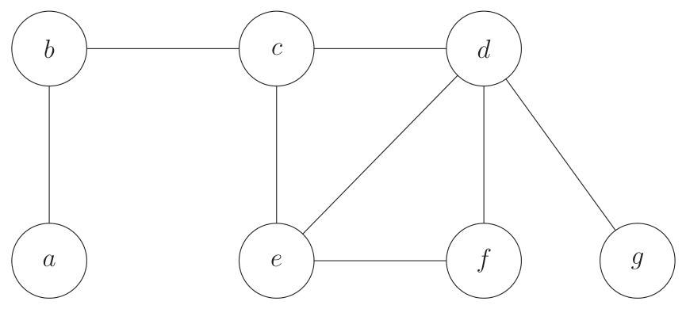
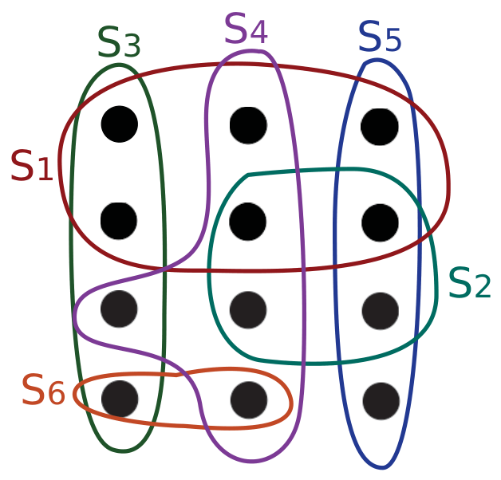
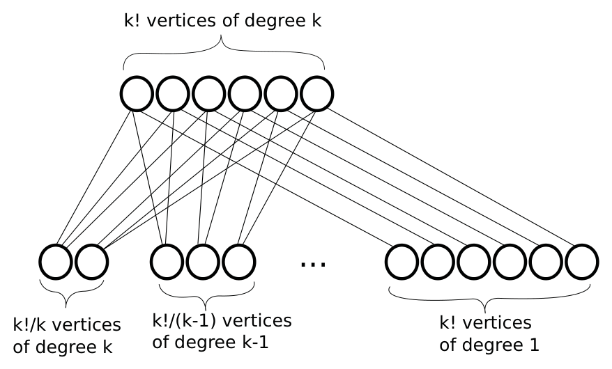

<!-- ===== PDF p1 ===== -->

<span style="color:#c0392b">**讲次 17（Lecture 17）：近似算法（Approximation Algorithms）**</span> <span style="color:#7f8c8d;">（Spring 2015，2015 春季学期）</span>

本讲大纲：
- **定义（Definitions）**
- **顶点覆盖（Vertex Cover）**
- **集合覆盖（Set Cover）**
- **划分（Partition）**

<span style="color:#c0392b">**近似算法与方案（Approximation Algorithms and Schemes）**</span>

令 $C_{opt}$ 是规模为 $n$ 的问题的**最优算法**的代价。如果对**任意输入**，该问题的一个近似算法都能产生代价为 $C$ 的解，满足

```math
\max\!\left( \frac{C}{C_{opt}}, \; \frac{C_{opt}}{C} \right) \le Q(n)
```

那么这个近似算法具有**近似比（approximation ratio）** $Q(n)$。这样的算法称为 **$Q(n)$-近似算法（$Q(n)$-approximation algorithm）**。

以 $c > 0$ 作为输入、并对任意固定的 $c$ 都产生满足 $C = (1 + c) C_{opt}$ 的解的近似方案（approximation scheme），是一个 **$(1 + c)$-近似算法**。

**多项式时间近似方案（Polynomial Time Approximation Scheme, PTAS）**是一个运行时间关于**输入规模 $n$ 多项式**的近似算法。**完全多项式时间近似方案（Fully Polynomial Time Approximation Scheme, FPTAS）**是一个运行时间关于 **$n$ 和 $c$ 都是多项式**的近似算法。例如，一个 $O(n^{2/\varepsilon})$ 近似算法是 PTAS 但不是 FPTAS；一个 $O(n/\varepsilon^2)$ 近似算法是 FPTAS。

<span style="color:#c0392b">**顶点覆盖（Vertex Cover）**</span>

给定无向图 $G(V, E)$，找到子集 $V' \subseteq V$，使得对每条边 $(u, v) \in E$，都有 $u \in V'$ 或 $v \in V'$（或两者都在）。进一步，找到使 $|V'|$ **最小**的 $V'$。这是一个 **NP 完全**问题。

> <span style="color:#1e8449;">**[note] Note（译者注，近似比的定义）:**</span>
>
> 正文那个取最大值的写法，要回答的是一个设计问题：怎样把「算法解离最优解有多远」压成一个与规模无关、与优化方向无关、能直接和 1 比较的数字。不这么做的代价很具体：若只报绝对差，同一个算法在订单量百万级的实例上差几百单像无关紧要，在弹道计算里差几百米就是事故，可它俩的质量其实相同；若只看未归一化的商，最大化问题会给出小于 1 的数，「比值越大越差」这个单调方向就丢了。
>
> 拆开看，$\max(C/C_{opt},C_{opt}/C)$ 就是把两个数里大的除以小的，于是恒 $\ge 1$，两解越接近越贴 1；它还能改写成 $1 + |C - C_{opt}|/\min(C,C_{opt})$，所以「$Q(n)$-近似」与「relative error（相对误差）不超过 $Q(n) - 1$」是同一句话。这正是后面 PTAS（多项式时间近似方案）里 $\varepsilon$ 的出处：它不是随手取的小量，而是算法向使用者承诺的相对误差上界。第二层含义在量词上：$Q(n)$ 要求对任意输入都成立，取的是 worst case（最坏情形）；一个算法可以在九成九的输入上返回最优解，只要有一个输入让比值超过 $Q(n)$，这个 $Q(n)$ 就作废。注意 $Q$ 是 $n$ 的函数而不是常数，这也不是装饰：顶点覆盖的常数 2 与集合覆盖的 $\ln n + 1$ 属于不同的强度等级，前者不随规模退化，后者会，而定义把这种强度差异原样写进了函数形式里，读者一眼就能分出「常数因子保证」与「随规模增长的保证」。
>
> 用正文的例子核一遍：七个顶点、$C = 6$、$C_{opt} = 3$，比值正好 2，把界顶满，于是 2 不是保守估计，而是真能取到的最坏情形。再套到最大化一侧：设最优利润 100 万元、算法给出 80 万元，商 0.8 看上去「还行」，取最大后得到 1.25，读法是「至多比最优差四分之一」。同一算法遇到最优 100 元、出 80 元的实例，比值还是 1.25，绝对差却只剩 20 元。比值抹掉了规模信息，这既是它的价值也是它的局限：一个 1.25-近似算法在 1 亿元的实例上可能白花 2500 万元，这一块要使用者自己掂量。
>
> 与 heuristic（启发式）的分界就在这里。🎥 *Devadas*："I'm going to use a heuristic... Or you could do approximation algorithms... I'm going to prove that this greedy heuristic, in every conceivable situation with respect to the inputs, is going to be within some factor of optimal."（翻译：我要用启发式……或者你可以做近似算法——我要证明这个贪心启发式，对输入的任何可能情况，都落在最优解的某个因子之内。）启发式只赌「通常的输入」表现好，approximation algorithm（近似算法）必须交出对所有输入都成立、可证明的 worst-case guarantee（最坏情形保证）。这两件事的工程后果不同：启发式出了问题你只能换一个再试，说不出下次会不会更糟；近似算法出了问题则说明你的实现有 bug（缺陷），与算法本身无关。
>
> 跨课程看，CSAPP 第 6 章讲 cache（缓存）时用 miss rate（缺失率）当指标而不是缺失次数，理由完全一致：次数随访问总量线性增长，跨负载不可比，比率才可比。区别在于缺失率是对某条真实 trace（访问轨迹）的实测统计，属经验量；approximation ratio（近似比）要对任意输入取 supremum（上确界），属普适量，后者强得多，也难证明得多。
>
> 这也接上你在讲次 16 学的 NP-complete（NP 完全）：既然这些问题在 $P \ne NP$ 下没有多项式精确算法，能拿到的就只有「多项式时间 + 可证明的比值」，比值于是成了这个领域的主要货币。读后面每一条 claim（论断）时留意，证明都用不到输入的具体形状，只抓一个结构不变式 —— 匹配的大小、每轮吃掉的比例、最大项与总量之比；这一步是整讲所有论证共用的骨架。

> <span style="color:#1e8449;">**[note] Note（译者注，PTAS 与 FPTAS 的微妙分界）:**</span>
>
> 这条注要钉死的是一个看着像术语游戏的边界：Polynomial Time Approximation Scheme（多项式时间近似方案）与 Fully Polynomial Time Approximation Scheme（完全多项式时间近似方案）之间，差的正是「精度旋钮 $\varepsilon$ 落在运行时间的哪个位置」。它值得单独拎出来，因为它决定你调精度时要不要重买机器：把 $\varepsilon$ 调小十倍，算法是慢一百倍，还是从此跑不完。
>
> 把定义摊成量词串就清楚了。PTAS（多项式时间近似方案）说的是：对每个 $\varepsilon > 0$，存在一个算法，它在 $O(n^{f(\varepsilon)})$ 时间内给出 $(1 + \varepsilon)$-近似，而 $f$ 可以是任意函数，哪怕 $f(\varepsilon) = e^{1/\varepsilon}$ 都算合格。FPTAS（完全多项式时间近似方案）要求更强：存在一个二元多项式 $p$，使时间是 $O(p(n, 1/\varepsilon))$，也就是 $n$ 与 $1/\varepsilon$ 都只能以多项式身份出场。差别只有一处：$f$ 是否被允许把 $1/\varepsilon$ 送进指数。这一处之所以要紧，是因为在实际使用中 $\varepsilon$ 是你手上反复要拧的旋钮，而 $n$ 是问题给定的、你改不了；一旦 $1/\varepsilon$ 进了指数，你拧旋钮改变的是 $n$ 的幂次，问题规模一点没变，复杂度却整数量级地翻。
>
> 代入数字看。取 $n = 1000$、$\varepsilon = 0.01$：若时间是 $O(n^{1/\varepsilon})$，指数就是 100，而 $1000^{100} = 10^{300}$；按每秒 $10^{9}$ 次运算估计需要 $10^{291}$ 秒，宇宙年龄约 $4.3 \times 10^{17}$ 秒，差了两百多个数量级，这不是「慢」，是不存在。同样的 $n$ 与 $\varepsilon$，若是 $O(n/\varepsilon^{2})$，代价是 $1000/10^{-4} = 10^{7}$ 次运算，约 $0.01$ 秒。再把 $\varepsilon$ 收紧到 $0.001$：后者变成 $10^{9}$ 次、约 1 秒，只涨一百倍；前者的指数从 100 换成 1000，仍然是无穷。这一组数就是那条分界的全部内容，也是为什么「有 PTAS（多项式时间近似方案）」与「有 FPTAS（完全多项式时间近似方案）」在工程上是两种结论。
>
> 层级与判据。APX（常数因子近似类）指容许某个固定常数因子近似的那类问题。已知有 FPTAS（完全多项式时间近似方案）的问题一定有 PTAS（多项式时间近似方案），反过来不成立。严格性一半已知一半未知：$P \ne NP$ 时 APX（常数因子近似类）真包含 PTAS（多项式时间近似方案），理由是 Max-3SAT 这类 APX（常数因子近似类）完全问题不存在任何 PTAS（多项式时间近似方案）；而 FPTAS（完全多项式时间近似方案）与 PTAS（多项式时间近似方案）是否真有一线之隔，至今仍是公开问题。反过来有一条好用的否证工具：若问题是强 NP 困难的，则它没有 FPTAS（完全多项式时间近似方案），除非 $P = NP$。论证很短：任何 FPTAS（完全多项式时间近似方案）都能把权重按 $\varepsilon$ 的比例粗化，再对粗化后的实例做动态规划，于是得到一个关于数值大小的伪多项式算法；而强 NP 困难的定义恰恰是「连伪多项式算法也不给」。划分只是弱 NP 困难（数值用二进制写才有困难），所以它确实有 FPTAS（完全多项式时间近似方案），这与正文最后一句吻合。
>
> 跨课程连接。实分析里 $\forall \varepsilon > 0\; \exists \delta$，$\varepsilon$ 是任给的小量，$\delta$ 依赖它，我们对 $\delta$ 随 $\varepsilon$ 缩小的速度毫不在意；这里的量词骨架一模一样，但关注点整个翻了过来 —— $f$ 的形状本身就是全部内容，因为它是你要付的钱。再看大二上要学的凸优化：一阶方法的迭代次数通常是 $O(1/\varepsilon)$ 或 $O(1/\varepsilon^{2})$，内点法是 $O(\log(1/\varepsilon))$，全是把精度当参数、把代价写成它的多项式或对数，形状上正是一个 FPTAS（完全多项式时间近似方案）。区别在于凸优化给的是对迭代步数的界，还要乘上每步代价才算完，而近似算法给的是端到端的时间界，且对最坏输入成立。
>
> 回到正文那两句：$O(n^{2/\varepsilon})$ 是 PTAS（多项式时间近似方案）而不是 FPTAS（完全多项式时间近似方案），$O(n/\varepsilon^{2})$ 是 FPTAS（完全多项式时间近似方案）—— 它们不是要背的例句，而是这条分界在具体表达式上的投影。原文用字母 $c$ 表示通常的 $\varepsilon$，本译稿统一写成 $\varepsilon$，读原文时不要把两者当成不同的量。

<!-- ===== PDF p2 ===== -->

<span style="color:#c0392b">**顶点覆盖的近似算法（Approximation Algorithm for Vertex Cover）**</span>

这里我们定义算法 **Approx Vertex Cover**——顶点覆盖的一个近似算法。从一个空集 $V'$ 开始。只要 $E$ 中还有边，就**任取**一条边 $(u, v)$。把 $u$ 和 $v$ **都**加入 $V'$。删除**所有与 $u$ 或 $v$ 关联**的边。重复直到 $E$ 中不再有边。Approx Vertex Cover 在多项式时间内运行。

以如下图 $G$ 为例：



> <span style="color:#7f8c8d;">[原图说明] 原页附图：示例图 $G$，顶点 $a, b, c, d, e, f, g$ 及其边（矢量图，p2）。Approx Vertex Cover 可能依次选中边 $(b, c)$、$(e, f)$、$(d, g)$。此图将在统一裁剪阶段作为原图插回。</span>

Approx Vertex Cover 可能依次选中边 $(b, c)$、$(e, f)$ 和 $(d, g)$，从而 $V' = \{b, c, e, f, d, g\}$ 且 $|V'| = 6$。因此代价 $C = |V'| = 6$。这个例子的最优解是 $\{b, d, e\}$，故 $C_{opt} = 3$。

<span style="color:#2471a3;">**[claim]**</span> **论断（Claim）**：Approx Vertex Cover 是一个 **2-近似算法**。

<span style="color:#2471a3;">**[proof]**</span> **证明（Proof）**：令 $U \subseteq V$ 是 Approx Vertex Cover 所选中边的集合。最优顶点覆盖必须包含 $U$ 中每条边的**至少一个端点**（以及其他边）。此外，$U$ 中**没有两条边共享端点**。因此，$|U|$ 是 $C_{opt}$ 的一个下界，即 $C_{opt} \ge |U|$。Approx Vertex Cover 返回的 $V'$ 中顶点数是 $2 \cdot |U|$。因此，$C = |V'| = 2 \cdot |U| \le 2C_{opt}$。故 $C \le 2 \cdot C_{opt}$。$\square$

> <span style="color:#1e8449;">**[note] Note（译者注，2-近似证明的妙处）:**</span>
>
> 这个证明真正值钱的地方，是它把「近似比」拆成了两条彼此独立的不等式：一条上界来自算法自己的行为（$C = 2|U|$），一条下界来自最优解必须满足的结构约束（$C_{opt} \ge |U|$），两条一比，因子 2 自己就冒出来了，全程不需要知道最优解长什么样。这正是一切近似证明的通用形状：算不出最优，就去算最优的下界，只要下界足够硬，比值就能压下来。
>
> 逐步走一遍。第一步，被选中的边集 $U$ 必是 matching（匹配）：每选一条边，两个端点都进 $V'$，其所有关联边随即从 $E$ 里删掉，所以后来选中的边不可能与之前的共享端点。$U$ 的大小记作 $\nu$。第二步，任何 vertex cover（顶点覆盖）都必须为 $U$ 中每条边至少派出一个端点，而这些边两两不共端点，一条边的端点帮不了另一条边，于是不同的边要消耗不同的顶点，得到 $|U| \le C_{opt}$，即 $\nu \le \tau$。第三步，算法对每条边付两个顶点，$C = 2|U| \le 2C_{opt}$。合起来就是一条夹逼：$\nu \le \tau \le 2\nu$，比值的上界 2 恰好来自夹逼的上端，而夹逼的下端正是那条弱到几乎不看图结构的下界。
>
> 「2」这个数字的来历也清楚了：算法每步花 2 个顶点，允许的下界每步只收 1 个，一花一收的比例就是 2。要把比值压到 2 以下，唯一的办法是把下界做硬，也就是找到比 $\nu$ 更大的下界。这件事在二分图里确实做得到：Kőnig 定理（1931）说明二分图上 $\nu = \tau$，空隙为零，于是顶点覆盖在二分图上有多项式精确算法。而这条 2-近似的论证本身在二分图上仍然只给出 2，因为它用的 $\tau \ge \nu$ 对一切图都成立，弱事实换不来强结论 —— 「知道结构」与「只知道一个普适下界」的差别，就在这里现形。
>
> 算三个例子把界摸一遍。其一，取 5 条互不相邻的边：每条边都得单独出一个端点，$C_{opt} = 5$；算法逐条处理，每条塞 2 个点，$C = 10$，比值正好 2，界被顶满。其二，取星形图 $K_{1,100}$：中心连 100 个叶子，最优只要中心一个点，$C_{opt} = 1$；算法随手取一条边，把中心和某个叶子都放进来，所有边当场删空，$C = 2$，比值 2 —— 那个叶子纯属浪费，界在最坏输入上是真能达到的。其三，取三角形 $K_3$：$C_{opt} = 2$，算法取一条边加 2 个点就删空了，$C = 2$，比值 1，说明 2 不是每条输入都取到，界只在最坏输入上紧。三个数摆在一起，worst-case guarantee（最坏情形保证）的含义就不含糊了：界说的是最坏点，不是平均表现。
>
> 跨课程连接有两处。一处是 6.042J 的图论与 Kőnig 定理：它给出的是结构等式 $\nu = \tau$，属于「为什么二分图能精确」；本讲给的是算法比值界，属于「为什么一般图不能」，两者互为表里。另一处更直接，是讲次 15 的 linear programming relaxation（线性规划松弛）与 LP duality（LP 对偶）：把问题写成 $\min \sum_v x_v$ 且 $x_u + x_v \ge 1$，$x \ge 0$；它的对偶是 fractional matching（分数匹配），即 $\max \sum_e y_e$ 且每个顶点关联的边权之和不超过 1。在 $K_3$ 上取 $x \equiv 1/2$、$y \equiv 1/2$，两边目标值同为 $3/2$，strong duality（强对偶）成立。而整数解只能是 0 或 1，$\tau = 2$，于是 $\tau/\tau^{*} = 4/3$ —— 这个比值就是 integrality gap（整数间隙），而「把所有 $x_v \ge 1/2$ 的顶点取整进覆盖」这一步把值放大到不超过 2 倍，于是得到 $C \le 2\tau^{*} \le 2\tau = 2C_{opt}$。原文的贪心证明与这条松弛路线算出的因子相同，但后者解释得更深。
>
> 顺便交代一下这个 2 的地位：Unique Games Conjecture（唯一博弈猜想）成立时，顶点覆盖不可能有因子小于 2 的多项式近似 —— 这是 Khot 与 Regev 2008 年发表在 JCSS 上的结果，所以朴素的 2-近似已经碰到了条件最优的天花板。记住这个证明骨架：上界来自算法每一步的实际开销，下界来自问题自身的结构约束，比值就是把两者一除。后面集合覆盖的 $|X_k|/t$ 与划分的 $(m+1)s_k \le 2L$ 用的是同一个骨架，换的只是结构约束的内容。

<span style="color:#c0392b">**集合覆盖（Set Cover）**</span>

给定集合 $X$ 和一族（可能重叠的）子集 $S_1, S_2, \cdots, S_m \subseteq X$，满足 $\bigcup_{i=1}^{m} S_i = X$，找到集合 $P \subseteq \{1, 2, 3, \cdots, m\}$ 使得 $\bigcup_{i \in P} S_i = X$。进一步，找到使 $|P|$ **最小**的 $P$。

集合覆盖是一个 **NP 完全**问题。

---

<!-- ===== PDF p3 ===== -->

<span style="color:#c0392b">**集合覆盖（续）**</span>

<span style="color:#c0392b">**集合覆盖的近似算法（Approximation Algorithm for Set Cover）**</span>

这里我们定义算法 **Approx Set Cover**——集合覆盖的一个近似算法。先把集合 $P$ 初始化为空集。只要 $X$ 中还有元素，就**选取最大的集合 $S_i$** 并把 $i$ 加入 $P$。然后从 $X$ 和所有其他子集 $S_j$ 中删除 $S_i$ 中的所有元素。重复直到 $X$ 中不再有元素。Approx Set Cover 在多项式时间内运行。

在下面的例子中，每个点都是 $X$ 中的一个元素，每个 $S_i$ 都是 $X$ 的子集。



> <span style="color:#7f8c8d;">[原图说明] 原页附图：集合覆盖示例图，$S_1$ 至 $S_6$ 六个子集，圆内点表示元素（内含 4 张小图，p3）。Approx Set Cover 依次选中 $S_1, S_4, S_5, S_3$。此图将在统一裁剪阶段作为原图插回。</span>

Approx Set Cover 按顺序选取集合 $S_1, S_4, S_5, S_3$。因此它返回 $P = \{1, 4, 5, 3\}$，其代价 $C = |P| = 4$。最优解是 $P_{opt} = \{S_3, S_4, S_5\}$，$C_{opt} = |P_{opt}| = 3$。

<span style="color:#2471a3;">**[claim]**</span> **论断（Claim）**：Approx Set Cover 是一个 **$(\ln(n) + 1)$-近似算法**（其中 $n = |X|$）。

<span style="color:#2471a3;">**[proof]**</span> **证明（Proof）**：令最优覆盖为 $P_{opt}$，且 $C_{opt} = |P_{opt}| = t$。令 $X_k$ 为 Approx Set Cover 在第 $k$ 轮迭代中**剩余的元素集合**，于是 $X_0 = X$。那么：

- 对所有 $k$，$X_k$ 都能被 $t$ 个集合覆盖（来自最优解）。
- 其中有一个集合至少覆盖 $|X_k|/t$ 个元素。
- Approx Set Cover 会选取一个（当前）大小 $\ge |X_k|/t$ 的集合。

---

<!-- ===== PDF p4 ===== -->

<span style="color:#c0392b">**集合覆盖（续）**</span>

- 对所有 $k$，$|X_{k+1}| \le (1 - \frac{1}{t}) |X_k|$（更精细的分析（见 CLRS 第 35 章）把 $Q(n)$ 与**调和数（harmonic numbers）**联系起来。$t$ 应该收缩。）
- 对所有 $k$，$|X_{k+1}| \le (1 - \frac{1}{t})^k \cdot n \le e^{-k/t} \cdot n$（其中 $n = |X_0|$）

算法在 $|X_k| < 1$（即 $|X_k| = 0$）时终止，此时的代价为 $C = k$：

```math
e^{-k/t} \cdot n < 1 \quad \Rightarrow \quad e^{k/t} > n
```

因此算法在 $k > t \ln(n)$ 时终止。所以 $k = C \le t \ln(n) + 1$，于是

```math
\frac{C}{C_{opt}} = \frac{C}{t} \le \ln(n) + 1
```

因此 Approx Set Cover 是集合覆盖的一个 $(\ln(n) + 1)$-近似算法。$\square$

注意到对于更大的问题，近似比会变差，因为它随 $n$ 变化。

> <span style="color:#1e8449;">**[note] Note（译者注，集合覆盖的 $\ln n$ 分析与调和数）:**</span>
>
> 这条证明的本质是一个几何衰减论证：每轮把剩余量乘上一个固定比例，于是轮数天然带出对数。要回答的设计问题是：贪心算法没有任何全局视野，凭什么敢给它一个随 $n$ 增长、但只长到对数级别的保证？答案藏在「剩余集合仍被最优解覆盖」这一句话里 —— 贪心不知道最优解是哪 $t$ 个集合，但只要知道存在这样的 $t$ 个，就能把它们的平均能力当成自己的下限。
>
> 把机制拆成四步。第一步，$X_k$ 仍可被那 $t$ 个最优集合覆盖：被删掉的元素都是已被贪心盖住的，而最优解覆盖整个 $X$，自然覆盖剩下的部分。第二步，$t$ 个集合要分掉 $|X_k|$ 个剩余元素，按平均值至少有一个集合吃掉不少于 $|X_k|/t$ 个，而贪心选的是当前最大的集合，只会更大，于是 $|X_{k+1}| \le (1 - 1/t)|X_k|$。这是鸽巢原理与最优性合成的结果，也是全部论证里唯一用到「最优解存在」的地方。第三步，迭代得 $|X_k| \le (1 - 1/t)^{k} n$，再用 $1 - x \le e^{-x}$（两边在 $x = 0$ 处相切，右边更大）换成 $e^{-k/t} n$。为什么要换：直接对 $(1-1/t)^k$ 取对数会得到 $\ln n / \ln\frac{t}{t-1}$ 这种形式，分母里藏着 $1/t$，读不出量级；换成指数立刻能对 $k$ 解出来，得 $k > t \ln n$。第四步，$|X_k|$ 是整数，小于 1 就等于 0，所以 $C \le t \ln n + 1$，那个加一只是把 $k$ 取整的余量。
>
> 代入数字。取 $n = 1000$、$t = 10$：$\ln 1000 = 6.9078$，于是 $t \ln n = 69.08$，界说最多用 70 个集合，而最优只用 10 个，最坏情况多花 7 倍；对照公式值 $\ln n + 1 = 7.9078$。再把规模拉大：$n = 10^{6}$、$t = 20$，$\ln 10^{6} = 13.8155$，$t\ln n = 276.3$，界说 $C \le 277$，比值约 $13.8$。请注意这里：$n$ 涨了一千倍，比值只从 7 涨到 13.8，不到一倍 —— 对数的工程含义就是这个，规模翻三个数量级，质量退化不到两倍。
>
> 调和数版本的记账更精细，值得单独走一遍，因为它解释了 $H_n$ 从哪冒出来。设第 $i$ 轮选中的集合新盖住 $c_i$ 个元素，就把「花掉 1 个集合」这笔账按 $1/c_i$ 平摊给这 $c_i$ 个元素。某个元素被盖住的那一刻，剩余元素数为 $k$，由同样的鸽巢论证有 $c_i \ge k/t$，于是它分摊到的代价不超过 $t/k$。把所有元素按被盖住的先后倒过来排（剩余数从 $n$ 递减到 1），总代价不超过 $\sum_{k=1}^{n} t/k = t H_n$，其中 $H_n$ 是 harmonic number（调和数）。这个界比 $t \ln n + 1$ 紧，差距可以算出来：$H_{1000} = 7.485471$，$\ln 1000 = 6.907755$，差 $0.577716$，正好逼近 Euler–Mascheroni constant（欧拉常数）$\gamma = 0.577216$；所以用 $\ln n + 1$ 比用 $H_n$ 松了大约 $1 - \gamma = 0.4228$。换句话说，调和数不是凭空出现的常数，它就是「把 $1/k$ 一路加下去」这一记账动作的产物。
>
> 历史只作点缀，但能解释为什么这条分析反复被重写。1972 年 Karp 把集合覆盖列入那 21 个 NP-complete（NP 完全）问题；1974 年 Johnson 给出贪心的 $H_n$ 界；1975 年 Lovász 换了个角度，用「整数覆盖与分数覆盖之比」重证；1979 年 Chvátal 把它推广到带权情形，界仍是 $H_n$，只是 $n$ 换成最大集合的大小。下界一侧晚了二十多年：Feige 在 1998 年证明，除非 NP 有准多项式时间的算法，任何多项式算法都做不到优于 $(1-o(1))\ln n$；Dinur 与 Steurer 在 2014 年把这个假设改弱到只剩 $P \ne NP$。两头合上之后，「贪心达到 $\ln n$」与「谁也没法显著更好」就成了同一个问题的一体两面。
>
> 跨课程连接。一是 6.006 里的 amortized analysis（摊还分析）：势能法把一次操作序列的总代价按「势函数变化」分摊到每次操作上，这里的做法是把输出的集合数按「每个元素被盖住时还剩多少元素」分摊到每个元素上，都是记账而非估计；区别在于摊还分析追求对操作序列总代价的紧界，而这里的记账利率 $t/k$ 依赖于未知的最优解大小 $t$，所以结论只能写成相对于 $C_{opt}$ 的比值，写不出绝对数。二是概率论里的 coupon collector（集邮者问题），轮数也是 $\Theta(n \ln n)$，长得像但要看清机制相反：那里每轮命中新元素的概率是 $1/k$，速率随剩余量衰减，所以常数因子是 1；这里每轮吃掉的比例 $1/t$ 恒定不变，速率不衰减而绝对量衰减，所以常数因子是 $t = C_{opt}$，两者只是恰好都落到对数上。
>
> 收束回正文最后一句：说近似比随 $n$ 变差，在这个框架里的准确含义是界里的 $\ln n$ 换不成常数，而 Feige 与 Dinur、Steurer 的下界说明这不是分析太松，是问题本身的极限 —— 一项计算的粗糙与无解的宿命，差别就在这种地方。

<span style="color:#c0392b">**划分（Partition）**</span>

输入是一个由 $n$ 个物品组成的集合 $S = \{1, 2, \cdots, n\}$，权重为 $s_1, s_2, \cdots, s_n$。不失一般性，假设物品已按 $s_1 \ge s_2 \ge \cdots \ge s_n$ 排序。把 $S$ 划分成集合 $A$ 和 $B$，以**最小化 $\max(w(A), w(B))$**，其中 $w(A) = \sum_{i \in A} s_i$，$w(B) = \sum_{j \in B} s_j$。

定义 $2L = \sum_{i=1}^{n} s_i = w(S)$。那么最优解的代价按定义满足 $C_{opt} \ge L$。

划分问题是 **NP 完全**的。我们想要找到一个 **PTAS**（$(1 + \varepsilon)$-近似）。（注意此问题的 2-近似是平凡的。）此外，该问题也存在一个 **FPTAS**。

<!-- ===== PDF p5 ===== -->

<span style="color:#c0392b">**划分的近似算法（Approximation Algorithm for Partition）**</span>

这里我们定义 **Approx Partition**。定义 $m = \lfloor \frac{1}{\varepsilon} \rfloor - 1$。（$\varepsilon \approx \frac{1}{m+1}$。）算法分两个阶段进行。

**第一阶段（First Phase）**：找到 $s_1, \cdots, s_m$ 的最优划分 $A', B'$。这需要 $O(2^m)$ 时间。

**第二阶段（Second Phase）**：把集合 $A$ 和 $B$ 分别初始化为 $A'$ 和 $B'$。于是它们已经包含 $s_1, \cdots, s_m$ 的一个划分。然后对每个 $i$（$i$ 从 $m+1$ 到 $n$）：如果 $w(A) \le w(B)$，就把 $i$ 加入 $A$，否则加入 $B$。

---

<span style="color:#c0392b">**划分（续）**</span>

<span style="color:#2471a3;">**[claim]**</span> **论断（Claim）**：Approx Partition 是划分问题的一个 **PTAS**。

<span style="color:#2471a3;">**[proof]**</span> **证明（Proof）**：不失一般性，假设 $w(A) \ge w(B)$。那么近似比是 $\frac{C}{C_{opt}} = \frac{w(A)}{L}$。令 $k$ 是最后一个加入 $A$ 的物品。有两种情形：要么 $k$ 在第一阶段加入，要么在第二阶段加入。

**情形 1（Case 1）**：$k$ 在第一阶段加入 $A$。这意味着 $A = A'$。我们得到的是**最优划分**，因为当有 $n \ge m$ 个物品时，我们不可能比 $w(A')$ 做得更好，而我们知道 $w(A')$ 对那 $m$ 个物品是最优的。

**情形 2（Case 2）**：$k$ 在第二阶段加入 $A$。此时我们知道 $w(A) - s_k \le w(B)$，因为这正是 $k$ 被加入 $A$ 而非 $B$ 的原因。（注意在此最后一次加入 $A$ 之后，$w(B)$ 可能已经增加。）现在，因为 $w(A) + w(B) = 2L$，有 $w(A) - s_k \le w(B) = 2L - w(A)$。因此 $w(A) \le L + \frac{s_k}{2}$。由于 $s_1 \ge s_2 \ge \cdots \ge s_n$，我们可以说 $s_1, s_2, \cdots, s_m \ge s_k$。现在，因为 $k > m$，$2L \ge (m + 1) s_k$。于是

```math
\frac{w(A)}{L} \le \frac{L + \frac{s_k}{2}}{L}
= 1 + \frac{s_k}{2L}
\le 1 + \frac{s_k}{(m+1) s_k}
= 1 + \frac{1}{m+1}
= 1 + \varepsilon
```

因此 Approx Partition 是划分问题的一个 $(1 + \varepsilon)$-近似。$\square$

> <span style="color:#1e8449;">**[note] Note（译者注，PTAS 的设计模板：「前 $m$ 个穷举 + 其余贪心」）:**</span>
>
> 这个方案要解决的是一个看起来自相矛盾的任务：既想拿到对任意输入的保证，又想把 $1/\varepsilon$ 挡在指数的外面。它的手法是把输入切成两段，大的一段用指数时间精确处理，小的一段用常数时间贪心处理，再用「大的那一段本身就压住了误差比例」把两段的误差接起来。三处设计各自回答一个「不这么做会怎样」。
>
> 为什么穷举前 $m$ 个而不是任意 $m$ 个：排序保证 $s_1 \ge s_2 \ge \cdots \ge s_n$，所以前 $m$ 个就是最重的 $m$ 个，决定误差的是它们之后最大的那一项，而不是随机挑的某一项。为什么是 $m = \lfloor 1/\varepsilon \rfloor - 1$ 这个数：最终要的是 $1/(m+1) \le \varepsilon$，取整方向必须保证不等式成立，差一点就会把界写坏。为什么剩下的用「放到较轻一侧」而不是别的贪心：只有这样才有 $w(A) - s_k \le w(B)$ 这条好用的局部事实，别的贪心给不出这一步。
>
> 证明链条按顺序读一遍：最后一个进 $A$ 的物品是 $k$，它进 $A$ 是因为当时 $A$ 更轻，所以 $w(A) - s_k \le w(B)$；再加上总量守恒 $w(A) + w(B) = 2L$，移项即得 $w(A) \le L + s_k/2$，误差被压缩成「半个 $s_k$」，这是全部技巧的落点。接着要把 $s_k$ 换成 $1/(m+1)$ 量级：$k > m$ 说明 $s_k$ 不在前 $m$ 个里，而前 $m+1$ 个都不比它轻，于是 $(m+1)s_k \le \sum_{i=1}^{m+1} s_i \le 2L$，即 $s_k \le 2L/(m+1)$。代回去：$w(A)/L \le 1 + s_k/(2L) \le 1 + 1/(m+1) \le 1 + \varepsilon$。
>
> 手算一个实例。权重取 $10, 9, 8, 7, 6, 5$，总和 45，于是 $L = 22.5$；最优划分是 $\lbrace 10, 7, 6 \rbrace$ 与 $\lbrace 9, 8, 5 \rbrace$，两侧为 23 与 22，而任何划分的较大侧至少是 $L = 22.5$，取整后最小可能值就是 23，所以 $C_{opt} = 23$。取 $\varepsilon = 0.25$，则 $m = \lfloor 4 \rfloor - 1 = 3$，只穷举前三个 $10, 9, 8$：最优是把 18 与 9 分开，即 $A' = \lbrace 10, 8 \rbrace$、$B' = \lbrace 9 \rbrace$。第二阶段逐个放：7 放进较轻的 $B$ 得 $B = 16$；6 再放进 $B$ 得 $B = 22$；5 放进 $A$ 得 $A = 23$。最后 $w(A) = 23 = C_{opt}$，比值 1.022，比承诺的 1.25 更紧。用界检验：$s_k = 5$，$L + s_k/2 = 25$，确实 $23 \le 25$；$s_k \le 2L/4 = 11.25$，也确实成立。
>
> 再算一个边界值，把这条路的代价暴露出来。若要求 $\varepsilon = 0.01$，则 $m = 99$，穷举量是 $2^{99} \approx 6.3 \times 10^{29}$ 次分配 —— 即使每秒做 $10^{9}$ 次也要 $2 \times 10^{13}$ 年。也就是说这个方案在工程上只对 $\varepsilon$ 不小于十分之一左右有用，精度一旦进入百分点区间就立刻失效。这正是它只是 PTAS（多项式时间近似方案）而进不了 FPTAS（完全多项式时间近似方案）的原因：$1/\varepsilon$ 坐在指数上，$n$ 再小也救不回来。原文说划分还有 FPTAS（完全多项式时间近似方案），那是另一条路：先把权重按 $\varepsilon L/n$ 的粒度四舍五入，再做子集和的动态规划，代价是 $O(n^{2}/\varepsilon)$ 量级，这条路线出自 Karmarkar 与 Karp 1975 年的工作；它拿精度换的是舍入误差，而不是穷举项数。
>
> 跨课程连接有两条。一条与 6.006 的子集和动态规划：那个 dynamic programming（动态规划）的状态是「前 $i$ 个物品凑出的和」，复杂度 $O(nL)$，对 $L$ 是伪多项式的；FPTAS（完全多项式时间近似方案）的粗化做的正是把 $L$ 这个维度按精度压扁，于是伪多项式变成真多项式。区别在于前者给出精确解但代价依赖数值大小，粗化给出近似解但代价只依赖 $n$ 与 $1/\varepsilon$。另一条与调度里的 LPT（最长处理时间优先）规则：把物品按降序放到当前最轻的一台机器上，正是本方案第二阶段的做法，只不过它不穷举前 $m$ 项。Graham 1969 年证明这条规则在 $m$ 台机器上的比值不超过 $4/3 - 1/(3m)$，两台机器时是 $7/6 \approx 1.167$；而本方案用 $O(2^{m})$ 的代价把比值从 $7/6$ 压到 $1 + \varepsilon$。这个对比说明了模板的实质：穷举不是免费的，它买来的正是那一段固定的精度损失。
>
> 收束回正文：整套方案的可复用之处在于「大头精确、小头贪心、误差由最大项归一」这条结构，装箱、调度、机器负载均衡里的方案大多是这个骨架的变形；判断它是不是 PTAS（多项式时间近似方案）时只需问一句，穷举规模随 $1/\varepsilon$ 长成了什么形状。

<!-- ===== PDF p6 ===== -->

<span style="color:#c0392b">**自然的顶点覆盖近似（Natural Vertex Cover Approximation）**</span>

这里我们描述 **Approx Vertex Cover Natural**——顶点覆盖的另一个不同的近似算法。从一个空集 $V'$ 开始。只要 $E$ 中还有边，就选取**度数最大**的顶点 $v \in V$ 并把它加入 $V'$。然后从 $E$ 中删除 $v$ 及其所有关联边。重复直到 $E$ 中不再有边。最后返回 $V'$。

下面的例子展示了 Approx Vertex Cover Natural 的一个**坏例（bad-case example）**。在这个例子中，最优覆盖会选取**顶部的 $k!$ 个顶点**。



> <span style="color:#7f8c8d;">[原图说明] 原页附图（矢量图，p6）：最大度贪心的坏例分层图——顶部为 $k!$ 个度为 $k$ 的顶点（最优覆盖），向下依次为 $\frac{k!}{k}$ 个度为 $k$ 的顶点、$\frac{k!}{k-1}$ 个度为 $k-1$ 的顶点、……、直至底部 $k!$ 个度为 1 的顶点，中间以「…」表示更多层。此图将在统一裁剪阶段作为原图插回。</span>

Approx Vertex Cover Natural 可能**从左到右依次选走所有底部顶点**。因此代价可能是 $k! \cdot \left( \frac{1}{k} + \frac{1}{k-1} + \cdots + 1 \right) \approx k! \log k$。这比最优解差了 $\log k$ 倍。

<span style="color:#2471a3;">**[claim]**</span> **论断（Claim）**：Approx Vertex Cover Natural 是一个 **$(\log n)$-近似**。

<span style="color:#2471a3;">**[proof]**</span> **证明（Proof）**：令 $G_k$ 为算法第 $k$ 轮迭代后的图。令 $n$ 为图中**边**的条数，即 $|G| = n = |E|$。每一轮迭代，算法选取一个顶点，并把它连同所有关联边删除。令 $m = C_{opt}$ 为 $G$ 的最优顶点覆盖中的顶点数。那么考察算法的前 $m$ 轮迭代：$G_0 \to G_1 \to G_2 \to \cdots \to G_m$。

令 $d_i$ 为 $G_{i-1}$ 中最大度顶点的度数。那么算法删除该顶点的所有关联边得到 $G_i$。因此：

```math
|G_m| = |G_0| - \sum_{i=1}^{m} d_i
```

---

<!-- ===== PDF p7 ===== -->

<span style="color:#c0392b">**自然的顶点覆盖近似（续）**</span>

另外：

```math
\sum_{i=1}^{m} d_i \ge \sum_{i=1}^{m} \frac{|G_{i-1}|}{m}
```

这之所以成立，是因为给定 $|G_{i-1}|$ 条边可被 $m$ 个顶点覆盖，我们知道存在一个度数至少为 $\frac{|G_{i-1}|}{m}$ 的顶点。那么：

```math
\sum_{i=1}^{m} \frac{|G_{i-1}|}{m} \ge \frac{|G_m|}{m} \cdot m = |G_m|
```

这之所以成立，是因为对所有 $i$ 有 $|G_i| \le |G_{i-1}|$。于是可以推出：

```math
|G_0| - |G_m| \ge |G_m|
```

即每 $m$ 轮迭代至少删除图的一半边（或从 $G_0$ 中删除更多边）。一般地，由于**每 $m$ 轮迭代都会把图里的边数减半**，在 $m \cdot \log |G_0|$ 轮迭代后，它将删除所有边。又因为每轮迭代向覆盖中加入 1 个顶点，它最终会得到一个大小为 $m \cdot \log |G_0| = m \cdot \log n$ 的顶点覆盖。由于我们假设 $m$ 是最优顶点覆盖的大小，有

```math
\frac{C}{C_{opt}} = \frac{m \log n}{m} = \log n
```

因此 Approx Vertex Cover Natural 是一个 $(\log n)$-近似。$\square$

注意到由于在图例中 $n \approx k! \log k$，最坏情形例子的比值约为 $\log k \approx \log \log n$，但**我们只证明了 $O(\log n)$ 近似**（即证明的界不紧）。

> <span style="color:#1e8449;">**[note] Note（译者注，最大度贪心的坏例与界的不紧性）:**</span>
>
> 这个坏例同时讲两件事，容易混成一件。第一件是算法层面的：为什么 degree-greedy（最大度贪心）只能保证 $O(\log n)$。第二件是方法论层面的：为什么证明给出的上界连这个坏例都远压不住，也就是界为什么不紧。前者是一个算法的时间故事，后者是一条关于「证明能给什么、构造能给什么」的普适经验。
>
> 先把 $O(\log n)$ 的论证走一遍。设 $m = C_{opt}$，$d_i$ 是第 $i$ 轮开始时最大顶点的度数，$G_i$ 是第 $i$ 轮结束后的图。关键事实是：$G_{i-1}$ 仍然被那 $m$ 个最优顶点覆盖 —— 删边只会让覆盖变容易，子图的最优覆盖不会变大。于是 $|G_{i-1}|$ 条边被 $m$ 个顶点覆盖，平均每个顶点管 $|G_{i-1}|/m$ 条，最大的那个至少管这么多，而算法正好取最大的，所以 $d_i \ge |G_{i-1}|/m$。把这 $m$ 轮的删除量加起来，再用边数单调下降把每一项换成 $|G_m|$，得 $|G_0| - |G_m| \ge |G_m|$，即每 $m$ 轮至少删掉一半边。删光所有边要 $O(\log |G_0|)$ 个这样的周期，每轮贡献 1 个顶点，总数 $C \le m \log n = C_{opt} \log n$。
>
> 现在看坏例为什么能击穿它。图的构造就是一台专门制造 tie（平局）的机器：顶层是一批度数相同的顶点，最优解就取它们；往下每层的度数依次递减，而每层的顶点数按 $1/j$ 递减，使得贪心每次都在相等度数的顶点里做选择，只要 tie-breaking（平局打破）规则选错方向，它就从底部的度 1 顶点开始横扫。代价可以算清：第 $j$ 层有 $k!/j$ 个顶点，每个只解决一条边，合计 $k!(1/k + 1/(k-1) + \cdots + 1) = k! H_k$，而最优只要 $k!$，比值就是调和数 $H_k \approx \ln k$。
>
> 代数字。$k = 3$ 时 $k! = 6$、$H_3 = 1 + 1/2 + 1/3 = 1.8333$，贪心花 11 个顶点，最优 6 个，比值 1.8333。$k = 4$ 时 $k! = 24$、$H_4 = 2.0833$，贪心花 50 个顶点，最优 24 个，比值 2.0833。这个实例的规模在 $k! \ln k = 24 \times 1.386 \approx 33$ 的量级，把 33 当作 $n$ 代进证明的界得 $\ln 33 = 3.50$，比实际比值 2.0833 宽出六成以上。对照 $\ln k = 1.386$ 与 $\ln\ln 33 = 1.25$，可以看出课上那句「大致是 $\log\log n$」是怎么来的：坏例的规模与 $k$ 是阶乘关系，所以 $n$ 取对数再取对数，正好退回 $\ln k$ 的量级。
>
> 界为什么不紧，有三个来源，值得分别记住。其一，用平均值替代最大值：$|G_{i-1}|/m$ 只是平均度，算法拿到的是最大度，这两者可以差一个数量级（星形图平均度接近 2，最大度是 100），每轮丢掉的这份信息被 $\log$ 次相乘放大。其二，减半论证把「前 $m$ 轮」整体打包，而实际常常在前几轮就删掉远超一半的边，打包等于按最坏进度核算。其三，坏例只在一个狭窄的规模窗口里成立 —— $n$ 与 $k$ 必须刚好是阶乘关系，而界要对一切 $n$ 一致成立，只能取所有窗口里最松的那一段。所以「证明的界」与「真实近似比」是两个对象：前者是 upper bound（上界），后者是确切的上确界，两者之间空出的区间就是我们知识的空白。
>
> 跨课程连接有两处。一处是 CSAPP 第 6 章 cache（缓存）里的经典坏例：对一个恰好比容量大一点的数组做循环访问，LRU（最近最少使用）的 hit rate（命中率）是零，而 Belady 最优策略的命中率接近百分之百 —— 局部启发式被构造性输入整体击穿，机制与这里完全平行。区别在于 cache（缓存）的输入是一条真实 trace（访问轨迹），无法对「所有输入」取最坏，所以那边只能报实测的 hit rate（命中率），报不出比值保证；这也正说明近似算法肯许诺 worst-case guarantee（最坏情形保证），代价是必须放弃对具体输入的优化。另一处是 6.042J 里的等价关系：最大度相同的顶点构成一个等价类，平局就是在这个类里没有指定代表元，而 tie-breaking（平局打破）规则本质上是在给这个类指定一个选择函数；不给规则，算法根本没被定义完，坏例攻击的正是这个没被定义的部分。
>
> 收束回正文最后那句话。原文说只证明了 $O(\log n)$ 而例子里比值只有 $\log\log n$，这不是笔误也不是矛盾：一条证明给上界，一个构造给下界，两者从两端夹住真实值，夹缝宽就说明还没搞清。Devadas 在课上把这条界从 $\log n$ 改口成 $\log\log n$，改的正是「上界被误当成真值」这个习惯 —— 对近似算法，任何时刻都要清楚自己手里的数是界还是事实。

> <span style="color:#1e8449;">**[note] Note（译者注，减半论证（halving argument））:**</span> 证明的核心是**减半论证**：前 $m = C_{opt}$ 轮迭代里，被删除的总边数 $\sum d_i$ 至少等于剩余边数的下界 $|G_m|$，于是 $|G_0| - |G_m| = \sum d_i \ge |G_m|$，推出 $|G_m| \le |G_0|/2$——**每 $m$ 轮边数至少减半**。重复 $O(\log n)$ 次「减半周期」就清空所有边，而每个周期花 $m$ 个顶点，总顶点数 $\le m \log n = C_{opt} \log n$。关键的中间不等式 $\sum_{i=1}^m d_i \ge \sum_{i=1}^m |G_{i-1}|/m$ 依赖一个事实：**最优覆盖的 $m$ 个顶点始终能盖住 $G_{i-1}$**（子图的最优覆盖下界仍为 $m$），所以 $|G_{i-1}|$ 条边被 $m$ 个点覆盖时，必有一个点度数 $\ge |G_{i-1}|/m$（鸽巢原理），而 $d_i$ 取的是**最大**度。这个「用最优下界按平均值压低每步损耗」的手法，与集合覆盖证明里的 $|X_k|/t$ 如出一辙——**两个 $\log$ 界都来自同一个「最优解按平均分摊」的论证模板**，值得作为可复用的证明策略记住。

---

<!-- ===== PDF p8 ===== -->

<span style="color:#7f8c8d;">**MIT OpenCourseWare**</span>

<span style="color:#7f8c8d;">http://ocw.mit.edu</span>

<span style="color:#7f8c8d;">**6.046J / 18.410J 算法设计与分析（Design and Analysis of Algorithms）**</span>

<span style="color:#7f8c8d;">Spring 2015（2015 春季学期）</span>

<span style="color:#7f8c8d;">有关引用这些材料的信息或我们的使用条款（Terms of Use），请访问：http://ocw.mit.edu/terms。</span>
