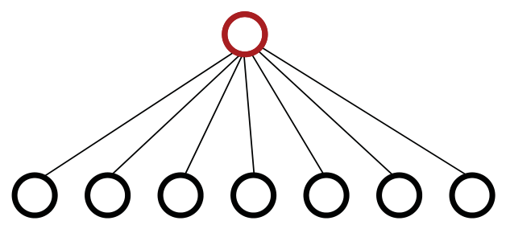
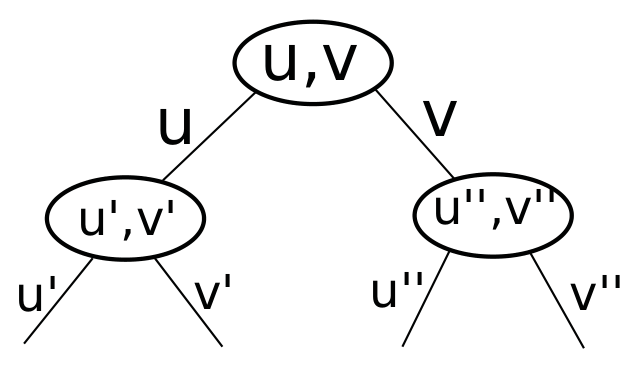

<!-- ===== PDF p1 ===== -->

<span style="color:#c0392b">**讲次 18（Lecture 18）：固定参数算法（Fixed-Parameter Algorithms）**</span> <span style="color:#7f8c8d;">（Spring 2015，2015 春季学期）</span>

本讲大纲：
- **顶点覆盖（Vertex Cover）**
- **固定参数可解性（Fixed-Parameter Tractability）**
- **核化（Kernelization）**
- **与近似的联系（Connection to Approximation）**

<span style="color:#c0392b">**固定参数算法（Fixed Parameter Algorithms）**</span>

固定参数算法是**应对 NP 困难问题**的另一种途径，与近似算法互补。一个算法有三个一般性的期望特征：

1. 求解（NP-）困难问题
2. **多项式时间**运行（快）
3. 得到**精确解**

一般而言，除非 $P = NP$，一个算法只能拥有这三个特征中的**两个**，而无法三者兼得。拥有特征 2 和 3 的算法是 $P$ 中的算法（多项式时间 + 精确）。近似算法拥有特征 1 和 2：它求解困难问题、运行很快，但不给出精确解。固定参数算法将拥有特征 1 和 3：它求解困难问题并给出精确解，但**运行不会很快**。

**思想（Idea）**：目标是得到一个**精确算法**，但把**指数项隔离到某个特定参数（parameter）上**。当这个参数的值较小时，算法就能快速处理实例。希望这个参数在实践中比较小。

**参数（Parameter）**：参数是一个非负整数 $k(x)$，其中 $x$ 是问题输入。通常，参数是问题的一个**自然性质（natural property）**（输入中的某个 $k$）。它**不一定能高效计算**（例如 OPT）。

**参数化问题（Parameterized Problem）**：参数化问题就是「问题 + 参数」，或者说「就参数而言看待的问题」。对任何给定问题，都可能存在许多有趣的参数化方式。

> <span style="color:#1e8449;">**[note] Note（译者注，「三选二」的不可能性）:**</span>
> 「困难、快速、精确——任选两个」是本讲的总纲，但它的身份比「经验法则」硬得多：它是 $P \ne NP$ 的逆否命题。设存在算法 $A$ 同时满足三条——求解 NP-hard（NP 困难）问题、在 polynomial time（多项式时间）内运行、返回 exact solution（精确解）。取任意一个 NP-complete（NP 完全）判定问题 $\Pi$，由 NP 完全的定义，$\Pi$ 可多项式归约到那个困难问题，于是「先归约、再跑 $A$」就在多项式时间内精确判定 $\Pi$；这蕴含 NP $\subseteq$ P，即 $P = NP$。所以「三选二」不是三个特征之间的审美取舍，而是「同时要三个就推翻主流猜想」这条逻辑的日常说法。
>
> 把三个特征各放弃一次，就落下三个真实存在的算法族。放弃「困难」（也就是问题本身落在 P 里）：讲次 1–15 的全部多项式算法，快且精确，但只处理简单问题。放弃「精确」：approximation algorithm（近似算法），讲次 17 的顶点覆盖 2-近似就是代表，它快、能啃困难问题，但答案只保证落在最优值 OPT 的常数倍以内。放弃「对输入规模一致的 polynomial time（多项式时间）」：本讲的 fixed-parameter algorithm（固定参数算法），它精确、能啃困难问题，代价是运行时间里带一个只依赖参数的指数因子 $f(k)$。还有一个常被忽略的第四格：brute force（暴力枚举）是「困难 + 精确 + 慢」，它在本讲的坐标系里恰好落在参数被推到极端的那一端，因此不是「三选二」之外的第五种，而是同一张图上的边界。
>
> 给一个算得到底的例子。取 $n = 1000$ 个顶点、$k = 20$ 的 vertex cover（顶点覆盖）实例，边数 $m = 5000$。暴力枚举要逐一检验 $\binom{1000}{20}$ 个候选集合，而 $\log_{10}\binom{1000}{20} \approx 41.5$，即约 $3.4\times 10^{41}$ 个集合；每个集合花 $O(m)$ 检查，总操作数约 $3.4\times10^{41} \times 5\times10^{3} \approx 1.7\times10^{45}$。按每秒 $10^{9}$ 次操作算，需要 $1.7\times10^{36}$ 秒；一年约 $3.16\times10^{7}$ 秒，故约 $5.4\times10^{28}$ 年，而宇宙年龄约 $1.38\times10^{10}$ 年，这个耗时是它的 $3.9\times10^{18}$ 倍。换成 bounded search tree（有界搜索树），$2^{20}\times 1000 \approx 1.05\times10^{9}$ 次操作，一秒内跑完。同一个小参数 $k = 20$，一边 $10^{36}$ 秒、一边 1 秒，相差 36 个数量级——这就是「放弃对 $n$ 的一致多项式、改用 $f(k)\cdot n^{O(1)}$」在能算与不能算之间划出的线。
>
> 跨课程连接：CSAPP 第 6 章的 cache（高速缓存）层次是同一个三角的物理版本——SRAM（静态随机存取存储器）快、贵、小，DRAM（动态随机存取存储器）慢、便宜、大，磁盘更慢、更便宜、更大，三种器件全都真实存在，却没有一种器件同时占据「最快的延迟 + 最大的容量 + 最低的单价」。区别有两处。其一，cache（高速缓存）三角的约束来自物理（晶体管面积、信号传播延迟、每次访问的能耗），本讲的三角约束来自逻辑（$P \ne NP$ 至今是猜想而非定理）；其二，硬件能靠层次叠加部分绕过三角——L1、L2、L3 与主存组合，让热数据近似拿到最快的延迟、冷数据近似拿到最大的容量，而一个算法只有一个运行时间，无法用叠加拼出三者兼得。再往上一层看，CLRS 第 34 章的 NP 完全性理论给出的正是「三特征不可兼得」的证明骨架，「三选二」只是把那条证明重新排布成一张设计空间图。
>
> 于是讲次 17 与讲次 18 不是两个孤立技巧，而是同一个不可能性定理朝两个方向的投影：一个朝「精确性」让步换速度，一个朝「多项式性」让步换精确性。看清这一点，遇到新的困难问题时，你的第一问就不再是「有没有快算法」，而是「我打算放弃哪一条」。

> <span style="color:#1e8449;">**[note] Note（译者注，参数化的思想）:**</span>
> 本条要解决的设计问题是：既然对 NP-hard（NP 困难）问题「精确」与「多项式时间」不能兼得，能不能把指数搬到一个更小的量上去？fixed-parameter algorithm（固定参数算法）的回答是把运行时间写成 $f(k)\cdot n^{c}$ 的形状：$n$ 的指数 $c$ 是与参数无关的常数，$k$ 只出现在函数 $f$ 的自变量位置。这次搬迁值钱的地方在于 $n$ 与 $k$ 是两个独立坐标：在一族实例上把 $k$ 钉死（在真实网络数据里，vertex cover（顶点覆盖）的大小常常只有个位数到几十），$f(k)$ 就退化成常数，整个算法对 $n$ 就是 $c$ 次多项式；而 $n^{f(k)}$ 的指数跟着 $k$ 一起长，钉死 $k$ 也换不来一个统一的次数。
>
> parameterized complexity（参数化复杂度）做的事就是把一维的复杂度曲线摊平成二维地图：横轴是输入规模 $n$，纵轴是参数 $k$。一维图里只有「多项式 / 超多项式」一条分界线，二维图里至少三块区域——FPT（固定参数可解）区，即 $f(k)\cdot n^{O(1)}$，$k$ 再大也只是把系数抬高、次数不动；XP 区（$n^{f(k)}$ 型），固定的 $k$ 是多项式，但 $k$ 一动次数就变；以及被 W-hierarchy（W 层级）划出来的、普遍认为不在 FPT（固定参数可解）里的区域。系统化的工作由 Downey 与 Fellows 在 1999 年的专著里完成，更早的先行者是 Gurevich、Stockmeyer 与 Vishkin 在 1984 年对「几乎成为树」的图类的处理。
>
> 代入数字看三层差别。取 $n = 10^{5}$ 个顶点、$k = 10$。暴力枚举是 $n^{k} = (10^{5})^{10} = 10^{50}$ 次操作，按每秒 $10^{9}$ 次算也要 $10^{41}$ 秒，彻底无望。bounded search tree（有界搜索树）是 $2^{10}\times 10^{5} \approx 1.02\times10^{8}$ 次操作，约 0.1 秒。再叠一层 kernelization（核化），把图压到 $2k^{2} = 200$ 个顶点，搜索树只需 $2^{10}\times 200 \approx 2.05\times10^{5}$ 次，微秒级。同一个问题、同一张图，三种写法的差距是 $10^{45}$ 倍。但必须立刻看反面：若 $k$ 不有界，比如 $k = 316$，则 $2^{316} \approx 1.3\times10^{95}$，比暴力还糟——这一族算法的实用性百分之百押在「现实分布里 $k$ 确实小」这个经验事实上，算法本身保证不了它。
>
> 跨课程连接有两条。第一条是 CLRS 第 15 章的 0-1 knapsack（0-1 背包）动态规划：$O(nW)$ 里的 $W$ 是容量数值，相对输入的编码长度来说它是指数的，所以该算法只是 pseudo-polynomial（伪多项式）的；但换个坐标看，$O(nW)$ 就是 $f(W)\cdot n^{1}$，$W$ 只进系数——它本来就是 fixed-parameter algorithm（固定参数算法）的一个特例，参数取「输入的数值上界」。区别在于：伪多项式算法的参数是被迫的（数值大小），$W$ 稍大就失效；FPT（固定参数可解）的参数是设计者主动挑的结构量，并且要求多项式部分的次数与参数无关，这比 $O(nW)$ 的要求更强，也更可组合。第二条是 CSAPP 第 6 章把 cache line（缓存行）的字节数 $B$ 当参数：cache miss（缓存未命中）次数写成 $O(n/B + L)$，其中 $L$ 是层数，$B$ 一固定就得到干净的线性界。这与「小量进 $f$、大量进多项式」是同一套手艺；区别是 $B$ 由硬件全局给定、对所有实例相同，而 $k$ 是每个实例自带的性质，所以参数化分析必须对 $k$ 的分布做经验判断，不能像 $B$ 那样当成常数写掉。
>
> 所以 fixed-parameter algorithm（固定参数算法）不是「更快一点的指数算法」，而是换坐标：在同一问题族上重新挑一个度量，让不可解那一侧塌缩成常数。评价一个 FPT（固定参数可解）算法只看两件事——$f$ 的形状（是 $2^{k}$、$k!$ 还是 $2^{2^{k}}$）与实际数据里 $k$ 的典型值；两者有一个不成立，理论上的好消息就变不成工程上的能跑。

---

<!-- ===== PDF p2 ===== -->

<span style="color:#c0392b">**固定参数算法（续）**</span>

**目标（Goal）**：固定参数算法的目标，是拥有一个**关于问题规模 $n$ 多项式、但可能关于参数 $k$ 指数**的算法，并且仍然得到**精确解**。

<span style="color:#c0392b">**$k$-顶点覆盖（$k$-Vertex Cover）**</span>

给定图 $G = (V, E)$ 和一个非负整数 $k$，是否存在一个大小至多为 $k$ 的顶点集合 $S \subseteq V$（$|S| \le k$）**覆盖所有边**？这是顶点覆盖的判定问题，也是 **NP 困难**的。我们将用 $k$ 作为参数，为 $k$-顶点覆盖开发一个固定参数算法。注意我们可以有 $k \ll |V|$，如下图所示：

<span style="color:#c0392b">**暴力解（坏）（Brute-force solution）**</span>



> <span style="color:#7f8c8d;">[原图说明] 原页附图（矢量图，p2）：暴力枚举示意——「Try all $\binom{v}{0} + \binom{v}{1} + \cdots + \binom{v}{k}$ sets of $\le k$ vertices」，即尝试所有大小 $\le k$ 的顶点集合。此图将在统一裁剪阶段作为原图插回。</span>

尝试所有大小 $\le k$ 的集合：

```math
\binom{v}{0} + \binom{v}{1} + \cdots + \binom{v}{k}
```

可以**跳过所有小于 $k$ 的项**，因为更大的集合覆盖能力更强。测试覆盖需要 $O(m)$ 时间，其中 $m$ 是边数。因此，总运行时间是 $O(V^k |E|)$。它对**固定的 $k$** 是多项式的，但**对不同 $k$ 不是同一个多项式**。在大多数情况下它效率低下。因此我们把 $n^{f(k)}$ 定义为**坏的（bad）**，其中 $n = |V| + |E|$ 是输入规模。

> <span style="color:#1e8449;">**[note] Note（译者注，为什么 $n^{f(k)}$ 是「坏」的）:**</span>
> 这里要回答的问题是：$O(V^{k}|E|)$ 这种暴力解到底「坏」在哪——它对固定 $k$ 明明是多项式，为什么不算数？关键在「多项式时间」这句话的语义：它的严格含义是「存在一个常数 $c$ 和一个阈值 $N$，使所有 $n > N$ 的运行时间不超过 $n^{c}$」。若次数里含 $k$，那么每钉住一个 $k$ 你得到的是**一个**多项式，换一个 $k$ 就得到**另一个**多项式；无穷多个多项式拼起来，不构成对一个问题类的单一承诺。fixed-parameter tractable（固定参数可解）要的是一次性覆盖全部 $k$：$f(k)\cdot n^{c}$ 里的 $c$ 是常数，$k$ 只抬高系数。所以 $n^{f(k)}$ 的「坏」是分类学意义上的坏——它让每个切片都可解，却让你说不出「这类问题整体可解」。
>
> 更硬的理由是 $k$ 并不受控。参数 $k$ 写在输入里只占 $O(\log k)$ 位，因此它完全可以随 $n$ 长大：取 $k = \log_{2} n$，则 $n^{k} = (2^{\log_{2} n})^{\log_{2} n} = 2^{(\log_{2} n)^{2}}$，这是 super-polynomial（超多项式）的，比任何 $n^{c}$ 都大。代入具体数：$n = 2^{20} \approx 1.05\times10^{6}$、$k = 20$ 时，$n^{k} = (2^{20})^{20} = 2^{400} \approx 2.6\times10^{120}$ 次操作；而 $2^{k}\cdot n = 2^{20}\times2^{20} = 2^{40} \approx 1.1\times10^{12}$ 次。两者的 $\log_{10}$ 相差约 $108$，也就是一百零八个数量级。同一条「固定 $k$ 就是多项式」的辩护，在 $k$ 随 $n$ 走的情形下彻底失效——而输入只保证你拿到 $k$ 的二进制编码，不保证它小。
>
> 再说「跳过所有小于 $k$ 的项」这一步，它的正确性来自单调性，收益却没想象中大。正确性：设 $S$ 覆盖 $E$ 且 $S \subseteq S'$，则每条边至少有一端在 $S$ 中，也就至少在 $S'$ 中，于是 $S'$ 仍覆盖 $E$；所以只要存在大小 $< k$ 的 vertex cover（顶点覆盖），就一定存在大小恰为 $k$ 的，判定答案不变，枚举只需看 $\binom{V}{k}$ 个集合。收益：二项式系数按 $\binom{1000}{i+1}/\binom{1000}{i} = (1000-i)/(i+1)$ 增长，$i = 19$ 时这个比值是 $981/20 \approx 49$，所以 $\sum_{i<20}\binom{1000}{i}$ 大约只有 $\binom{1000}{20}$ 的 $1/48$——跳过小于 $k$ 的项总共只省下约 $2\%$。换句话说，那一步是干净的化简，但不是复杂度的来源；真正的改进必须换算法形状，把「枚举集合」改写成「做决策」。
>
> 跨课程连接：这条注里的单调性是 6.042J 的 partially ordered set（偏序集）里 up-set（上闭集）的一个实例——「是覆盖」这个谓词在包含关系下向上封闭，于是「存在一个解」的判定只需在极小的一批候选上验证，因为把覆盖加厚只会让条件更容易成立，不会更难。同一个模板在本课程内部也反复出现：讲次 12 的 cut property（割性质）靠「往森林里加边不会破坏无环」这条单调性，只检查跨割的最小边；CSAPP 第 6 章的 cache（高速缓存）则有一条经验版的单调性——cache（高速缓存）更大，命中率不会降低。区别在约束来源：up-set（上闭集）的单调性是定义的直接推论（逻辑层），cut property（割性质）的单调性是图论结构给出的（算法层），而 cache（高速缓存）的单调性是硬件行为被实测归纳出来的（物理层），后者只是近似成立，容量翻倍也可能因为 conflict miss（冲突未命中）变多而降低命中率——这正好提醒你，单调性用错层次就会得出假结论。
>
> 所以严格的说法是：$O(V^{k}|E|)$ 属于 XP 家族而不是 FPT（固定参数可解）家族，它的「对固定 $k$ 是多项式」这句话是真的，但不足以支撑任何跨 $k$ 的承诺；把它记成坏的，是因为复杂度理论关心的从来不是单个实例，而是整族实例的可解性。

<span style="color:#c0392b">**有界搜索树算法（好）（Bounded search-tree algorithm）**</span>

这是一个用于改进暴力搜索的**通用技术**。它的工作方式如下：

- **任取**一条边 $e = (u, v)$
- 我们知道**要么 $u \in S$，要么 $v \in S$**（或两者），但不知道是哪个
- **猜测**是哪一个：尝试两种可能性
  1. 把 $u$ 加入 $S$，从 $G$ 中删除 $u$ 及其关联边，并用 $k' = k-1$ 递归。
  2. 对 $v$ 做同样的事（替换 $u$）。
  3. 返回两个结果的 **OR**。

---

<!-- ===== PDF p3 ===== -->

<span style="color:#c0392b">**有界搜索树算法（续）**</span>

这就像动态规划里的**猜测（guessing）**，但**记忆化（memoization）在这里没有帮助**。递归树如下所示：



> <span style="color:#7f8c8d;">[原图说明] 原页附图（矢量图，p3）：二分递归树——根为边 $(u,v)$，分支出「选 $u$」与「选 $v$」两条路径，各自再递归到下一层边 $(u',v')$、$(u'',v'')$，形成满二叉树，深度为 $k$、叶数 $2^k$。此图将在统一裁剪阶段作为原图插回。</span>

在叶子（$k = 0$）处，若 $|E| = 0$（所有边都被覆盖）则返回 YES。删除 $u$ 或 $v$ 需要 $O(V)$ 时间。因此总运行时间为 $O(2^k |V|)$。

- 对固定 $k$：$O(V)$ 多项式
- **多项式的次数与 $k$ 无关**
- 对 $k = O(\lg |V|)$ 也是多项式
- 对例如 $k \le 32$ 是实用的
- 因此我们把 $f(k) \cdot n^{O(1)}$ 定义为**好的（good）**

<span style="color:#c0392b">**固定参数可解性（Fixed Parameter Tractability）**</span>

如果存在一个运行时间 $\le f(k) \cdot n^{O(1)}$ 的算法，其中 $f: \mathbb{N} \to \mathbb{N}$（非负）、$k$ 是参数、且多项式的 $O(1)$ 次与 $k$ 和 $n$ **无关**，那么这个参数化问题是**固定参数可解的（fixed-parameter tractable, FPT）**。

**问题（Question）**：为什么是 $f(k) \cdot n^{O(1)}$ 而不是 $f(k) + n^c$？

<span style="color:#2471a3;">**[theorem]**</span> **定理（Theorem）**：存在 $f(k) \cdot n^c$ 算法 **$\iff$** 存在 $f'(k) + n^c$ 算法。

<span style="color:#2471a3;">**[proof]**</span> **证明（Proof）**：

- **（$\Leftarrow$）**：平凡（假设 $f'(k)$ 和 $n^c$ 都 $\ge 1$）。
- **（$\Rightarrow$）**：
  - 若 $n \le f(k)$，则 $f(k) \cdot n^c \le f(k)^{c+1}$
  - 若 $f(k) \le n$，则 $f(k) \cdot n^c \le n^{c+1}$
  - 因此 $f(k) \cdot n^c \le \max(f(k)^{c+1},\, n^{c+1}) = f'(k) + n^{c'}$ $\square$

另外，由于 $xy \le x^2 + y^2$，可以直接令 $f'(k) = (f(k))^2$ 且 $c' = 2c$。

**例（Example）**：$O(2^k \cdot n) \le O(4^k + n^2)$。

> <span style="color:#1e8449;">**[note] Note（译者注，有界搜索树的二分分支）:**</span>
> 这条换算解决的问题是：为什么 bounded search tree（有界搜索树）能把 $\binom{V}{k}$ 的「挑出 $k$ 个顶点」换成 $2^{k}$ 的「做 $k$ 次二选一」？答案是换掉了搜索空间的语言——前者在「顶点集合」这一层枚举，候选有 $\binom{V}{k}$ 个；后者在「决策序列」这一层枚举，每步只回答一个二元问题：这条边由谁负责。分支因子从 $V$ 降到 $2$，深度从「任意的 $k$ 元组合」降到「恰好 $k$ 步」，于是叶数从 $\binom{V}{k}$ 变成 $2^{k}$。
>
> 机制拆开有三层。第一层是必要条件：对任一条边 $e = (u, v)$，任何 vertex cover（顶点覆盖）都必须含 $u$ 或含 $v$——这是覆盖定义直接给出的，不需要任何额外知识。第二层是分支的正确性：可靠性靠叶子处的显式检查（预算耗尽时若还有边没被覆盖就返回 NO，若边集空则返回 YES，于是每条 YES 路径都对应一个真实覆盖）；完备性靠「每个解对根边必选 $u$ 或 $v$」，所以两条分支里必有一条包含某个真实解，归纳下去不丢解。第三层是预算递减：每进一层 $k$ 减一，深度被硬性截在 $k$，所以树的大小被 $2^{k}$ 从上方钉死，与 $n$ 无关——这正是「指数只依赖参数」的实现方式。
>
> memoization（记忆化）在这里帮不上忙，理由可以用一句话量化：dynamic programming（动态规划）的收益等于「不同子问题数」远小于「不同路径数」。讲次 10 的序列对齐里，路径数约 $\binom{2n}{n} \approx 4^{n}/\sqrt{n}$，子问题却只有 $O(n^{2})$ 个由区间 $[i,j]$ 标记的状态，重叠率极高；而在搜索树里，第 $d$ 层的结点由「删掉的 $d$ 元顶点集」唯一确定，两条不同路径删的是不同集合，剩余图一般不同，于是子问题数与路径数同阶（都约 $2^{d}$），比值为 1。缓存只能增加哈希开销，省不下时间。这也解释了为什么讲义强调「像 DP 里的猜测，但记忆化没用」——借的是 DP 的「分情况」形式，不是它省时间的那一半。
>
> 代入数字看指数底的实际含义。取 $n = 1000$、$m = 5000$：$k = 20$ 时约 $2^{20} \approx 1.05\times10^{6}$ 次递归调用，每次删点花 $O(V) = 1000$，总操作约 $1.05\times10^{9}$，一秒量级；$k = 32$ 时 $2^{32} = 4.29\times10^{9}$，乘 1000 得 $4.29\times10^{12}$ 次操作，按每秒 $10^{9}$ 次算是 $4295$ 秒，约 $72$ 分钟；$k = 40$ 时 $2^{40} \approx 1.10\times10^{12}$，乘 1000 得 $1.1\times10^{15}$，需要约 $1.1\times10^{6}$ 秒，即 $12.7$ 天。讲义说 $k \le 32$ 实用，这个门槛不是理论边界，而是 $2^{k}\cdot n$ 在当前机器速度下的产物：底数每涨 10，时间涨 $1024$ 倍，一个月变成三十年。
>
> 把它抽象成可复用的证明策略模板，可以命名为 branch-and-reduce（分支-减参数）：① 在实例里找一处「必须多选一」的局部结构（这里是「这条边的两个端点」）；② 对每个选项开一支，把实例约化（删掉该顶点及其关联边）；③ 让参数在每支上严格减少，使深度有界；④ 解递推 $T(k) \le b\cdot T(k-1) + \mathrm{poly}(n)$ 得 $O(b^{k}\cdot \mathrm{poly}(n))$。递推树与特征方程这套工具来自 CLRS 第 4 章，与讲次 3 的 divide and conquer（分治）同一副骨架；区别是分治靠「规模减半」得到对数深度，这里靠「参数减一」得到线性深度加指数叶数，前者把 $n$ 压成 $\log n$，后者把 $n$ 里那个 $k$ 次方整块剥掉。
>
> 跨课程连接还可以补一条更贴身的对照：binary search（二分搜索）的分支因子是 1、深度是 $\log_{2} n$，因为每次比较后可以丢掉一半数据；这里是分支因子 2、深度是 $k$，因为每次决策关于给定边是互斥的、数据删不掉。同一个「搜索树」形状，一个把对数当指数，一个把参数当指数——树的两个自由度（分支因子、深度）分别由问题和参数占用，这就是为什么后续改进只有两条路：减小分支因子（更聪明的约化规则），或减小深度（更好的上界与 kernelization（核化）预处理）。

> <span style="color:#1e8449;">**[note] Note（译者注，为什么用乘积 $f(k) \cdot n^{O(1)}$ 而不用和 $f(k)+n^c$）:**</span>
> 这条注要回答的设计问题是：定义 fixed-parameter tractable（固定参数可解）时，为什么把界写成乘积而不写成和？因为定理告诉你两种写法刻画的是同一个类，所以这个选择只是「规范写法」，不带来任何强弱差别。先把两个方向都摊开。
>
> $(\Leftarrow)$ 平凡：若算法时间是 $f'(k) + n^{c}$，则 $f'(k) + n^{c} \le 2\max(f'(k), n^{c}) \le 2 f'(k) \cdot n^{c}$（最后一步用了「两个都 $\ge 1$」），常数 2 直接吸收进 $f$。$(\Rightarrow)$ 分情况：若 $n \le f(k)$，则 $f(k)\cdot n^{c} \le f(k)\cdot f(k)^{c} = f(k)^{c+1}$；若 $f(k) \le n$，则 $f(k)\cdot n^{c} \le n\cdot n^{c} = n^{c+1}$。两种情况合起来，$f(k)\cdot n^{c} \le \max(f(k)^{c+1}, n^{c+1}) \le f(k)^{c+1} + n^{c+1}$，取 $f'(k) = f(k)^{c+1}$、$c' = c+1$ 就回到和形式。要点在于：乘积在两个区间上分别被「只看 $k$」和「只看 $n$」的单项压住，因此总能用两项之和从上方覆盖。
>
> 还有一条更短的路径：由 $(x-y)^{2} \ge 0$ 得 $xy \le x^{2} + y^{2}$，直接令 $x = f(k)$、$y = n^{c}$，得到 $f(k)\cdot n^{c} \le f(k)^{2} + n^{2c}$，即 $f'(k) = f(k)^{2}$、$c' = 2c$。这是 Young inequality（杨氏不等式）在指数取 $2$ 时的特例——它的完整形式 $ab \le a^{p}/p + b^{q}/q$（$1/p + 1/q = 1$）你在实分析的凸性讨论里见过同源的推导（$\log$ 的凹性），取 $p = q = 2$ 就退回上面这一步。用这条路径，你不必分情况讨论，代价是把 $f$ 和 $c$ 都抬高（$f$ 平方、$c$ 翻倍），界变松但结论不变。
>
> 代入数字感受「同一定义、不同常数」。取 $f(k) = 2^{k}$、$c = 1$、$n = 1000$。$k = 20$ 时乘积形式给出 $2^{20}\times1000 \approx 1.05\times10^{9}$ 次操作；和形式给出 $4^{20} + 1000^{2} \approx 1.0995\times10^{12} + 10^{6} \approx 1.1\times10^{12}$，乘积形式好三个数量级。换成 $k = 10$：乘积是 $1024\times1000 \approx 1.02\times10^{6}$，和形式是 $4^{10} + 10^{6} \approx 1.05\times10^{6} + 10^{6} \approx 2.05\times10^{6}$，两者只差两倍。可见两个界在常数层面能差到天壤之别，但都在 $O(\cdot)$ 意义下刻画同一件事——「是否 FPT（固定参数可解）」。这也提示了一条实用经验：要证明一个问题是 FPT（固定参数可解），用乘积形式做代数操作最省事；要给某个具体实例报上界，用取 $\max$ 的两项式更紧。
>
> 跨课程连接：这个定理和 6.042J 里的 $\Theta$（渐进紧记号）是同一套哲学的两个刻度——$\Theta$ 把「相差常数倍」的两条函数归为一类，这里把「相差任意 $f(k)$ 倍」的两条归为一类，后者是带参数的渐近。它也和实分析里 equivalent norm（等价范数）的结构相似：有限维空间里不同范数互相被常数倍夹住，所以「收敛」这件事与选哪条范数无关；这里的不同界互相被 $f(k)$ 倍夹住，所以「是否 FPT（固定参数可解）」与选哪种写法无关。区别有两点：范数等价是双向常数，这里是单向的、带 $k$ 的放缩；范数等价在无穷维失效，而这里的等价在每一族参数化问题上都成立。再往应用侧看，CSAPP 第 6 章的 AMAT（平均访存时间）写成 $t_{hit} + m \times t_{miss}$，是「和 + 积」混写的形式，但它描述的是有量纲的物理时间，两种写法不能互换；FPT（固定参数可解）的两种写法没有量纲，互换纯粹为了代数方便，这个对比正好标出「数学等价」和「物理等价」的界线。
>
> 最后给出选乘积的两条实用理由。其一，乘积形式在读法上直接对应「参数进指数、规模进多项式」这句口号，$f(k)$ 与 $n^{c}$ 的角色一望即知。其二，乘积形式在复合下更好用：把两个 FPT（固定参数可解）算法串起来当子程序调用，运行时间相乘、参数相加，$f_{1}(k_{1})f_{2}(k_{2})\cdot n^{O(1)}$ 仍然落在同一个类里，闭环；而和形式在复合时会出现 $\max$ 的嵌套，写起来更绕。所以定义选乘积，证明用和，各取所需。

---

<!-- ===== PDF p4 ===== -->

<span style="color:#c0392b">**核化（Kernelization）**</span>

**核化**是一种**简化性的自归约（simplifying self-reduction）**。它是一个**多项式时间算法**，把输入 $(x, k)$ 转换为一个**小且等价**的输入 $(x', k')$。这里「小」指 $|x'| \le f(k)$，「等价」指对 $x$ 的答案与对 $x'$ 的答案**相同**。

<span style="color:#2471a3;">**[theorem]**</span> **定理（Theorem）**：一个问题属于 FPT **$\iff$** 存在核化。

<span style="color:#2471a3;">**[proof]**</span> **证明（Proof）**：

- **（$\Leftarrow$）**：核化后得 $n' \le f(k)$；运行任意有限算法 $g(n')$；总时间 $n^{O(1)} + g(f(k))$。
- **（$\Rightarrow$）**：令 $A$ 是 $f(k) \cdot n^c$ 算法，假设 $k$ 已知：
  - 若 $n \le f(k)$，它已经被核化了。
  - 若 $f(k) \le n$，则：
    1. 运行 $A$ → 只需 $f(k) \cdot n^c \le n^{c+1}$ 时间
    2. 输出一个 $O(1)$ 大小的 YES/NO 实例（作为核化结果）
  - 若 $k$ 未知：运行 $A$ 达 $n^{c+1}$ 时间，若仍未结束，就知道它已被核化。

于是我们知道（指数大小的）核**存在**。近期工作旨在在可能时找到**多项式（甚至线性）核**。

<span style="color:#c0392b">**$k$-顶点覆盖的多项式核（Polynomial kernel for $k$-Vertex Cover）**</span>

为 $k$-顶点覆盖创建核，算法遵循以下步骤：

- 通过删除所有**自环（self loops）**和**重边（multi-edges）**使图**简单化**。
- **度数 $> k$ 的任何顶点**必然在覆盖中（否则需要加入 $> k$ 个顶点才能覆盖其关联边）。

---

<!-- ===== PDF p5 ===== -->

<span style="color:#c0392b">**核化（续）**</span>

- 一次一个地删除这样的顶点（及其关联边），并相应减小 $k$。
- 剩余图的最大度数 $\le k$。
- 每个剩余顶点覆盖 $\le k$ 条边。
- 若剩余边数 $> k^2$，回答 NO 并输出一个**规范 NO 实例（canonical NO instance）**。
- 否则，$|E'| \le k^2$。
- 删除所有**孤立顶点（isolated vertices）**（度为 0 的顶点）。
- 于是 $|V'| \le 2k^2$。
- 输入已被约简为规模 **$O(k^2)$** 的实例 $(V', E')$。

核化算法的运行时间是朴素的 $O(VE)$。（多费些功夫可做到 $O(V + E)$。）之后，我们可以对核应用暴力算法，得到总体运行时间 $O(V + E + \binom{2k^2}{k} \cdot k^2) = O(V + E + 2^k k^{2k+2})$；或者应用有界搜索树解，得到 $O(V + E + 2^k k^2)$。迄今最好的算法：**$O(kV + 1.274^k)$**，出自 [Chen, Kanj, Xia - TCS 2010]。

> <span style="color:#1e8449;">**[note] Note（译者注，核化三步走：规约规则 → 尺寸界 → 组合）:**</span> <span style="color:#1e8449;">**[note] Note（译者注，kernelization（核化）三步走：reduction rule（规约规则）→ 尺寸界 → 组合）:**</span>
> kernelization（核化）要解决的问题是：在把实例交给指数算法之前，先用多项式时间把与参数无关的「体积」削掉，让指数部分只在一个只依赖 $k$ 的小实例上发生。它的三步不是并列的三条经验，而是一条链：reduction rule（规约规则）必须既保答案又减规模，尺寸界必须由参数直接推出，最后的组合必须让总时间仍是 $f(k)\cdot n^{O(1)}$。
>
> 第一步是简单化。self loop（自环）$(v,v)$ 的覆盖约束比普通边更强——它要求 $v$ 必须入解，因此可以直接把 $v$ 当作强制项删掉并把 $k$ 减一；若按某些教材的约定把自环视作不参与覆盖，则删除它也不改变答案。multi-edge（重边）即同一对端点之间的多条平行边，覆盖一条就覆盖全部，等价于一条边。两种情形都是「删掉不改变答案」，但理由不同：一个是强制，一个是冗余。这一步的意义是让后续的度数论证成立——高度规则与 $k^{2}$ 界都默认图是 simple graph（简单图）。
>
> 第二步是 high-degree rule（高度规则）：若顶点 $v$ 的度数超过 $k$，则 $v$ 必在任何大小不超过 $k$ 的 vertex cover（顶点覆盖）中。反证，若 $v$ 不入解，则它的每一条关联边都只能靠另一端覆盖，而简单图中这 $\deg(v) > k$ 个另一端互不相同，需要多于 $k$ 个顶点，预算已经超了，矛盾。于是可以放心地把 $v$ 删掉、把 $k$ 减一、继续。这一步是关键剪枝：它不需要搜索，就能把「被迫的决定」一次性做掉；不做这一步，搜索树会在这些高度顶点上白白分支 $k$ 层。
>
> 第三步是尺寸界。做完前两步后剩余图的最大度 $\le k$，于是每个剩余顶点最多覆盖 $k$ 条边，$k$ 个顶点最多覆盖 $k \cdot k = k^{2}$ 条边；若残留边数超过 $k^{2}$，立刻回答 NO 并输出一个规范 NO 实例。否则 $|E'| \le k^{2}$；再删掉 isolated vertex（孤立顶点）（度为零，对覆盖没有任何贡献），每条边贡献两个不同端点，故 $|V'| \le 2|E'| \le 2k^{2}$。两步推理由参数直接给出尺寸，不依赖 $n$——这就是「核」的定义要求的 $|x'| \le f(k)$。
>
> 代入数字看压缩比。取 $k = 10$，则 $|E'| \le 100$、$|V'| \le 200$；取 $k = 20$，则是 $400$ 条边、$800$ 个顶点。若原图有 $10^{5}$ 个顶点与 $3\times10^{5}$ 条边，$k = 20$ 时压缩比分别是 $125$ 倍与 $750$ 倍。组合环节的对比更能说明问题：对核直接跑暴力要 $\binom{2k^{2}}{k}$ 次检验，$k = 10$ 时 $\binom{200}{10} \approx 2.2\times10^{16}$，乘上每次 $k^{2} = 100$ 的检验代价约 $2.2\times10^{18}$；按讲义给出的粗界 $2^{k}k^{2k+2}$ 写成 $1024\times10^{22} \approx 10^{25}$。而把 bounded search tree（有界搜索树）用在核上只要 $2^{k}k^{2} = 1024\times100 \approx 1.02\times10^{5}$。结论很直接：核化把 $n$ 赶出了指数，但核上仍然应当继续用搜索树，而不是退回暴力——两者叠起来才是 $O(n^{c} + 2^{k}k^{2})$ 的形状。
>
> 跨课程连接有两层。第一层是 CSAPP 第 6 章的 working set（工作集）：程序要想跑得快，先得把热数据压进 cache（高速缓存），此后每次访问的成本才与容量无关；核化做的是同一件事的算法版——先把实例压到小得能放进任何算法，后面的代价才与 $n$ 无关。区别在于 working set（工作集）由访问模式动态决定、只影响性能，而核的尺寸界由参数静态推出、并且必须保证答案等价，压错了就直接改变问题。第二层是讲次 16 的 polynomial-time reduction（多项式时间归约）：核化是这种归约的一个受限版本——方向是 self-reduction（自归约），即自己归约到自己，时间必须是多项式，输出规模必须只依赖 $k$。普通归约只要求「可计算」，保不住尺寸；核化多要一条尺寸承诺，换来「预处理之后指数部分与输入规模脱钩」。
>
> 前沿指标值得记住两个坐标。顶点覆盖的当前最好界是 $O(1.2738^{k} + kn)$，出自 Chen、Kanj、Xia 发表在 Theoretical Computer Science 2010 年 411 卷 3736–3756 页的论文，讲义里写的 $1.274^{k}$ 是它的四舍五入；这个记录保持了十余年，2022 年才被 $O^{*}(1.25284^{k})$ 的算法改进。另一方面，核的大小并非可以无限压缩：在标准复杂性假设下，顶点覆盖不存在 $O(k^{2-\varepsilon})$ 大小的核，$O(k^{2})$ 已经接近下界。两头夹住，你就明白为什么研究者的精力都压在底数的最后几位小数上——这不是理论洁癖，而是 $1.27^{k}$ 与 $2^{k}$ 在 $k = 100$ 时相差约 $5.2\times10^{19}$ 倍的现实差距。

<span style="color:#c0392b">**与近似算法的联系（Connection to Approximation Algorithms）**</span>

取一个优化问题（其 OPT 为整数），考虑其关联判定问题：「**OPT $\le k$？**」并以 $k$ 为参数。

<span style="color:#2471a3;">**[theorem]**</span> **定理（Theorem）**：优化问题有 **EPTAS**（EPTAS：**高效 PTAS**，$f(\frac{1}{\varepsilon}) \cdot n^{O(1)}$，例如讲次 17 的 ApproxPartition）**$\Rightarrow$** 判定问题是 **FPT**。

<span style="color:#2471a3;">**[proof]**</span> **证明（Proof）**：（类似于 FPTAS / 伪多项式算法的论证。）

- 设这是最大化问题（且是 $\le k$ 判定）。
- 用 $\varepsilon = \frac{1}{2k}$ 运行 EPTAS，时间 $f(2k) \cdot n^{O(1)}$。
- 相对误差 $\le \frac{1}{2k} < \frac{1}{k}$。
- $\Rightarrow$ 若 $OPT \le k$，**绝对误差 $< 1$**。

---

<!-- ===== PDF p6 ===== -->

<span style="color:#c0392b">**与近似的联系（续）**</span>

- 因此若我们找到一个值 $\le k$ 的解，则 $OPT \le \left(1 + \frac{1}{2k}\right) \cdot k = k + \frac{1}{2} < k + 1$。
- **OPT 为整数** $\Rightarrow OPT \le k \Rightarrow$ **YES**。
- 否则 $OPT > k$（NO）。

$\square$

另外：**$=$、$\le$、$\ge$ 判定问题在 FPT 意义下是等价的**。（可以用这个关系在某些情形下证明 EPTAS 不存在。）

> <span style="color:#1e8449;">**[note] Note（译者注，EPTAS ⇒ FPT：近似与精确的桥）:**</span>
> 这条定理搭的是两座楼之间的桥：一头是 approximation scheme（近似方案），另一头是参数化算法。它说的是，只要一个 optimization problem（优化问题）拥有 EPTAS（高效多项式时间近似方案，时间为 $f(1/\varepsilon)\cdot n^{O(1)}$），它的 $\text{OPT} \le k$ 判定问题就是 FPT（固定参数可解）。机制的核心是「用足够小的相对误差换取绝对意义上的精确判定」：把误差参数调到 $\varepsilon = 1/(2k)$ 之后，近似解的偏差被压到半个单位以内，而最优值 OPT 与解值都是整数，半个单位的偏差不足以跨过任何整数格点。
>
> 把两个方向都验证一遍，因为讲义正文只写了其中一个。先看 YES 方向：若 $\text{OPT} \le k$，任何可行解 $s$ 都满足 $s \le \text{OPT} \le k$，直接判 YES——这一步只用到「解是可行的」，连近似保证都没用上。再看 NO 方向：若 $\text{OPT} > k$，由于 OPT 是整数，必有 $\text{OPT} \ge k+1$；近似保证给出 $s \ge \text{OPT}/(1+\varepsilon) \ge (k+1)/(1 + 1/(2k)) = 2k(k+1)/(2k+1) = k + k/(2k+1)$，而 $k/(2k+1) < 1/2$ 对一切 $k \ge 1$ 成立，所以 $s > k$，判 NO。两侧拼起来，「$s \le k$」与「$\text{OPT} \le k$」严格等价，于是近似算法直接充当精确判定器。
>
> 代入具体数字。取 $k = 4$，则 $\varepsilon = 1/8 = 0.125$，运行时间形如 $f(8)\cdot n^{c}$，仍是 FPT（固定参数可解）形状。若 $\text{OPT} = 3$，则 $s \ge 3/1.125 = 2.667$，整数性给出 $s \ge 3$；又 $s \le 3$，故 $s = 3$，判 YES。若 $\text{OPT} = 5$，则 $s \ge 5/1.125 = 4.444$，取整得 $s \ge 5 > 4$，判 NO。再看大一点的 $k = 1000$，$\varepsilon = 1/2000 = 0.0005$：$\text{OPT} = 1000$ 时 $s \ge 1000/1.0005 = 999.5002$，取整得 $s \ge 1000$，判 YES；$\text{OPT} = 1001$ 时 $s \ge 1001/1.0005 = 1000.4998 > 1000$，取整得 $s \ge 1001 > 1000$，判 NO。两个相邻的整数值被分得干干净净，靠的正是 $\varepsilon \cdot \text{OPT} \le 1/2$ 这条裕度。
>
> 为什么这条桥只朝一个方向通？因为判定问题只吐一个是或否，不产出任何构造性的近似解；要从「能精确判 $\text{OPT} \le k$」恢复出「一个误差 $\varepsilon$ 的解」通常还需要额外的结构（例如最优化版本的自归约、或者解空间可以二分）。所以 FPT（固定参数可解）并不自动蕴含 EPTAS（高效多项式时间近似方案）。反过来，这条单向性正是它的实用价值：若某优化问题对应的判定问题是 W[1]-hard（W[1] 困难）而非 FPT（固定参数可解），则该优化问题没有 EPTAS（高效多项式时间近似方案），除非 FPT（固定参数可解）恰好等于 W[1]。这条反证路线比「没有常数因子近似」更细——后者只排除常数倍，而它连 $(1+\varepsilon)$ 都排除。经典例子是 clique（团）：判定「是否存在大小为 $k$ 的团」由 Downey 与 Fellows 在 1995 年证明是 W[1]-完全的，因此最大团问题没有 EPTAS（高效多项式时间近似方案）。
>
> 跨课程连接有两处。第一处是讲次 17 的三层近似方案：PTAS（多项式时间近似方案）的时间是 $n^{f(1/\varepsilon)}$，$n$ 的指数依赖 $\varepsilon$，所以它本身不是 FPT（固定参数可解）；FPTAS（完全多项式时间近似方案）的时间是 $(1/\varepsilon)^{O(1)}n^{O(1)}$；EPTAS（高效多项式时间近似方案）居中，时间是 $f(1/\varepsilon)\cdot n^{O(1)}$——恰好是 FPT（固定参数可解）的定义形状，定理于是把这条链的左端接进了参数化世界，得到一条包含链：FPTAS（完全多项式时间近似方案）包含于 EPTAS（高效多项式时间近似方案），后者又对应 FPT（固定参数可解）判定。第二处是 CLRS 第 34 章的「优化 ⇒ 判定」归约：平常我们用二分搜索把最优化压成判定；这里反过来，用「判定性的近似」产出「精确的判定」，是把归约反向用了一次。区别在于普通归约是多项式时间可计算的变换，而这里多要一条「近似误差可压到 1 以下」的量化保证。
>
> 最后给一张地图，方便你把这条定理挂到更大的框架上。参数化复杂度用 W-hierarchy（W 层级）给不可解问题分层：FPT（固定参数可解）包含于 W[1]，W[1] 包含于 W[2]，如此向上，每一层的完全问题由「有界 weft（电路层数）的电路可满足性」定义，团与独立集是 W[1]-完全，支配集是 W[2]-完全。这套层级给你一条现成的判据：先把判定问题用 fpt-reduction（FPT 归约）归约到某个 W[t]-完全问题（这类归约保持参数大小不变），就宣布该优化问题无 EPTAS（高效多项式时间近似方案）。所以这条注真正教你的不是「近似能推出精确」这个技巧，而是「近似与参数化是同一枚硬币的两面」——哪一面算得动，另一面就有了上界或下界。

---

<!-- ===== PDF p7 ===== -->

<span style="color:#7f8c8d;">**MIT OpenCourseWare**</span>

<span style="color:#7f8c8d;">http://ocw.mit.edu</span>

<span style="color:#7f8c8d;">**6.046J / 18.410J 算法设计与分析（Design and Analysis of Algorithms）**</span>

<span style="color:#7f8c8d;">Spring 2015（2015 春季学期）</span>

<span style="color:#7f8c8d;">有关引用这些材料的信息或我们的使用条款（Terms of Use），请访问：http://ocw.mit.edu/terms。</span>
