<!-- ===== PDF p1 ===== -->

**讲次 19（Lecture 19）：同步分布式算法（Synchronous Distributed Algorithms）——对称破缺（Symmetry-Breaking）、最短路生成树（Shortest-Paths Spanning Trees）** （6.046J, Spring 2015，Nancy Lynch 主讲）

**分布式算法（Distributed Algorithms）**

<!-- ===== PDF p2 ===== -->

**什么是分布式算法？（What are Distributed Algorithms?）**

- 运行在**联网的处理器**上，或运行在**共享内存的多处理器**上的算法。
- 它们求解许多种问题：
  - 通信（Communication）
  - 数据管理（Data management）
  - 资源管理（Resource management）
  - 同步（Synchronization）
  - 达成共识（Reaching consensus）
  - ……
- 它们在**困难的环境中**工作：
  - 许多处理位置上的**并发活动（Concurrent activity）**
  - **时间、事件顺序、输入的不确定性（Uncertainty）**
  - **处理器、信道的故障与恢复（Failure and recovery）**
- 所以它们可能**很复杂**：
  - 难以设计、证明正确性，也难以分析。

> **[note] Note（译者注，分布式算法的背景）:** 分布式算法的设计问题，不是「把同一个算法算得更快」，而是「在没有任何进程看得见全局、也没有一个可读的全局时钟的条件下，让 n 个各自为政的 processor（处理器）对同一件事得出同一个结论」。串行算法的正确性只挂在「输入到输出」这一条链上；distributed algorithms（分布式算法）的正确性还挂在「消息怎么走、谁先到、谁坏掉」上，等于凭空多出一整个维度要证。
>
> 这一讲之所以从同步模型切入，是因为同步送了你一件东西：节拍器。所有进程按同一个 round（轮）推进，「这一轮发出的 message（消息）一定在这一轮结束前送达」被写成模型公理。因果链很短：有统一轮，送达就有上界；有上界，轮数就能直接当时间用；能当时间用，归纳就能对「已经过去几轮」做。下一讲把节拍器抽掉，一条 message（消息）的延迟不再有上界，「没收到」和「还没到」在本地再也分不开，这才是异步模型真正难的地方。
>
> 标题页把三个挑战并列写出来：concurrency（并发）、缺少全局时钟、independent failure（独立故障）。三者都不是实现细节，而是会改变「什么问题可解」的结构性条件——任何一个单独出现，都还能靠工程手段绕过去；三个叠在一起，才逼出了独立于串行算法的一整套证明方法，也让「正确性」从一条链变成一个系统性质。
>
> 算一个具体的数，看「我们不考虑故障」这句假设有多强。设 n = 1000 台机器，每台每轮以 $p = 10^{-6}$ 的概率崩溃，一轮约 1 秒，跑一小时共 $3600$ 轮。期望崩溃台数 $= 1000 \times 3600 \times 10^{-6} = 3.6$ 台。也就是说一小时里平均坏三到四台，任何要求「全程所有参与者都活着」的算法在这个尺度上都不成立。要把它压回去，标准做法是 replica（副本）：三副本时三份同时坏掉才丢数据，单次概率 $p^3 = 10^{-18}$，一小时期望坏 $1000 \times 3600 \times 10^{-18} = 3.6 \times 10^{-12}$ 次，取倒数得约 $2.8 \times 10^{11}$ 小时，折合约 3200 万年一次——这就是「用空间换可靠性」的定量版本。
>
> 跨课程连接放在 CSAPP。你在第 12 章 concurrent programming（并发编程）里用的 mutex（互斥锁）与 semaphore（信号量）有两个前提：所有线程共享一个地址空间，系统里有一个调度器能够观测全部线程。分布式里这两个前提同时消失——没有共享内存，互斥就必须由 message（消息）加超时搭出来；没有全局观测者，「谁先拿到」就必须由 logical clock（逻辑时钟）或 quorum（多数派）裁定。区别用一句话记住：CSAPP 里的 lock 是内核和硬件直接给你的原语，分布式的 lock 是拿原语搭出来的协议，写错了不会段错误，只会静默地让两方同时进临界区。
>
> 至于 6.042J 那套 state machine（状态机）加 invariant（不变式），在这里从「证明工具之一」升级成「唯一可用的证明工具」，因为全局状态根本没有谁能直接看到，你只能用一个关于「所有进程状态与所有在途 message（消息）」的断言去间接地钉住它。收束回正文：这一讲先用同步模型把并发这一维单独拎出来讲透，异步与故障留给后面几讲。

<!-- ===== PDF p3 ===== -->

**分布式算法（续）**

- 自 **1967** 年起研究，始于 **Dijkstra** 和 **Lamport**。
  - Edsger Dijkstra：**1972 年图灵奖**得主
  - Leslie Lamport：**2013 年图灵奖**得主
- 一些参考资料：
  - Lynch, *Distributed Algorithms*
  - Attiya 和 Welch, *Distributed Computing: Fundamentals, Simulations, and Advanced Topics*
  - Morgan Claypool 的分布式计算理论系列专著
  - 会议：
    - 分布式计算原理（Principles of Distributed Computing, PODC）
    - 分布式计算（Distributed Computing, DISC）

> **[note] Note（译者注，历史）:** 这一页的历史不该当年表读，它其实是一条技术主线：一旦承认「没有全局时钟」，「谁先发生」就不再是观测事实，而必须被定义出来。定义得好，整门学科就立住了；定义得含糊，后面每一个算法都会在「顺序」上翻车。
>
> Lamport 1978 年那篇 CACM 论文（第 21 卷第 7 期，558 到 565 页）只做了一件事：定义 happens-before（先于发生）这个偏序——同一进程内的事件按发生顺序，发送先于它对应的接收，再对这三条取传递闭包。它是偏序而不是全序，两个进程各自独立发生的事件互不可比，这一点必须硬扛住；若为了「方便比较」而假装它们有序，就等于凭空引入了不存在的因果，后面的证明全部失效。
>
> 要把偏序压成一个可比的数，就用 logical clock（逻辑时钟）：每个进程配一个计数器，本地事件加一，发 message（消息）时把计数带出去，收到时取两者较大值再加一。得到的是单向保证：若 a 先于 b，则 $C(a) < C(b)$；反过来不成立，两个并发事件也可能一大一小。所以 logical clock（逻辑时钟）只能给出一个与因果相容的全序扩展（并列时用进程编号打破），不能用来判断真实因果。真要判断因果得升级成 vector clock（向量时钟）：每个进程维护 n 个计数器，每条 message（消息）带 n 个整数，比较两个向量谁「小于等于且不全等」才能确定因果。
>
> 第一个可算的例子回答「物理时钟为什么不行」。两个 quartz（石英）晶振各有 10 ppm 的频率误差，最坏相对漂移 $2 \times 10^{-5}$；一天 $86400$ 秒，累计漂移 $86400 \times 2 \times 10^{-5} = 1.73$ 秒。而一条同城链路的往返延迟可能是 1 毫秒，跨洋大约 150 毫秒。用这两个数复算：$1.73\ \mathrm{s} / 1\ \mathrm{ms} \approx 1.7 \times 10^{3}$，是三个数量级；$1.73\ \mathrm{s} / 150\ \mathrm{ms} \approx 11.5$，只有一个数量级（约 12 倍）。所以「时钟误差碾压消息延迟」只在同城那一档成立，跨洋这一档差了将近两个数量级——但即便只差十二倍，物理时间戳定序仍会把因果判反——这正是不得不发明逻辑时钟的直接压力。
>
> 第二个例子是位宽。32 位计数器在每秒 $10^9$ 个事件的速率下，$2^{32} / 10^{9} = 4.29$ 秒就溢出；换成 64 位是 $2^{64} / 10^{9} \approx 1.84 \times 10^{10}$ 秒，除以一年的 $3.16 \times 10^{7}$ 秒约 584 年。这两个数与你在 CSAPP 第 2 章算过的整数环绕是同一件事，只是这里的环绕会直接把定序判错，而不只是打印出负数。
>
> 另一条主线是 mutual exclusion（互斥）与 consensus（共识）。bakery algorithm（面包店算法）1974 年提出，只用「读一个寄存器、写一个寄存器」这种最弱的原子操作就能保证互斥，不需要 test-and-set 之类的硬件原语；Paxos 在 1998 年的《The Part-Time Parliament》里把「复制状态机」变成可实现的协议。这类工作的共同策略是：先承认底层只能提供最弱的保证，再在这一层之上把保证一级一级搭回来，而不是假设硬件听话。
>
> 会议与奖项只作坐标，不当年表背。PODC 1982 年首办于渥太华；DISC 1985 年以 WDAG（International Workshop on Distributed Algorithms）之名创立，1998 年改为现名。Dijkstra 奖 2000 年起颁发，原名 PODC Influential Paper Award，2002 年 Dijkstra 去世后改用他的名字；GHS 1983 年那篇最小生成树论文拿到的是 2004 年的奖。奖项的作用不在荣誉，而在标出「哪些问题定义了这门学科」。
>
> 跨课程连接：CSAPP 第 2 章的整数溢出与第 12 章的事件排序，在这里被合成了同一件事——计数器的有限位宽决定了逻辑时间能跑多久。区别在于，CSAPP 的 happens-before（先于发生）由锁与内存屏障在单机内实现，保证的是同一块内存的可见顺序；Lamport 的 happens-before（先于发生）跨机器，只能靠 message（消息）传递来建立，因此它比内存序弱得多，也正因为弱，才必须显式地算。
>
> 收束回正文：这一页列的参考文献不是装饰，Lynch 1996 年那本 872 页的《Distributed Algorithms》是把上面这些定义、算法与不可能性结果整理成统一记号的地方，本讲后面每一个定理都能在它的框架里找到位置。

<!-- ===== PDF p4 ===== -->

**本周（This Week）**

- 一个快速入门：
  - 两种常见的**分布式计算模型**，
  - 几个**基础算法**，以及
  - **分析算法**的技术。
- **同步分布式算法**：
  - 领导者选举（Leader Election）
  - 极大独立集（Maximal Independent Set）
  - 广度优先生成树（Breadth-First Spanning Trees）
  - 最短路生成树（Shortest Paths Trees）
- **异步分布式算法**：
  - 广度优先生成树
  - 最短路生成树

<!-- ===== PDF p5 ===== -->

**建模、证明与分析（Modeling, Proofs, Analysis）**

- 对分布式算法**至关重要**，因为它们**复杂且易错**。
- **无穷状态交互状态机（Infinite-state interacting state machines）**。
- 证明使用**不变式（invariants）**，用**归纳（induction）**证明。
- **抽象关系（Abstraction relations）**。
- 新的**复杂度度量**：
  - **时间复杂度**：轮数（Rounds），或实时。
  - **通信复杂度（Communication complexity）**：消息数（Messages），或比特数（bits）。

> **[note] Note（译者注，分布式证明方法）:** 这条注要回答的设计问题是：串行算法里一句「对输入规模归纳」就能搞定的事，为什么在分布式里必须换成「对轮数归纳」，而且还必须把信道上在途的东西一起算进状态。答案很干脆——分布式没有「输入规模」这个天然顺序，只有一个天然有序的量，就是 round（轮）编号。
>
> 先看机制。全局状态不是一个能被谁观测到的对象，它只能被定义成一个二元组：所有进程的局部状态，加上所有信道上在途的 message（消息）序列。因果链是这样的：若状态里不含在途 message（消息），那么「上一条 message（消息）已经发出、本轮还没被处理」这个真实存在的中间态就没有位置表达，归纳步会在那里断掉；一旦把它包含进来，转移就变成一个确定的函数——下一轮的全局状态完全由本轮结束时的全局状态决定，因为同步模型保证每条 message（消息）在一轮内必然送达。这也解释了一件容易被忽略的事：分布式的不变式往往比串行的长两三倍，不是因为问题更难，而是因为它必须显式地描述那个「延迟元件」。
>
> 归纳变量为什么只能是轮数？串行算法可以按输入长度归纳，因为输入是一个完整摆在面前的串；分布式里输入是分散在各进程手上的，没有「长度」这个先后，唯一天然有序的量是 round（轮）编号。所以本讲每一个正确性证明都长成同一个形状：「r 轮之后 P(r) 成立」，基例看初始状态，归纳步只看「r 到 r+1」这一格。
>
> 算一下归纳到底省了多少。设 n = 1000 个进程，每个进程 3 个布尔变量加一个 10 位 parent 指针，共 13 位；全局状态数为 $2^{1000 \times 13} = 2^{13000}$，取以 10 为底的对数得 $13000 \times 0.301 = 3913$，也就是约 $10^{3913}$ 个状态。而 BFS 的正确性归纳只需要 diam 加 1 步；若 diam = 20，就是 21 步。$10^{3913}$ 对 21——你不是在「选择要不要归纳」，而是除了归纳没有第二条路可走。
>
> 复杂度度量也换了口径。串行看时间与空间，分布式看 round（轮）数与 message（消息）数（粗算）或 bit（比特）数（细算）。本地计算被忽略的理由很朴素：一次本地比较是纳秒量级，一次跨机房往返是毫秒量级，两者差六个数量级，记入成本也淹没在噪声里。
>
> 再算一下成本结构。设边数 5000，每条无向边对应两条有向 channel（信道），每轮至多 10000 条 message（消息）；跑 20 轮共 $2 \times 10^{5}$ 条，每条 1000 bit（比特），合计 $2 \times 10^{8}$ bit（比特）。摊到 10000 条 channel（信道）上，每条承载 $2 \times 10^{4}$ bit（比特），在 10 Mb/s 的链路上只要 2 毫秒。而 20 轮、每轮 50 毫秒的单向延迟合计 1 秒。延迟项比传输项大 500 倍——所以在延迟主导的场景里，轮数是主成本，消息条数是次成本，bit（比特）数反而不是瓶颈；反过来在带宽紧张的跨境链路上，这个次序会翻转，这也是「复杂度」必须同时报两个数而不是一个的原因。
>
> 跨课程连接：6.042J 的 induction（归纳）与 state machine（状态机）在这里被原样复用，但归纳对象从「一个机器」变成「n 个机器的积」，而且积的每一步都要穿过「信道」这个延迟元件。区别值得写下来：6.042J 的状态机转移是即时的，这里的转移天然带一拍延迟，因此不变式必须显式覆盖那一拍，否则你会证明出一个比真实系统强的性质，然后在实现里被打破。
>
> 收束回正文：建模、证明、分析在分布式里不是三个步骤，而是同一个动作的三个面——状态定义对了，不变式就写得出来；不变式写得出来，归纳就过得去；归纳过得去，复杂度界才有意义。

<!-- ===== PDF p6 ===== -->

**分布式网络（Distributed Networks）**

- 基于一个**无向图** $G = (V, E)$。
  - $n = |V|$
  - $r(u)$：顶点 $u$ 的**邻居集合**。
  - $\deg u = |r(u)|$：顶点 $u$ 的**邻居数**。
- 把**一个进程**关联到**每个图顶点**。
  - 一个无穷状态自动机。
  - 有时把进程或顶点称为**节点（nodes）**。
- 把**两个有向通信信道**关联到**每条边**。
- 注意：**我们不考虑故障**。

<!-- ===== PDF p7 ===== -->

**同步分布式算法（Synchronous Distributed Algorithms）**

> [原图说明] 原页为章节分隔页（p7），仅标题「Synchronous Distributed Algorithms」。

<!-- ===== PDF p8 ===== -->

**同步网络模型（Synchronous Network Model）**

- 见 Lynch, *Distributed Algorithms* 第 2 章。
- 无向图**节点上的进程**通过**消息**通信。
- 每个进程有**输出端口（output ports）**、**输入端口（input ports）**，连接到通信信道。
  - 顶点 $u$ 上的进程**不知道**其端口的信道连到谁。
  - 只知道端口的**局部名字**，如 $1, 2, \ldots, k$，其中 $k = \deg u$。
- 进程**不必可区分（distinguishable）**。
  - 例如，它们不需要**唯一标识符（Unique Identifiers, UIDs）**。
  - 它们只知道**自己有多少端口**及其局部名字。

> **[note] Note（译者注，同步模型的两个关键设定）:** 同步模型用两句话就把「进程到底知道什么」钉死了：端口只知道本地编号，进程之间可以完全不可区分。这两条不是为了让模型好写而做的简化，而是把「对称」这个难点显式地暴露出来，好让后面的不可能性定理有一个干净的前提可以踩。
>
> 先说端口局部性。一个进程 u 的视图只有两样东西：自己的端口个数 k，以及每个端口上收到过的 message（消息）序列。它不知道端口 1 连到谁，只知道端口的局部名字是 1 到 k。为什么必须这样设定？因为一旦它知道，就等于给整个图装上了一个全局坐标系：每个进程都拿到了自己在图里的绝对位置，那么「同一个视图、不同的全局位置」这种配置根本不存在，任何「不可区分导致不可能」的论证都无从展开。所以这条设定不是为了省事，而是为了留下那个反例能站住的空间。
>
> 把因果链压成一句：视图相同，确定性算法必然给相同输出；若两个视图相同的进程在图里占据不同位置，算法就失去了「按位置区分」的能力，只能让它们做出同样的决定。
>
> 第一个可算的例子看本地排列数。一个度为 4 的进程，把 4 个本地端口接到 4 个邻居上的方式有 $4! = 24$ 种；从它自己的视角看，这 24 种全局配置完全无法分辨，所以它的输出必须在这 24 种情况下全部一致——这就是「局部视图」这四个字的量化含义。
>
> 第二个例子看整体的对称度。n = 1000 的 ring（环），把图映到自身且保持边关系不变的双射有 n 个旋转加 n 个反射，共 $2n = 2000$ 个。也就是说环上任意一个进程的视图，都与另外 1999 个进程的视图同构。这个数比「图是对称的」这句形容词有用得多：它直接告诉你，在这张图上任何基于「视图」的算法最多只能区分出 1 类进程，而不是 1000 类。
>
> 再说第二个设定：可区分性。不要求 UID（唯一标识符），意味着所有进程的初始状态可以完全相同，于是对轮数的归纳可以在「所有进程状态相同」这条对角线上封闭——这正是后面团网络不可能性证明的全部内容。一旦给了 UID（唯一标识符），初始状态就互不相同，归纳的前提被打破，对称才有可能被真正打破。所以「需要 UID」这句话的准确含义不是「需要一个名字」，而是「需要破坏归纳的对角线」。
>
> 顺便把一轮的物理成本算清楚。每轮每条无向边对应两条有向 channel（信道），所以一轮最多 $2|E|$ 条 message（消息）；4-regular 图在 n = 1000 时 $|E| = 2000$，即 4000 条。一轮的时长由最慢的一步决定：单向延迟 50 毫秒，加上发送 1000 bit（比特）在 10 Mb/s 上的 0.1 毫秒，合计约 50.1 毫秒；跑 20 轮就是 1.002 秒。注意这里用的是单向延迟而不是往返，因为同步模型把发送与接收安排在同一轮内完成，你并不需要额外等一个 ack（确认）。
>
> 跨课程连接放在 CSAPP 第 11 章。socket（套接字）编程里，程序拿到的只是一个 fd（文件描述符），它也只知道自己这一端，对端身份要等 accept（接受）或 connect（连接）成功才确定——这就是端口局部性在真实系统里的样子。区别值得写清楚：socket（套接字）的 fd（文件描述符）编号是 OS（操作系统）分配的本地名字，而且 connect（连接）之后对端地址就写进了内核结构，进程随时可以查；分布式模型里连「对端是否存在」都不在本地视图之内，进程手里只有端口序号，连邻居的名字都没有。
>
> 收束回正文：所以「不可区分」不是抽象洁癖，它是 Theorem 1 的唯一前提。把这两个设定记住，后面每一条不可能性结论你都能一句话说清它踩的是哪一条。

<!-- ===== PDF p9 ===== -->

**执行（Execution）**

- 算法在**同步轮（synchronous rounds）**中执行。
- 每一轮，每个进程根据其状态，决定要在**所有端口**上发送的消息。
  - 每轮每个端口**至多一条消息**。
- 每条消息被放入其信道，并**投递**到另一端的进程。
- 然后每个进程根据其**旧状态**和**到达的消息**计算**新状态**。
- 关于成本的说明：
  - 一般**忽略本地计算**的成本（时间与空间）。
  - 聚焦**时间**（轮数）与**通信**（消息数或总比特数）。

<!-- ===== PDF p10 ===== -->

**领导者选举（Leader Election）**

> [原图说明] 原页为章节分隔页（p10），仅标题「Leader Election」。

<!-- ===== PDF p11 ===== -->

**领导者选举（Leader Election）**

- $G = (V, E)$ 是任意**连通**（无向）图。
- 目标是让**恰好一个进程**输出一个特殊的**领导者信号（leader signal）**。
- 动机：领导者可以负责：
  - 通信
  - 协调数据处理
  - 分配资源
  - 调度任务
  - 达成共识
  - ……

> **[note] Note（译者注，领导者选举的意义）:** leader（领导者）选举本质上是一个「复杂度转换器」：它花掉一次性的 message（消息）预算，把之后每一次协调从「n 个进程达成一致」降成「1 个进程做决定」。这个转换值不值，取决于你后面要协调多少次——这一点在最后那个算例里会变得非常具体。
>
> 为什么非要一个 leader（领导者）。若没有 leader（领导者），「下一步该谁动」这件事就需要 n 个进程对同一个问题达成一致，而这正是 consensus（共识）问题本身，难度比它看起来高得多；有了 leader（领导者），决定只在一点做出，其余点只需要接收广播。这条因果链还有后半段：单点决策带来单点故障，所以真实系统里的 leader（领导者）必须配 lease（租约）或 quorum（多数派）兜底。这也解释了为什么文献里「选举」与「共识」总是并排出现——选出一个 leader（领导者）本质上就是解了一次共识。
>
> 讲义把目标写成「恰好一个进程输出 leader（领导者）信号」，这个措辞比「选出最好的那个」精确得多。它同时要求两件事：安全性上不能有两个，活性上最终必须有一个。拆开看就是「任何时刻至多一个」加「有限轮内至少一个」，两条都必须对任意执行成立，而不是对某一次幸运的执行成立。
>
> 第一个算例看一般图选举的代价。n = 1000、边数 5000，标准做法是每个进程各起一棵 BFS 树（把自己当根）来广播自己的编号，代价是 $O(n \cdot |E|)$ 条 message（消息），但常数要算对：一棵 BFS 树是 $2|E|$ 条（每条边两个方向各走一条 search），$n$ 棵并行就是 $n \cdot 2|E| = 1000 \times 10000 = 10^{7}$ 条；每条按 1000 bit（比特）算，合计 $10^{10}$ bit（比特），放到一条 10 Mb/s 的链路上要 1000 秒。对比一下：选举结束后一次全网广播只要约 $|V| + |E| = 6000$ 条 message（消息），即 $6 \times 10^{6}$ bit（比特），0.6 秒；一次完整协调算上上行汇播与下行广播是它的两倍，1.2 秒。所以这笔一次性的 1000 秒相当于 833 次广播的等价成本（按 1.2 秒一次的完整往返计）。回本的判据不是拿它去比一次广播：没有 leader（领导者）时，每一次协调本身都要重付这 1000 秒，所以后续协调只要超过一次就回本——「先选举」不是无条件正确的工程直觉，但它的账要用 833 次广播来记，不能用「上千次协调」来记。
>
> 第二个算例看环上的下界。单向 ring（环）选举的已知下界是 $\Omega(n \log n)$ 条 message（消息），n = 1000 时 $n \log_2 n = 1000 \times 9.97 \approx 9970$ 条。这个数说明打破对称本身有价格：想让 1000 个一模一样的进程里准确冒出一个特殊的，至少要传一万条消息，任何「一条消息搞定」的直觉在环上都是错的。
>
> 历史只作坐标：LeLann 1977 年给出环上的第一个选举算法，Chang 与 Roberts 1979 年给出简化版；GHS 1983 年那篇最小生成树论文顺带解决了一般图选举——最后存活的 fragment（片段）根就是 leader（领导者），2004 年获 Dijkstra 奖。注意 GHS 的思路：它不是在选举上做文章，而是发现「求最小生成树」这个更强的任务顺便就把 leader（领导者）定了——问题选对了，副产品就有了。
>
> 跨课程连接：与 6.006 的 Dijkstra 和 Prim 对比最清楚。那两个算法都假设有一个全局可见的 priority queue（优先队列），每一步都能取出全局最小边；分布式里没有这样的队列，每个进程只看得见自己的邻接边，所以「最小」必须先被选举或聚合出来。同一个贪心骨架，缺的正是全局视野。另一条连接是与讲次 16 的判定问题对比：NP 判定问题的答案只有一个 bit（比特），而选举的答案是「哪一个」，输出空间是 n，所以「给一个 YES 的证书就能验证」那套框架在这里完全用不上，你必须让 n 个进程自己对同一个身份达成一致。
>
> 收束回正文：所以下一张幻灯片要证的不是「算法不够聪明」，而是「在某些图上，无论多聪明都做不到」——把不可能性先钉死，才知道必须往模型里加什么。

<!-- ===== PDF p12 ===== -->

**简单情形：团网络（Simple case: Clique Network）**

- 所有顶点**两两直接相连**。
- **定理 1（Theorem 1）**：令 $G = (V, E)$ 是 $n$ 顶点**团（clique）**。那么**不存在**由**确定性的、不可区分的进程**组成的算法，能保证在 $G$ 中选举出一个领导者。
- **证明（Proof）**：
  - 例如，考虑 $n = 2$。
  - 两个**相同的、确定性的**进程。
  - 用**归纳**证明：这两个进程**永远保持相同状态**……

<!-- ===== PDF p13 ===== -->

**证明（Proof）**

- 用**反证法**。假设存在求解该问题的算法 $A$。
- 两个进程从**相同的初始状态**开始。
- 对完成的轮数 $r$ 做**归纳**：证明 $r$ 轮后两个进程处于**相同的状态**。
  - 生成相同的消息。
  - 收到相同的消息。
  - 做出相同的状态改变。
- 因为该算法求解领导者选举问题，**最终会有一个被选上**。
- 那么**两个都被选上**，矛盾。

> **[note] Note（译者注，对称性破缺的不可能性）:** 这个证明的方法论价值远大于结论本身：它不是「举一个坏例子」，而是「证明任何算法都逃不掉」，而且你甚至不需要知道算法长什么样——只用它的两个性质（确定性、读到的输入相同）就够了。这种「不知道实现也能否定全部实现」的证明，就是 symmetry argument（对称性论证）的原型。
>
> 把归纳三步写实。基例：两个进程初始状态相同，因为不可区分加上接到的输入相同。归纳步：假设 r 轮后两个进程状态仍然相同；因为算法是确定性的函数，端口编号也相同，它们在每个端口上发出的 message（消息）必然逐位相同；clique（团）里端口是一致接线的（端口 k 接到对端的端口 k），于是两个进程收到的 message（消息）也逐位相同；相同状态加相同输入必然给出相同转移，于是 r+1 轮后仍然相同。结论是对任意 r 都相同，也就是「永远相同」。
>
> 收口只需要两句话。算法必须终止，且必须恰好一个进程被选；既然两个进程永远相同，一个被选则另一个也必然被选，与「恰好一个」矛盾。注意这里叠了两个工具：反证法负责把「不存在」变成「假设存在再来推翻」，归纳负责把「某一轮不同」这个唯一的逃生口堵死。少任何一个，证明都不成立。
>
> 第一个算例把「永远待在对角线上」这句话量化。设每个进程的状态是 64 bit（比特），两个进程的联合状态空间是 $2^{128} \approx 3.4 \times 10^{38}$；而「两个状态相同」这条对角线只有 $2^{64} \approx 1.8 \times 10^{19}$ 个点，占比 $2^{-64} \approx 5.4 \times 10^{-20}$。归纳说的就是：无论跑多少轮，轨迹永远待在这条对角线上，一步都出不去。这个比例精确地表达了「不可区分」这条假设的力量——它把 $10^{38}$ 的自由度当场砍成 $10^{19}$。
>
> n 大于 2 的版本只是把二元推广成多元，但要留意一个新假设。团里每个进程有 n-1 个输出端口和 n-1 个输入端口，各按 1 到 n-1 编号，并假设是「一致接线」。同样的归纳给出「所有进程永远同状态」，于是「某个被选」升级成「所有人被选」。这里「一致接线」是证明的一部分而不是修辞：它保证端口编号本身不携带任何区分信息；若接线是任意的，编号就可能变成一种隐式身份，归纳的对角线就不封闭了。
>
> 🎥 *Lynch 在课上点破*："So what you've just seen is one of the very basic problems for distributed algorithms, which is breaking symmetry among identical processes. And you see that deterministic, indistinguishable processes just can't do it. So we have to have something more."（翻译：你刚才看到的是分布式算法最基础的问题之一——在相同进程之间打破对称。你会发现确定性的、不可区分的进程就是做不到，所以我们必须加点什么。）
>
> 跨课程连接有两条。其一是 6.042J 的等价关系与图的自同构：把图映到自身、保持边关系不变的双射，构成一种等价关系下的分类，同一条轨道上的顶点在算法眼里完全一样。其二是概率论里的 exchangeability（可交换性）：若联合分布对任意置换不变，则任何依赖顺序的统计量其分布都不变——结论是「顺序不影响分布」，不是「无偏」；无偏说的是均值，exchangeability（可交换性）管的是整条分布对置换的对称性，均值无偏只是它的一个副产品。这是同一条「对称则不可区分」的连续版本。区别在于，这里全程确定、也没有 adversary（对手）在挑选执行，所以结论是「必然失败」而不是「高概率失败」；一旦引入随机性，性质才从不可能变成几乎必然可能。
>
> 把方法记成可复用的模板：要证不可能，就构造一个置换——把进程重新编号、同时保持图结构与端口接线不变的双射——再证明算法在该置换下根本「看不到」它，于是输出必须不变，而要求的输出又必须随位置改变。这个骨架后面会反复出现：容错下界、匿名网络的不可判定性，用的都是同一套。
>
> 收束回正文：所以下一张幻灯片不是「换个更聪明的算法」，而是「往模型里加一条新的初始非对称」——唯一标识符或者随机数。

<!-- ===== PDF p14 ===== -->

**团网络（Clique Network）**

- **定理 1（Theorem 1）**：令 $G = (V, E)$ 是 $n$ 顶点团。那么不存在由确定性、不可区分进程组成的算法能保证在 $G$ 中选举领导者。
- **证明（Proof）**：
  - 现在考虑 $n > 2$。
  - 进程有 $n-1$ 个输出端口和 $n-1$ 个输入端口，各编号为 $1, 2, \ldots, n-1$。
  - 假设端口「**一致地**」连接：一个进程的输出端口 $k$ 连接到另一端的输入端口 $k$。
  - 用**归纳**证明：所有进程**永远保持相同状态**……

<!-- ===== PDF p15 ===== -->

**证明（Proof）**

- 假设存在求解领导者选举问题的算法 $A$。
- 所有进程从相同的初始状态开始。
- 对完成的轮数 $r$ 做归纳：证明 $r$ 轮后**所有进程处于相同状态**。
  - 对每个 $k$，它们在端口 $k$ 上生成相同的消息。
  - 对每个 $k$，它们在端口 $k$ 上收到相同的消息。
  - 做出相同的状态改变。
- 因为该算法求解领导者选举问题，最终**某个**进程被选上。
- 那么**每个人**都被选上，矛盾。
- 分布式算法的一个**基本问题：打破对称（Breaking symmetry）**。
- 确定性、不可区分的进程**做不到**。
- 所以我们需要**更多的东西**……

<!-- ===== PDF p16 ===== -->

**所以我们需要更多的东西……（So we need something more…）**

- **唯一标识符（Unique Identifiers, UIDs）**
  - 假设进程有唯一的标识符（UIDs），它们「知道」自己的 UID，例如每个进程在某个特殊状态变量里保存自己的 UID。
  - UID 是某个**全序集合（totally-ordered set）**的元素，例如自然数。
  - 不同的 UID 可以出现在图的任意位置，但**每个 UID 只能出现一次**。
- **随机性（Randomness）**

> **[note] Note（译者注，两种破对称的手段）:** 定理 1 说的是「对称必须先被注入破坏」，这一页给出两个注入口：UID（唯一标识符）与 randomness（随机性）。两者的差别不在「谁更聪明」，而在成本付在离线还是付在线——把账算清之后，你会发现它们其实是同一种操作的两种付费方式。
>
> 先看 UID（唯一标识符）的机制。它来自一个全序集，例如自然数，于是任意两个标识符可比，「最大者」存在且唯一，一轮广播加一次取最大就选完了。因果链很短：全序给出可比性，可比性给出最大值的存在，唯一性给出最大值只出现一次，于是恰好一个进程被选。这里全序不是装饰：若标识符只唯一但彼此不可比（比如任意集合的元素，谁大谁小没有定义），「最大」就无从谈起，整个算法当场失效。
>
> 有一个常被忽略的细节：实践中不需要自然数。任何有限长的二进制串配上字典序就是全序，所以「唯一」加「可比较」这两条就够了，这正是 MAC 地址与 UUID（通用唯一识别码）可以直接拿来当标识符用的原因——它们唯一、定长、天然可比较。
>
> 再看随机性。每轮各进程独立、均匀地从 1 到 r 中抽一个编号，然后按 UID（唯一标识符）的规则办；一旦出现并列就整轮作废、下一轮重抽。它把「确定性不可能」换成「概率 1 可能」，代价是可能要多跑几轮，而且每一轮的保证都是概率性的。
>
> 第一个算例把 r 的取值算实。引理 3 给出 r 取 $n^2 / (2 \varepsilon)$ 的上取整。取 n = 1000、$\varepsilon = 0.01$：$n^2 = 10^{6}$，$2\varepsilon = 0.02$，得 $r = 5 \times 10^{7}$。冲突概率的上界是 $\binom{n}{2} / r = 499500 / (5 \times 10^{7}) = 0.00999$，确实压到了 $0.01$ 以下，与引理的断言一致。
>
> 第二个算例看它要多少位。$2^{25} = 3.36 \times 10^{7}$ 不够，$2^{26} = 6.71 \times 10^{7}$ 够，所以 26 bit（比特）足以表示五千万个值。换成 n 等于一百万、$\varepsilon = 0.01$，r 变成 $5 \times 10^{13}$，$2^{45} = 3.52 \times 10^{13}$ 不够，$2^{46} = 7.04 \times 10^{13}$ 够，需要 46 bit（比特）。注意 n 翻了一千倍，位数只从 26 涨到 46——因为 r 随 n 平方增长，而位数随 n 的对数增长，所以「随机几乎唯一」在位数上其实很便宜，贵的是重复的风险。
>
> 两种手段的账要并排放。UID（唯一标识符）是离线注入一次、在线零成本，但需要有人先做一次集中式编号：一百万个进程、每个 32 bit（比特）编号，那张表就是 4 MB，而且必须保证全局不重复，这本身又是个分布式难题（谁来分配、怎么防重）。随机性是纯在线，每轮现抽，期望轮数是 $1/(1-\varepsilon)$；$\varepsilon = 0.01$ 时期望 1.01 轮，几乎就一轮，但它给不出绝对保证，只有「概率 1 保证」，也就是「几乎必然成功，但理论上存在永远失败的那条概率为 0 的执行」。
>
> 跨课程连接有两条。一是讲次 21 到 22 的 hashing（哈希）与 cryptography（密码学）：把长串压成短指纹，碰撞概率的分析与这里的并集界完全同构，密码学里的 nonce（一次性随机数）就是「随机破对称」的工程版。二是 CSAPP 第 6 章 cache（缓存）的 set（集合）index：用地址低位选组，本质也是一种确定性的破对称，区别在于 cache（缓存）只需要低冲突率，不需要唯一——两组撞了只是慢一点，而这里撞了就是选不出 leader（领导者）。
>
> 收束回正文：所以「需要 UID（唯一标识符）或随机数」这句话的准确含义是「需要在初始状态里引入一处不可复制的差异」，而这一处差异付多少成本、付在什么时间点，才是设计时真正要权衡的东西。

<!-- ===== PDF p17 ===== -->

**使用 UID 的算法（Algorithm Using UIDs）**

- **定理 2（Theorem 2）**：令 $G = (V, E)$ 是 $n$ 顶点团。那么存在由带 UID 的确定性进程组成的算法，能保证在 $G$ 中选举领导者。
- 该算法**只需 1 轮**，只用 **$n$ 条点对点消息**。
- **算法（Algorithm）**：
  - 每个进程把自己的 UID 发送到**所有输出端口**，并收集在**所有输入端口**上收到的 UID。
  - **UID 最大的进程**把自己选举为领导者。

> **[note] Note（译者注，最大 UID 当选）:** 这是「破对称」最便宜的一次兑现：不需要额外的图结构，也不需要多轮协商，只要一次全广播加一次比较。但它便宜的原因值得说清，因为它恰好暴露了后面所有算法都要面对的一个问题——成本记在谁头上。
>
> 先看为什么一轮就够。clique（团）的直径是 1，任意两个进程之间只隔一条边，所以「每个人把自己的 UID（唯一标识符）发给所有邻居」就等于「每个人拿到了全网的标识符集合」。因果链只有三格：知道全集，加上全序，就能算出最大值；最大值唯一，所以只有它把自己置为 leader（领导者）。正确性甚至不需要归纳，只需要「全序」和「唯一」这两条前提，这也解释了为什么它被写成定理 2 而不是某个定理的推论。
>
> 现在回答原注里那个疑问：到底是多少条消息。n = 1000 的团，每个进程有 999 个输出端口，每轮每个端口至多一条 message（消息），所以物理发送次数是 $n(n-1) = 999000$，不是 1000。若讲义写「n 条点对点消息」，能解释得通的只有一种口径：n 条逻辑 message（消息），每条被复制到 n-1 个端口；按 bit（比特）算账仍然是 999 次、每次 1000 bit（比特）的传输。这说明「消息复杂度」在报数之前必须先声明计数口径，否则 1 与 n-1 的差别会被悄悄藏进定义里，两边都觉得自己对。
>
> 把时间成本也算到底。一轮的时长由度决定：每个进程出口带宽 10 Mb/s，要发 999 条、每条 1000 bit（比特），合计 999000 bit（比特），约 0.0999 秒，接近 100 毫秒；加上 50 毫秒的单向延迟，一轮约 150 毫秒。若 n 变成 10000，每个进程要发近一万条 message（消息），约 $10^{7}$ bit（比特），单机出口就要 1 秒。这就是「稠密图上的一轮并不便宜」的量化版本：轮数是个位数，但每一轮的墙钟时间随 n 线性增长。
>
> 与随机版并排看，差别就是一个会计科目。确定性版一轮完成，但要求 UID（唯一标识符）预先分配；随机版不需要任何预分配，期望 $1/(1-\varepsilon)$ 轮，但每轮都要重抽、还可能整轮作废。一句话：把成本从在线挪到离线，或者反过来挪回去，没有哪一种更「先进」。
>
> 还有一个边界必须点出：如果两个进程的 UID（唯一标识符）相同，也就是唯一性假设被违反，那么两者都会算出自己是最大，于是出现两个 leader（领导者）。这正是定理 2 的措辞里必须写「带 UID（唯一标识符）的确定性进程」的原因——唯一性不是修辞，它是正确性证明里被真正用到的那一条前提。
>
> 跨课程连接有两条。一是 CSAPP 第 6 章 cache（缓存）的 tag 比较与选路：结构上同样是「用一个唯一键做选择」，区别在于 cache（缓存）用硬件并行比较 4 到 8 路，而这里是协议层、n 可以到一万，比较只能在这个进程里串行做 999 次。二是与「找最大值」这个基本选择问题的连接：串行找最大值需要 n-1 次比较，这里每个进程各做 n-1 次本地比较，总数变成 $n(n-1)$ 次，但墙钟只有一次比较的时间。分布式做的是把「总功」放大 n 倍，换来「时间」压到常数轮——这笔交换是否值得，取决于你更缺哪一个。
>
> 收束回正文：所以定理 2 的价值不在算法本身（它太简单了），而在于它标定了「对称破缺的最小成本」——一轮、n 条逻辑消息、外加一次离线的全局编号。后面所有更复杂的算法，都是在这条基线上加代价换功能。

<!-- ===== PDF p18 ===== -->

**使用随机性的算法（Algorithm Using Randomness）**

- **思想（Idea）**：进程从**足够大的集合**中**随机**选择 ID，使得**所有 ID 都不同**的可能性很大。然后像 UID 一样使用它们。
- **问（Q）**：什么是「足够大」的集合？
- **引理 3（Lemma 3）**：令 $\varepsilon$ 为实数，$0 < \varepsilon < 1$。假设 $n$ 个进程 $1, \ldots, n$ 独立地从 $\{1, \ldots, r\}$ 均匀随机地选择 id，其中 $r = \lceil n^2 / 2\varepsilon \rceil$。那么**以至少 $1 - \varepsilon$ 的概率**，所有选出的数都不同。
- **证明（Proof）**：任意两个特定进程选到相同数的概率是 $\frac{1}{r}$。对全部 $\binom{n}{2}$ 对取**并界（union bound）**，概率仍然 $< \varepsilon$。

> **[note] Note（译者注，并界与生日悖论）:** 这条注要回答的是一个定价问题：随机选 id 时，取值空间为什么必须开到 $r = \lceil n^{2}/2\varepsilon \rceil$，而不是「差不多 $n$ 就够」。机制只有一句话——一次抽签里「出现重复」不是一个事件，而是 $\binom{n}{2}$ 个事件的并集，而 union bound（并界）让这个并集的概率变成可以逐项相加的和。
>
> 先把坏事件写清楚。设 $A_{ij}$ 表示第 $i$ 与第 $j$ 个进程抽到同一个值。抽签是 uniform（均匀分布）的，所以单个 $A_{ij}$ 的概率恰好 $1/r$，与 $i$、$j$ 无关。要的是「全都不重复」，也就是 $\bigcup A_{ij}$ 不发生。精确算这个并集得用 inclusion-exclusion（容斥），项数随 $n$ 指数增长，实算不动；而 union bound（并界）说 $P(\bigcup A_{ij}) \le \sum P(A_{ij})$，只要求概率非负，连 independence（独立性）都不要。这正是这一步能成立的唯一理由：$A_{12}$ 与 $A_{13}$ 都涉及第 1 个进程，本身相关，用乘法会算错，用加法不会。这个界在信息上极其廉价，它只用每个事件的边缘概率，完全不管事件之间的相关结构，所以它永远算得出来，也永远可能松。
>
> 代进去：$P \le \binom{n}{2}/r \le (n^{2}/2)/r$，令其不超过 $\varepsilon$ 得 $r \ge n^{2}/(2\varepsilon)$，这就是引理 3 的取值。注意代价落在哪里：$r$ 是 $n^{2}/\varepsilon$ 量级而不是 $n$ 量级。冲突概率对 $n$ 是平方敏感的，对 $r$ 只是一次敏感的——把 $r$ 放大十倍，冲突概率降十倍；把 $n$ 放大十倍，冲突概率涨一百倍。
>
> 具体算一遍。取 $n = 1000$、$\varepsilon = 0.01$，得 $r = \lceil 10^{6}/0.02 \rceil = 5 \times 10^{7}$。上界：$\binom{1000}{2} = 499500$，除以 $5\times 10^{7}$ 得 $0.00999$，确实在 $0.01$ 以内。再用真实概率检查这个界松到什么程度：全不同的概率是 $\prod_{k=0}^{n-1}(1 - k/r)$，当 $n^{2}/2r$ 很小时约等于 $\exp(-499500/5\times 10^{7}) = \exp(-0.00999)$，所以撞车概率约 $1 - 0.99006 = 0.00994$。上界 $0.00999$ 与真值 $0.00994$ 只差半个百分点，说明坏事件稀少时 union bound（并界）几乎不损失。它什么时候会废：若图省事取 $r = n = 1000$，真概率是 $1 - \exp(-0.4995) ≈ 0.393$，而 union bound（并界）给出 $499500/1000$，这个数已经大于 1，退化成毫无信息的界。同一把工具，事件一常见就立刻失效，这是它唯一的适用条件。
>
> birthday paradox（生日悖论）是这个模型最熟悉的实例：$r = 365$ 时要 $n = 23$ 才有超过一半的撞车概率，因为 $\binom{23}{2}/365 = 253/365 ≈ 0.693$ 已在「超过一半」的量级。顺手把阈值公式记下来：撞车概率过半时 $n ≈ 1.18\sqrt{r}$，代入 $r = 365$ 得 $22.5$，取整就是 23，可见 23 不是经验常数而是开方关系的产物。这里真实撞车概率约 $0.507$，并界给 $0.693$，事件一旦常见，限就松了三成七（$0.693 / 0.507 \approx 1.37$）。讲义把它参数化成 $\varepsilon$，等于把「全部 id 不同」当成一项可调的工程预算：你要多可靠，就直接决定 $r$ 要几位。
>
> 跨课程连接：CSAPP 第 6 章的 direct-mapped（直接映射）cache（缓存）与这里是同一个抽样模型。32 KiB 的 L1、每块 64 B，就有 512 个 set（集合）；若 8 个同时活跃的地址在 set（集合）上近似均匀，则「至少一对撞进同一 set（集合）」的上界是 $\binom{8}{2}/512 = 28/512 ≈ 5.5\%$，这正是 conflict miss（冲突缺失）的最粗估算。连接路径是「$n$ 个对象落进 $r$ 个桶，问有没有碰撞」；区别在于 cache（缓存）用地址低位做确定性映射，冲突能被数据布局主动规避，而随机 id 没有可控结构，只能靠加大 $r$ 去压。
>
> 所以引理 3 不是技巧性的估计，而是「用 $\log r$ 比特随机性买 $1-\varepsilon$ 的唯一性」的定价单；下一张幻灯片「最大 id 当选」之所以成立，全靠这张单子。

<!-- ===== PDF p19 ===== -->

**使用随机性的算法（Algorithm Using Randomness）**

- **定理 4（Theorem 4）**：令 $G = (V, E)$ 是 $n$ 顶点团。那么存在由**随机的、不可区分进程**组成的算法，能**以概率 1** 最终在 $G$ 中选举出领导者。
- 该算法的**期望时间 $< \frac{1}{1-\varepsilon}$**。
- 并且以概率 $> 1 - \varepsilon$，算法**仅用一轮**就完成。
- **算法（Algorithm）**：
  - 进程从足够大的空间中随机选择 id。
  - 交换 id；若**最大值唯一**，则最大值获胜。
  - 否则**重复**，需要多少次就多少次。

> **[note] Note（译者注，概率 1 收敛与期望轮数）:** 这条注要回答两个看起来互相矛盾的问题：一个「每轮成功概率至少 $1-\varepsilon$、失败就重来」的算法，凭什么说它「以概率 1 最终选出领导者」；又凭什么它的 expected time（期望时间）只有 $1/(1-\varepsilon)$ 轮。两件事其实是同一个论证的两端：multiplication（连乘）给出尾部，geometric distribution（几何分布）给出均值。
>
> 先把「重来」的正确性拆开。各轮抽签互相独立，所以连续失败 $k$ 轮的概率是 $(1-p)^{k} \le \varepsilon^{k}$。这一步用了 independence（独立性），而它正是「必须重新抽签」而不能「拿同一组 id 重跑」的原因：若重跑时 id 不变，失败就是由这组 id 决定的确定性事实，重跑一万次还是同一个结果，$(1-p)^{k}$ 根本不成立。随机算法的「几乎必然」不是时间熬出来的，是每轮重新引入新随机性换来的。
>
> 均值那一端：成功所需轮数 $T$ 服从 geometric distribution（几何分布），$P(T = k) = (1-p)^{k-1}p$，$E[T] = 1/p \le 1/(1-\varepsilon)$。当 $\varepsilon$ 很小时这个数几乎就是 1，算法平均第一轮就完事。但均值是弱话：均值为 1 的随机变量照样可能偶尔跑很久，所以真正要交付的是「以高概率在有限轮内结束」。
>
> 尾部怎么给：取 $k = \lceil \ln n / \ln(1/\varepsilon) \rceil$ 轮，失败概率至多 $\varepsilon^{k} \le 1/n$。这就是讲义把定理 4 写成「以概率 1」而不是「$n$ 轮内必然」的分寸——概率 1 允许一条永远失败的路径存在，只是它落在零测集里。
>
> 代入数字。取 $n = 1000$，要求单轮冲突概率不超过 $10^{-3}$，则 $r = \lceil 10^{6}/0.002 \rceil = 5\times 10^{8}$，约需 29 比特，因为 $2^{29} = 5.37\times 10^{8}$ 刚好越过这个数，而 $2^{28} = 2.68\times 10^{8}$ 不够。此时 expected time（期望时间）不超过 $1/0.999 ≈ 1.001$ 轮，超过 2 轮还没成功的概率至多 $10^{-6}$，超过 3 轮至多 $10^{-9}$。把 $\varepsilon$ 放松到 $0.01$ 做一次对比：$r$ 掉到 $5\times 10^{7}$，省下 3 比特，期望轮数变成不超过 $1.0101$，但超过 3 轮的概率升到 $10^{-6}$。多给 3 比特随机性，尾部掉三个数量级，这就是空间换概率的具体汇率。
>
> 这类算法有专门的名字：Las Vegas algorithm（拉斯维加斯算法）输出永远正确，只有运行时间随机；Monte Carlo algorithm（蒙特卡洛算法）时间固定，正确性只有概率保证。定理 4 的算法是前者，被选出的领导者一定是最大 id 的持有者，$\varepsilon$ 只影响等多久，不影响对不对。若把「最多跑 $4\log n$ 轮就收工」写进算法，它立刻退化成后者：可能根本没选出人，而且没人知道自己没选出。这个区分有工程后果，前者可以无脑重试，后者必须配一套错误检测。
>
> 跨课程连接：Bertsekas 那本概率论里 geometric distribution（几何分布）的 memoryless property（无记忆性）就是「每轮从零开始」的数学依据，已经失败 $k$ 轮不影响下一轮成功率，因为每轮重新抽签；CSAPP 第 11 章看到的 TCP 的 retransmission timeout（重传超时）是同一族思路的工程化，失败后重试、间隔按指数退避放大。区别在于 TCP 面对的是包有没有丢，重试不能改变样本，只能改变节奏；这里重试真的换一组新 id，所以重试改变的是成功概率本身。
>
> 回到正文：正因为「概率 1」与「期望 1 轮」是两件不同的事，讲义才要同时写「以概率 1 最终选出」和「期望时间小于 $1/(1-\varepsilon)$」——前者是正确性，后者是代价。

<!-- ===== PDF p20 ===== -->

**极大独立集（Maximal Independent Set）**

> [原图说明] 原页为章节分隔页（p20），仅标题「Maximal Independent Set」。

<!-- ===== PDF p21 ===== -->

**极大独立集（Maximal Independent Set, MIS）**

- 一般无向图网络：
- **问题（Problem）**：选择节点的一个子集 $S$，使它们构成一个**极大独立集**。
- **独立（Independent）**：集合中**没有两个节点互为邻居**。
- **极大（Maximal）**：在不破坏独立性的前提下，**不能再加入任何节点**。
- **每个节点要么在 $S$ 中，要么有一个邻居在 $S$ 中**。

> **[note] Note（译者注，MIS = 独立支配集）:** 这条注要钉住一个极易滑过去的区分：maximal independent set（极大独立集）里的 maximal（极大）不是 maximum（最大），而 maximal（极大）这个较弱的条件恰好等价于 independent dominating set（独立支配集）。等价性才是它在网络里值钱的真正原因——弱的那一侧定义，给出的是强的那一侧保证。
>
> 两个定义的分量词不同。maximum（最大）说的是「在所有独立集里基数最大」，一个全局最优化断言；maximal（极大）说的是「再加任何顶点都会破坏独立性」，一个逐顶点的局部断言。前者要比较全部解，后者只要检查每个不在 $S$ 里的顶点有没有邻居在 $S$ 里。
>
> 用最小的反例看清差距。3 个顶点的 path（路）$a-b-c$：$\{b\}$ 是独立集，且 $a$、$c$ 都与 $b$ 相邻，加进去就破坏独立性，所以它 maximal（极大），基数 1；而 $\{a,c\}$ 也 maximal（极大），基数 2。同一个图上两个极大独立集的基数分别是 1 和 2，可见极大绝不等于最大：
>
> a --- b --- c      S = {b}       |S| = 1   极大，非最大
>
> a --- b --- c      S = {a, c}    |S| = 2   极大且最大
>
> 图上还有第三种读法：把每条边看成「两端不能同时当选」的约束，maximal（极大）等价于「不存在两端都在 $S$ 外的边」。放回顶点视角就是 domination（支配）：每个顶点要么在 $S$ 里，要么与 $S$ 中某点相邻。
>
> 等价性两边各一句话。若 $S$ 是 maximal（极大）独立集，而某个顶点 $v$ 既不在 $S$ 里又没有邻居在 $S$ 里，那么 $S \cup \{v\}$ 仍然独立，与 maximal（极大）矛盾，所以 $S$ 一定 domination（支配）全图。反过来，若 $S$ 既独立又支配，任何不在 $S$ 里的 $v$ 都必有邻居在 $S$，加进去立刻不独立，所以 $S$ 不能再扩，正是 maximal（极大）。两句话都没用到图的结构，只用到独立与邻接的定义，说明这个等价是纯组合的，与 $G$ 长什么样无关。
>
> domination（支配）是它在分布式里值钱的原因：$S$ 是一个一跳 backbone（骨干），任何节点要么自己是骨干、要么一跳之内有骨干。于是「根要通知全网」可以两轮完成：第一轮 $S$ 里的节点发给所有邻居，第二轮收到消息的非 $S$ 节点各转发一次。对 $10^{4}$ 个节点排成 100 乘 100 的网格，普通 BFS 波前要 $\operatorname{diam} = 200$ 轮，走骨干只要 2 轮，消息量仍是 $\Theta(n)$ 级，只多出一次转发。用轮数换消息量，这是分布式里最常见的交易。
>
> 为什么分布式算法只敢要 maximal（极大）？因为 maximum（最大）是 NP 困难的，而且已知即使只求 $n^{1-\epsilon}$ 倍的近似也仍然是 NP 困难的。更关键的是信息结构：判定一个新顶点能不能入集，在 maximal（极大）语义下只需读邻居的状态，纯局部；maximum（最大）要全局比较，而模型里每个进程只知道自己，没有通道去完成这件事。所以极大不是妥协，是把一个全局优化问题换成一个局部可行性问题，代价是解可能只有最优的一半，上面 $a-b-c$ 就是 1 对 2。
>
> 账也要算清楚：maximal（极大）虽然不保证接近 $\alpha$，但给了一个无条件下界。贪心每选一个顶点至多排除 $\deg u + 1$ 个顶点，所以 $|S| \ge n/(\Delta + 1)$，其中 $\Delta$ 是最大 degree（度）。网格图 $\Delta = 4$，下界是 $n/5$，$10^{4}$ 个节点至少 2000 个骨干；反过来，星形图的极大独立集可以是 $n-1$ 个叶子，说明上界这一侧没有好的通用形式，工程上该关心的是下界而不是上界。
>
> 于是正文那句「每个节点要么在 $S$ 中，要么有一个邻居在 $S$ 中」不是随手补的注脚：它既是 maximal（极大）的等价刻画，也是后面 Luby 算法正确性（定理 6）要交付的全部内容。

<!-- ===== PDF p22 ===== -->

**分布式 MIS（Distributed MIS）**

- 假设：
  - 无 UID
  - 进程知道 $n$ 的一个**良好上界**。
- 要求：
  - 计算整个网络图的一个 **MIS $S$**。
  - $S$ 中每个进程应输出 in，其他进程输出 out。
- 在某些图中，**确定性算法不可解**。
- 所以考虑**随机算法**。
- 分布式 MIS 的应用：
  - 通信网络：被选中的进程可以负责通信，把信息传递给其邻居进程。
  - 发育生物学：区分果蝇神经系统中的细胞，使其成为「**感觉器官前体（Sensory Organ Precursor, SOP）**」细胞 [Afek, Alon, et al., *Science*]。

> **[note] Note（译者注，分布式 MIS 的现实应用）:** 这一页列了两个应用，一个工程、一个生物，但共用同一个论点：maximal independent set（极大独立集）是少见的那种「不需要全局信息、不需要 UID、还能给出全网覆盖保证」的稀疏结构，所以凡是要在无中央控制的系统里挑骨干，最后都会落到它身上。
>
> 通信网络这一条要说清覆盖保证值多少钱。选中的节点做转发，前提是每个没被选中的节点一跳就能到选中节点，这正是 domination（支配）条款。少了它，非骨干到骨干的距离可能是 3 跳、5 跳，路由得先找路，骨干就退化成一张普通子图。同时 $S$ 独立，保证骨干之间不互发冗余消息；$S$ maximal（极大），保证骨干不能再删。三条合起来，骨干规模有个无条件下界 $n/(\Delta + 1)$，$\Delta$ 是最大 degree（度），你在设计阶段就能算出最坏要付多少转发开销。
>
> 算一个具体数。100 乘 100 的网格，$n = 10^{4}$，$\operatorname{diam} = 200$，$\Delta = 4$：下界给 $|S| \ge 10^{4}/5 = 2000$，而棋盘式间隔取点能取到 5000 个，即 $n/2$。用 BFS 树广播，最远一跳要走 200 轮；用骨干两跳覆盖，任何节点到骨干至多 1 跳，最坏 2 轮完成。轮数比是 100 比 1；消息量上两版都是 $\Theta(n)$ 级，但常数差得清楚：BFS 树广播是 $n-1 = 9999$ 条，骨干版是 $4|S| + |S| = 25000$ 条（每个骨干向 4 个邻居各转发一次，再沿骨干广播一次），约 2.5 倍。这就是结构换时间的汇率：拿 2.5 倍的消息换回 100 倍的轮数。
>
> 生物学那一条要讲清同一个算法为什么会长在细胞里。果蝇的神经系统在发育时要决定哪些上皮细胞变成 sensory organ precursor（SOP，感觉器官前体）细胞：不能挨着的两个细胞同时变成这类细胞，否则触觉毛挤在一起；也不能有一片区域谁都不变，否则那块就没毛。这两条恰好就是 independence（独立）与 domination（支配）。机制是 lateral inhibition（侧向抑制）：细胞表面的 Delta 配体激活邻居的 Notch 受体，被激活的一方压低对方的配体水平，于是强者愈强，最终只有一个细胞赢下局部竞争。随机性来自基因表达的噪声，同一群细胞在同一位置、同一时刻，配体量并不相同，这份噪声就是破对称的随机源——细胞没有 UID，用的正是随机数。
>
> 这个案例有确切出处：Afek、Alon、Barad、Hornstein、Barkai、Bar-Joseph 六人的论文 A Biological Solution to a Fundamental Distributed Computing Problem，发表在 Science 331 卷 6014 期 183 至 185 页（2011 年），DOI 为 10.1126/science.1193210。他们的做法是把细胞竞争与 Luby 风格的两轮阶段对齐：每个细胞抽一个随机量、与邻居比较、强者入集并抑制邻居，一个阶段结束时活跃集合按常数因子收缩。量级上，若每个细胞平均 6 个邻居即 $\Delta = 6$，下界给 $|S| \ge n/7 ≈ 14.3\%$，而算法端保证的是密度落在该下界的常数倍以内，不需要实测数据就能推出这个区间。
>
> 跨课程连接两条。其一是 6.042J 的图论：独立集、支配集、匹配在那门课里是分别证明的对象，比如用贪心或概率方法证 $|S| \ge n/(\Delta + 1)$；这里它们被合成一个必须被真的算出来的对象，区别在于 6.042J 只问存在性与大小界，这里问的是在只看得到邻居的模型里谁能把它算出来。其二是 CSAPP 第 11 章的 socket（套接字）与多跳转发：你写 echo server 时一个 accept 循环就是中央控制点，所有连接都直连它；无线传感器网络没有这个点，骨干等价于临时选出来的那个 accept 循环，而且必须随时能换人。
>
> 所以这两个例子不是凑数的应用举例：一个给出骨干的规模保证，一个解释了为什么可以不要 UID——随机性在细胞里叫噪声，在网络里叫随机数。

<!-- ===== PDF p23 ===== -->

**Luby 的 MIS 算法（Luby's MIS Algorithm）**

- 以**2 轮阶段（2-round phases）**执行。
- 初始所有节点都是**活跃（active）**的。
- 每个阶段，一些活跃节点决定 in、一些决定 out，算法带着**更小的图**进入下一阶段。
- 重复直到所有节点都已决定。
- 活跃节点 $u$ 在阶段 ph 的行为：
  - **第 1 轮（Round 1）**：
    - 从 $\{1, 2, \ldots, n^5\}$ 中选一个随机值 $r$，发送给所有邻居。
    - 从所有活跃邻居处接收值。
    - 若 $r$ **严格大于**所有收到的值，则加入 MIS，输出 in。
  - **第 2 轮（Round 2）**：
    - 若你加入了 MIS，向所有（活跃）邻居广播该消息。
    - 若你收到这样的广播，则决定不加入 MIS，输出 out。
    - 若你在此阶段决定了（in 或 out），则变为不活跃。

> **[note] Note（译者注，Luby 算法的直觉）:** 这条注要把 Luby 算法每一行为什么非这样不可拆开。核心机制一句话：在没有任何 UID 的情况下，唯一能被相邻节点共同观测、又彼此不同的信息，是这一轮抽到的随机值；算法把「谁当领导」外包给「谁的随机值在局部最大」，于是对称性被随机性替换。
>
> 先交代身份：Michael Luby 1986 年发表在 SIAM Journal on Computing 15 卷 4 期 1036 至 1053 页的论文 A Simple Parallel Algorithm for the Maximal Independent Set Problem；同年 Alon、Babai、Itai 在 Journal of Algorithms 7 卷 4 期 567 至 583 页独立发表了同一思想；两篇同获 2016 年 Dijkstra 奖，颁奖词点明的正是本讲的要求：$O(\log n)$ 轮、每轮 $O(\log n)$ 比特通信的随机化分布式 MIS。
>
> 为什么一个 phase（阶段）要两轮而不是一轮？第 1 轮把随机值送出去并收齐邻居的值，判定「我是不是局部最大」必须先看到所有邻居的值，这是信息依赖，绕不过去。第 2 轮把「我入集」广播出去，让邻居立刻知道自己出局。省掉第 2 轮，邻居只能推出「有人比我大」，推不出「那个人已入集、我不必再争」，于是继续留在活跃集合里互相比较；正确性不坏，但活跃图收缩慢，引理 9 的每阶段期望减半就没了。
>
> 为什么判据是严格大于而不是大于等于？只有严格大于才能保证两相邻节点不会同时入集：若 $u$ 与 $v$ 相邻且都入集，则 $r(u) > r(v)$ 且 $r(v) > r(u)$，矛盾。写成大于等于，一条边上两个相等的值会双双入集，独立性当场破掉。并列的代价是「谁都不入集」，那只是慢一轮，不是错。
>
> 为什么取值空间取 $n^{5}$？因为引理 8 要的不是邻居之间不撞车，而是全图所有节点这一阶段的值两两不同，只有这样才能像有 UID 那样直接比大小。用 union bound（并界）算：$\binom{n}{2}$ 对，每对撞车概率 $1/n^{5}$，每阶段失败率至多 $n^{2}/2/n^{5} = 1/(2n^{3})$。这个常数不紧：只要求每阶段失败率 $1/n$ 的话，取 $n^{3}$ 就够；$r=n^{5}$ 是给 $4\log n$ 个阶段的并集留余量。复算一遍：$r=n^{5}$ 时每阶段失败率 $1/(2n^{3})$，并起来约 $2\log n/n^{3}$，$n=1000$ 时约 $2\times10^{-8}$，比 $1/n = 10^{-3}$ 小约五个数量级；反过来只取 $n^{3}$，并集失败率约 $2\log n/n \approx 0.02$，比 $1/n$ 大一个多数量级（约 20 倍）。所以 $n^{3}$ 是临界值，$n^{5}$ 在它之上留了约四到五个数量级。
>
> 为什么不干脆比 degree（度），或者比端口编号？因为这两样在对称图上都对称。$n = 2$ 的团里两个进程 degree（度）都是 1、端口编号都是 1，永远并列；$n$ 个顶点的团里所有 degree（度）都是 $n-1$，也永远并列。随机值是唯一一个初始状态完全相同也可能不同的量，这正是定理 1 的不可能性被绕开的唯一缝隙。
>
> 把讲义第 25 到 30 页的例子算到底：10 个节点，第一阶段抽到 16、13、2、10、1、11、9、8、7、5，局部最大的 16 与 13 入集；与 16 相邻的 11、10 出局，与 13 相邻的 5、2 出局；剩 1、9、8、7 四个未定。第二阶段这四个重抽 4、18、7、12，18 与 12 入集，7 出局，拿到 4 的那个既没赢也没收到入集广播，继续活跃。第三阶段它单独活跃，没有活跃邻居，判据空成立，入集。共 3 个阶段，5 个节点入集；定理 7 的界是 $4\log n = 4 \times 3.32 ≈ 13.3$ 个阶段，比实测宽出四倍多，高概率界本来就不为单个实例作保。
>
> 跨课程连接：6.006 里 quicksort（快速排序）的随机化是让最坏输入失效，Luby 的随机化是让没有身份信息这件事失效；同样用随机数，一个买期望时间，一个买 symmetry breaking（对称破缺）。分析手法上，把活跃边数当 potential（势能），每阶段期望乘 $1/2$（引理 9），于是期望阶段数是 $O(\log |E|)$，这正是讲次 5 势能法在随机情形下的版本（势能法在讲次 5 的 amortized analysis（均摊分析）里首次系统出现）：势能不必单调下降，只要期望按常数因子下降就够。
>
> 所以那三行伪代码不是想法，而是把三个必须满足的性质分别编码进三条规则：入集判据编码 independence（独立），第 2 轮广播编码 domination（支配），随机重抽编码破对称。

<!-- ===== PDF p24 ===== -->

**示例（Example）**

- 所有节点初始完全相同。

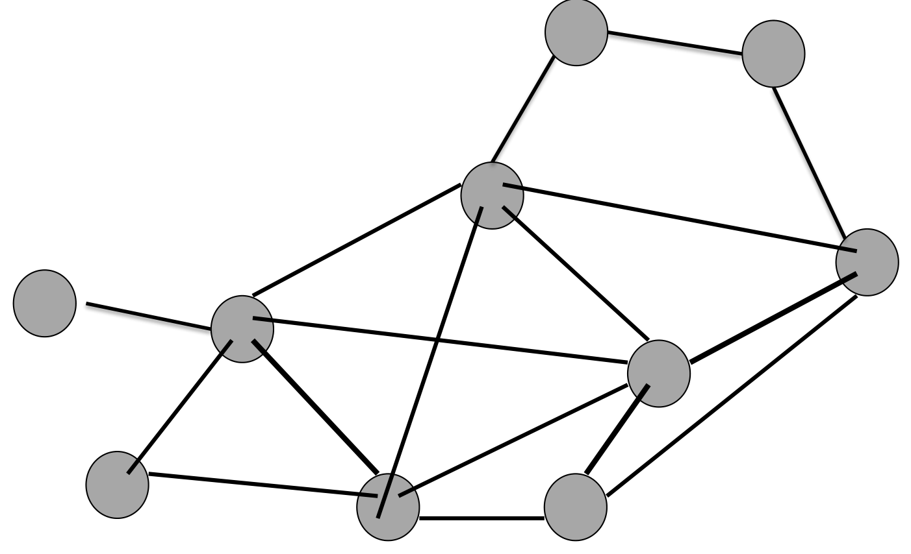

> [原图说明] 原页附图（p24）：MIS 示例起始状态——所有节点相同的初始图。此图将在统一裁剪阶段作为原图插回。

<!-- ===== PDF p25 ===== -->

**示例（Example）**

- 每个节点选择一个 ID（16、13、2、10、1、11、9、8、7、5 等）。

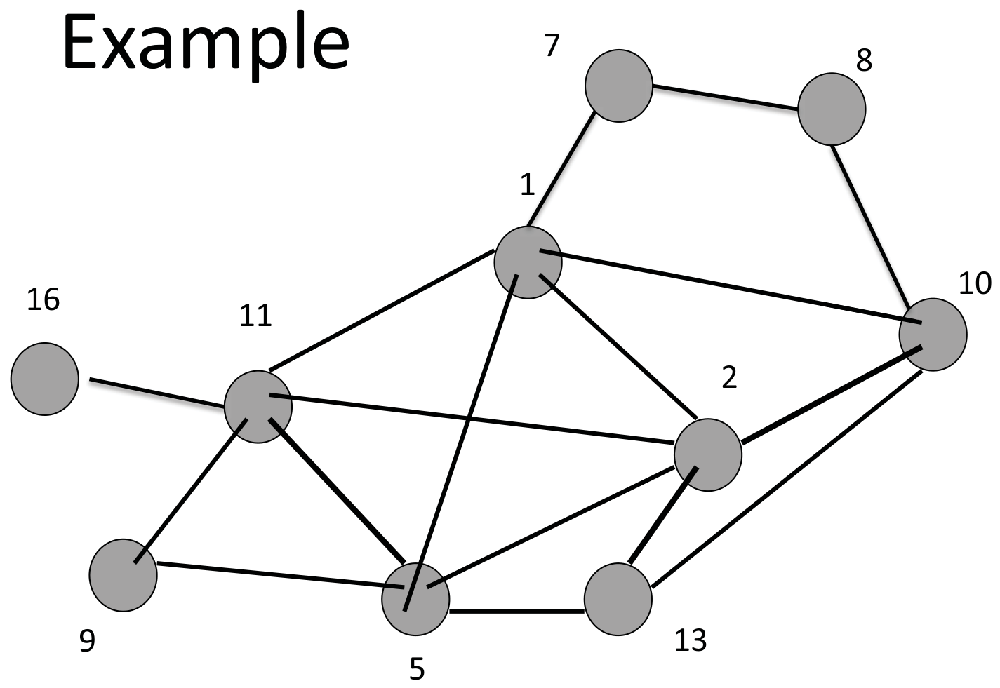

> [原图说明] 原页附图（p25）：所有节点各自选择随机 ID。此图将在统一裁剪阶段作为原图插回。

<!-- ===== PDF p26 ===== -->

**示例（Example）**

- 选择了 16 和 13 的进程 **in**。
- 选择了 11、5、2 和 10 的进程 **out**。

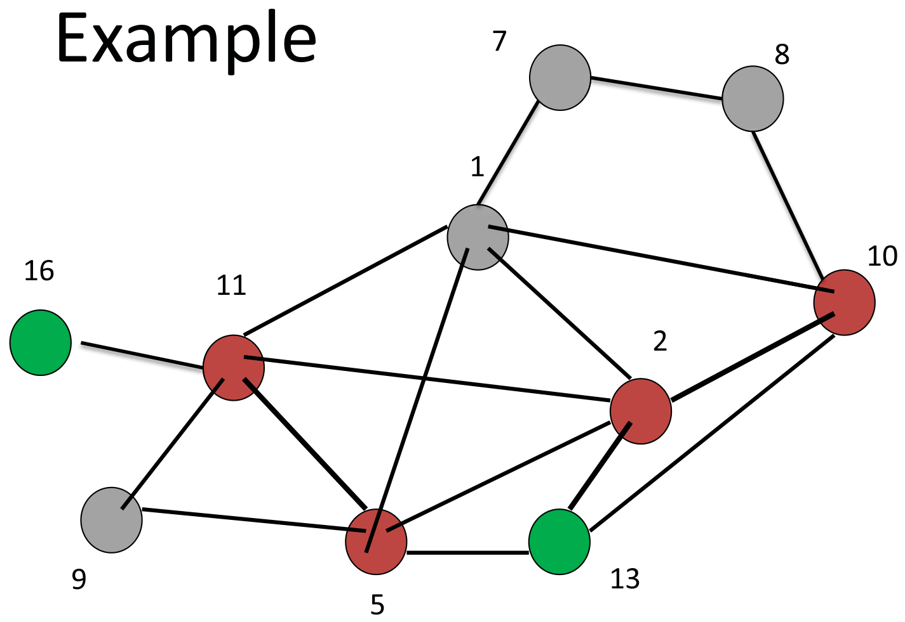

> [原图说明] 原页附图（p26）：局部最大者（16、13）入集，其邻居出局。此图将在统一裁剪阶段作为原图插回。

<!-- ===== PDF p27 ===== -->

**示例（Example）**

- 未决定（灰色）的进程选择新的 ID（4、18、7、12）。

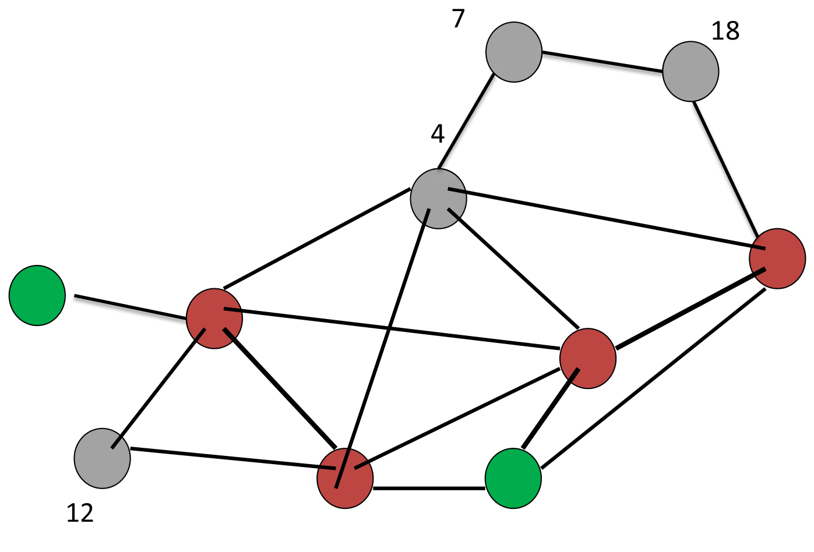

> [原图说明] 原页附图（p27）：未决定节点选择新 ID。此图将在统一裁剪阶段作为原图插回。

<!-- ===== PDF p28 ===== -->

**示例（Example）**

- 选择了 12 和 18 的进程 **in**。
- 选择了 7 的进程 **out**。

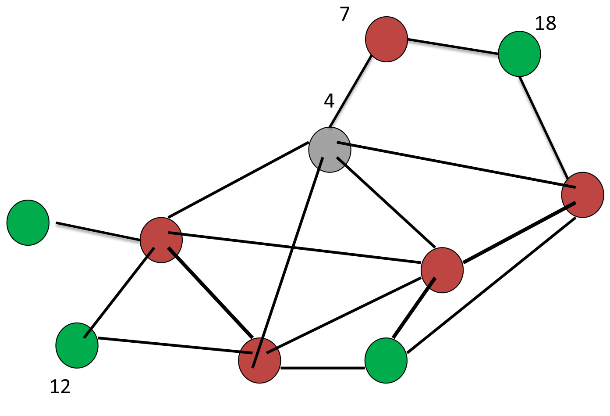

> [原图说明] 原页附图（p28）：第二轮局部最大者（12、18）入集、7 出局。此图将在统一裁剪阶段作为原图插回。

<!-- ===== PDF p29 ===== -->

**示例（Example）**

- 未决定（灰色）的进程选择新 ID（12）。

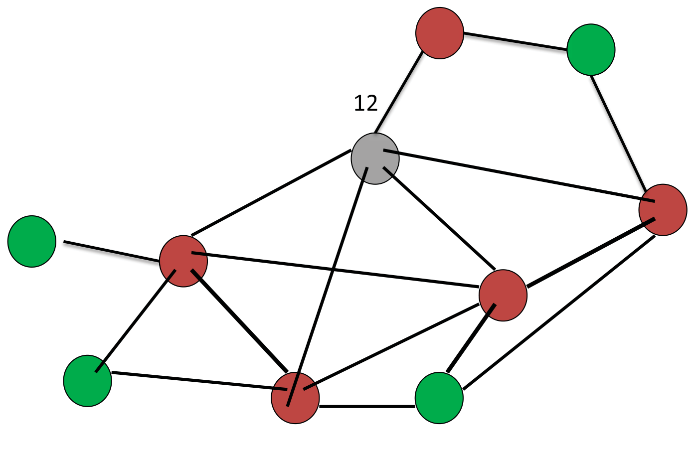

> [原图说明] 原页附图（p29）：最后一个未决定节点选择新 ID。此图将在统一裁剪阶段作为原图插回。

<!-- ===== PDF p30 ===== -->

**示例（Example）**

- 它 in。

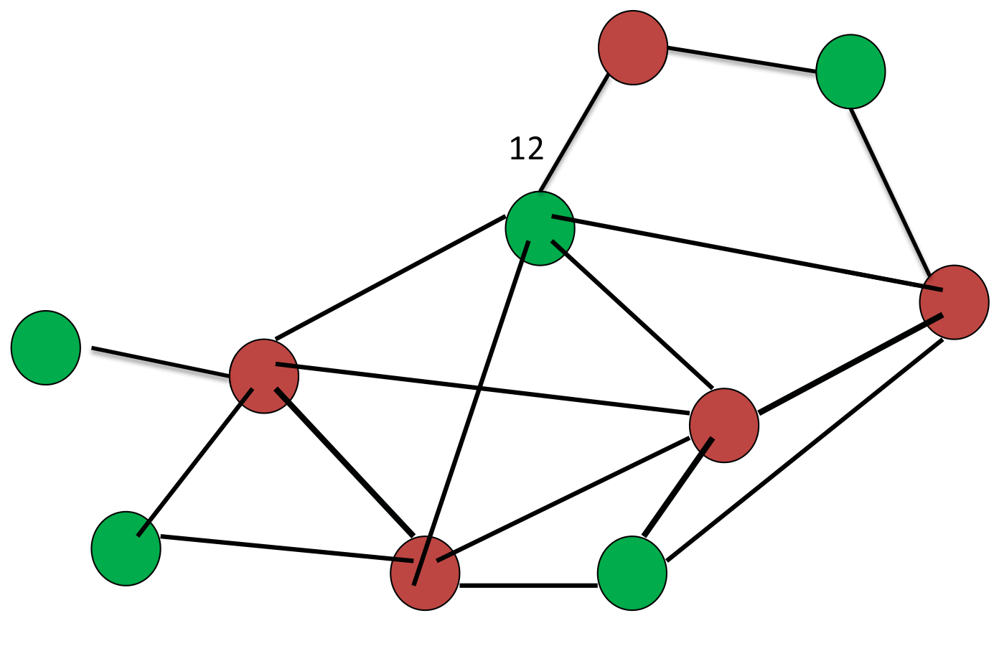

> [原图说明] 原页附图（p30）：最后节点入集，算法结束。此图将在统一裁剪阶段作为原图插回。

<!-- ===== PDF p31 ===== -->

**独立性（Independence）**

- **定理 5（Theorem 5）**：若 Luby 算法最终终止，则最终集合 $S$ 满足**独立性**。
- **证明（Proof）**：
  - 每个节点仅在**某个阶段**于其**邻域内具有唯一最大值**时才加入 $S$。
  - 当它加入时，其所有邻居都变为不活跃。

<!-- ===== PDF p32 ===== -->

**极大性（Maximality）**

- **定理 6（Theorem 6）**：若 Luby 算法最终终止，则最终集合 $S$ 满足**极大性**。
- **证明（Proof）**：
  - 一个节点仅在**自己加入 $S$ 或某邻居加入 $S$** 时才变为不活跃。
  - 我们持续直到**所有节点都不活跃**。

> **[note] Note（译者注，定理 5/6 的证明为何这么短）:** 定理 5 与定理 6 的证明各只有两行，不是讲义省略，而是断言本身弱：它们只说「终止时 $S$ 独立」和「终止时 $S$ maximal（极大）」，一个字都没说 $S$ 有多大。证明短的代价是结论弱——这两条定理允许算法交出只有最优解一半大的答案。
>
> 把两个性质放进证明论的坐标里看更清楚。independence（独立性）是 safety property（安全性）：它在每一个前缀时刻都成立，靠 invariant（不变式）维护；maximality（极大性）在算法中途并不成立，中途总有未定节点，它只在终止那一刻兑现，属于 liveness property（活性）。交付这两类性质通常要两套完全不同的论证，一套归纳每一轮，一套论证必然终止；而 Luby 算法让两套都退化成一行，因为它把「何时入集」设计成了「入集即杀邻居」。
>
> 定理 5 的因果链：入集条件是「我的值严格大于我所有活跃邻居的值」，所以 $u$ 入集时，它的每个活跃邻居在同一阶段都不可能入集；而不活跃节点永远不再入集，因为阶段规则里只有活跃节点才抽值。因此 $u$ 入集等于它周围一圈永久关闭，任意时刻 $S$ 里不存在相邻的一对。这里用的是当时活跃而不是当时全部邻居，这已经够用：不活跃的邻居要么已在 $S$ 里，要么被别的入集者杀掉了。
>
> 定理 6 的因果链：一个节点变成不活跃只有两种原因，自己入集，或第 2 轮收到某个入集邻居的广播。所以每个不活跃节点都满足在 $S$ 里或邻接 $S$；而终止条件是所有节点都不活跃。两句话接起来就是 domination（支配），也就是 maximal（极大）的等价刻画。
>
> 拿 5 个顶点的 path（路）$1-2-3-4-5$ 手算一遍，就能看到这两条定理的边界。设第一阶段抽到 $2,5,1,3,1$：节点 2 的值 5 大于邻居的 2 与 1，入集；节点 4 的值 3 大于邻居的 1 与 1，入集；第 2 轮两者广播，1、3、5 全部出局。$S = \{2,4\}$，基数 2，独立性成立，极大性也成立（1 邻 2，3 邻 2 与 4，5 邻 4），两条定理都兑现。但这个图的 maximum（最大）独立集是 $\{1,3,5\}$，基数 3，比值 $2/3 ≈ 0.667$。也就是说，定理 5/6 全部满足时，解可能只有最优的六成七。
>
> 这个例子不是要说 Luby 不好，而是提醒你把正确性定理与质量定理分开读。定理 5/6 是正确性，$S$ 一定合法；定理 7 是效率，几阶段收工；而「$S$ 有多大」在讲义里没有定理：随机化 MIS 的经典结论只保证 $O(\log n)$ 轮，不保证接近 $\alpha$。工程上想要大一点的 $S$，通常靠后处理，反复做局部删改，而不是靠算法本身。
>
> 跨课程连接：6.042J 的 state machine invariant（状态机不变式）与这里的关系正好倒过来。那门课里你是给一个写好的系统找不变式来证明它正确；这里算法作者先选一个容易维持的不变式，即入集者周围一圈关闭，再按这个不变式写规则。工作量从证明挪到了设计：证明两行，找到这样的规则花了一篇论文。CSAPP 里 assert 的用法是同一件事的另一面，把必须成立的约束写成可检查的形式，让错误早暴露；这里把必须成立的性质写成可维护的形式，让证明变短。
>
> 所以证明为何这么短的答案是：不是证明写得好，是断言提得低；真正难的工作被前置到算法设计里去了。

<!-- ===== PDF p33 ===== -->

**终止性（Termination）**

- 以概率 1，Luby 的 MIS 算法**最终终止**。
- **定理 7（Theorem 7）**：以至少 $1 - \frac{1}{n}$ 的概率，所有节点在**$4 \log n$ 个阶段**内决定。
- 证明使用一个与之前类似的引理：
  - **引理 8（Lemma 8）**：以至少 $1 - \frac{1}{n}$ 的概率，在每个阶段 $1, \ldots, 4 \log n$ 中，所有节点选择**不同的随机值**。
- 所以我们可以**基本上假装**每个阶段的所有随机数都不同。
- **关键思想**：证明图在每个阶段都变得**充分「更小」**。
- **引理 9（Lemma 9）**：对每个阶段 ph，**活跃边（连接两个活跃节点的边）**在阶段结束时**期望数**至多为阶段开始时的一半。

<!-- ===== PDF p34 ===== -->

**终止性（Termination）**

- **引理 9（Lemma 9）**：对每个阶段 ph，活跃边在阶段后的**期望数**至多为阶段前的一半。
- **证明（Proof）**：
  - 若节点 $u$ 有某个邻居 $w$，其选择值**大于 $w$ 的所有邻居和 $u$ 的所有其他邻居**，则 $u$ 必须在阶段 ph 决定 out。
  - $w$ 选择这样值的概率**至少** $\frac{1}{\deg u + \deg w}$。
  - 那么节点 $u$ 被某个邻居以这种方式「杀死」的概率**至少** $\sum_{w \in r(u)} \frac{1}{\deg u + \deg w}$。
  - 现在考虑一条边 $(u, v)$。

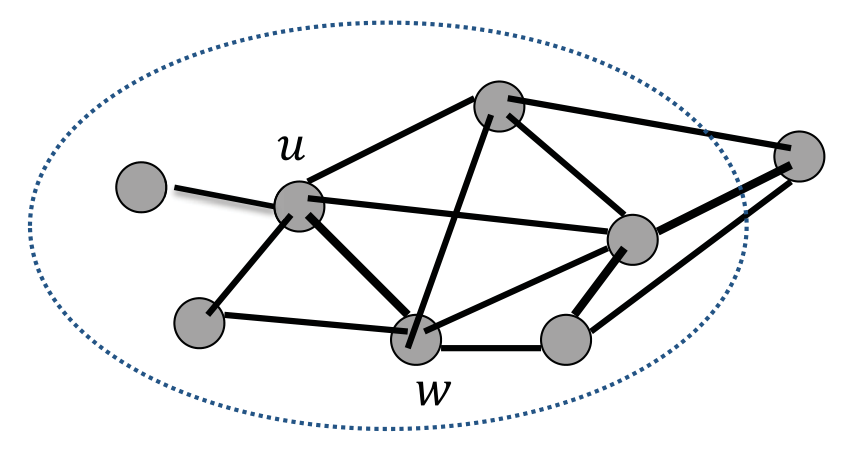

> [原图说明] 原页附图（p34）：节点 $u$ 与其邻居 $w$ 的示意图，用于分析「$u$ 被 $w$ 杀死」的概率。此图将在统一裁剪阶段作为原图插回。

<!-- ===== PDF p35 ===== -->

**终止性（续）（Termination, cont'd）**

- **证明（Proof）**：
  - 概率 $u$ 被杀死 $\ge \sum_{w \in r(u)} \frac{1}{\deg u + \deg w}$。
  - 边 $(u, v)$ 「**死亡**」（两端之一被杀死）的概率 $\ge \frac{1}{2}$（概率 $u$ 被杀 + 概率 $v$ 被杀）。
  - 所以期望死亡的边数 $\ge \frac{1}{2} \sum_{\{u,v\}}$（概率 $u$ 被杀 + 概率 $v$ 被杀）。
  - 这个和把每个节点 $u$ 的「被杀概率」恰好计了 $\deg u$ 次。
  - 所以把和重写为：$\frac{1}{2} \sum_u \deg u$（概率 $u$ 被杀）。
  - 代入概率下界：$\ge \frac{1}{2} \sum_u \deg u \sum_{w \in r(u)} \frac{1}{\deg u + \deg w} = \frac{1}{2} \sum_u \sum_{w \in r(u)} \frac{\deg u}{\deg u + \deg w}$。

<!-- ===== PDF p36 ===== -->

**终止性（续）**

- **证明（Proof）**：
  - 期望死亡的边数 $\ge \frac{1}{2} \sum_u \sum_{w \in r(u)} \frac{\deg u}{\deg u + \deg w}$。
  - 把这个表达式等价地写成对有向边 $(u, v)$ 的和：$\frac{1}{2} \sum_{(u,v)} \frac{\deg u}{\deg u + \deg v}$。
  - 这里每条无向边被计了两次（每个方向各一次），所以这等于对无向边 $\{u, v\}$ 的和：$\frac{1}{2} \sum_{\{u,v\}} \frac{\deg u + \deg v}{\deg u + \deg v}$。
  - 这恰是**无向边总数的一半**，如所需！
- **引理 9（Lemma 9）**：对每个阶段 ph，活跃边在阶段结束时的期望数至多为阶段开始时的一半。

> **[note] Note（译者注，引理 9 的「平均减半」论证）:** 引理 9 是整个终止性分析的唯一燃料，定理 7 全靠它。要证的是一句话：每个阶段结束时活跃边的期望数至多减半。难处在于一条边死不死同时取决于两端邻居的随机值，直接算联合分布算不动；而算法恰好设计得能把这件事拆成三件互不干扰的小事。
>
> 第一件，定义「$u$ 被 $w$ 杀死」。条件是 $w$ 在 $u$ 的邻居集合 $r(u)$ 里，且 $w$ 的值大于 $w$ 的所有邻居、也大于 $u$ 的所有其他邻居。这时 $w$ 必是局部最大，必入集，$u$ 在第 2 轮收到广播后出局。注意这是充分而非必要条件，$u$ 也可能自己被选上；正因为只是充分条件，后面得到的概率都只是下界，引理照样成立。
>
> 第二件，算这个条件的概率。需要比较的竞争者是 $w$ 自己，加上 $N(w)$ 去掉 $w$，再加上 $N(u)$ 去掉 $w$，总数不超过 $\deg u + \deg w$；所有值独立同分布，$w$ 在其中当最大值的概率至少 $1/(\deg u + \deg w)$。独立同分布是整个论证的地基：若各节点按 degree（度）缩放抽不同分布，这个均匀性立刻消失。
>
> 第三件，求和。讲义直接写 $\sum_{w \in r(u)}$ 而没用 union bound（并界）包一层，不是偷懒：「$w_{1}$ 杀 $u$」与「$w_{2}$ 杀 $u$」不可能同时成立，两只之间必有一个更小，事件互斥，求和是精确的。对比注 9 里必须放缩的场景，这里结构更好，再放缩反而白松。
>
> 再从点走到边。边 $\{u,v\}$ 死亡指至少一端被杀或入集。它的概率至少是两端各自被杀概率的最大值，而最大值不小于平均值，所以写成 $(P_{u} + P_{v})/2$ 合法：除以 2 就是把最大值换成可相加形式所付的固定折扣。对所有边求和，每条边两端各被计一次，正好得到 $\sum_u \deg u \cdot P_{u}$ 的一半。
>
> 代入下界，得二分之一乘上 $\sum_u \sum_{w \in r(u)} \deg u/(\deg u + \deg w)$。把按顶点求和改成按有向边求和，每条无向边出现两个方向，同一对贡献 $\deg u/(\deg u + \deg w) + \deg w/(\deg u + \deg w) = 1$，分母相同、分子相加恰好等于分母。整个和式塌缩成无向边数的一半。这个恒等式是全程枢纽：按 degree（度）加权这个看似随意的权重，正是为了让两个方向的贡献互补为 1。
>
> 手算核对。3 个顶点的 path（路）$a-b-c$，degree（度）为 1、2、1：$P_{b} \ge 1/3 + 1/3 = 2/3$，两端各 $\ge 1/3$，期望死亡边数至少 $(1/3 + 2 \cdot 2/3 + 1/3)/2 = 1 = |E|/2$，取等。4 个顶点的 cycle（环）每个 degree（度）为 2，$P_{u} \ge 1/2$，总和至少 $(4 \cdot 2 \cdot 1/2)/2 = 2 = |E|/2$，也取等。星形图 $K_{1,3}$ 中心 degree（度）3、叶子 1，中心 $\ge 3/4$、每叶 $\ge 1/4$，总和至少 $(3 \cdot 3/4 + 3 \cdot 1/4)/2 = 1.5 = |E|/2$，仍取等。三个例子都落在下界上，说明这个界在「每点只有一个强邻居」的结构里是紧的。
>
> 还有一处易误会：引理说的是期望，不是每阶段都减半。某些阶段可能一条边都不死，所有值恰好落在低端，但那一定被别的阶段的超额死亡补回。这正是 expectation（期望）在此的唯一用途，它允许单个阶段失败。
>
> 跨课程连接：整条证明只要两件工具，你在 Bertsekas 的概率论教材与 6.042J 里都学过，indicator variable（指示变量）与 linearity of expectation（期望线性性）。把死亡边数写成每条边的 0 与 1 指示变量之和，期望等于各自概率之和，而这一步不需要边与边之间的 independence（独立性），正好避开边之间相关这个算不动的困难。

<!-- ===== PDF p37 ===== -->

**终止性（续）**

- **引理 9（Lemma 9）**：每个阶段后活跃边的期望数至多为阶段前的一半。
- **定理 7（Theorem 7）**：以至少 $1 - \frac{1}{n}$ 的概率，所有节点在 $4 \log n$ 个阶段内决定。
- **证明梗概（Proof sketch）**：
  - 引理 9 蕴含：$4 \log n$ 个阶段后仍活跃的边数期望至多为 $\frac{\binom{n}{2}}{2^{4 \log n}} = \frac{1}{n}$。
  - 那么仍有活跃边的概率 $< \frac{1}{n}$（**马尔可夫不等式 Markov**）。
  - 算法在 $4 \log n$ 个阶段内不终止的概率 $< \frac{1}{n} + \frac{1}{n} < \frac{2}{n}$。

> **[note] Note（译者注，定理 7 的证明：期望减半 + 马尔可夫）:** 定理 7 把引理 9 的期望减半升级成「以至少 $1-1/n$ 的概率在 $4\log n$ 个阶段内全部决定」。中间只有一步非平凡转换，从期望小到概率小；用的工具是 Markov inequality（马尔可夫不等式），它只要求随机变量非负，代价是界很松，而这里松不要紧，因为期望已经小到 $1/n$ 以下。
>
> 因果链如下。引理 9 给 $E[X_{t+1}] \le E[X_{t}]/2$，$X_{t}$ 是第 $t$ 阶段后的活跃边数；递推得 $E[X_{t}] \le |E|/2^{t}$，而 $|E| \le \binom{n}{2} < n^{2}/2$。取 $t = 4\log n$ 则 $2^{t} = n^{4}$。这一步要留意 $\log$ 的底：只有以 2 为底，$2^{4\log n}$ 才等于 $n^{4}$，讲义没写底，读的时候必须自己补上。于是 $E[X_{t}] \le (n^{2}/2)/n^{4} = 1/(2n)$，再用 Markov inequality（马尔可夫不等式）得 $P(X_{t} \ge 1) \le E[X_{t}] \le 1/(2n)$。
>
> 为什么不上 Chebyshev（切比雪夫不等式）拿更紧的界？因为 Chebyshev 要 variance（方差），而 $X_{t}$ 是一大堆高度相关的指示变量之和，方差本身就得算两条边同时死亡的概率，那正是引理 9 刻意绕开的困难。Markov inequality（马尔可夫不等式）只要能算均值就能用，这才是它不可替代的理由：不是它紧，而是它是唯一只要均值的界。
>
> 还有个细节：写成 $P(X \ge 1) \le E[X]$ 隐含用了 $X$ 是非负整数，于是 $X \ge 1$ 等价于 $X > 0$。若 $X$ 能取小数，就只能写 $P(X > 0)$，界会白松一个常数倍。边数天生是整数，这一步免费。
>
> 另一半误差来自引理 8：$4\log n$ 个阶段里每阶段所有值两两不同的概率至少 $1-1/n$，所以整段执行里「假设值互不相同」这个前提失败的概率至多 $1/n$。两处相加得 $1/n + 1/(2n) < 2/n$。讲义正文写 $1-1/n$、证明梗概算出 $2/n$，两者只差常数，不影响量级，但读的时候要知道这是同一句结论的两个精度版本。
>
> 代入 $n = 1000$ 核对量级：$4\log_{2} 1000 ≈ 4 \times 9.97 = 39.9$，取 40 个阶段，共 80 轮（每阶段 2 轮）。$2^{40} ≈ 1.1 \times 10^{12}$，活跃边期望至多 $499500/1.1\times 10^{12} ≈ 4.5\times 10^{-7}$，「仍有活跃边」的概率至多同样量级，比承诺的 $1/n = 10^{-3}$ 还小两千倍。可见常数 4 留了余量：取 $3\log n$ 已给出同样的 $1/(2n)$，多出的一个 $\log n$ 是给引理 8 的失败率留位置。
>
> 最后接回以概率 1 终止。定理 7 只保证一段 $4\log n$ 阶段内成功概率很高，真实算法会一直往下跑。把这些阶段切成一段段长 $4\log n$ 的窗口，各窗口的随机值互相独立，所以前 $k$ 个窗口全失败的概率是 $(2/n)^{k}$，随 $k$ 趋于零。于是永远不终止是一条概率为零的路径，这就是 almost sure termination（几乎必然终止），与确定性算法的必然有限步不是同一个量级的断言。
>
> 跨课程连接：这条推理链，即几何衰减的期望、单个不等式、加性合并误差、独立窗口相乘，在 6.006 的随机化分析里是标准骨架，你在讲次 17 的 coupon collector（赠券收集）与引理 3 的 union bound（并界）里见过它的不同片段；Bertsekas 那本概率论里 Markov 与 Chebyshev（切比雪夫不等式）的对照则解释了为什么这里只能选前者。区别在于分布式场景下随机变量不独立，凡要用联合分布的地方都得绕开，凡只要均值的都能用。
>
> 回到正文那句「我们基本上可以假装每个阶段的所有随机数都不同」：这句话的合法性由引理 8 的 $1/n$ 买单，而引理 8 的合法性又由注 9 的 union bound（并界）买单，三处论证串起来才是完整的终止性证明。

<!-- ===== PDF p38 ===== -->

**广度优先生成树（Breadth-First Spanning Trees）**

> [原图说明] 原页为章节分隔页（p38），仅标题「Breadth-First Spanning Trees」。

<!-- ===== PDF p39 ===== -->

**广度优先生成树（Breadth-First Spanning Trees）**

- **新问题，新设定**。
- 假设图 $G = (V, E)$ 是连通的。
- $V$ 包含一个**特殊的顶点 $v_o$**，它将成为 BFS 树的**根（origin, root）**。
- 一般地，进程对图**没有任何知识**。
- 进程有 **UID**。
  - 每个进程知道自己的 UID。
  - $i_o$ 是根 $v_o$ 的 UID。
  - UID 为 $i_o$ 的进程知道自己在根上。
- 我们可以（WLOG）假设进程知道其**邻居的 UID**，并知道**每个输入/输出端口连到哪个邻居**。
- 算法将是**确定性的**（或非确定性的），但**不是随机化的**。

<!-- ===== PDF p40 ===== -->

**广度优先生成树（续）**

- 进程必须产生一棵**以顶点 $v_o$ 为根的广度优先生成树**。
- 分支是从 $v_o$ 出发的**有向路径**。
  - **生成（Spanning）**：分支到达所有顶点。
  - **广度优先（Breadth-first）**：距离 $v_o$ 为 $d$ 的顶点出现在树的**恰好深度 $d$** 处。
- **输出（Output）**：每个进程 $i \ne i_o$ 应输出**父节点 $j$**，表示 $j$ 的顶点是 $i$ 的顶点在 BFS 树中的父节点。

> **[note] Note（译者注，分布式 BFS 与串行 BFS 的对照）:** 这条注要回答的设计问题是：当"全局邻接表"这个前提被抽掉以后，BFS 里还有什么是真正不变的东西。
>
> 串行 BFS 有一个上帝视角：整张图躺在内存里，任何 vertex（顶点）想访问谁就直接顺着指针读，谁是第几层由 queue（队列）的先进先出保证。分布式 BFS 里没有上帝：每个进程只知道自己的 UID（唯一标识符）、自己有几个 port（端口）、port（端口）那头是哪个 neighbor（邻居），连 $n$ 与 $diam$ 都不知道。所以算法不能先设计成"算完距离再建树"，只能设计成"树与距离一起长出来"，每一步都只用本地信息。
>
> 机制是上下界夹逼。以 $d$ 记某顶点到 root（根）的真实距离。下界：任何从根到它的路径至少 $d$ 条 edge（边），而一条消息跨一条边恰好耗掉一轮，所以它在第 $d$ 轮之前不可能收到任何 search（搜索）消息。上界：取一条真正的最短路，路上第 $k$ 个顶点在第 $k$ 轮被标记，对 $k$ 做 induction（归纳）即可——第一个是根，第二个收到根在第 $1$ 轮发的消息，依此类推。两个方向夹住同一个数，于是第 $d$ 轮恰是它被标记的时刻，它在树里的 depth（深度）也正是 $d$。这里"同步"是一台免费的计时器：轮号本身就是层号，不需要任何 timestamp（时间戳），也不需要谁去数跳数。
>
> 算一个能复核的例子。$1000$ 个顶点的 path（路径图）：$|E| = 999$，$diam = 999$；单跳延迟取 $1\ \mathrm{ms}$，则需要 $999$ 轮，约 $999\ \mathrm{ms}$；消息总数约 $2|E| = 1998$ 条，平均每轮两条。换成 $32 \times 32$ 的网格：$n = 1024$，横向边 $32 \times 31 = 992$、纵向同一数目，$|E| = 1984$，从一角走到对角要 $31 + 31 = 62$ 步，故 $diam = 62$，时间 $62\ \mathrm{ms}$，消息 $2|E| = 3968$ 条。顶点数几乎没变（从 $1000$ 到 $1024$），时间从 $999\ \mathrm{ms}$ 掉到 $62\ \mathrm{ms}$，代价只是消息翻一倍。这就是"时间由 $diam$ 而不是由 $n$ 决定"的直接后果：同样多的顶点，图越"胖"，波前越早收拢。
>
> 跨课程连接。6.006 里 CLRS §22.2 的串行 BFS 用 queue（队列）保证按距离非降序出队，分布式 BFS 用 round（轮）这台物理时钟达到同一个效果；区别在于计量的对象不同：串行 BFS 的时间是 $O(|V| + |E|)$ 条指令，与每层有多少顶点无关；分布式 BFS 的时间就是轮数，与每轮处理多少顶点无关。换句话说，串行 BFS 关心"处理了多少元素"，分布式 BFS 关心"波前走了多远"，两者对"快"的定义根本不同。
>
> 最后回到输出格式：进程 $i$ 输出 parent（父节点）$j$，也就是每条树边由 child（子节点）指向父。这与 CSAPP 第 11 章 socket（套接字）那种对等连接的表示正好相反：socket（套接字）的两端身份对等、方向对称，而树是有向的。正因为有方向，后面才做得出 convergecast（汇播）这样的自底向上聚合——对等连接里没有"上"这个方向。
>
> 顺带交代一个代价：进程不知道 $n$，于是既没法预分配数组，也没法判断"收敛了没有"。串行 BFS 里"queue（队列）空了"就是终止信号，一眼可见；分布式 BFS 里没有队列，也没有任何一个进程能看到全局是否已空，所以建树完成与"知道建树完成"是两件不同的事，后者需要 p57 那套专门的 termination（终止）机制，代价不是一轮往返：从叶子起汇播 $n$ 条 done、根再向下广播 $n$ 条「可以停」，各走 $\operatorname{diam}$ 轮，合计 $2\operatorname{diam}$ 轮、$2n$ 条 message（消息）。

<!-- ===== PDF p41 ===== -->

**示例（Example）**

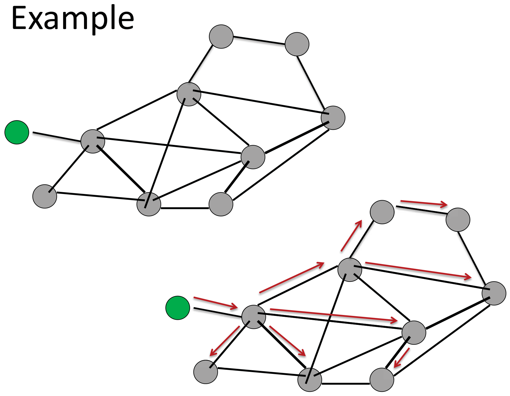

> [原图说明] 原页附图（p41）：BFS 生成树示例图（根 $v_o$ 及其生成树）。此图将在统一裁剪阶段作为原图插回。

<!-- ===== PDF p42 ===== -->

**简单 BFS 算法（Simple BFS Algorithm）**

- 进程在**被纳入树中**时标记自己。
- 初始只有 $i_0$ 被标记。
- 进程 $i$ 的算法：
  - **第 1 轮（Round 1）**：
    - 若 $i = i_0$，则进程 $i$ 向其邻居发送一条 **search（搜索）**消息。
    - 若进程 $i$ 收到消息，则它：
      - 标记自己。
      - 选择 $i_0$ 作为父节点，输出 parent $i_o$。
      - 计划在下一轮发送。
  - **第 $r > 1$ 轮（Round $r > 1$）**：
    - 若进程 $i$ 计划发送，则它向其邻居发送一条 search 消息。
    - 若进程 $i$ **未标记**且收到消息，则它：
      - 标记自己。
      - 选择某个发送者邻居 $j$ 作为父节点，输出 parent $j$。
      - 计划在下一轮发送。

> **[note] Note（译者注，简单 BFS 的「波前」思想）:** 这条注要拆的是一个看起来危险的许可：算法允许"收到几条 search（搜索）就随便挑一个当父"，凭什么这不会出错。
>
> 先看算法把静态的"层"做成了动态的 wavefront（波前）。设计问题是：没有全局 queue（队列）的情况下，凭什么保证每个 vertex（顶点）恰好落在正确的一层。答案藏在同步模型的一个副作用里——时间本身携带信息。search（搜索）消息一轮只跨一条 edge（边），所以轮号读完就是跳数，算法不需要任何人去数。
>
> 机制分三步拆。第一步，为什么"第一次收到就定父"不会选错。设某进程在第 $r$ 轮第一次收到 search（搜索），它的发送者深度必为 $r - 1$：比 $r - 1$ 更浅的发送者只会在更早的轮里发过消息，而比 $r - 1$ 更深的发送者此刻还没被标记，根本没资格发消息。所以第一条到达的消息一定来自最浅的那批邻居，挑它做父，depth（深度）就取到了最小值。
>
> 第二步，为什么"同一轮来几条都随便挑"也安全。同在第 $r$ 轮到达的消息，其发送者深度相同，都是 $r - 1$；无论挑谁，父的深度一样，自己的深度都是 $r$，在树上都不违规。非确定性的潜在危害被"同轮同深度"这条不变式吸收掉了，所以它不构成风险，只构成输出的自由度。
>
> 第三步，为什么反过来做（第二次收到才定父、或者允许事后换父）会立刻崩。若允许换父，原来那条父边会被抽走，树要么裂成两片、要么绕出 cycle（环）；更麻烦的是，一个已经广播过 search（搜索）的顶点若改换了归属，它下面整片 subtree（子树）的距离全部作废，前面花掉的通信白白蒸发。算法把"标记"与"定父"绑成同一个不可撤销的动作，动机就是不让已花的通信作废——这是分布式算法里反复出现的"不可撤销动作换简单性"的取舍。
>
> 算一个能核的例子。$4 \times 4$ 网格，$16$ 个顶点，根在左上角。各距离层的顶点数依次是 $1, 2, 3, 4, 3, 2, 1$，沿反对角线先增后减。第 $r$ 轮结束时被标记的恰好是距离小于 $r$ 的顶点，于是逐轮累计：第 $1$ 轮 $1$ 个、第 $2$ 轮 $3$ 个、第 $3$ 轮 $6$ 个、第 $4$ 轮 $10$ 个、第 $5$ 轮 $13$ 个、第 $6$ 轮 $15$ 个、第 $7$ 轮 $16$ 个，全部到齐；而根到右下角的距离是 $6$，两者正好对得上。
>
> 跨课程连接。CSAPP 第 11 章的 socket（套接字）里，一次"请求-应答"就是一个 RTT（往返时延），这里的每一轮也正好是一个 RTT（往返时延）。取 RTT（往返时延） $= 50\ \mathrm{ms}$，上面那棵 $6$ 层深的树要 $7$ 轮，即 $350\ \mathrm{ms}$；同样规模放大到 $32 \times 32$ 网格的 $62$ 层，就要 $62 \times 50 = 3100\ \mathrm{ms}$。区别在于 RTT（往返时延）的角色：socket（套接字）编程里 RTT（往返时延）是你要用 timeout（超时）与重传去对抗的噪声，这里 RTT（往返时延）直接成了算法的计时单位，越短越好，且不需要任何额外机制去测它。
>
> 收束一句：波前成立的全部前提，是"事件发生的轮号"与"图上的距离"这两个量被同步模型强行绑在一起；异步模型一旦松绑，同一套算法就要靠收敛检测之类的额外机制去补这个缺口。

<!-- ===== PDF p43 ===== -->

**非确定性（Nondeterminism）**

- 算法**略微非确定**：一个进程可以在若干可能的父节点中**任意选择**。
- 我们可以通过使用默认规则（如「**总是选 UID 最小的发送者**」）使其**确定化**。
- 但**保持非确定性也没问题**。
- 对分布式算法而言，**非确定性的含义与串行算法不同**。
  - 一个分布式算法应在**所有**解决非确定性选择的方式下**都正确工作**。

> **[note] Note（译者注，分布式非确定性的语义）:** 这条注要回答的是：为什么分布式算法敢把"随便挑一个"写进规范，而串行算法不敢这么写。
>
> 先说清 nondeterminism（非确定性）在两个世界里扮演的角色完全不同。串行算法里的非确定选择（比如随机挑一个 pivot（基准））是算法自己引入的，是一个需要被分析掉的概率对象，最终要对"以多大概率给出正确答案"负责。分布式算法里的非确定选择是环境强加的，不是算法自己挑的：消息的到达顺序由网络排队、操作系统调度、甚至链路长短共同决定，进程无法控制自己先收到哪一个 neighbor（邻居）的 search（搜索）消息。
>
> 于是正确性的量词结构变了。串行版本说的是"存在一次幸运的执行，算法输出正确答案"；分布式版本说的是"对每一次合法的 schedule（调度），算法都输出正确答案"，这是一个全称保证。这不是口味问题：如果算法只对某一种顺序正确，那么同一份代码换台机器、换个负载就可能输出错误的 parent（父节点），甚至让某个 vertex（顶点）被两个父同时认领，树就不再是树。
>
> 具体到这条幻灯片：一个已标记的进程收到多条 search（搜索）时，只在第一次挑一条，之后再不更改。这个自由度不会影响任何可观测输出，因为所有候选父的 depth（深度）都相同，差的只是一个 UID（唯一标识符）。反过来，若把规则写成"必须选 UID（唯一标识符）最小的发送者"，算法就变成 deterministic（确定性）的，输出唯一；代价是每个进程要多花一轮去交换 UID（唯一标识符）才能做比较，而且在 UID（唯一标识符）尚未收齐时还得决定要不要继续等。自由度的价值就在这里：不约束，就不用付这一轮的代价。
>
> 算一个能核的例子。diamond（菱形）图：root（根）$v_o$ 连 $a$ 与 $b$，$a$ 与 $b$ 各自连 $c$ 与 $d$。距离分布是 $a, b$ 为 $1$，$c, d$ 为 $2$。$c$ 的父可以是 $a$ 也可以是 $b$，两种；$d$ 的父同样两种；两处独立，共 $2 \times 2 = 4$ 棵不同的 BFS 树。四棵树的深度分布完全一样（$c, d$ 都在第 $2$ 层），四棵都合法。这就是"非确定性不伤正确性"的最小样本：$4$ 种执行，$1$ 个正确性标准，判定标准与执行分支正交。
>
> 再补一句为什么"必须全称"。假设算法内部写了"我假定先收到 UID（唯一标识符）小的邻居的消息"，那么在真实网络里这条假设可能被违背；一旦违背，某个顶点可能先被深层的邻居标记，depth（深度）当场偏大，而它已经广播出去了，纠正不了。全称保证的作用就是把这类"靠运气"的假设从算法里全部删掉，让正确性不依赖任何调度细节。
>
> 跨课程连接。6.042J 里你写过"对任意元素成立"的谓词，量词顺序决定命题强弱；这里把"对任意"从集合元素换成了"对任意调度"，形式完全一样，只是论域从元素变成了执行序列。另一条路是 CSAPP 第 12 章对 data race（数据竞争）的定义：并发程序的结果依赖于 interleaving（交错），所以程序员必须用 lock（锁）把交错约束成一种。区别在处置方式上：CSAPP 里交错是敌人，要用同步原语消灭它；分布式里交错是常数项，消不掉，只能要求算法对全体交错都正确。
>
> 收束一句：p43 说"保持非确定性也没问题"，讲的就是这件事——正确性从头到尾没有依赖那个选择，所以那个选择也就不必被任何规则约束住。

<!-- ===== PDF p44 ===== -->

**简单 BFS 算法（Simple BFS Algorithm）**

- **问（Q）**：为什么这个算法产生 BFS 树？
- **答**：因为所有分支都是**同步创建**的，每轮增长一跳。
- **问（Q）**：为什么它最终覆盖所有节点？
- **答**：因为图是连通的，且任何被标记的节点都会向其邻居发送消息。

> **[note] Note（译者注，两个「为什么」）:** 这两个问答看起来像在复述，其实各自对应 BFS 树定义里的一条硬性质：depth（深度）正确，以及 spanning（生成）完整。
>
> 第一个为什么——深度等于距离——用的是夹逼。下界：从 root（根）到某 vertex（顶点）的任何路径至少 $d$ 条 edge（边），而一条消息一轮只跨一条边，所以它在第 $d$ 轮之前收不到任何 search（搜索）消息。上界：取一条真正的最短路 $v_o = u_0, u_1, \ldots, u_d = v$，对 $k$ 做 induction（归纳）证明 $u_k$ 在第 $k$ 轮被标记——$k = 0$ 时它就是根，初始已标记；设 $u_{k-1}$ 在第 $k-1$ 轮被标记并计划在此轮发送，则 $u_k$ 在第 $k$ 轮收到消息。两个方向夹住同一个数，深度只能是 $d$。
>
> 第二个为什么——覆盖所有顶点——用的是反证加"第一个未标记"。若存在未标记顶点，因图连通，取一条从根到它的路径，沿路径第一个未标记的顶点记作 $w$。它的前驱已经被标记，而任何被标记的进程都一定会向所有 neighbor（邻居）发 search（搜索），于是 $w$ 必在某一轮收到消息从而被标记，与假设矛盾。这个论证用到两件事：连通性保证路径存在，广播保证波前不中断；任一条不成立，反证就接不上。
>
> 这里还有一处细节容易被略过：算法里那个 send（发送）布尔量，作用是把"本轮被标记"与"本轮就发消息"错开一轮。若省掉它、让被标记的进程在同一轮立刻回发，那么标记与发送就落在同一轮里，模型"先发后收"的顺序被打破，波前会在同一条边上多走一步，所有深度集体偏小一。这类"一个布尔量撑起一条不变式"的细节，正是分布式算法实现时最常见的错误来源——逻辑上看起来多余的一个状态位，实际是模型时序的锚点。
>
> 算一个能核的例子。$8 \times 8$ 网格：$n = 64$，横向边 $8 \times 7 = 56$、纵向同样 $56$，$|E| = 112$；从一角到对角的距离是 $7 + 7 = 14$，故 $diam = 14$。轮数就是 $14$；每条 search（搜索）只走一个方向，每个顶点一生只发一轮，故总消息不超过 $2|E| = 224$ 条，平均每轮 $224 / 14 = 16$ 条。取 RTT（往返时延）$50\ \mathrm{ms}$，总时间 $14 \times 50 = 700\ \mathrm{ms}$。
>
> 值得往前一步：$diam$ 轮不只是这个算法的成本，还是这个问题的时间下界。任何正确算法都要至少 $diam$ 轮，因为根到最远顶点有 $diam$ 跳，而信息物理上一轮只能走一跳——这是"距离"本身施加的限制，与算法多聪明无关。所以简单 BFS 在时间维度上是 time-optimal（时间最优）的，它浪费的只是消息，不是轮数。这与比较排序的 $\Omega(n \log n)$ 下界同属信息量下界，机制不同：一个从路径长度来，一个从判定树的叶子数来，两者都是"信息必须走的距离"给出的绝对界线。
>
> 跨课程连接。6.006 里分治算法的递归树给出"每层成本乘层数"的估算框架，这里可以直接套：每层成本是每轮的消息数，约 $2|E| / diam = 16$；层数是 $diam = 14$；相乘回到 $224$。差别在层数的来源：递归树的层数是对数，来自问题规模每层减半；BFS 的层数是几何量，来自最长的那条最短路。同一个乘法框架，一个吃规模，一个吃形状。
>
> 收束一句：这两个论证合起来就是 p54 那组不变式的口语版；形式化时只是把"夹逼"与"反证"换成对轮数归纳，骨架一点没变。

<!-- ===== PDF p45 ===== -->

**示例：简单 BFS（Example: Simple BFS）**

> [原图说明] 原页附图（p45）：BFS 示例起始图。此图将在统一裁剪阶段作为原图插回。

<!-- ===== PDF p46 ===== -->

**第 1 轮（Round 1）**

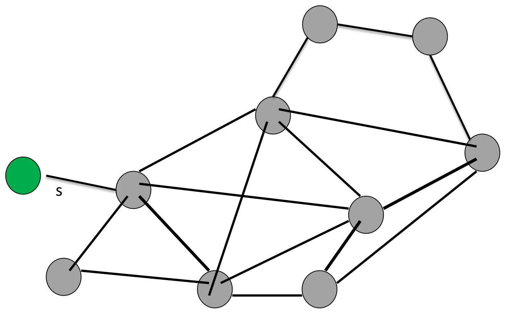

> [原图说明] 原页附图（p46）：第 1 轮——根 $s$ 向邻居发送 search 消息。此图将在统一裁剪阶段作为原图插回。

<!-- ===== PDF p47 ===== -->

**第 1 轮（Round 1）**

> [原图说明] 原页附图（p47）：第 1 轮后——根的直接邻居被标记并选定父节点。此图将在统一裁剪阶段作为原图插回。

<!-- ===== PDF p48 ===== -->

**第 2 轮（Round 2）**

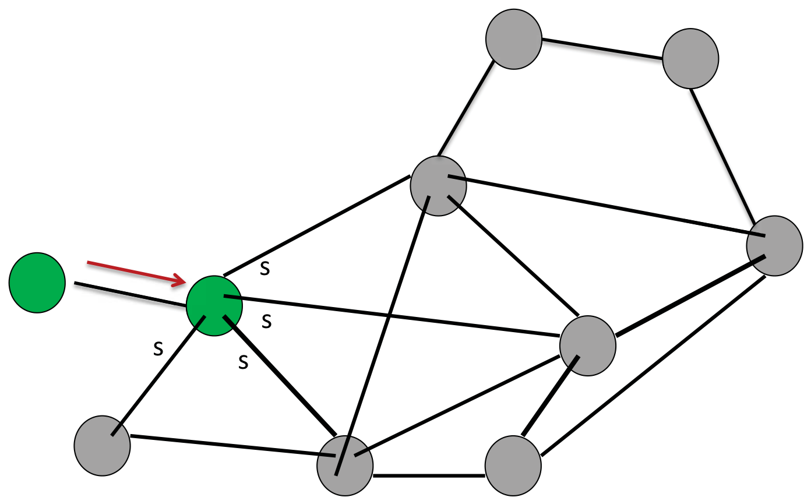

> [原图说明] 原页附图（p48）：第 2 轮——距离 1 的节点向邻居广播 search。此图将在统一裁剪阶段作为原图插回。

<!-- ===== PDF p49 ===== -->

**第 2 轮（Round 2）**

> [原图说明] 原页附图（p49）：第 2 轮后——距离 2 的节点被标记。此图将在统一裁剪阶段作为原图插回。

<!-- ===== PDF p50 ===== -->

**第 3 轮（Round 3）**

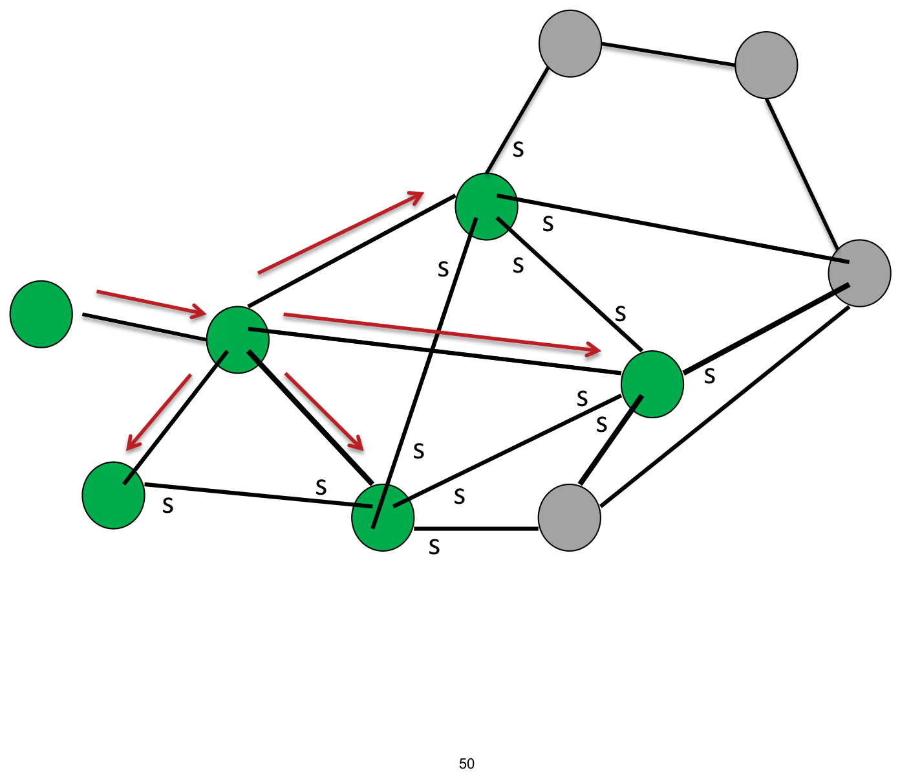

> [原图说明] 原页附图（p50）：第 3 轮——距离 2 的节点继续广播。此图将在统一裁剪阶段作为原图插回。

<!-- ===== PDF p51 ===== -->

**第 3 轮（Round 3）**

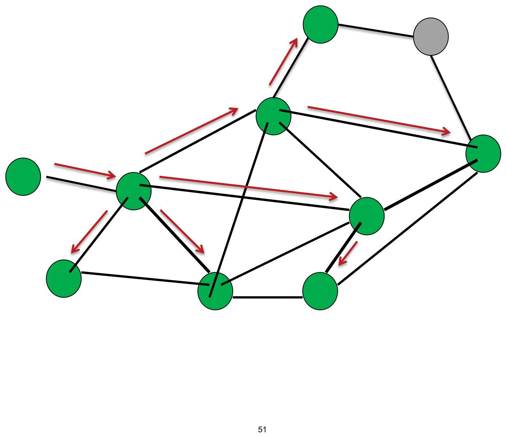

> [原图说明] 原页附图（p51）：第 3 轮后——距离 3 的节点被标记。此图将在统一裁剪阶段作为原图插回。

<!-- ===== PDF p52 ===== -->

**第 4 轮（Round 4）**

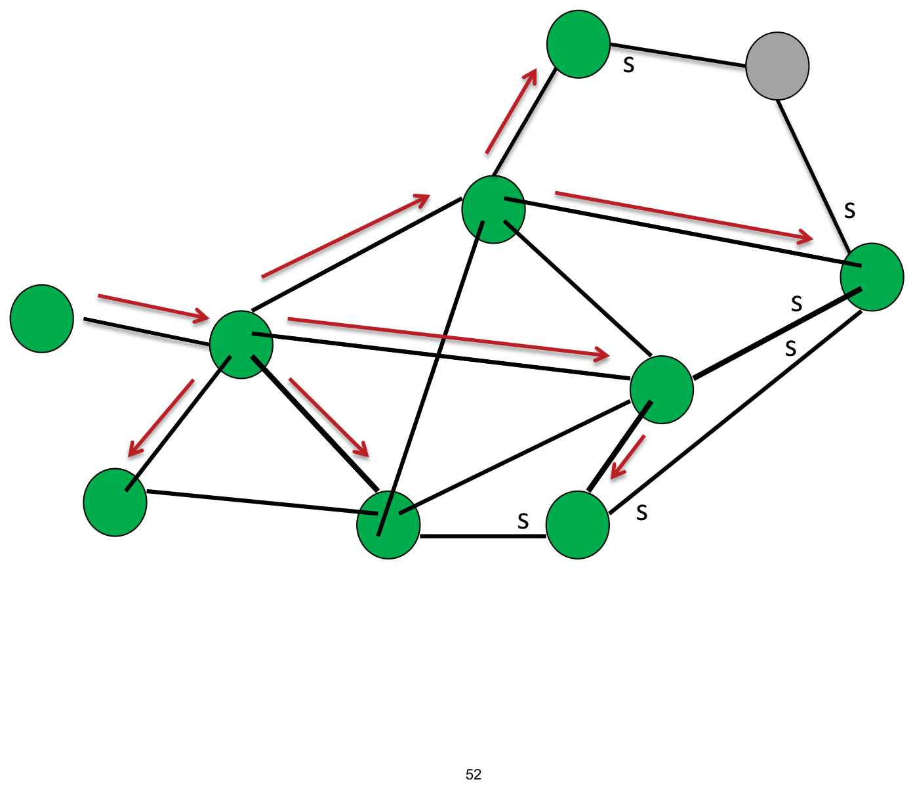

> [原图说明] 原页附图（p52）：第 4 轮——距离 3 的节点广播 search。此图将在统一裁剪阶段作为原图插回。

<!-- ===== PDF p53 ===== -->

**第 4 轮（Round 4）**

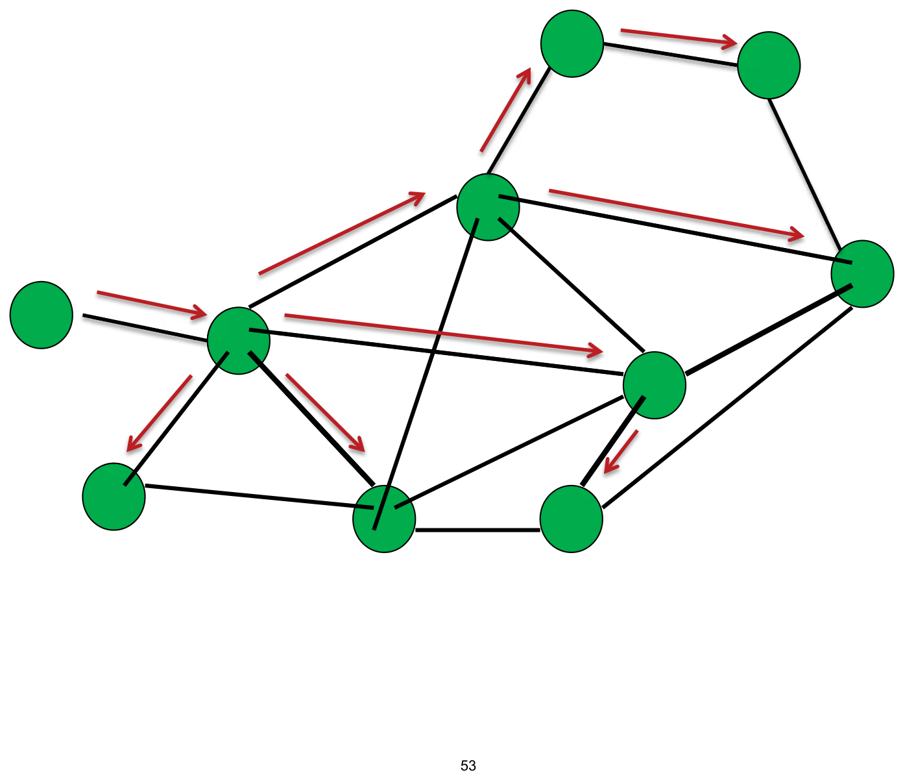

> [原图说明] 原页附图（p53）：第 4 轮后——距离 4 的节点被标记，全部节点标记完成。此图将在统一裁剪阶段作为原图插回。

<!-- ===== PDF p54 ===== -->

**正确性（Correctness）**

- **问（Q）**：描述 $r$ 轮后状态的**关键不变式**？
- 每个进程的状态变量：
  - `marked`，布尔，初始对 $i_o$ 为 true、对其他人 false
  - `parent`，UID 或 undefined
  - `send`，布尔，初始对 $i_o$ 为 true、对其他人 false
  - `uid`
- **不变式（Invariants）**：
  - $r$ 轮结束时，恰好**距离 $v_o$ 小于 $r$ 的进程**被标记。
  - 进程 $i \ne i_o$ 的 parent **有定义当且仅当**它被标记。
  - 对任何距离 $v_o$ 为 $d$ 的进程，若其 parent 有定义，则它是距离 $v_o$ 为 $d-1$ 的某个进程的 UID。
- 可用于正式的正确性证明。

> **[note] Note（译者注，BFS 不变式）:** 这三条 invariant（不变式）不是三个平行结论，而是一条递进的链：先钉住"谁被标记"，再钉住"标记与父指针同步"，最后钉住"父指针携带深度"。
>
> 第一条为什么写"距离小于 $r$"而不是"小于等于 $r$"，值得逐句走一遍。第 $r$ 轮开始时被标记的恰是距离小于 $r$ 的顶点；这一轮里，距离恰为 $r$ 的顶点收到 search（搜索）消息；第 $r$ 轮结束时被标记的便是距离小于 $r+1$ 的顶点。这正好是 induction（归纳）的一步。若把不变式写成"小于等于 $r$"，归纳步就跨不过去：第 $r$ 轮结束时距离为 $r+1$ 的顶点还没收到任何消息，却被断言已经标记，整个证明在这里断掉。基例取 $r = 0$ 时集合为空，从 $r = 1$ 起算更干净。
>
> 第二条是两个方向同时成立。进程只在"第一次收到 search（搜索）"这一个动作里同时做两件事——置 marked（已标记）与写 parent（父节点），所以有父必有标记；反过来，任何被标记的非根进程当初都是被某条消息标记的，那条消息的发送者就被记成了父。两个方向合起来才是"当且仅当"，缺一半就只能证明"有父则被标记"这种弱结论。
>
> 第三条是三者中唯一真的涉及"树"的。若 $i$ 的父是 $j$，则 $j$ 的距离比 $i$ 少一，于是沿父指针上溯，$d$ 步恰好回到 root（根），树中的 depth（深度）因此等于图上的距离。这条保证的不是"有一棵树"，而是"这棵树是 BFS 树"——前两条只保证结构和标记一致，第二条即使成立，父指针也可能指到同层的一个 vertex（顶点）上，那样树照样存在，深度却全错。
>
> 算一个能核的例子。五个顶点的图：$v_o$ 连 $a$ 与 $c$，$a$ 连 $b$，$c$ 连 $b$，$b$ 连 $d$。距离分布：$a, c$ 为 $1$，$b$ 为 $2$（走 $a$ 或走 $c$ 都两步），$d$ 为 $3$。逐轮验第一条：$r = 1$ 时应是距离小于 $1$ 的，只有 $v_o$，$1$ 个；$r = 2$ 时距离小于 $2$，即 $v_o, a, c$，$3$ 个；$r = 3$ 时加上 $b$，$4$ 个；$r = 4$ 时加上 $d$，$5$ 个，全部到齐。再验第三条：$d$ 的父是 $b$，而 $b$ 的距离为 $2 = 3 - 1$，差正好是一。
>
> 这套证明可以抽象成一个可复用的模板：状态变量加不变式加对轮数归纳。四步走——把每个进程的全部状态变量与其初值列清；写出带参数的 $I(r)$；检查基例；假设 $I(r)$ 成立，证明一轮状态转移之后 $I(r+1)$ 成立。分布式版本比串行多一道要求：不变式要把"进程状态"与"信道上在途的消息"一起覆盖，否则轮与轮之间的世界是空的，归纳步会凭空多出没有交代的东西。本讲之所以只写进程状态就够，是因为同步模型保证一轮之内消息必然投递完，不存在在途消息——这条"免费"是同步假设买来的，异步模型里要还回去。
>
> 跨课程连接。6.042J 里你用归纳证明过递推式的解，也用不变式证明过状态机的安全性；CLRS 第 2 章插入排序的循环不变式是同一套模板的串行版。区别在归纳变量：串行循环按迭代次数归纳，一次一步，前一步的结果确定地交给后一步；分布式按 round（轮）归纳，一轮之内所有进程同时动作，所以归纳步必须论证"同时动作"不会让某个进程跑到别人前面——这正是同步假设提供的那把尺子。
>
> 收束一句：这三条写出来之后，正确性就不再需要"看图说话"；p55 的复杂度估算与后面的终止检测，全都建立在这三条之上。

<!-- ===== PDF p55 ===== -->

**复杂度（Complexity）**

- **时间复杂度**：
  - 直到所有节点输出其父节点信息所需的轮数。
  - 任何节点到 $v_o$ 的**最大距离**，即 $< \operatorname{diam}$。
- **消息复杂度**：
  - 整个执行期间所有进程发送的消息总数。
  - $O(|E|)$。

> **[note] Note（译者注，复杂度对比）:** 这条注要拆的是分布式复杂度的二维结构：时间与通信是两个互相独立的量，各自被图的一个几何参数卡着。
>
> 时间为什么是 $diam$（直径）而不是 $n$：因为一轮之内所有进程同时推进一步，wavefront（波前）是整层一起走，所以完成时刻等于"最长的那条最短路"的长度。两个极端说明差距有多大：星形图有 $n$ 个 vertex（顶点），$diam = 2$，两轮就结束；链状图也有 $n$ 个顶点，$diam = n - 1$，要 $n - 1$ 轮。同样 $10000$ 个顶点，一个是 $2$ 轮，一个是 $9999$ 轮，差三个数量级。所以"这个分布式算法快不快"这句话本身不成立，必须先问图的形状。
>
> 消息为什么是 $O(|E|)$：每条 search（搜索）消息由某个已标记顶点发给某个 neighbor（邻居），也就是一条 edge（边）的一个方向；而一个顶点一生只发一次（标记是一次性、不可撤销的事件），所以每个方向至多发一条，总数不超过 $2|E|$。这里用的是"发一次"这件事实，不是"每轮都发"——后者会得到 $O(n|E|)$，那正是下一张幻灯片 Bellman-Ford 的代价。
>
> 还有第三个维度常被略过：space（空间）。每个进程只存四个量——marked（已标记）、parent（父节点）、send（发送）、uid，都是常数个，与度数无关，所以单点本地空间是常数，全网总量是 $O(n)$。这与串行 BFS 的 $O(n)$ 数组看似相同，差别在于分布式里没有那张全局表，任何一个进程都看不到总量，也就无法用"表是否已满"来判断进度。串行 BFS 中 queue（队列）最多可能装下 $O(n)$ 个顶点，那部分空间在分布式里被换成了时间：没有人排队，等待表现为若干轮的空转。
>
> 把两个维度都算出来。设某网络 $|E| = 5000$，$diam = 100$，每条消息 $64$ 字节即 $512$ bit，链路带宽 $10\ \mathrm{Mb/s}$，单跳传播延迟 $1\ \mathrm{ms}$。时间维度：$100$ 轮乘 $1\ \mathrm{ms}$，得 $100\ \mathrm{ms}$。通信维度：$2|E| = 10000$ 条乘 $512$ bit 得 $5120000$ bit，除以 $10^7$ bit/s 得 $0.512\ \mathrm{s}$。两个数一比，通信时间是传播时间的五点一倍——在这个配置下，把消息条数砍一半，比把轮数砍一半更划算。反过来，若把每条消息压到 $8$ 字节即 $64$ bit，通信时间降到 $0.064\ \mathrm{s}$，反而短于传播时间，瓶颈立刻换成了跳数。同一张图、同一份代码，瓶颈由消息大小而非算法决定。
>
> 跨课程连接。CSAPP 第 6 章讲 cache（缓存）层次时反复强调 latency（延迟）与 bandwidth（带宽）是两件不能混着比的事；这里的 $100\ \mathrm{ms}$ 是延迟型成本，$0.512\ \mathrm{s}$ 是带宽型成本，正好一一对应。区别在你能控制什么：cache（缓存）的延迟由容量与命中率决定，你可以靠提高 locality（局部性）改善；这里的时间由 $diam$ 决定，改善它的唯一办法是改图的拓扑，算法本身无能为力。
>
> 再对比下一张幻灯片：Bellman-Ford 要 $n - 1$ 轮、$O(n|E|)$ 消息，BFS 要 $diam$ 轮、$O(|E|)$ 消息。差距的来源不是技巧，是假设——BFS 用的是"无权"，一条边只算一跳；把权加回去，最短路可能要用到 $n - 1$ 条边，两个复杂度同时变差。这就是算法课总要问"你的输入允许什么"的原因：复杂度常常是假设的价钱，不是代码的价钱。
>
> 收束一句：读任何分布式算法的复杂度，先问时间被什么量控制、通信被什么量控制，再问这两个量能不能用小改动压下去；p81 那句"时间界真的依赖 $n$ 吗"，问的正是这个。

<!-- ===== PDF p56 ===== -->

**锦上添花（Bells and Whistles）**

- **子指针（Child pointers）**：
  - 到目前为止，每个进程只知道自己的父节点，不知道自己的孩子。
  - 要添加子指针：每个收到 search 消息的人都**在下一轮**发回 parent 或 nonparent 响应。
- **距离（Distances）**：
  - 增强算法，使每个人还学习并输出**自己到 $v_o$ 的距离**。
  - 每个进程在一个新的 `dist` 变量中记录自己到 $v_o$ 的距离，初始对进程 $i_o$ 为 0，对其他人为 $\infty$。
  - 把 dist 值放入每条 search 消息；当未标记进程收到 search $d$ 消息时，把自己的 dist 设为 $d + 1$。

> **[note] Note（译者注，两个扩展）:** 这两个"锦上添花"要补的是同一个结构性缺陷：原算法的树是单向的，子知道父，父不知道子，于是信息只能向上、不能向下。
>
> 先看子指针为什么非要多花一轮。发送者发出 search（搜索）消息之后，并不知道哪个接收者把自己选作了父——接收者可能同时收到好几条 search（搜索），要到本轮末尾才定下 parent（父节点）。所以确认信息最早只能在下一轮发出，而且要发到具体的 port（端口）上。这条因果链也解释了为什么"提前应答"行不通：提前应答等于发送者替接收者做决定，一旦接收者的实际选择与之不符，父子关系两边就不一致，后期汇播会漏掉一整片子节点。
>
> 代价算清：search（搜索）消息本来是 $2|E|$ 条（$E$ 为 edge（边）集），加上应答变成 $4|E|$ 条。换来的是每个父节点手里有完整的 children（子节点）集合，这是 broadcast（广播）与 convergecast（汇播）的前提——没有子指针，树就是一条只能上行的单行道，根发出的任何指令都落不下去。
>
> 再看距离为什么可以免费搭车。dist（距离）的定义是"父的距离加一"，而父恰好就是发 search（搜索）的那个人，所以把 dist（距离）写进消息，接收者拿到 $d$ 就知道自己是 $d + 1$。正确性依赖前面那条不变式：第一次收到的 search（搜索）一定来自最浅的那层，故 $d + 1$ 就是真实距离，而不是某个偏大的估计。初值取根为 $0$、其余为无穷；这个"无穷"只是占位符，实现里取一个比任何可能路径之和都大的数即可，取多大不影响正确性。
>
> 算一笔能核的账。$8 \times 8$ 网格，$n = 64$，$|E| = 112$。只有覆盖时：$2|E| = 224$ 条消息。加子指针：再加 $224$ 条应答，共 $448$ 条，正好翻倍。加 dist（距离）：消息条数不变，每条多带一个 $16$ 位字段即 $2$ 字节，$224$ 条就多出 $448$ 字节；若按 $20$ 字节的固定头部算，总字节从 $224 \times 20 = 4480$ 涨到 $224 \times 22 = 4928$，只涨约一成。功能上却从"只有父指针"变成"双向树加层号"，这是典型的用小元数据换大能力。
>
> 跨课程连接。CSAPP 第 6 章里每个 cache（缓存）行都带 tag（标记）与 valid bit（有效位），靠一点点元数据把一块裸存储变成可寻址、可判断的层次结构；这里靠两字节的 dist（距离）把一棵裸树变成带层信息的索引结构，思路同源。区别在维护者：cache（缓存）的元数据由硬件在每个访存周期自动更新，你几乎看不到它出错；这里的 dist（距离）要算法显式传播，某轮漏带一次，下游距离全错，而且错误会顺着树一路传下去，越靠叶子的顶点偏得越远。
>
> 顺带说一句工程含义：子指针与距离是所有"树形通信原语"的最小配置。少了子指针，根无法下发指令、也无法收齐所有完成信号；少了距离，节点无法判断自己是否可以提前收工去做局部聚合。后面 p57 到 p64 的终止检测、p65 的流水线广播与全局聚合，都建立在这两个扩展之上。
>
> 收束一句：这两个扩展的本质都是"让树携带方向之外的信息"，一个带结构（谁是我的孩子），一个带度量（我离根多远）；两者叠加，树才从一条单向链变成一根可双向调度的骨架。

<!-- ===== PDF p57 ===== -->

**终止性（Termination）**

- **问（Q）**：进程如何知道 BFS 树已完成？
- 若它们知道 $\operatorname{diam}$ 的上界，就可以**等到那么多轮过去**。
- **问（Q）**：若它们对图一无所知呢？
- **稍简单的问题**：进程 $i_o$ 应知道树何时完成。
- **终止算法（Termination algorithm）**：
  - 假设每条 search 消息都收到响应（parent 或 nonparent）。
  - 一个节点对其所有发出的 search 消息都收到响应后，就知道**谁是自己孩子**，并知道它们都已被标记。
  - **树的叶子**知道自己是叶子（它们只收到 nonparent 响应）。
  - 现在用**汇播（convergecast）**策略：

<!-- ===== PDF p58 ===== -->

**终止性（Termination）**

- **终止算法（Termination algorithm）**：
  - 一个节点对其所有 search 消息都收到响应后，就知道谁是自己孩子，并知道它们都被标记。
  - **树的叶子**知道自己是叶子。
  - 用**汇播（convergecast）**策略：
    - 从叶子开始，进程沿着 BFS 树把 **done 消息向 $i_0$ 扇入（fan in）**。
    - 进程 $i \ne i_o$ 在以下两个条件满足后，可向其父节点发送 done：
      - 它已收到所有 search 消息的响应（所以知道谁是自己孩子），并且
      - 它已收到所有孩子的 done 消息。
    - $i_o$ 在以下两个条件满足时，知道 BFS 树已完成：
      - 它已收到所有 search 消息的响应，并且
      - 它已收到所有孩子的 done 消息。

> **[note] Note（译者注，汇播 = 树上的自底向上聚合）:** convergecast（汇播）解决的是一个非常具体的判定问题：一棵静止的树上，所有顶点都干完了活，这件事什么时候才能被根确知。
>
> 先把两个条件的必要性拆开看。条件一是"对每条发出去的 search（搜索）都收到应答"，它换来的是"我知道谁是我的 children（子节点）"。条件二是"收到所有孩子的 done（完成）消息"，它换来的是"我知道这些孩子各自的 subtree（子树）都完成了"。少任何一个都不行：只有条件一，孩子可能还在干活，你就宣布完成，root（根）会在信息不全时收工；只有条件二，你可能还在等一个尚未被识别出来的孩子，而那个孩子根本没被算进"所有孩子"里，你在等一个空集，条件二立刻空真满足。两个条件必须同时存在，才能把"我没有漏掉任何孩子"和"我的孩子都完成了"这两件事都钉住。
>
> 为什么这套逻辑一定能停：因为"子树完成"是一个递归定义，而树是有限的。leaf（叶子）最先满足——它对每条 search（搜索）都只收到 nonparent 应答，说明没人认它作父，它没有孩子，条件二空真成立；叶子上报之后，父的"所有孩子都 done"才可能成立；如此逐层向上，直到根。这是一个对树高做 induction（归纳）的论证，基例是叶子，归纳步是"所有孩子已完成则父可完成"，收敛性由树的有限性保证。
>
> 代价算一下。done 消息每条 edge（边）只走一次，共 $n - 1$ 条；轮数等于树高，也就是 $diam$（直径）。取 $8 \times 8$ 网格的 BFS 树：$n = 64$，树高 $14$，于是汇播花 $63$ 条消息、$14$ 轮。若还要求所有进程都知道"树已完成"，根还得沿树再广播一条 finish（结束）消息，又是 $63$ 条、$14$ 轮；合计 $126$ 条消息、$28$ 轮。取 RTT（往返时延）$50\ \mathrm{ms}$，总共 $28 \times 50 = 1400\ \mathrm{ms}$，比建树本身的 $700\ \mathrm{ms}$ 还贵一倍——终止检测不是免费的，它和主干算法同量级。
>
> 能不能省？能。若进程事先知道 $diam$ 的上界，直接等够那么多轮就行，一条消息都不用发，代价是设计时必须有人知道图有多大。这就把"终止检测"换成了"预先知识"，是一笔典型的用假设换通信的交易；p57 那两个问句问的正是这笔交易的两端。
>
> 跨课程连接。CSAPP 第 12 章里父线程调用 join（线程汇合）等子线程退出，语义上就是"等我的所有孩子都完成我再继续"；这里只是把 join（线程汇合）从"一次等一个线程"换成"等一个集合，而集合本身要先被通信确认"。另一条线是 reduction（归约）：$64$ 个数求和，用树形结构两两相加只需 $6$ 层、$63$ 次加法，与这里的 $63$ 条 done 消息一一对应。区别在谁在调度：reduction（归约）的层数由库内部决定，节点之间靠共享内存直接读；汇播的每一层都要一条真实的 message（消息），还要多花一轮去确认"我到底有几个孩子"。
>
> 收束一句：broadcast（广播）自上而下、convergecast（汇播）自下而上，两条方向相反的波构成树上的双向信息流；p65 的流水线广播与全局聚合，都是这条双向通道上的应用。

<!-- ===== PDF p59 ===== -->

**用汇播终止（Termination Using Convergecast）**

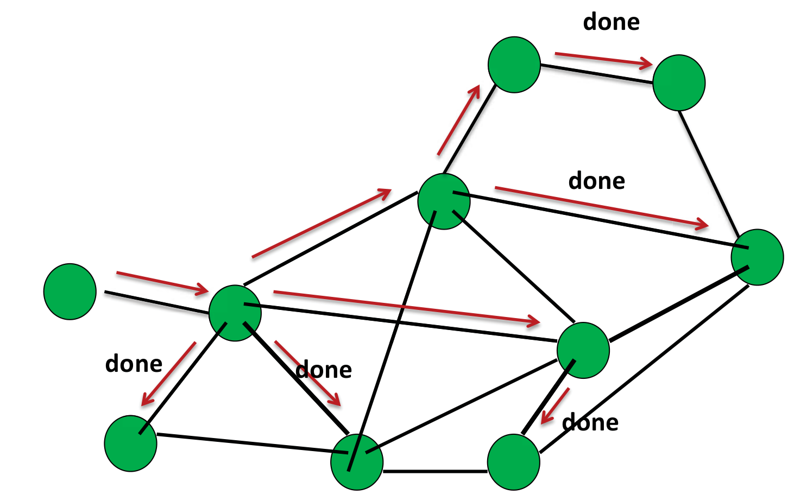

> [原图说明] 原页附图（p59）：汇播起始——各节点向父节点发送 done 消息。此图将在统一裁剪阶段作为原图插回。

<!-- ===== PDF p60 ===== -->

**用汇播终止（Termination Using Convergecast）**

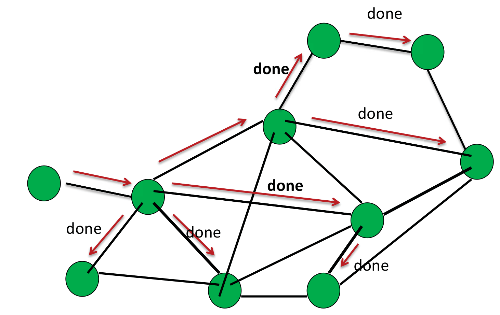

> [原图说明] 原页附图（p60）：汇播推进——done 消息沿树逐层向上。此图将在统一裁剪阶段作为原图插回。

<!-- ===== PDF p61 ===== -->

**用汇播终止（Termination Using Convergecast）**

> [原图说明] 原页附图（p61）：汇播推进——更高层节点收到所有孩子的 done 后继续上传。此图将在统一裁剪阶段作为原图插回。

<!-- ===== PDF p62 ===== -->

**用汇播终止（Termination Using Convergecast）**

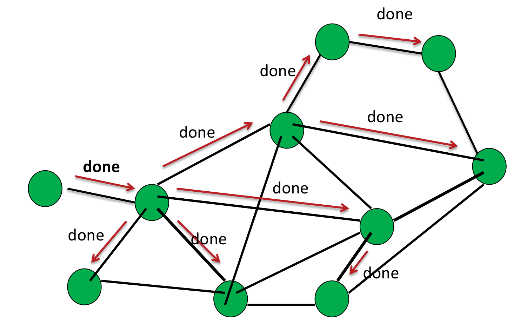

> [原图说明] 原页附图（p62）：汇播推进——接近根。此图将在统一裁剪阶段作为原图插回。

<!-- ===== PDF p63 ===== -->

**用汇播终止（Termination Using Convergecast）**

> [原图说明] 原页附图（p63）：Done!——根收到所有 done 消息，BFS 树完成。此图将在统一裁剪阶段作为原图插回。

<!-- ===== PDF p64 ===== -->

**终止的复杂度（Complexity for Termination）**

- 树完成后，done 信息传到 $i_o$ 需要 $< \operatorname{diam}$ 轮和 $n$ 条消息。
- **问（Q）**：如何让**所有**进程都知道 BFS 树已完成？
- 进程 $i_o$ 可以**沿树的边向所有人广播**一条消息。
- 需要**额外的 $\operatorname{diam}$ 轮和 $n$ 条消息**。

<!-- ===== PDF p65 ===== -->

**广度优先生成树的应用（Applications of Breadth-First Spanning Trees）**

- **消息广播（Message broadcast）**：
  - 进程 $i_o$ 可以用带子指针的 BFS 树向网络中所有进程广播一系列消息。
  - 每条需要 $\operatorname{diam}$ 轮和 $n$ 条消息。
  - 可以**流水线化（pipeline）**它们，使 $k$ 条消息只需 $\operatorname{diam} + k$ 轮，而非 $\operatorname{diam} \times k$。
- **全局计算（Global computation）**：
  - 假设每个进程以某个初始值开始，进程 $i_o$ 应确定**所有进程值的某个函数**的值。
  - min、max、sum、average……
  - 可以在 BFS 树上用**汇播**完成。
  - 代价是 $\operatorname{diam}$ 轮和 $n$ 条消息。
  - 一般而言消息可能很大，但对许多函数，沿途可以做一些**数据聚合（data aggregation）**。

> **[note] Note（译者注，BFS 树的应用与流水线）:** BFS 树真正的用处不是「给每个节点找到父节点」，而是把一张没有结构的图换成一台有结构的交换机：每个进程一旦知道自己的父，全网就有了一条唯一确定的转发路径，广播与汇播从此不再需要地址、路由表或者任何名字。
>
> 先看为什么必须先把树建出来。在没有树的图上做广播，唯一正确的办法是 flooding（泛洪）：每个节点把收到的内容转发给所有邻居，消息沿所有边扩散。它能覆盖全网，代价是每条边每个方向都被走一次，共 $2|E|$ 条消息；而且同一份内容会沿不同路径重复到达同一个节点，接收方必须自己识别并丢弃重复。树把这个结构固定下来：每个非根节点恰有一个父，转发关系是一棵树而不是一张网，每条树边只用一次，消息数恰为 $n-1$，没有重复需要处理。BFS 树还多给了一样东西：它的深度恰好等于根的 eccentricity（偏心率），也就是从根到最远节点的真实距离；而任何 spanning tree（生成树）的深度都不可能小于这个数，所以在「层数最少」这个指标上 BFS 树已经是同类里最好的。
>
> 广播的代价是「$\operatorname{diam}$ 轮、$n-1$ 条消息」，其中 $\operatorname{diam}$ 是从根出发的最大距离。若发的是一串 $k$ 条而不是一条，串行做法是发一条、等它到底、再发下一条，共 $\operatorname{diam}\times k$ 轮。树上的转发不需要等：中间节点收到第 1 条后可以立刻把第 2 条往后送，于是第 $i$ 条在第 $i$ 轮进入树，在第 $\operatorname{diam}+i-1$ 轮到达最深的叶子，全部 $k$ 条只要 $\operatorname{diam}+k-1$ 轮。代入数字：设 $\operatorname{diam}=12$、$k=100$，串行要 $12\times 100=1200$ 轮，流水线要 $12+100-1=111$ 轮，快约 10.8 倍；而且 $\operatorname{diam}$ 这段建立时间被 100 条消息摊薄，每条只剩 $1.11$ 轮的边际成本，几乎就是纯吞吐。
>
> 反方向的汇播同理。设根要知道全网 $n$ 个数之和，朴素做法是每个叶子把原始值沿树送去，共 $n$ 个值；但加法结合律允许先加后传：每个节点把自己的值加上孩子汇总来的值，只往上送一个数。消息条数仍是每边一次，运载的数据量却从 $O(n)$ 个值降到每条边一个值——设每个值 32 个 bit（比特）、$n=1000$，朴素方案靠近根的边要流 $1000\times 32=32000$ 个 bit（比特），沿途聚合后这条边只流 32 个 bit（比特），差三个数量级。这就是 data aggregation（数据聚合）的全部内容：不是少发消息，而是让每条消息只携带它必须携带的信息。
>
> 跨课程连接有两处。其一，CSAPP 第 5 章把处理器流水线的执行时间拆成建立时间加吞吐乘条数，这里的 $\operatorname{diam}+k-1$ 是同一式子的离散版：$\operatorname{diam}-1$ 是填满流水线所需的轮数，$k$ 是排空之后每条消息的稳定间隔；区别在于 CSAPP 的流水线寄存器由硬件时钟推进，而这里的时钟是消息在边上的一跳延迟，你没法加快它，只能让它一直有活干。其二，MapReduce 的 reduce 阶段做的正是这种自底向上的归约：mapper 先在本地聚合，reducer 只接收各分区的部分和；区别是 MapReduce 的树由调度器事先定好（通常一两层），这里的树从图结构里自然长出来，深度由 $\operatorname{diam}$ 决定。
>
> 所以这一页真正在说的是：把通信结构压成一棵树，是分布式系统里收益最容易算清的一次投资——一次性付 $\operatorname{diam}$ 轮与 $n-1$ 条消息，此后所有广播、汇播、聚合都在这个结构上按建立时间加吞吐乘条数计价。

<!-- ===== PDF p66 ===== -->

**BFS 构造的应用（Application of the BFS construction）**

- **一般图中的领导者选举（Leader election in a general graph）**：
  - 没有特殊进程 $i_o$。
  - 进程对图一无所知。
  - **每个人都可以启动自己的 BFS**，充当根。
  - 用这个来确定**最大 UID**；拥有最大 UID 的进程就是领导者。
  - 代价是 **$O(\operatorname{diam})$ 轮、$O(n \cdot |E|)$ 消息**。

> **[note] Note（译者注，用 BFS 做一般图选举）:** 这一页要回答的是：在没有全局广播这条原语的一般连通图上，怎么把「最大 UID（唯一标识符）当选」做成？答案是让每个进程都建一棵以自己为根的 BFS 树，用 $n$ 棵树的代价人工模拟一次完全图上的广播。
>
> 先看为什么非这样不可。团网络里一轮就完事，因为完全图让「一条消息直达所有人」成为物理事实：任何两个进程之间都有边。一般图没有这个性质，一个进程的值要到另一个进程，至少要走它们之间的最短路径，最坏 $\operatorname{diam}$ 轮。而选举要求每个人都知道全局最大值，这是一个需要全员信息的问题；没有共享介质、没有路由表、又不知道图长什么样，唯一能用的载体就是生成树。建树本身不产生信息，它的作用是把「谁是邻居」这个局部事实，翻译成「谁能把消息送到谁」这个全局事实。
>
> 代价拆开看。一棵 BFS 树的消息数约 $2|E|$（每条边每方向各一条 search），$n$ 棵并行就是 $O(n|E|)$；轮数不是 $n\cdot \operatorname{diam}$，而是 $\operatorname{diam}$，因为 $n$ 棵树同时生长、波前同步推进，最慢的那棵用 $\operatorname{diam}$ 轮，其余在同一批轮里完成。要注意这里的 $|E|$ 指原图的边数而非树的边数：建树阶段每个进程向全部邻居发 search，每条边两个方向各走一次，所以一棵 BFS 树的建树代价是 $O(|E|)$；树建好之后沿树转发才降到 $n-1$ 条。代入数字：设 $n=1000$、$|E|=3000$、$\operatorname{diam}=12$，消息数约 $1000\times 6000=6\times 10^6$ 条；设每条 20 字节（8 字节 UID（唯一标识符）加头部），总通信量 $1.2\times 10^8$ 字节即 120 MB。带宽按讲义例子的 $10\ \mathrm{Mb/s}$ 即 $1.25\ \mathrm{MB/s}$ 算，光把消息送出去就要 $120/1.25=96$ 秒；同样 $n=1000$ 的完全图只要 $1000\times 20=20000$ 字节，约 16 毫秒。两者差 6000 倍，这个倍数不是一个常数因子，而是「一次广播要 $2|E|$ 次转发」与「一次广播只要 $n$ 次发送」的结构差异。
>
> 跨课程连接：CSAPP 第 11 章讲 socket（套接字）时，UDP 支持广播地址与组播，一次 `sendto` 就能让同一网段所有主机收到——那是链路层硬件替你在交换机的端口上复制报文，应用层只付一次发送代价。分布式算法没有这层硬件：它面对的抽象是「每条边上两个方向各一条信道」，复制必须由你自己用 $2|E|$ 条独立消息完成。这条对比也解释了为什么「能不能广播」是网络模型里最贵的一条假设，代价差着一个 $|E|$ 的因子。
>
> 再往前看一步：既然 $n$ 棵树太贵，自然的想法是只建少数几棵。Gallager、Humblet、Spira 在 1983 年给出的 minimum spanning tree（最小生成树）分布式算法就是这个思路走得最远的一版——所有进程协作长出一棵共享的树，消息数压到 $O(n\log n+|E|)$，比 $O(n|E|)$ 少一整个量级——这个「少一个量级」要看图的疏密：稀疏图上 $O(n|E|)$ 是 $O(n^{2})$、GHS 是 $O(n\log n)$，差的是 $n/\log n$；只有稠密图 $|E| = \Theta(n^{2})$ 时才差开完整的 $n$。该文 2004 年获 Dijkstra 奖。从「每人都建树」到「大家共建一棵树」，省下来的正是重复劳动：那 $n$ 份 BFS 结构里，真正有用的信息只有一份，其余都是拷贝。GHS 的手法是把「所有人同时找最小边」换成「相邻片段配对合并」，每轮至少让片段数减半，合并只进行 $O(\log n)$ 轮，这就是它把消息数压下一整个量级的机制。
>
> 一句话收束：一般图的选举不是「想出一个聪明规则」的问题，而是「先把广播这件基础设施建起来」的问题；BFS 树给出了最便宜的建法，代价是 $O(\operatorname{diam})$ 轮与 $O(n|E|)$ 消息，而这 $n$ 倍开销正是后续最小生成树研究要削掉的东西。

<!-- ===== PDF p67 ===== -->

**最短路生成树（Shortest Paths Trees）**

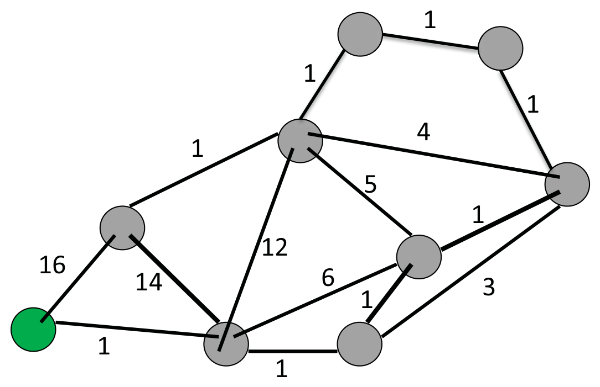

> [原图说明] 原页附图（p67）：最短路示例图——带权图（边权 1、3、4、5、6、12、14、16 等），根 $v_o$ 在左。此图将在统一裁剪阶段作为原图插回。

<!-- ===== PDF p68 ===== -->

**最短路（Shortest Paths）**

- 把 BFS 问题推广到**允许边带权**：边 $\{u, v\}$ 有权 $\operatorname{weight}(u, v)$。
- 连通图 $G = (V, E)$、根顶点 $v_o$、进程 $i_o$。
- 进程有 UID。
- 进程知道自己的**邻居**和**关联边的权**，但除此之外对图**没有任何知识**。

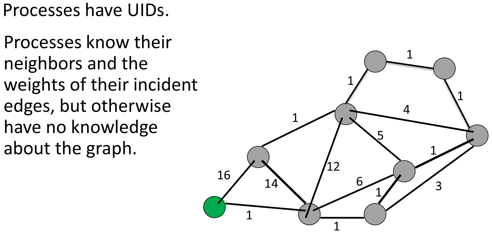

> [原图说明] 原页附图（p68）：最短路问题示例图（带权边，根 $v_o$）。此图将在统一裁剪阶段作为原图插回。

<!-- ===== PDF p69 ===== -->

**最短路（Shortest Paths）**

- 进程必须产生一棵**以顶点 $v_o$ 为根的最短路生成树**。
- 分支是从 $v_o$ 出发的**有向路径**。
  - **生成（Spanning）**：分支到达所有顶点。
  - **最短路（Shortest paths）**：到每个节点的树分支的**总权**是 $G$ 中从 $v_o$ 出发**任何路径的最小总权**。
- **输出（Output）**：每个进程 $i \ne i_o$ 应输出 **parent $j$, distance($d$)**，含义是：
  - $j$ 的顶点是 $i$ 的顶点在从 $v_o$ 出发的**最短路上的父节点**，
  - $d$ 是从 $v_o$ 到 $j$ 的**最短路的总权**。

> **[note] Note（译者注，最短路生成树 = 带权 BFS）:** BFS 树能在无权图上给出「层等于距离」，靠的是一个隐式前提：每条边的代价相同，于是跳数最少与代价最小是同一件事。带权图把这个前提打掉了，整套机器必须重建。
>
> 用最小的反例说明。三个节点：$v_o$ 到 $b$ 有一条权 5 的边，$v_o$ 到 $a$ 有权 1 的边，$a$ 到 $b$ 也有权 1 的边。若沿用「第 $r$ 轮标记跳数距离为 $r$ 的节点」这条规则，第 1 轮 $a$ 与 $b$ 同时被标记，$b$ 的父被定为 $v_o$，按权记账 $b$ 的距离就是 5；可真实的最短权路径是 $v_o\to a\to b$，权 $1+1=2$。错在哪儿？错在「第 $r$ 轮标记的节点，其最优解已经确定」这条在无权图成立、在带权图不成立的假设。无权图里第 $r$ 层的节点不可能被更短的路径追上，因为所有路径每步代价都是 1；带权图里一条 2 跳的小权路径完全可能打败一条 1 跳的大权边。
>
> 于是算法必须允许「先给临时估计，之后被更小的值覆盖」，也就是 relaxation（松弛）：每个进程保留一个 dist 作为上界估计，只要邻居送来比我当前值更小的候选，就更新并换父。看似只改了更新规则，真正的代价是它让树动态化了：BFS 树一旦定下父就不再改（先到先得），最短路树的父会在更好的路径出现时被换掉。后面两张幻灯片讲的子指针维护与终止检测之所以变复杂，根源都在这里——不是实现细节麻烦，而是「树在收敛之前一直在变」这件事改变了问题的性质。
>
> 把前面那个例子算完：初始 $dist(v_o)=0$，其余为 $\infty$。第 1 轮 $a$ 取 $0+1=1$、$b$ 取 $0+5=5$。第 2 轮 $a$ 广播 1，$b$ 从 $a$ 得 $1+1=2<5$，改为 2、父改为 $a$。此时已与真值一致，第 3 轮只是确认无变化。同一张图若用 BFS 规则，第 1 轮就把 $b$ 的父锁死为 $v_o$、距离锁死为 5，永远不会改回 2——先到先得在带权图里给出的是错答案，不是一个偏慢的答案。这个区别很重要：它说明最短路问题不能靠在 BFS 上打补丁解决，必须换算法。顺带说清输出格式的差别：BFS 树只需输出父节点，因为深度沿父指针数得出来；最短路树必须额外输出 distance，因为带权图里层不再可数，距离只能作为数据沿树传下来。另有一个前提要记住：本讲只讨论非负权，最短路因此总能取简单路径、松弛也不会自己绕圈；一旦允许负权，就得额外检测负环，那是另一个话题。
>
> 跨课程连接要分两层。算法层是 6.006 的最短路家族：Dijkstra 在非负权下做到 $O(|E|\log|V|)$，靠的是一台全局最小优先队列，每轮从所有未定节点里挑出 dist 最小的那个。这台队列在分布式模型里根本不存在：没有哪个进程看得见全局的 dist 数组，也没有共享内存给它们排序，所以只能退到 Bellman-Ford 的「所有边一起松弛」。系统层是 CS144 会讲的两类路由协议：OSPF 让每台路由器先靠 flooding（泛洪）拿到整张链路状态图，再在本地跑 Dijkstra；RIP 不拿全局图，只与邻居交换 distance vector（距离向量），跑的就是分布式 Bellman-Ford。两种协议的取舍正是「全局优先队列对局部并行松弛」这对张力的工程投影。
>
> 一句话收束：最短路树不是 BFS 加个权，而是把「层」这个离散结构换成了势——层只能整体加一，势可以任意跳；代价是失去了单调分层带来的免证明正确性，必须靠松弛的不变式来兜底。

<!-- ===== PDF p70 ===== -->

**Bellman-Ford 最短路算法（Bellman-Ford Shortest Paths Algorithm）**

- **状态变量（State variables）**：
  - `dist`，非负实数或 $\infty$，表示**已知的从 $v_o$ 出发的最短距离**。初始对进程 $i_o$ 为 0、对其他人 $\infty$。
  - `parent`，UID 或 undefined，初始 undefined。
  - `uid`
- **进程 $i$ 的算法**：
  - 每一轮：
    - 向所有邻居发送一条 **distance(dist)** 消息。
    - 从邻居处接收消息；令 $d_j$ 为从邻居 $j$ 收到的距离。
    - 执行**松弛步骤（relaxation step）**：
      - $\operatorname{dist} := \min(\operatorname{dist},\; \min_j (d_j + \operatorname{weight}(i, j)))$
    - 若 dist 减小，则设 parent := $j$，其中 $j$ 是产生新 dist 的任意邻居。

> **[note] Note（译者注，分布式 Bellman-Ford）:** 这一页值得逐字读，因为它示范了分布式改写最本质的一步：把串行算法里「谁先谁后」这个顺序维度，换成「谁与谁同时」。串行 Bellman-Ford 是「按某个顺序把所有边扫一遍，重复 $n-1$ 遍」；分布式版把这句里的顺序直接删掉，让所有边在每一轮里同时被松弛。
>
> 为什么删掉顺序仍然正确？因为串行 Bellman-Ford 的正确性从来不依赖扫描顺序。它依赖两件事：每次更新都对应一条真实存在的路径，所以 dist（距离估计）永远是真最短距离的上界；以及最优路径的最后一条边被松弛过这件事必然发生，所以上界会降到真值。前者是只减不增且不越过真值的单调性，后者是每轮至少推进一层边数。同步轮恰好同时满足两条：一轮里所有边都被看一遍，等价于串行的一整遍扫描；而单调性对任意更新次序都成立。换句话说，分布式版不是另一种 Bellman-Ford，而是把原算法里那个本就不必要的自由度显式地并行掉了。
>
> 讲义后面会提到这条规则与最短路线性规划的关系，这里就地讲清，不需要懂线性规划。最短路问题可以写成：给每个节点一个数值 $d$，要求 $d(v_o)=0$，并且对每条边满足 $d(v)\le d(u)+w(u,v)$——这就是绕一段路不会更近，是三角不等式在图上的样子。满足这些约束的 $d$ 有许多组，其中被压得最紧的那组就是真最短距离。松弛步骤 $\operatorname{dist}:=\min(\operatorname{dist},\,d_j+w)$ 做的正是从上方逼近这个最紧解：每次发现某条约束被违反，就把值往下拉。不需要知道对偶或单纯形，只要记住上界逐轮压紧、最终压到真值。
>
> 算一个能看出「轮数等于边数」的例子。四节点：$v_o$ 与 $p$、$p$ 与 $q$、$q$ 与 $r$ 之间各有一条权 5 的链边，另有 $v_o$ 与 $r$ 之间一条权 16 的捷径边。初始四个值 $(0,\infty,\infty,\infty)$。第 1 轮 $p$ 得 $0+5=5$，$r$ 得 $0+16=16$。第 2 轮 $q$ 得 $5+5=10$；$r$ 从 $q$ 收到的还是 $\infty$，保持 16。第 3 轮 $r$ 从 $q$ 得 $10+5=15<16$，更新为 15、parent（父节点）换为 $q$。第 4 轮无变化。$n-1=3$ 轮收敛，与界严丝合缝；而这张图的跳数直径只有 2（$r$ 直连 $v_o$），说明收敛轮数由边数决定，不由跳数决定。顺带核对消息量：每轮每个进程向自己的每个邻居各发一条，全轮共 $2|E|$ 条；$n-1$ 轮累计 $2(n-1)|E|$，即 $O(n|E|)$。这个数不是 $O(n^2)$，因为每轮发送量由边数决定，与点的平方无关——稀疏图上它接近 $O(n^2)$，稠密图上才退化到 $O(n^3)$。
>
> 跨课程连接：CLRS §24.1 的串行版给出的 $O(|V||E|)$ 在这里一一对应，只是「一次扫描」被摊平成「一轮」。更值得记的是它在真实网络里的样子：RIP 协议就是分布式 Bellman-Ford（文献里常叫 DBF，即 distance-vector 路由），每台路由器周期性把「我到各个目的地有多远」的向量发给直连邻居，收到更新就做 min，与本页算法逐字同构。历史顺序也有意思：这个方法最早由 Shimbel 在 1955 年提出，Ford 1956、Bellman 1958、Moore 1959 各自独立发表，所以叫 Bellman-Ford 更多是命名惯例，并不反映发明顺序。
>
> 一句话收束：同步模型把 Bellman-Ford 从一个循环变成了一个 fixed point（不动点）迭代，两者等价的关键是松弛的单调性对更新顺序不敏感——这是本节最廉价、也最容易被忽略的免费午餐。

<!-- ===== PDF p71 ===== -->

**示例：Bellman-Ford（Example: Bellman-Ford）**

- **初始（Initially）**：根 dist = 0，其他 $\infty$。

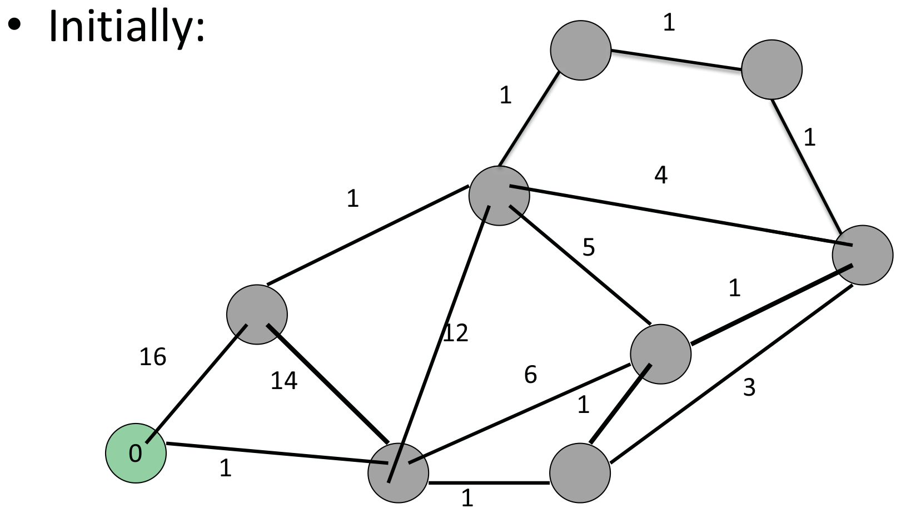

> [原图说明] 原页附图（p71）：初始状态——根节点 dist=0，其余为 ∞。此图将在统一裁剪阶段作为原图插回。

<!-- ===== PDF p72 ===== -->

**Bellman-Ford（Bellman-Ford）**

- **1 轮后（After 1 round）**：根的邻居收到 dist 0，更新为边权。

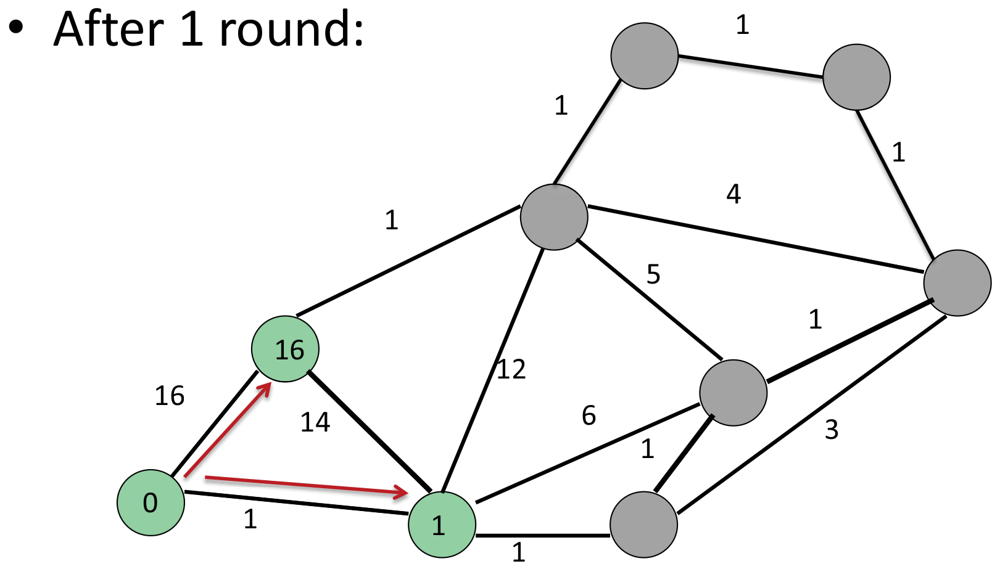

> [原图说明] 原页附图（p72）：1 轮后——根的直接邻居 dist 更新为各自边权（如 6、16 等）。此图将在统一裁剪阶段作为原图插回。

<!-- ===== PDF p73 ===== -->

**Bellman-Ford（Bellman-Ford）**

- **2 轮后（After 2 rounds）**：距离 2 跳的节点被更新。

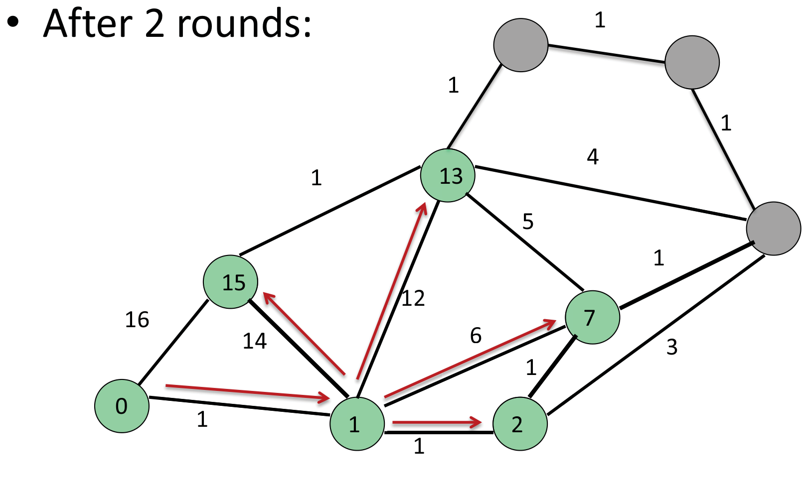

> [原图说明] 原页附图（p73）：2 轮后——更多节点 dist 更新（如 12、14、15 等）。此图将在统一裁剪阶段作为原图插回。

<!-- ===== PDF p74 ===== -->

**Bellman-Ford（Bellman-Ford）**

- **3 轮后（After 3 rounds）**。

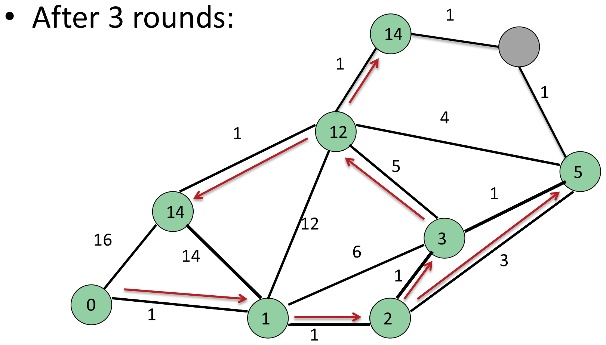

> [原图说明] 原页附图（p74）：3 轮后——dist 继续收敛。此图将在统一裁剪阶段作为原图插回。

<!-- ===== PDF p75 ===== -->

**Bellman-Ford（Bellman-Ford）**

- **4 轮后（After 4 rounds）**。

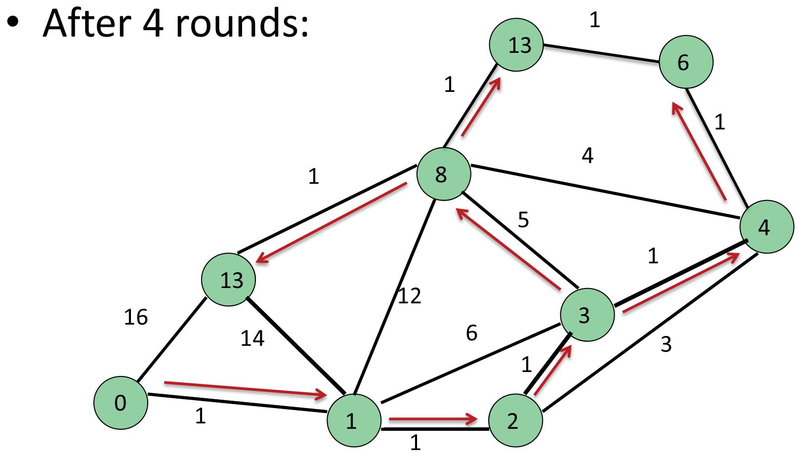

> [原图说明] 原页附图（p75）：4 轮后。此图将在统一裁剪阶段作为原图插回。

<!-- ===== PDF p76 ===== -->

**Bellman-Ford（Bellman-Ford）**

- **5 轮后（After 5 rounds）**。

> [原图说明] 原页附图（p76）：5 轮后。此图将在统一裁剪阶段作为原图插回。

<!-- ===== PDF p77 ===== -->

**Bellman-Ford（Bellman-Ford）**

- **6 轮后（After 6 rounds）**。

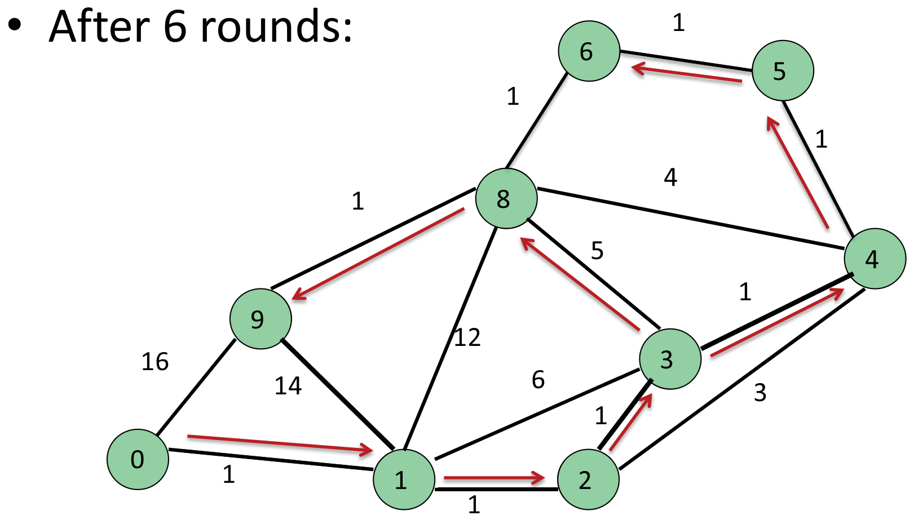

> [原图说明] 原页附图（p77）：6 轮后。此图将在统一裁剪阶段作为原图插回。

<!-- ===== PDF p78 ===== -->

**Bellman-Ford（Bellman-Ford）**

- **7 轮后（After 7 rounds）**。

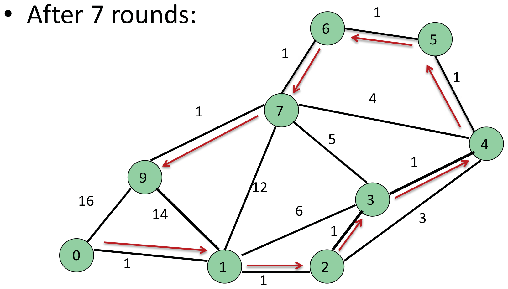

> [原图说明] 原页附图（p78）：7 轮后。此图将在统一裁剪阶段作为原图插回。

<!-- ===== PDF p79 ===== -->

**Bellman-Ford（Bellman-Ford）**

- **8 轮后（After 8 rounds）**：所有 dist 收敛到最短路。

> [原图说明] 原页附图（p79）：8 轮后——所有节点 dist 稳定为最短路权。此图将在统一裁剪阶段作为原图插回。

<!-- ===== PDF p80 ===== -->

**正确性（Correctness）**

- **论断（Claim）**：最终，每个进程 $i$ 都有：
  - $\operatorname{dist}$ = 从 $i_o$ 到 $i$ 的**路径最小权**，且
  - 若 $i \ne i_o$，$\operatorname{parent}$ = 从 $i_o$ 到 $i$ 的**某条最短路径上的前一节点**。
- **关键不变式（Key invariant）**：
  - 对每个 $r$，在 $r$ 轮结束时，每个进程 $i \ne i_o$ 的 dist 和 parent 对应**从 $i_o$ 到 $i$、由至多 $r$ 条边组成的最短路径**；若不存在这样的路径，则 $\operatorname{dist} = \infty$ 且 parent 未定义。

> **[note] Note（译者注，Bellman-Ford 不变式 = 「≤ r 条边的最短路」）:** 这条 invariant（不变式）的措辞值得逐字推敲：「至多 $r$ 条边」不是保守的修辞，而是让整个归纳能走通的唯一写法。换成「恰好 $r$ 条边」或者「$r$ 轮后已到达的所有点」，归纳会当场断掉。
>
> 两个理由。第一个是最短路不需要那么多边：从 $v_o$ 到邻居的最短路只有 1 条边，它在第 1 轮就正确，此后 $n-2$ 轮里这个值一直保持不变；若不变式要求恰好 $r$ 条边，那第 2 轮它就该对应一条 2 边的路，事实却是它对应 1 边的路，不变式当场为假。第二个是归纳步骤要能相加：$r+1$ 轮的值只能由 $r$ 轮的值加一条边构造出来，「至多 $r$」加一条边是「至多 $r+1$」，这一步闭合；「恰好 $r$」加一条边得「恰好 $r+1$」，而实际更新出来的候选值可能来自一条更短的路，于是「恰好」被打破。
>
> 把它记成一个可复用的模板：双侧夹逼加参数化 predicate（谓词）。谓词 $P(r)$ 是「$r$ 轮后，每个 $\operatorname{dist}$ 等于所有至多 $r$ 条边的路径中的最小权」。上界一侧：每次更新都对应一条真实路径，用「至多 $r$ 条边」的邻居值加一条边构造，所以 $\operatorname{dist}$ 不小于真值，永不越过。下界一侧：设到 $i$ 的「至多 $r+1$ 条边」最优路径为 $v_o\to\cdots\to u\to i$，则到 $u$ 的「至多 $r$ 条边」最优值在第 $r$ 轮已就位（这是归纳假设），第 $r+1$ 轮 $u$ 把它广播给 $i$，$i$ 取最小值后必不大于该路径权。两侧合起来给出等式。归纳终点是 $r=n-1$：任何简单路径至多 $n-1$ 条边，于是「至多 $n-1$」就是「全部」。
>
> 用上一页那张四节点图逐轮核对，$n=4$、$n-1=3$。第 1 轮后 $r$ 的 dist 是 16，而「至多 1 条边」到 $r$ 的唯一路径就是 $v_o\to r=16$，相符。第 2 轮后仍是 16，因为「至多 2 条边」到 $r$ 只有 $v_o\to r$ 这一条（$p$ 与 $r$ 之间没有边），相符。第 3 轮后变成 15，而「至多 3 条边」到 $r$ 的最小者正是 $v_o\to p\to q\to r=15$，相符。三轮逐轮对得上，说明不变式不是事后装饰，而是能当检查表用的：哪一轮对不上，就说明你对松弛或广播的时序理解错了。
>
> 同类模板的对照也有用：BFS 的不变式是「$r$ 轮后距离小于 $r$ 的点被标记」，走的是层的单调扩张；这里走的是边数的参数化；再往后 Luby 的极大独立集用的是「活跃边期望减半」，那是概率版本。三者形状不同，共同点是：不变式必须是一个带参数的谓词 $P(r)$，而 $P(r)\Rightarrow P(r+1)$ 的推导只允许用到「一轮之内能发生什么」这一条局部事实——凡是要全局视角才能推出的不变式，在分布式里都无法用归纳维护。
>
> 跨课程连接：这是动态规划的标准形态。6.006 里 Bellman 方程 $d(v)=\min_u(d(u)+w(u,v))$ 表达的是最优子结构，串行动态规划按子问题的边数从小到大算；分布式只是把「按边数从小到大」的计算顺序换成了「按轮数从小到大」的时间顺序，轮数就是被允许的边数。6.042J 的结构归纳给了这套论证的形式骨架：对路径长度这个结构参数做归纳。区别在于 6.042J 里你站在外部俯瞰整个计算，这里每个进程只看得到自己那一份 dist，所以不变式必须写成对每个进程同时成立的全称形式。
>
> 一句话收束：不变式里那个「至多」二字，是整个分布式 Bellman-Ford 正确性证明的承重墙——去掉它，那句「$r$ 轮收敛到至多 $r$ 条边」就没法从 $r$ 传到 $r+1$。

<!-- ===== PDF p81 ===== -->

**复杂度（Complexity）**

- **时间复杂度**：
  - 直到所有变量稳定到最终值所需的轮数。
  - **$n - 1$ 轮**
- **消息复杂度**：
  - 整个执行期间所有进程发送的消息总数。
  - **$O(n \cdot |E|)$**
- 比 BFS 更昂贵：
  - BFS：$\operatorname{diam}$ 轮，$O(|E|)$ 消息
- **问（Q）**：时间界真的依赖 $n$ 吗？

> **[note] Note（译者注，Bellman-Ford vs BFS 的复杂度对比）:** 这两行复杂度对比的差别不是常数因子，而是两个不同的上界来源：BFS 的 $\operatorname{diam}$ 来自图的最长最短路径，Bellman-Ford 的 $n-1$ 来自「简单路径最多 $n-1$ 条边」。前者是图的性质，后者是组合学的地板。
>
> 关键在「权最小」与「边数最少」是否等价。无权图里每条边代价相同，任何一条边数更少的路径一定更短，所以最短路就是边数最少的简单路径，而这类路径长度的最大值就是 diameter（直径），于是 $\operatorname{diam}$ 轮恰好够。带权图里两个目标脱钩：一条 19 条小权边的路可以打败一条 1 条大权边的路。这时候能说的最强的话只剩下「最短路可以取简单路径，简单路径至多 $n-1$ 条边」，于是轮数退到 $n-1$。这不是算法变笨，而是图上可用的结构信息变少了。
>
> 构造一个能看出差距的例子。$n=20$：$v_o$ 与 $v_2,\ldots,v_{19}$ 各连一条权 100 的边，$v_o$ 与 $v_1$ 一条权 1 的边，同时这些节点串成一条链 $v_1,v_2,\ldots,v_{19}$，每段权 1。这张图的 hop count（跳数）直径是 2（任意两个节点都能经 $v_o$ 两跳到达），但到 $v_{19}$ 的最短权路径是沿链走 19 段，权 19，远小于 100。于是 Bellman-Ford 需要 $n-1=19$ 轮才能把这个值一路推到底，而 BFS 只要 2 轮，差 9.5 倍。消息数上：$|E|=18+1+18=37$，BFS 约 $2|E|=74$ 条，Bellman-Ford 约 $19\times 74=1406$ 条，差 19 倍，正好是轮数之比。
>
> 这个对比背后有一条不能再退的物理约束：一轮里信息最多前进一条边。所以任何算法要算出一条 $L$ 条边的最短路，至少要 $L$ 轮。BFS 的算法正好达到「最长最短路有多少边」，Bellman-Ford 的算法正好达到「最坏情况下最短路有多少边」，两者都是紧的、都在自己的模型里最优——它们不是谁比谁好，而是在两张不同的图上各自贴着下界跑。这条「轮数不小于路径边数」是分布式时间复杂度的地基，与本地时钟频率、CPU 快慢完全无关。为什么直径在带权图上不再是上界？因为直径量的是最少的边数，带权最短路最小化的是权和，两个度量之间没有单调关系：边数少的路可以让权很大，边数多的路可以让权很小。前面那个 $n=20$ 的例子就是证据，直径 2，最短路 19 条边。顺带把权衡量化一下：同一张链长 $d$ 段的带权图上，Bellman-Ford 要 $d$ 轮、约 $d\cdot 2|E|$ 条消息；若先花一次 $O(|E|)$ 的 flooding（泛洪）把整张图收进根，再在根上串行跑 Dijkstra，则只要 $O(\operatorname{diam})$ 轮通信加 $O(|E|\log|V|)$ 次本地计算。前者用时间换通信，后者用通信换时间。
>
> 跨课程连接：CS144 里 RIP 把跳数上限硬性定为 15、以 16 表示不可达，这个 15 正是对「$n-1$ 轮太慢」的工程妥协——网络规模一大，向量收敛要几十轮，中途还会出现 count-to-infinity（两台路由器互相把对方当作下一跳，距离一轮轮往上涨）。OSPF 换了一条路：先 flooding（泛洪）拿到全网链路状态，再在本地跑 Dijkstra，把多轮迭代换成一次广播加一次本地计算。这里能看出一条通用规律：当分布式迭代的轮数太长时，可以用一次更贵的通信把它换掉，这正是本讲末尾要讲的权衡。
>
> 一句话收束：$n-1$ 与 $\operatorname{diam}$ 的差别不是精度问题，而是「有没有结构可用」的问题；带权把图的跳数结构抹平了，只剩组合学的天花板可以依靠。

<!-- ===== PDF p82 ===== -->

**子指针（Child Pointers）**

- 忽略重复消息。
- 当进程 $i$ 收到一条**没有用来改进 dist** 的消息时，它用 nonparent 消息响应。
- 当进程 $i$ 收到一条**用来改进 dist** 的消息时，它用 parent 消息响应，并向**任何先前的父节点**也发 nonparent 消息。
- 进程 $i$ 把从它收到 parent 消息的节点记录在集合 `children` 中。
- 当进程 $i$ 从当前孩子处收到 nonparent 消息时，把它从 `children` 中移除。
- 当进程 $i$ 改进 dist 时，它清空 `children`。

> **[note] Note（译者注，动态树的子指针维护）:** 这一页列的四条规则看着琐碎，其实全被一句话逼出来：父节点会变，而每个父节点又要靠「孩子都完成了」来判断自己能不能向上汇报。只要父会变，任何一次不通知旧父的偷懒，都会让旧父永远等一个不会来的 done。
>
> 逐条看因果。收到一条改进了我 dist 的消息，说明经由你更近，于是我把父设为 $j$，并回一条 parent 告诉你我是你的孩子——不回的话，$j$ 的 children（子节点集合）里没有我，它汇播时不会等我，可能在我还没算完时就向上报完成。同时必须给旧父回一条 nonparent（非父响应），因为旧父的 children 里还留着我，它会等我的 done；而我永远不会再以它的孩子身份发 done，于是它的「所有孩子都完成」永远为假，整棵子树卡死。这不是效率问题，是活性问题。改进 dist 时清空 children，是因为我的 dist 变小意味着经由我的所有路径都变短，我的孩子很可能改投更短的父；继续留着旧关系，会让我等到一批已经不存在的孩子。最后那条忽略重复消息，是为了避免同一份信息被确认两次，把「收到所有响应」这个计数条件提前满足。
>
> 算一个具体的三节点换父例子。$v_o$ 到 $b$ 权 10，$v_o$ 到 $a$ 权 1，$a$ 到 $b$ 权 1。第 1 轮 $a$ 得 1、父为 $v_o$；$b$ 得 10、父为 $v_o$；两条 parent 消息让 $v_o$ 的 children 变成 $\lbrace a,b\rbrace$。第 2 轮 $a$ 广播 1，$b$ 得 $1+1=2<10$，于是 $b$ 更新、换父为 $a$，向 $a$ 发 parent、向 $v_o$ 发 nonparent；$v_o$ 从 children 中删去 $b$，剩 $\lbrace a\rbrace$；$a$ 的 children 变成 $\lbrace b\rbrace$。整个过程的关系变更消息共 4 条（两条初始 parent、一条新 parent、一条 nonparent），而最终树只有 $n-1=2$ 条边，说明维护开销是树边数的两倍。
>
> 再看总开销的量级。每个进程的 dist 只减不增，取值来自路径权之和这个有限集合；若边权都是不超过 $W$ 的正整数，则任何最短路的权不超过 $(n-1)W$，于是单个进程最多改进 $(n-1)W$ 次，全局最多 $n(n-1)W$ 次改进，每次改进带两条关系消息，总消息 $O(n^2W)$。这个界很松，实际运行中改进次数远小于此，但它给出一条有用的结论：只要权是正的、有限的，换父次数必然有限，算法不会在父子关系上打转。这正是后面终止性论证需要的良基性。顺带说清这套规则对 BFS 不必要的原因：BFS 树的父一旦定下就不再变，所以 children 只需在收到响应时添加一次，永远不会删；最短路树必须支持删除，这就是它比 BFS 多出来的全部复杂度来源。
>
> 跨课程连接：CSAPP 第 9 章讲动态内存分配器时，`free` 一个块要同时维护前后两个方向的链表指针并合并空闲块，本质也是双向关系的一致性维护；区别是分配器的元数据在单一地址空间里、由一个线程顺序更新，而这里的关系分散在 $n$ 个进程里，撤销必须靠显式消息。另一个更好的对照是并查集的 path compression（路径压缩）：那里 parent 也会被改写，却不需要通知旧父，因为并查集是只查不问的结构，没有反向的等待；最短路树有反向等待，父在等子，所以父变必须广播。有没有反向依赖，正是判断变更要不要通知的判据。
>
> 一句话收束：子指针不是顺手记一下，而是一份契约——父靠它决定何时可以宣布完成，所以契约一旦变更，必须双方同时更新，否则不是慢，是死锁。

<!-- ===== PDF p83 ===== -->

**终止性（Termination）**

- **问（Q）**：进程如何知道最短路树已完成？
- **问（Q）**：进程如何知道自己可以输出自己的父节点和距离？
- 若进程知道 $n$ 的上界，它们可以**等到那么多轮过去**。
- 但若它们对图**一无所知**呢？
- 回顾 BFS 的终止：用了**汇播（convergecast）**。
- **问（Q）**：这里能用汇播吗？

<!-- ===== PDF p84 ===== -->

**终止性（Termination）**

- **问（Q）**：进程如何知道最短路树已完成？
- **问（Q）**：这里汇播能用吗？
- **能**，但**更棘手**，因为**树结构会变**。
- **关键思想（Key ideas）**：
  - 进程 $i \ne i_o$ 可以在以下条件满足后，向其**当前父节点**发送 done：
    - 它已收到所有 distance 消息的响应，所以它**相信自己知道谁是自己孩子**，且
    - 它已收到所有**这些孩子**的 done 消息。
  - **同一个进程可能多次参与汇播**，基于改进后的估计。

> **[note] Note（译者注，动态树上的终止更难）:** 这一页的问题可以改写成一句话：没有任何进程有全局视图，它们怎么一致地知道「已经没事可做了」？BFS 的汇播之所以简单，是因为树的形状在汇播期间冻结了；最短路树的形状一直在动，于是「子树完成」这个递归定义失去了良基性。
>
> 具体坏在哪里。设进程 $i$ 在某个时刻向父 $j$ 发了 done，理由是「我收到了所有 distance 消息的响应，且我所有孩子都 done 了」。这句话在发出的那一刻为真，但它描述的是一棵特定形状的树。若下一轮 $i$ 的 dist 被改进、父从 $j$ 换成 $k$，那条 done 就变成对旧树的承诺：在新树里 $i$ 是 $k$ 的孩子，$j$ 不该把 $i$ 算作已完成。如果 $j$ 不区分版本，它会把这个过期的 done 当作数，提前宣布自己的子树完成并向上报——根于是收到一个错误的全网完成，输出的父指针和距离就是错的。
>
> 更根本的困难是稳定这个性质无法被局部观测。一个进程能观察到的只有「这一轮我的 dist 没变」，它无法区分「暂时没变」与「永远不会变」。分布式系统里这类性质叫非局部性质：要判断它，你需要的信息在别处。这也是为什么讲义先给了一条退路——如果知道 $n$ 的上界，就等 $n-1$ 轮，因为不变式保证「$r$ 轮后至多 $r$ 条边的最短路已就位」，$n-1$ 轮后必然全部就位。等待的正确性来自一条已经证明过的上界，而不是来自任何观测。补一句版本号怎么加。最直接的做法是给每次换父递增一个计数器，done 里带上当时的父 UID 与轮次；父收到 done 时检查这两项与自己的记录是否一致，不一致就丢弃。这等价于把汇播从一棵树上升级成「每棵树各跑一遍汇播、只有最后那棵的结果被采纳」。更省的做法是让进程只在 dist 稳定了整整 $n-1$ 轮之后才允许发 done，用时间代替版本——两者本质相同，都是用一个可观测的量去近似稳定这个不可观测的性质。
>
> 用四节点的例子看过期 done 的实际后果。$v_o$ 到 $p$、$p$ 到 $q$、$q$ 到 $r$ 各权 5，$v_o$ 到 $r$ 权 16。第 2 轮结束时 $q$ 已从 $p$ 拿到 10，$r$ 仍是 16；假设 $r$ 此时认为邻居都跟我说完了，向当时的父 $v_o$ 发 done，$q$ 也向 $p$ 发 done。第 3 轮 $q$ 广播 10，$r$ 得 $15<16$，换父到 $q$。若 $v_o$ 不做 version（版本）处理，它在第 2 轮收到 $r$ 的 done（随后才是 $p$ 的 done——$q$ 的 done 只发给它的父 $p$，$p$ 要等 $q$ 的 done 到了才发自己的 done），于是在第 3 轮之前就可能宣布完成——此时 $r$ 的 dist 还是 16，而真值是 15。结论：不做版本管理，终止检测给出的不是慢答案，是错答案。
>
> 跨课程连接：CSAPP 第 11 章讲 TCP 关闭时，双方用 FIN 与 ACK 协商，最后由 TIME_WAIT 等 $2\,\mathrm{MSL}$ 才真正释放。为什么不直接检测对端确实没有数据了？因为它同样无法观测这种非局部性质：对端可能已经崩溃，也可能还有延迟报文在路上，于是只能用一段保守的时间上界代替检测。这与「知道 $n$ 的上界就等 $n-1$ 轮」是同一策略——当全局稳定不可观测时，用已证明的时间上界换取正确性。区别是 TCP 的界来自报文最大生存期，这里的界来自最短路至多 $n-1$ 条边这条组合事实。
>
> 一句话收束：termination detection（终止检测）的难点不在「怎么通知根」，而在「凭什么说现在可以通知」；动态结构把这份凭据变成了会过期的承诺，于是终止从一次汇播升级为一个带版本的一致性问题——下一讲的异步模型会把这条困难推到极限。

<!-- ===== PDF p85 ===== -->

**MIT OpenCourseWare**

http://ocw.mit.edu

**6.046J / 18.410J 算法设计与分析（Design and Analysis of Algorithms）**

Spring 2015（2015 春季学期）

有关引用这些材料的信息或我们的使用条款（Terms of Use），请访问：http://ocw.mit.edu/terms。
