<!-- ===== PDF p1 ===== -->

**讲次 20（Lecture 20）：异步分布式算法（Asynchronous Distributed Algorithms）——最短路生成树（Shortest-Paths Spanning Trees）** （6.046J, Spring 2015，第二部分 Part 2，Nancy Lynch 主讲）

**分布式算法（Distributed Algorithms）**

<!-- ===== PDF p2 ===== -->

**本周（This Week）**

- **同步分布式算法**：
  - 领导者选举（Leader Election）
  - 极大独立集（Maximal Independent Set）
  - 广度优先生成树（Breadth-First Spanning Trees）
  - 最短路生成树（Shortest Paths Trees，开始）
  - 最短路生成树（完成）
- **异步分布式算法**：
  - 广度优先生成树
  - 最短路生成树

> **[note] Note（译者注，本讲定位）:** 这一讲要回答的设计问题是：把分布式算法从 synchronized（同步）设定搬到 asynchronous（异步）设定，究竟哪一条前提被抽走，代价又由谁付。八十多页里前二十七页是复习，从第二十八页才进入新内容，这个配比本身就是信号：asynchronous（异步）那一半只来得及讲两个问题，因为每一个都比 synchronized（同步）版本贵一个数量级甚至更多。
>
> 先把被抽走的东西说准。synchronized（同步）模型的地基是按 round（轮）一个一个往前推：每个 round（轮）里每个 process（进程）先把待发的 message（消息）写到输出 port（端口），再让 channel（信道）把 message（消息）送到对端，最后各 process（进程）按收到的 message（消息）算新 state（状态）。这三步固定了先后，于是 round（轮）号天然成了 hop count（跳数）的计量器：第 $r$ 轮结束时被标记的节点，恰好是 distance（距离）不超过 $r$ 的那些。正确性因此可以对 $r$ 做 induction（归纳），一轮一步，结论是精确的。asynchronous（异步）模型把这个骨架整个拆掉：没有 round（轮），没有全局 clock（时钟），某个 state transition（状态迁移）在什么时刻发生完全由 execution（执行）自己决定。于是「$r$ 轮之后系统是什么样」这句话失去了指称对象，因为 $r$ 根本不存在。剩下的唯一出路是绕开「精确状态」，改说对一切 execution（执行）都成立的性质。
>
> 代价能直接算出来。设 channel（信道）投递一条 message（消息）的时延上界 $d = 10\ \mathrm{ms}$，本地计算时延忽略，图的 diameter（直径）$\operatorname{diam} = 10$，节点数 $n = 1000$。synchronized（同步）的 breadth-first search（广度优先搜索）只需要 $\operatorname{diam}$ 个 round（轮），每个 round（轮）耗时 $d$，合计 $10 \times 10\ \mathrm{ms} = 100\ \mathrm{ms}$。asynchronous（异步）的同一个算法，时间界写成 $\operatorname{diam} \cdot n \cdot d$，代入得 $10 \times 1000 \times 10\ \mathrm{ms} = 100\ \mathrm{s}$。两者差一千倍，而一千正是 $n$。这个因子不是凭空冒出来的：每条 channel（信道）上最多可能堆着 $n$ 条 message（消息），每个节点至少贡献一条自己的初值，queue（队列）只能一条一条往外吐，每条都要 $d$，于是一跳就要 $n \cdot d$。再把节点数放大到 $n = 10^{5}$，同一个 $\operatorname{diam} = 10$、$d = 10\ \mathrm{ms}$，异步时间界变成 $10 \times 10^{5} \times 10\ \mathrm{ms} = 10^{4}\ \mathrm{s}$，约两小时四十七分——而同步仍是 $100\ \mathrm{ms}$。记住这个乘法结构：传播时间等于跳数乘每跳堆积再乘单条时延。本讲后半程会看到堆积因子从 $n$ 涨到 $2^{n/2}$，指数灾难就是这么长出来的。
>
> 跨课程连接有三处。CSAPP 第十一章讲 socket（套接字）时，你写的是两个 process（进程）之间的一条 byte stream（字节流），可靠性与排序全部外包给 TCP（传输控制协议），你根本不必关心对端何时收到；这里相反，没有 TCP（传输控制协议）替你重排和重传，每个 process（进程）只能凭自己的 state（状态）和到手的 message（消息）作决定，对端的进度永远是黑箱。6.042J 的 partial order（偏序）在这里从练习题变成硬工具：一次 asynchronous（异步）execution（执行）天然只给出因果上的 partial order（偏序），没有全序，「谁先谁后」在很多对上根本没有答案，这一点在 6.852 的 logical time（逻辑时间）里会被正式拿来用。6.006 的 Bellman-Ford 你在一台机器上跑，relaxation（松弛）循环几轮由你自己写的 `for` 循环决定；这里同一套 relaxation（松弛）交给一群互不同步的 process（进程）执行，收敛要几步不由任何人说了算，只能靠性质去证明它终将收敛。
>
> 一句话收束：前半程的复习不是凑页数，而是让你看清究竟哪一条前提被拿掉了。拿掉的是 round（轮），塌掉的是「时间等于 distance（距离）」这个等式，后面所有指数级的坏消息都从这个等式塌掉的地方长出来。

<!-- ===== PDF p3 ===== -->

**分布式网络（Distributed Networks）**

- 基于无向图 $G = (V, E)$。
  - $n = |V|$
  - $r(u)$：顶点 $u$ 的邻居集合。
  - $\deg u = |r(u)|$：顶点 $u$ 的邻居数。
- 把**一个进程**关联到**每个图顶点**。
- 把**两个有向通信信道**关联到**每条边**。

<!-- ===== PDF p4 ===== -->

**同步分布式算法（Synchronous Distributed Algorithms）**

> [原图说明] 原页为章节分隔页（p4），仅标题「Synchronous Distributed Algorithms」。

<!-- ===== PDF p5 ===== -->

**同步网络模型（Synchronous Network Model）**

- 图顶点上的进程通过消息通信。
- 每个进程有连接到通信信道的输出端口、输入端口。
- 算法以**同步轮**执行。
- 每一轮：
  - 每个进程在其端口上发送消息。
  - 每条消息被放入信道，投递到另一端的进程。
  - 每个进程根据到达的消息计算新状态。

> [回顾] 本页是讲次 19 同步模型的复习，详细译注见讲次 19 的 p8-9。

<!-- ===== PDF p6 ===== -->

**领导者选举（Leader Election）**

> [原图说明] 原页为章节分隔页（p6），仅标题「Leader Election」。

<!-- ===== PDF p7 ===== -->

**$n$ 顶点团（n-vertex Clique）**

- **定理（Theorem）**：不存在由确定性、不可区分进程组成的算法能保证在 $G$ 中选举领导者。
- **定理（Theorem）**：存在由带 UID 的确定性进程组成的算法能保证选举领导者。
  - 1 轮，$n$ 条消息。
- **定理（Theorem）**：存在由随机的、不可区分进程组成的算法能**以概率 1** 最终选举领导者。
  - 期望时间 $< \frac{1}{1-\varepsilon}$。
  - 以概率 $> 1 - \varepsilon$，一轮内完成。

> [回顾] 本页复习讲次 19 的 p12-19（团网络的三个定理），详细译注见该讲。

<!-- ===== PDF p8 ===== -->

**极大独立集（Maximal Independent Set, MIS）**

> [原图说明] 原页为章节分隔页（p8），仅标题「Maximal Independent Set (MIS)」。

<!-- ===== PDF p9 ===== -->

**MIS（MIS）**

- **独立（Independent）**：集合中没有两个节点互为邻居。
- **极大（Maximal）**：在不破坏独立性的前提下不能再加入节点。
- **每个节点要么在 $S$ 中，要么有一个邻居在 $S$ 中**。
- 假设：
  - 无 UID
  - 进程知道 $n$ 的一个良好上界。
- 要求：
  - 计算网络图的一个 **MIS $S$**。
  - $S$ 中每个进程输出 in，其他进程输出 out。

> [回顾] 本页复习讲次 19 的 p21-22（MIS 定义），详细译注见该讲。

<!-- ===== PDF p10 ===== -->

**Luby 算法（Luby's Algorithm）**

- 初始所有节点都是活跃的。
- 每个阶段，一些活跃节点决定 in、一些决定 out，其余进入下一阶段。
- 活跃节点在一个阶段的行为：
  - **第 1 轮**：从 $\{1, 2, \ldots, n^5\}$ 选随机值 $r$，发送给所有邻居；从所有活跃邻居接收值；若 $r$ **严格大于**所有收到的值，则加入 MIS，输出 in。
  - **第 2 轮**：若你加入 MIS，向所有（活跃）邻居广播；若收到这样的广播，则决定不加入 MIS，输出 out；若在本阶段已决定，则变为不活跃。

> [回顾] 本页复习讲次 19 的 p23（Luby 算法），详细译注见该讲。

<!-- ===== PDF p11 ===== -->

**Luby 算法（Luby's Algorithm）**

- **定理（Theorem）**：若 Luby 算法最终终止，则最终集合 $S$ 是一个 MIS。
- **定理（Theorem）**：以至少 $1 - \frac{1}{n}$ 的概率，所有节点在 $4 \log n$ 个阶段内决定。

> [回顾] 本页复习讲次 19 的 p31-37（Luby 正确性与终止），详细译注见该讲。

<!-- ===== PDF p12 ===== -->

**广度优先生成树（Breadth-First Spanning Trees）**

> [原图说明] 原页为章节分隔页（p12），仅标题「Breadth-First Spanning Trees」。

<!-- ===== PDF p13 ===== -->

**广度优先生成树（Breadth-First Spanning Trees）**

- 特殊顶点 $v_a$。
- 进程必须产生一棵**以顶点 $v_a$ 为根的广度优先生成树**。
- 假设：
  - 有 UID。
  - 进程对图没有知识。
- 输出：每个进程 $i \ne i_a$ 应输出 **parent $j$**。

> [回顾] 本页复习讲次 19 的 p39-40（BFS 问题设定），详细译注见该讲。

<!-- ===== PDF p14 ===== -->

**简单 BFS 算法（Simple BFS Algorithm）**

- 进程在**被纳入树中**时标记自己。
- 初始只有 $i_0$ 被标记。
- 进程 $i$ 的算法：
  - **第 1 轮**：若 $i = i_0$，向邻居发送 search 消息；若收到消息，则标记自己、选 $i_0$ 为父、计划下轮发送。
  - **第 $r > 1$ 轮**：若计划发送，则发送 search；若未标记且收到消息，则标记自己、选某个发送者为父、计划下轮发送。

> [回顾] 本页复习讲次 19 的 p42（简单 BFS 算法），详细译注见该讲。

<!-- ===== PDF p15 ===== -->

**正确性（Correctness）**

- 每个进程的状态变量：`marked`（初始对 $i_a$ true）、`parent`（UID 或 undefined）、`send`、`uid`。
- **不变式（Invariants）**：
  - $r$ 轮结束时，恰好**距离 $v_a$ 小于 $r$** 的进程被标记。
  - 进程 $i \ne i_a$ 的 parent 有定义当且仅当它被标记。
  - 对任何距离 $v_a$ 为 $d$ 的进程，若其 parent 有定义，则它是距离 $d-1$ 的某进程的 UID。

> [回顾] 本页复习讲次 19 的 p54（BFS 不变式），详细译注见该讲。

<!-- ===== PDF p16 ===== -->

**复杂度（Complexity）**

- **时间复杂度**：直到所有节点输出父节点信息所需的轮数 = 任何节点到 $v_a$ 的**最大距离**，即 $< \operatorname{diam}$。
- **消息复杂度**：整个执行期间的消息总数 = **$O(|E|)$**。

> [回顾] 本页复习讲次 19 的 p55（BFS 复杂度），详细译注见该讲。

<!-- ===== PDF p17 ===== -->

**锦上添花（Bells and Whistles）**

- **子指针**：对 search 消息发送 parent/nonparent 响应。
- **距离**：把距离搭载在 search 消息上。
- **终止**：从叶子开始的汇播（convergecast）。
- **应用**：从根的广播、全局计算。

> [回顾] 本页复习讲次 19 的 p56-66（扩展与应用），详细译注见该讲。

<!-- ===== PDF p18 ===== -->

**最短路生成树（Shortest Paths Trees）**

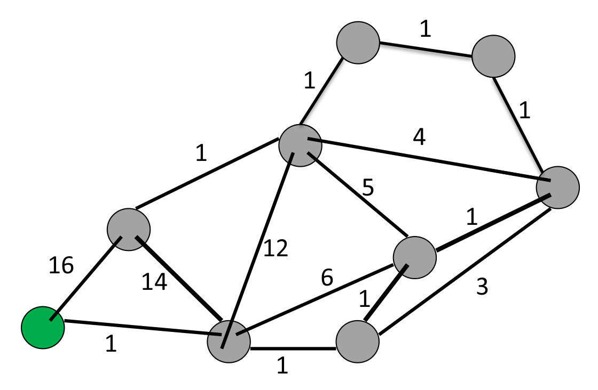

> [原图说明] 原页附图（p18）：最短路示例图（带权边，根 $v_o$）。此图将在统一裁剪阶段作为原图插回。

<!-- ===== PDF p19 ===== -->

**最短路（Shortest Paths）**

- 把 BFS 问题推广到**允许边带权**：边 $\{u, v\}$ 有权 $\operatorname{weight}(u, v)$。
- 连通图 $G = (V, E)$、根顶点 $v_a$、进程 $i_a$。
- 进程有 UID。
- 进程知道自己的**邻居**和**关联边的权**，但除此之外对图**没有任何知识**。

> [回顾] 本页复习讲次 19 的 p68（最短路问题设定），详细译注见该讲。

<!-- ===== PDF p20 ===== -->

**最短路（Shortest Paths）**

- 进程必须产生一棵**以顶点 $v_a$ 为根的最短路生成树**。
- 分支是从 $v_a$ 出发的有向路径。
  - **生成**：分支到达所有顶点。
  - **最短路**：到每个节点的树分支总权是 $G$ 中从 $v_a$ 出发任何路径的最小总权。
- 输出：每个进程 $i \ne i_a$ 应输出 **parent $j$, distance($d$)**，含义是 $j$ 的顶点是 $i$ 在最短路上的父节点、$d$ 是从 $v_a$ 到 $j$ 的最短路总权。

> [回顾] 本页复习讲次 19 的 p69（最短路生成树定义），详细译注见该讲。

<!-- ===== PDF p21 ===== -->

**Bellman-Ford 最短路算法（Bellman-Ford Shortest Paths Algorithm）**

- **状态变量**：`dist`（非负实数或 $\infty$，初始对 $i_a$ 为 0、其他人 $\infty$）、`parent`（初始 undefined）、`uid`。
- **进程 $i$ 的算法**：每轮向所有邻居发送 distance(dist)；接收后做**松弛**：$\operatorname{dist} := \min(\operatorname{dist}, \min_j(d_j + \operatorname{weight}(i,j)))$；若 dist 减小则设 parent 为产生新 dist 的邻居。

> [回顾] 本页复习讲次 19 的 p70（Bellman-Ford 算法），详细译注见该讲。

<!-- ===== PDF p22 ===== -->

**正确性（Correctness）**

- **论断（Claim）**：最终，每个进程 $i$ 有 dist = 从 $i_a$ 到 $i$ 的路径最小权，且 parent 为某条最短路上的前一节点。
- **关键不变式**：$r$ 轮结束时，每个进程的 dist/parent 对应**至多 $r$ 条边**的最短路；若无则 dist = $\infty$、parent undefined。

> [回顾] 本页复习讲次 19 的 p80（Bellman-Ford 不变式），详细译注见该讲。

<!-- ===== PDF p23 ===== -->

**复杂度（Complexity）**

- **时间复杂度**：$n-1$ 轮。
- **消息复杂度**：$O(n \cdot |E|)$。
- 比 BFS 更昂贵：BFS 是 $\operatorname{diam}$ 轮、$O(|E|)$ 消息。
- **问（Q）**：时间界真的依赖 $n$ 吗？

> [回顾] 本页复习讲次 19 的 p81（Bellman-Ford 复杂度），详细译注见该讲。

<!-- ===== PDF p24 ===== -->

**子指针（Child Pointers）**

- 忽略重复消息。
- 收到未改进 dist 的消息 → 响应 nonparent；收到改进 dist 的消息 → 响应 parent、并向旧父也发 nonparent。
- 收到 parent 消息的节点记入 `children`；收到当前孩子的 nonparent 则移除；改进 dist 时清空 `children`。

> [回顾] 本页复习讲次 19 的 p82（动态子指针维护），详细译注见该讲。

<!-- ===== PDF p25 ===== -->

**终止性（Termination）**

- **问（Q）**：进程如何知道最短路树已完成？如何知道自己可以输出父节点和距离？
- 若知道 $n$ 的上界，就等到那么多轮过去。
- 但若对图一无所知呢？
- 回顾 BFS 的终止：用了汇播。
- **问（Q）**：这里汇播能用吗？

> [回顾] 本页复习讲次 19 的 p83（终止问题），详细译注见该讲。

<!-- ===== PDF p26 ===== -->

**终止性（Termination）**

- **能**，但更棘手，因为**树结构会变**。
- **关键思想**：进程 $i \ne i_a$ 在「已收到所有 distance 消息的响应（相信知道自己孩子）」且「已收到所有孩子的 done」后，向**当前父节点**发送 done；**同一进程可能多次参与汇播**，基于改进后的估计。

> [回顾] 本页复习讲次 19 的 p84（动态树上的汇播终止），详细译注见该讲。

<!-- ===== PDF p27 ===== -->

**终止性（Termination）**

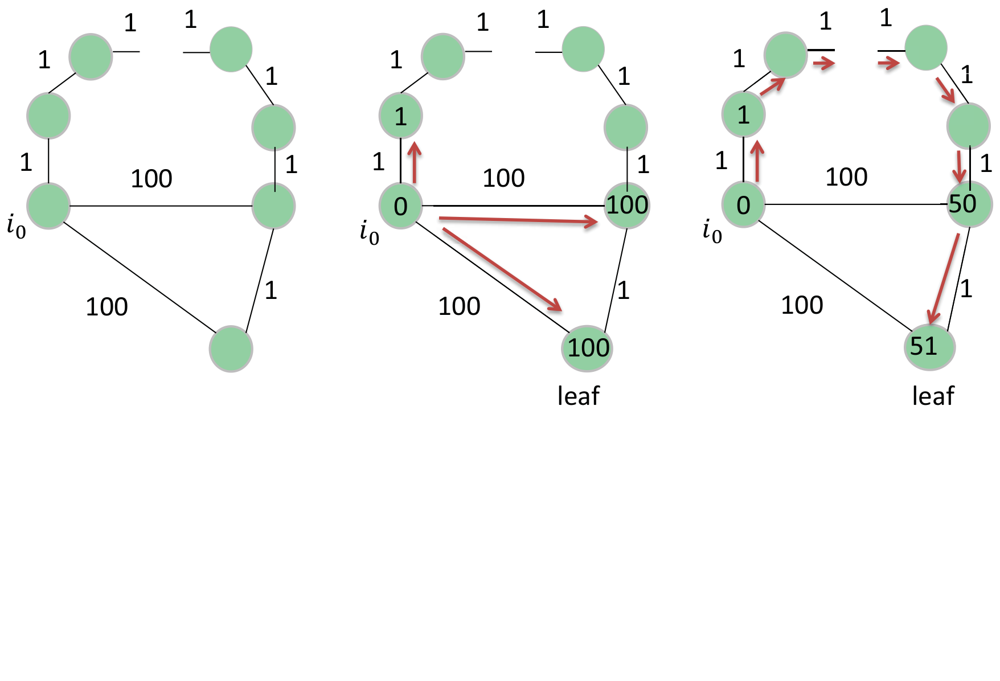

> [原图说明] 原页附图（p27）：动态最短路树上汇播终止的示例——边权含 100、1、50、51、5 等，标注 leaf（叶子）节点。此图将在统一裁剪阶段作为原图插回。

<!-- ===== PDF p28 ===== -->

**异步分布式算法（Asynchronous Distributed Algorithms）**

> [原图说明] 原页为章节分隔页（p28），仅标题「Asynchronous Distributed Algorithms」。

<!-- ===== PDF p29 ===== -->

**异步网络模型（Asynchronous Network Model）**

- **到目前为止的复杂性**：
  - 进程**并发**活动。
  - **一点点**非确定性。
- **现在情况糟得多**：
  - **没有轮**——进程步骤与消息投递发生在**任意时刻、任意顺序**。
  - 进程**失同步（get out of synch）**。
  - **多得多的非确定性**。
- **理解异步分布式算法很难**，因为我们**无法精确理解它们如何执行**。
- 相反，我们必须理解**执行的抽象性质**。

> **[note] Note（译者注，异步模型的根本困难）:** 这一页要处理的问题是：为什么 asynchronous（异步）模型下「第几个 round（轮）之后系统是什么样」这类陈述全都失效，以及失效之后该改说什么。答案不在算法层面，而在「什么算一个系统 state（状态）」这个定义层面。synchronized（同步）模型里，state（状态）是 round（轮）号与各 process（进程）局部 state（状态）的函数：给定这两样，下一步会发生什么完全确定，所以可以写「$r$ 轮结束时恰有 distance（距离）小于 $r$ 的节点被标记」，并对 $r$ 逐轮做 induction（归纳）。asynchronous（异步）里，同一个 process（进程）的同一个 step（步骤）可以发生在任何时刻，于是「系统此刻处于什么」取决于在此之前到底发生过哪些 step（步骤）、以什么次序发生。换句话说，state（状态）变成了 execution（执行）history（历史）的函数，而 history（历史）有无穷多条。
>
> 把「无穷多」量化一下就有感觉了。取 3 个 process（进程），每个恰有 2 个 enabled（可执行）的 step（步骤），且这些 step（步骤）中途不产生新 message（消息）。这 6 个 step（步骤）的所有 interleaving（交错）方案数是 $\frac{6!}{2! \, 2! \, 2!} = 90$。把 process（进程）数提到 5、每个仍是 2 个 step（步骤），方案数变成 $\frac{10!}{2^{5}} = 113400$，比前者大 1260 倍。若再让每条 channel（信道）各有 2 条排队中的 message（消息），每个 queue（队列）内部又有 $2!$ 种投递次序，总数还要乘以 $2^{3} = 8$，于是 3 个 process（进程）的情形已经是 $720$ 条互不相同的 execution（执行）。这还只是 6 个 step（步骤）的玩具系统；真实网络的 step（步骤）数随 message（消息）数一起增长，execution（执行）数按阶乘速度膨胀。
>
> 图解：把 3 个 process（进程）、各 2 个 step（步骤）的 execution（执行）前缀摊成树，往下每一层只多走一个 step（步骤）——
>
> (起点，无人走过任何 step（步骤）)
>   ├─ p1 走它的第 1 个 step（步骤）
>   ├─ p2 走它的第 1 个 step（步骤）
>   └─ p3 走它的第 1 个 step（步骤）
>
> 第一层只有三条边，往下每一层边数继续增加，等到 6 个 step（步骤）全部走完，叶子数正是算出来的 90。这张图要说明的是：树是「先分叉、再局部收敛」的形状，不同内部路径可以走到同一个局部 state（状态）组合，但要证明的性质必须在每一个 leaf（叶子）上都成立，只验证其中一条路径等于什么都没证明。
>
> 方法论的转向因此是被迫的，而不是风格选择：不刻画精确的 execution（执行），只刻画所有 execution（执行）共有的性质。具体是两类。invariant（不变式）对任意可达 state（状态）都成立，管的是「算出来的东西从不说谎」；timing property（时序性质）断言「到某个时刻某件事一定已经发生」，管的是「该算出来的迟早算得出来」。前者对应 safety（安全性），后者对应 liveness（活性），二者缺一不可：只有 invariant（不变式），算法可以永远不动而仍然正确；只有 timing property（时序性质），算法可以很快给出错误答案。
>
> 跨课程连接落在 CSAPP 第十二章与实分析两处。pthread（线程库）编程里，「互斥锁保证不出现非法交错」就是一条 invariant（不变式），它对任何 interleaving（交错）都成立；「条件变量保证等待线程最终被唤醒」就是一条 timing property（时序性质），它排除的是无限饿死。区别在于 pthread（线程库）底下有操作系统调度器兜底，你可以跑一遍看结果；这里没有任何兜底，只能在全部 execution（执行）上证明。实分析里的 $\varepsilon$-$\delta$ 语言是同一种思维迁移：既然算不出逐点的误差，就改说「对任意 $\varepsilon$ 存在 $\delta$」。区别只是量词的对象换了——那边量词作用于实数，这边量词作用于 execution（执行）。
>
> 一句话收束：asynchronous（异步）把「算出此刻的答案」这条路封死，只留下「证明对全部 execution（执行）都成立的性质」这一条，这不是退让，而是唯一能覆盖所有 interleaving（交错）的表述方式。

<!-- ===== PDF p30 ===== -->

**异步网络模型（Aynchronous Network Model）**

- 见 Lynch, *Distributed Algorithms* 第 8 章。
- 无向图 $G = (V, E)$ 节点上的进程通过消息通信。
- 与边关联的通信信道（每条边每个方向一个）。
  - $e_{u,v}$：从顶点 $u$ 到顶点 $v$ 的信道。
- 每个进程有连接到其信道的输出端口和输入端口。
- 进程**不必可区分**。

> **[note] Note（译者注，异步模型的形式化基础）:** 这一页要回答的是：既然精确描述 execution（执行）这条路走不通，总得先有个东西把「什么是一个 process（进程）」和「什么算一次 step（步骤）」讲清楚，否则连「对全部 execution（执行）都成立」这句话都无处落脚。I/O automaton（输入输出自动机）就是这个东西：一个 state（状态）集合、一个起始 state（状态）、一个按名字索引的 transition（迁移）关系，此外别无他物。极简本身就是目的——组件描述越薄，组合规则才写得越干净，后面把几十上百个组件拼成网络时才不会在一堆细节里迷路。
>
> 关键在于 transition（迁移）按 action（动作）名字分成三类：input（输入）由环境触发，output（输出）由自动机自己触发，internal（内部）既不进也不出。三分不是为了分类好看，而是为了回答「谁有权决定这一步」这个协作问题。input（输入）不能被拒绝，这叫作 input-enabled（输入使能）：只要外界送来 message（消息），自动机必须有一条 enabled（可执行）的迁移可以走，哪怕那条迁移的效果是原地不动。为什么必须这样？因为一旦允许拒绝 input（输入），「message（消息）送到了但对方不收」就需要额外协议去协商，而协商本身又要靠 message（消息），于是无穷回退。output（输出）则相反，不能从外部强加：只能由自动机自己发起，否则它就不再是自主的组件，而只是别人的遥控对象。
>
> 算一下 input-enabled（输入使能）的代价。设 process（进程）$P_u$ 有 4 个邻居，每个邻居可能送来值域为 $\{0, 1, \ldots, 99\}$ 的 message（消息），另有一个「不说话」的空动作。那么必须写明的 input（输入）迁移有 $4 \times 100 = 400$ 条，而 output（输出）迁移只需 $4$ 条，每条 channel（信道）一条 send。比例是 100 比 1。把值域换成 32 位整数，穷举数是 $4 \times 2^{32}$，约 $1.7 \times 10^{10}$ 条，形式定义里根本写不下，只能写成「对任意 $m$」的参数化模板——幻灯片上那些带 $m$ 的迁移规则不是偷懒的简写，而是唯一可行的写法。
>
> 这套骨架与真实的消息系统对得上。现实链路层也是这样：一条 channel（信道）里可能同时躺着若干 message（消息），接收方无法选择「只要第 3 条、不要第 1 条」，必须先接过队头；这正是 FIFO（先进先出）语义，也是 input-enabled（输入使能）在网络里的具体表现：你可以决定何时处理，但不能决定跳过。区别在于真实系统的 FIFO（先进先出）是硬件和协议栈共同保证的，而这里是被写进模型定义的公理。
>
> 跨课程有两处。CSAPP 第十一章的 socket（套接字）接口里，`read` 从来不先问你「现在想不想收」：没有数据就阻塞或返回 `EAGAIN`，但调用总得有一个结果，这与 input-enabled（输入使能）是同一条纪律，区别是那边由内核替你兜底，你只需要看返回值。6.042J 的状态机定义，即一个 state（状态）集合加一个 transition（迁移）关系，与这里的骨架几乎一样，缺的恰恰是两类东西：action（动作）的三分，以及把多个自动机拼成网络的组合规则。那边你只有一个孤立的状态机，这边你要几十个自动机按 action（动作）名字对接。
>
> 一句话收束：I/O automaton（输入输出自动机）的价值不在复杂，而在把「谁能触发、谁必须接住」写成了语法，后面所有关于 correctness（正确性）的论证都长在这条语法上。

<!-- ===== PDF p31 ===== -->

**信道自动机 $e_{u,v}$（Channel Automaton $e_{u,v}$）**

- 形式地，一个 **I/O 自动机**。
- **输入动作**：$\operatorname{send}(m)_{u,v}$
- **输出动作**：$\operatorname{receive}(m)_{u,v}$
- **状态变量**：
  - `mqueue`，一个 FIFO 队列，初始为空。
- **迁移（Transitions）**：
  - $\operatorname{send}(m)_{u,v}$：效果——把 $m$ 加入 `mqueue`。
  - $\operatorname{receive}(m)_{u,v}$：前提——$m = \operatorname{head}(\text{mqueue})$；效果——移除队头。

> **[note] Note（译者注，FIFO 信道自动机）:** 这张幻灯片给的是整个模型的第二块砖：channel（信道）。它小到只有两个 action（动作）和一个状态变量，却决定了后面所有关于「消息堆积」的推理能不能成立。信道 $e_{u,v}$ 就是有向边 $(u, v)$ 上的一个 FIFO（先进先出）queue（队列）`mqueue`，input（输入）动作是 $\operatorname{send}(m)_{u,v}$，output（输出）动作是 $\operatorname{receive}(m)_{u,v}$，前者把 $m$ 压进队尾，后者弹出队头。
>
> 把 state transition（状态迁移）摊成表，一共只有两行规则，跑一遍就是——
>
> 起点：`mqueue` 为空
>   send(m1) 之后：`mqueue` = [m1]
>   send(m2) 之后：`mqueue` = [m1, m2]
>   receive(m1) 之后：`mqueue` = [m2]
>   send(m3) 之后：`mqueue` = [m2, m3]
>   receive(m2) 之后：`mqueue` = [m3]
>
> 关键在于 receive 的 enabled（可执行）条件不是「queue（队列）非空」，而是「$m$ 恰好等于队头」。为什么把条件写得这么死？如果只要求非空，接收方就能挑任意一条 $m$ 出来，这条 channel（信道）提供的其实是 set（集合）语义，发送方写下的先后信息被抹平了。抹平之后会发生什么？设 $u$ 先发出 `dist` 为 3 的 message（消息），再发出 `dist` 为 5 的；对端若先拿到 5 再拿到 3，就会先把估计抬高、再压回去，凭空多一次 state（状态）改写和一次重播。本讲后半程那个指数级的 message（消息）总量，正是靠这种无谓的反复被放大出来的。所以 FIFO（先进先出）不是修辞，它把一条边上的先后关系变成了免费信息，是异步模型里少数可以白拿的顺序。
>
> 再算一个最小的时间例子。设单条 message（消息）的投递时延上界 $d = 10\ \mathrm{ms}$，某条 channel（信道）上已排着 $4$ 条 message（消息）。队头那条最迟在 $10\ \mathrm{ms}$ 内出手，第二条最迟 $20\ \mathrm{ms}$，第四条最迟 $40\ \mathrm{ms}$。也就是说 queue（队列）深度 $k$ 直接乘到延迟上，$k \cdot d$ 就是最后一条的出队上界。这个 $k \cdot d$ 就是后面「每跳堆积」项的最朴素版本：那一项里的 $k$ 先涨到 $n$，因为每个节点至少塞一条自己的初值；再涨到 $2^{n/2}$，因为改进波在延迟窗口内反复追上自己。变的始终只是这个 $k$。
>
> 还有一处容易看漏：`receive` 是 channel（信道）的 output（输出）动作，按定义该由它自己发起；可它同时又是对面 process（进程）的 input（输入）动作。这个「一个 action（动作）名字被两方共用」的写法，就是把信道和进程焊在一起的胶水，下下张幻灯片会正式定义它。理解这一点之后，「消息被投递」不再是「发送」之后必然发生的第二件事，而是同一件事的两面。
>
> 跨课程连接有两条。CSAPP 第十一章里，TCP（传输控制协议）替你做了这件事：byte stream（字节流）按序交付是 TCP（传输控制协议）的核心承诺，你在 socket（套接字）上 `read` 出来的字节顺序就是对方 `write` 进去的顺序。区别在于 TCP（传输控制协议）还要额外扛丢包与重传，而这里的 channel（信道）被抽象成不丢——fairness（公平性）保证 queue（队列）非空就迟早投递，丢包这一层整个被拿掉，剩下的只有延迟。CSAPP 第六章的 store buffer（写缓冲）是同一种形状：对同一个地址，写操作按程序顺序离开缓冲区，对不同地址的写却可以互相越过。把「地址」换成「channel（信道）」，两个模型就是同一条假设——一条路上的顺序保得住，不同路之间的顺序保不住。
>
> 一句话收束：channel（信道）只提供一种顺序，就是它自己内部那一条；凡是跨越 channel（信道）的因果，都得由算法自己装在 message（消息）里带过去。

<!-- ===== PDF p32 ===== -->

**进程自动机 $P_u$（Process Automaton $P_u$）**

- 把进程自动机关联到 $G$ 的每个顶点。
- 为简化记号，令 $P_u$ 表示顶点 $u$ 处的进程自动机。
  - 但进程**「不知道」$u$**。
- $P_u$ 有 $\operatorname{send}(m)_{u,v}$ 输出和 $\operatorname{receive}(m)_{v,u}$ 输入。
- 也可能有外部输入和输出。
- 有状态变量。
- 持续执行步骤（最终）。

> **[note] Note（译者注，进程不知道自己是哪个顶点）:** 这一页看起来只是一句脚注，其实是整个模型最容易被读漏的地方：process automaton（进程自动机）$P_u$ 被关联到 graph（图）的顶点 $u$，但 $P_u$ 自己「不知道」$u$。这一句话把「它在哪里」与「它知道自己在哪里」彻底分开，而这个分离正是分布式算法与单机算法的第一条分水岭。单机程序里 `&x` 给出一个地址，你随时可以知道自己在内存的哪个位置；这里地址是外部视角，进程只有内部视角。
>
> 严格说，$P_u$ 手里只有三样东西：自己的 state（状态）、各个 port（端口）上的本地名字（例如「第 3 号端口」）、以及从这些 port（端口）收到的 message（消息）。它不知道「第 3 号端口通向 UID（标识符）为 42 的那个邻居」。三样之外的一切都不在它手里：自己的标识、graph（图）的形状、$n$ 的大小、自己的 degree（度）。这条约束推下去会得出一个硬结论：所有 $P_u$ 的初始 state（状态）必须一模一样。为什么？如果初始 state（状态）里写着「我是顶点 7」，那这条信息不是从 message（消息）学来的，而是白送的；一旦白送，算法就可以绕过通信直接读答案，模型立刻退化成作弊。
>
> 用对称性把这条约束的后果算出来。取一个 $n = 4$ 的无向环，四个节点都没有 UID（标识符），初始 state（状态）相同。任取节点 $v$，把整个 graph（图）旋转一格，得到的 execution（执行）对 $v$ 而言与原 execution（执行）完全无法区分：它收到的 message（消息）序列、发出的 message（消息）序列、自己的 state（状态）序列全都一样。输入一样，确定性算法给出的 output（输出）就必须一样。于是四个节点要么全输出 in，要么全输出 out。可正确的 leader election（领导者选举）要求恰好一个 in、其余 out，矛盾。环有 $4$ 个旋转，就有 $4$ 个互相无法分辨的视角，任何确定性的匿名算法都被这重对称性卡死。给上 UID（标识符）之后情形立刻翻转：四个 UID（标识符）两两不同，旋转一次不再是对称 execution（执行），算法可以在一轮内选出最大者，消息数是每对之间一条，共 $\binom{4}{2} = 6$ 条；若每个节点向其余三个各发一条，则是 $4 \times 3 = 12$ 条。
>
> 这里有个常被混淆的点值得拆开：位置是物理事实，认知是信息论事实。「$P_u$ 位于 $u$」是外部观察者给的事实，可以写进论文；「$P_u$ 知道自己在 $u$」却是内部卷宗，只能由 message（消息）写进去。模型的纪律是：只有内部卷宗里的东西才准用来做决定。这条纪律在 CSAPP 里你能找到同构的表述——线程栈里的局部变量是内部卷宗，`proc/self/maps` 里那张表是外部事实，程序通常拿不到也没法用。
>
> 跨课程连接有两处。CSAPP 第九章讲虚拟内存时，你手上拿到的是 virtual address（虚拟地址），这个数跟真实落在哪个 physical page（物理页）没有固定关系；进程不知道自己住在哪一页，只知道自己手里的地址。区别在于虚拟内存这层抽象是操作系统为了让每个进程都以为自己独占整台机器，方向是「藏起位置、统一视图」；这里的匿名性方向相反，是「藏起位置、保留差异」，因为 graph（图）的形状恰恰是算法要自己摸出来的东西，摸的过程就是通信。6.042J 里的 equivalence relation（等价关系）在这里从定义变成工具：把「对所有 $u$ 都相同」当初始条件，就能在 state（状态）空间上划出等价类，同一等价类里的两个 state（状态）对算法不可分辨，于是任何确定性算法在它们上面必然给出相同的 output（输出）。这条「不可分辨则行为相同」的推理，是排除不可能性的标准手法。
>
> 一句话收束：这条设定之所以要紧，是因为它把 algorithm（算法）锁在局部可见信息里，凡是靠偷看才能拿到的东西一律不算数，后面所有不可能性结论都靠这条锁成立。

<!-- ===== PDF p33 ===== -->

**示例：Max 进程自动机（Example: Max Process Automaton）**

- **输入动作**：$\operatorname{receive}(m)_{v,u}$
- **输出动作**：$\operatorname{send}(m)_{u,v}$
- **状态变量**：
  - `max`，自然数，初始为 $x_u$
  - 对每个邻居 $v$：`send(v)`，布尔，初始 true
- **迁移**：
  - $\operatorname{receive}(m)_{v,u}$：效果——若 $m > \max$ 则 $\max := m$，且对每个 $w$ 令 `send(w) := true`。
  - $\operatorname{send}(m)_{u,v}$：前提——`send(v) = true` 且 $m = \max$；效果——`send(v) := false`。

> **[note] Note（译者注，Max 自动机的「改进即重播」）:** 这个 Max 自动机是整个异步部分的第一块试验田，它要演示一个可以反复套用的 pattern（模式）：看到更好的值就向所有邻居重播。模式本身三行就能写完：`max` 存当前已知的最大值，收到更大的 $m$ 就更新 `max` 并把所有 `send(v)` 置 true，`send(v)` 为 true 表示「还有新值要发给 $v$」，发完置 false。真正值得停下来看的是为什么要重播给所有邻居，而不是发给其中某一个。
>
> 设想省一点，收到改进只告诉「看起来最需要」的那个邻居。问题立刻出现：process（进程）无法知道谁需要。它对邻居的了解只有 port（端口）编号，不知道对方当前的 `max` 是多少，也不知道对方是否已经从别的路径学到了更大的值。在无法判断的前提下，把 broadcast（广播）收窄成 unicast（单播）等同于赌，而 asynchronous（异步）里这个赌必输：被跳过的那条边完全可能正是唯一的传播通道。反过来，重播给所有人是安全的，代价只是重复的 message（消息），而重复的 message（消息）最多浪费 bandwidth（带宽），不会破坏 correctness（正确性）。这是异步设计的第一条取舍原则——宁可多发，不可少发。
>
> 再往细一层：`send(v)` 是每个邻居各一个布尔量，不是全局的一个 dirty（脏）标志。这个粒度不是随手定的。若只有一个全局标志，一次改进把所有邻居一起置脏，而发送过程可以在任何一步被挂起——刚发给 A、还没来得及发给 B，此时另一个邻居送来更大的值，全局标志被重置，A 已经收过、B 还没有，重播从谁开始就取决于调度运气。per-neighbor（逐邻居）的布尔量把「谁还没收到」变成可表达的状态，挂起再恢复能接着做。一句话：state（状态）变量的粒度必须与正确性所依赖的假设对齐，粒度太粗就等于把假设丢掉了。
>
> 把代价算出来。用幻灯片上那张 5 个节点的 graph（图），初始值是 5、3、4、10、7，连成一个环，每个节点的 degree（度）都是 2。逐个算改进次数：持有 3 的节点最坏会依次学到 4、5、7、10，改进 4 次；持有 4 的学到 5、7、10，改进 3 次；持有 5 的学到 7、10，改进 2 次；持有 7 的只学到 10，改进 1 次；持有 10 的本来就是最大值，改进 0 次。合计 $4 + 3 + 2 + 1 + 0 = 10$ 次改进，每次向 $2$ 个邻居各发一条，总 message（消息）数 $2 \times 10 = 20$ 条。幻灯片给的界是 $O(n \cdot |E|)$，代入 $n = 5$、$|E| = 5$ 得 $25$，同一量级。要紧的不是这个常数，而是量级本身：消息数不是 $n$ 的几倍，而是 $n$ 乘上边数。
>
> 这个乘法结构的来源值得写清：改进次数上界是每个节点最多改进 $n-1$ 次，因为可学的值最多 $n-1$ 个；每次改进要触达自己全部的 degree（度）条边。两个因子相乘，$n \cdot |E|$ 就出来了。后面异步 BFS（广度优先搜索）第二次尝试的消息数是 $O(n \cdot |E|)$，异步 Bellman-Ford 变成 $O(n^{n} \cdot |E|)$，长的都是同一条 $|E|$ 尾巴，变的只是前面的改进次数从 $n$ 换成了阶乘量级。
>
> 跨课程连接落在 CSAPP 第六章。多核一致性协议里，一个核写入某条 cache line（缓存行），其他核手里那份副本必须失效，这个 invalidate（失效）是广播出去的，不管对方到底读过没有。为什么不能只通知真正读过的人？因为读者集合随时变化，跟踪它的成本高于直接广播。MESI（缓存一致性协议）选广播，与这里选重播是同一条思路。区别在粒度与延迟：那边由硬件做，粒度是 cache line（缓存行），延迟是几十个 clock cycle（时钟周期）；这边由 algorithm（算法）自己做，粒度是一条 message（消息），延迟是 $d$。
>
> 一句话收束：Max 自动机的这层壳——记录已知最好、改进就重播——正是后面 breadth-first search（广度优先搜索）与 Bellman-Ford 里 relaxation（松弛）的雏形，也是所有「用重复 message（消息）换 correctness（正确性）」的设计的源头。

<!-- ===== PDF p34 ===== -->

**组合进程与信道（Combining Processes and Channels）**

- 无向图 $G = (V, E)$。
- 每个顶点 $u$ 处有进程 $P_u$。
- 每条边 $\{u, v\}$ 关联两个信道 $e_{u,v}$ 与 $e_{v,u}$。
- 进程 $P_u$ 的 $\operatorname{send}(m)_{u,v}$ 输出与信道 $e_{u,v}$ 的 $\operatorname{send}(m)_{u,v}$ 输入**等同（identified）**。
- 信道 $e_{v,u}$ 的 $\operatorname{receive}(m)_{v,u}$ 输出与进程 $P_u$ 的 $\operatorname{receive}(m)_{v,u}$ 输入等同。
- 涉及这种**共享动作**的步骤会同时引起一个进程和一个信道的状态迁移。

> **[note] Note（译者注，共享动作与组合系统）:** 这张幻灯片做的是「把零件装成整机」，全部招式只有一个：identify（等同）。process（进程）$P_u$ 的 output（输出）动作 $\operatorname{send}(m)_{u,v}$ 与 channel（信道）$e_{u,v}$ 的 input（输入）动作同名，于是二者被认作同一个 action（动作），一次 step（步骤）同时改动两边的 state（状态）。这一招把「先进程发、再信道收」的两步建模压成一步，系统的总步数直接减半，而且不必再引入「消息正在途中」这种谁都不拥有的中间态。
>
> 组合之后，一个 action（动作）什么时候算 enabled（可执行）？规则是：对每一个含有这个名字动作的组件，该动作在组件内部都必须 enabled（可执行）。看着只是个技术细节，实际上它兑现了前一页 input-enabled（输入使能）那笔投资。为什么？对 output（输出）动作 $\operatorname{send}(m)_{u,v}$ 而言，两侧里发送方那侧要看自己的 `send(v)` 标志，接收方那侧是 channel（信道）的 input（输入），而 input（输入）永远 enabled（可执行）。于是组合里这条 action（动作）能否执行完全由发送方说了算，接收方挡不住路。反过来想：如果当初没有要求 input-enabled（输入使能），每发一条 message（消息）都得先问对面「现在收不收」，组合规则就必须引入一轮协商，而协商本身又要靠 message（消息），模型当场塌掉。
>
> 组合自动机在概念上很干净，在体积上很恐怖，因为 state（状态）空间是各组件的笛卡尔积。算一下。取 $n = 5$ 的环，节点 5 个、边 5 条，每个方向一条 channel（信道），共 10 条。每条 channel（信道）的 queue（队列）里最多积 4 条 message（消息），哪怕只按「空、1 条、2 条、3 条、4 条」这 5 档粗算，10 条 channel（信道）就有 $5^{10} = 9765625$ 种组合，将近一千万。再把 5 个 process（进程）各自的 `max` 取值乘上去，轻松破亿。这个数说明：组合自动机是理解系统的正确概念工具，却不是验证算法的可计算工具。所以后面所有 correctness（正确性）证明都走分层，先证组件性质，再用组合规则拼回去，绝不枚举全局 state（状态）。
>
> 分层能成立，靠的是组合规则的两条性质：一是组件内部动作互不干扰，二是共享动作的 enabled（可执行）条件只取决于一侧。第一条让你可以把别的组件当作黑箱，第二条让你能单独推理「发送方什么时候想发」。两条合起来，才允许你说「这个 action（动作）在组合里 enabled（可执行）当且仅当它在发送方 enabled（可执行）」——证明里反复用到的正是这句话。
>
> 跨课程连接落在 CSAPP 第十一章。写 socket（套接字）程序时你并不关心内核里 TCP（传输控制协议）状态机有多少个 state（状态），只依赖接口契约：`send` 返回即数据进了发送缓冲，`recv` 返回即数据已按序到手。这个契约就是共享动作的工程版本——两端约定同一个事件，各自只维护自己那半边 state（状态）。区别在于操作系统替你兜了缓冲与重传，而这里没有任何兜底，契约必须由 enabled（可执行）规则本身来保证。6.042J 里讲 system composition（系统组合）时，你拼的是「模块甲的 output（输出）接模块乙的 input（输入）」，那条思路在这里被写成形式规则，区别是那边只看功能对不对得上，这边还要求时序与 enabled（可执行）条件同时对上。
>
> 一句话收束：组合规则表面只有一句「同名即等同」，它真正提供的是可分解性——把一条全局证明拆成一堆局部证明再拼回去，这是本讲之后全部论证的骨架。

<!-- ===== PDF p35 ===== -->

**执行（Execution）**

- **不再有同步轮**。
- 系统通过**一次一个、任意顺序**地执行 enabled 步骤来运行。
- 形式地，执行建模为**单个步骤的序列**。
- 这与同步模型不同——同步里所有进程每轮**并发**执行步骤。
- 假设 enabled 步骤**最终发生（fairness）**：
  - 每个信道总是**最终投递**其队列中的第一条消息。
  - 每个进程总是**最终执行**某个 enabled 步骤。

> **[note] Note（译者注，异步执行与公平性假设）:** 这一页把 execution（执行）正式定义为 step（步骤）的 sequence（序列），并且只许一次走一步、顺序任意。这个定义弱到几乎没有约束，可它立刻留下一个必须补上的洞：如果「顺序任意」按字面执行，某些 step（步骤）完全可以永远不被选中，那么任何 algorithm（算法）都不可能完成任务。fairness（公平性）就是用来堵这个洞的假设，而且它整讲里唯一一条对环境的承诺——除了公平性，环境可以做任何事。
>
> 公平性分两条，各有各的职责。第一条是 channel fairness（信道公平）：每条 channel（信道）只要 queue（队列）非空，它的队头 message（消息）最终会被投递出去。第二条是 process fairness（进程公平）：每个 process（进程）只要还有 enabled（可执行）的 step（步骤），它最终会被执行一次。两条缺一不可。少了第一条，message（消息）可以永远躺在 queue（队列）里，传播链断在半路；少了第二条，某个 process（进程）可以永远不动，它的 state（状态）冻结在初始值上。还要注意「最终」这个词的分量：它只排除无限拖延，不承诺任何时限。这正是它与实时上界 $d$、$l$ 的分工——fairness（公平性）管「会不会发生」，$d$ 与 $l$ 管「多快发生」。termination（终止性）证明靠前者，complexity（复杂度）界靠后者。
>
> 给个具体反例，看清 fairness（公平性）到底排除了什么。取两个节点的系统，$P_1$ 的初始值是 7，$P_2$ 的初始值是 3，$P_1$ 要把 7 传出去，于是把 $7$ 压进 channel（信道）$e_{1,2}$ 的 queue（队列），随即把 `send(2)` 置 false。若没有 channel fairness（信道公平），就能构造一条合法的 execution（执行）：$P_2$ 之后走了一千步、一百万步，每一步都是内部动作，而 $e_{1,2}$ 的队头始终不被弹出。这条 execution（执行）里 $P_2$ 的 `max` 永远是 3，Max 系统的结论当场作废。再算一下「最终」到底有多弱：公平性允许第一步延后任意长的时间，取 $T = 10^{9}\ \mathrm{s}$ 也仍然合法，这个数是 $10^{9} / (365 \times 24 \times 3600) \approx 31.7$ 年。所以任何只依赖 fairness（公平性）的 termination（终止性）证明都给不出一个时间数字，要数字就必须再加 $d$ 与 $l$。
>
> 这条界线在整讲里反复被用到。p35 之后的每一次「最终收敛」都指向 fairness（公平性），每一次「至多多少时间」都指向 $d$ 与 $l$。分不清这两类依据，就会写出「因为有公平性所以 $O(n \cdot d)$ 时间内完成」这种错话——公平性并不蕴含任何时间界，它只说迟早。
>
> 跨课程连接有两处。CSAPP 第十二章讲 pthread（线程库）时，「每个线程最终获得 CPU（中央处理器）」是 scheduler（调度器）的保证，对应 process fairness（进程公平）；「条件变量的 signal（信号）不会永久丢失」对应 channel fairness（信道公平）。区别在于操作系统那条保证有工程实现兜底，你 `strace` 一下就能看到，而这里的 fairness（公平性）是一条数学假设，写进模型只为让「算法必须终止」这句话有意义。再看 CSAPP 第十一章：阻塞的 `read` 最终会返回，那是 TCP（传输控制协议）与内核共同提供的 liveness（活性），模型里没有任何东西替你保证这一点，只有这一条假设。也正因为它是假设而不是定理，真实系统必须自己实现心跳、超时与重传，把假设变成事实。
>
> 一句话收束：fairness（公平性）是异步模型地基里唯一一块外部承诺，抽掉它所有关于 liveness（活性）的结论都站不住；正因为太关键，它又必须反复声明自己从未承诺任何时限。

<!-- ===== PDF p36 ===== -->

**组合 Max 进程与信道（Combining Max Processes and Channels）**

- 每个进程 $Max_u$ 以初始值 $x_u$ 开始。
- 它们都发送初始值，并**传播自己的 max 值**，直到每个人都拥有全局最大值。
- 发送与接收步骤可以以**许多不同顺序**发生，但**所有情况下**全局最大值最终都会到达各处。

> **[note] Note（译者注，Max 系统的顺序无关性）:** 这一页要回答的设计问题是：在完全没有时序保证的 network（网络）里，一个只做「记住最大值」的算法为什么还能有确定的最终结果，而且这个结果与 message（消息）到达顺序无关。答案不在时序里，而在运算本身的代数结构里。
>
> 先把机制拆成因果链。每个 node（节点）维护一个 estimate（估计值），初始为自己的初值；收到更大的值就把 estimate（估计值）改成它，并把所有待发标记重新置位，也就是「改进即重播」。第一条性质是 idempotent（幂等）：同一个值到达两次，estimate（估计值）只变一次，所以重复投递不污染状态，这让「至少一次投递」这种语义变得无害。第二条是 commutative（交换）：先收到 3 再收到 10，与先收到 10 再收到 3，最终的 estimate（估计值）相同，这一条直接吃掉「到达顺序」这个自由度。第三条是 associative（结合）：三个值以任何分组归并结果一致，于是「多跳中转」与「一步直达」等价，任意形状的 network（网络）上的转发都不改变结果。第四条是 monotone（单调）：estimate（估计值）只增不减，所以任意时刻的估计都落在初值与最终值之间，误差被夹在一侧，而不是上下乱跳。
>
> 有了这四条，剩下的只是一次归纳。把全局最大值记作 $M$，它住在某个 node（节点）上。对任意 node（节点）与任意跳数 $k$ 可以证明：只要从 $M$ 到该 node（节点）的路径长度不超过 $k$，那个 node（节点）的 estimate（估计值）最终会变成 $M$。归纳步靠的是 fairness（公平性）：如果某个 node（节点）手上有「待发给邻居的更新」，它迟早被调度执行，那条 message（消息）迟早被 channel（信道）投递，邻居于是也握有 $M$。这条链每一环都只承诺「迟早」，不承诺任何时延，所以结论不依赖调度顺序，也不依赖图的形状。
>
> 算一个能手算复核的例子。取一条 5 个 node（节点）的链，初值依次为 3、1、4、1、5，于是 $M = 5$ 住在最后一个 node（节点）上。第一波每个 node（节点）向每个邻居发一次自己的初值，4 条边乘 2 个方向共 8 条 message（消息）。之后倒着传播：持有 5 的 node（节点）把 5 发给前一个，后者 estimate（估计值）从 1 升到 5，向前一个和回头各发一次，计 2 条；再往前一格又是 2 条；再往前一格 2 条；最前面那个 node（节点）只往后发 1 条，因为它没有更前的邻居。合计 8 加 2 加 2 加 2 加 1 等于 15 条 message（消息）。用本讲的粗界 $n|E|$ 估一下是 5 乘 4 等于 20 条，实际 15 条落在这个界内，说明这个界不算太松。若只看传播时延，$M$ 要走 4 跳，每跳至多 $d$，一共 $4d$。
>
> 跨课程看，这件事在 6.042J 里有现成的代数外壳：偏序集上取上确界这种运算是 join（并），它天然满足上面那四条，于是全体取值构成一个 semilattice（半格）—— 也就是「任意两个元素都有上确界」的最小偏序结构。但 6.042J 只问「这个代数对象满足什么性质」，本讲多问了一句「谁来执行这个 join（并），执行次序能不能被任意打乱」；在 distributed（分布式）系统里 join（并）必须由 message（消息）完成，于是凭空多出一个义务：fairness（公平性）。区别就在这：6.042J 的论证是纯代数的、与时间无关，本讲的论证必须额外说「改进不会永远停在半路」。再往下看一层，CSAPP 第 11 章的 socket（套接字）只保证字节流不丢不乱，同样不承诺时间，所以把「到达时刻」当信息的推断在那一层也不成立；两处是同一条纪律。
>
> 一句话收束：归并运算的四条性质负责让结果与顺序无关，fairness（公平性）负责让结果真的到达。两者同时成立时，任何交错执行都收敛到同一个值 —— 这是 eventual consistency（最终一致性）最小可用的原型，也是后来 CRDT（无冲突复制数据类型）的地基。

<!-- ===== PDF p37 ===== -->

**Max 系统（Max System）**

> [原图说明] 原页附图（p37）：Max 系统初始状态——各节点初始值 5、3、4、10、7。此图将在统一裁剪阶段作为原图插回。

<!-- ===== PDF p38 ===== -->

**Max 系统（Max System）**

> [原图说明] 原页附图（p38）：Max 传播第一步。此图将在统一裁剪阶段作为原图插回。

<!-- ===== PDF p39 ===== -->

**Max 系统（Max System）**

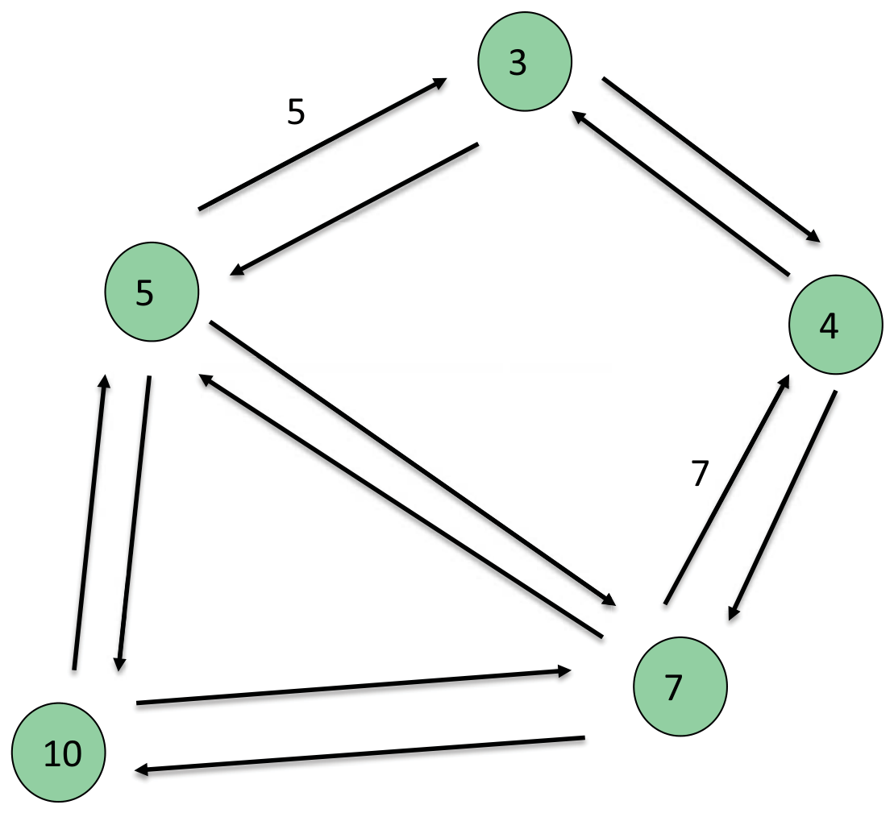

> [原图说明] 原页附图（p39）：Max 传播推进。此图将在统一裁剪阶段作为原图插回。

<!-- ===== PDF p40 ===== -->

**Max 系统（Max System）**

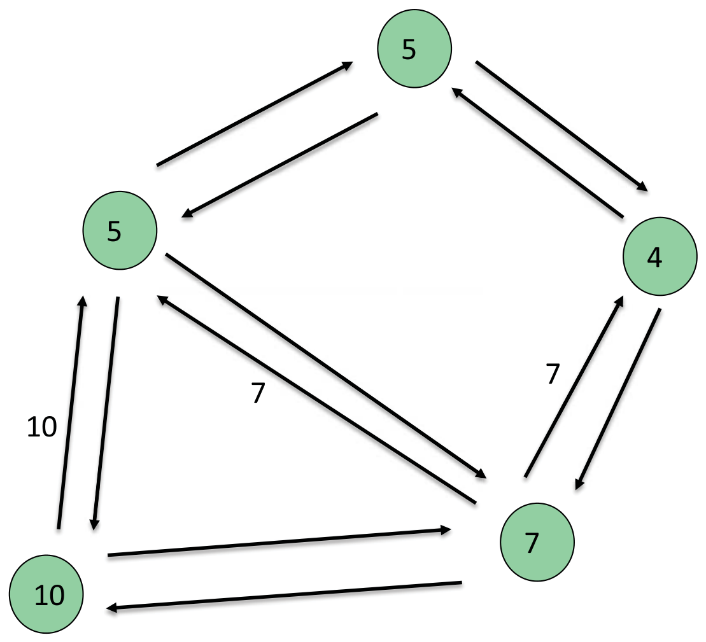

> [原图说明] 原页附图（p40）：Max 传播推进。此图将在统一裁剪阶段作为原图插回。

<!-- ===== PDF p41 ===== -->

**Max 系统（Max System）**

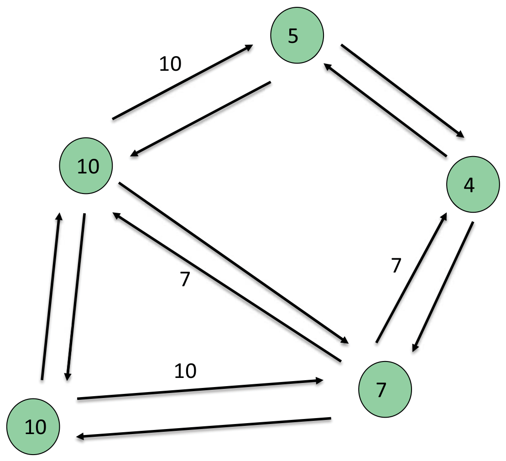

> [原图说明] 原页附图（p41）：Max 传播推进。此图将在统一裁剪阶段作为原图插回。

<!-- ===== PDF p42 ===== -->

**Max 系统（Max System）**

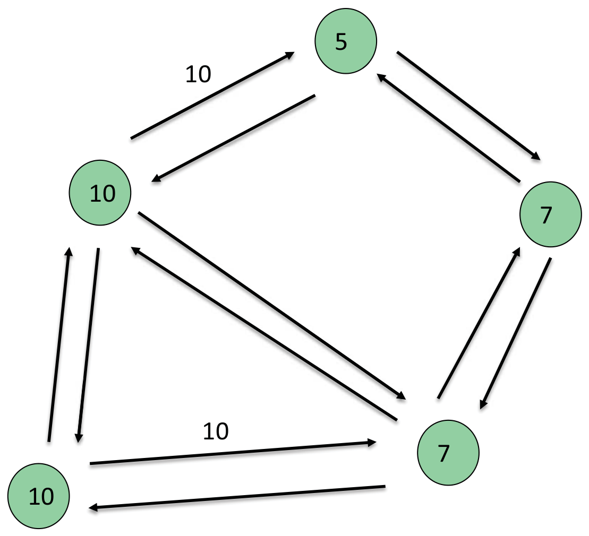

> [原图说明] 原页附图（p42）：Max 传播推进。此图将在统一裁剪阶段作为原图插回。

<!-- ===== PDF p43 ===== -->

**Max 系统（Max System）**

> [原图说明] 原页附图（p43）：Max 传播推进。此图将在统一裁剪阶段作为原图插回。

<!-- ===== PDF p44 ===== -->

**Max 系统（Max System）**

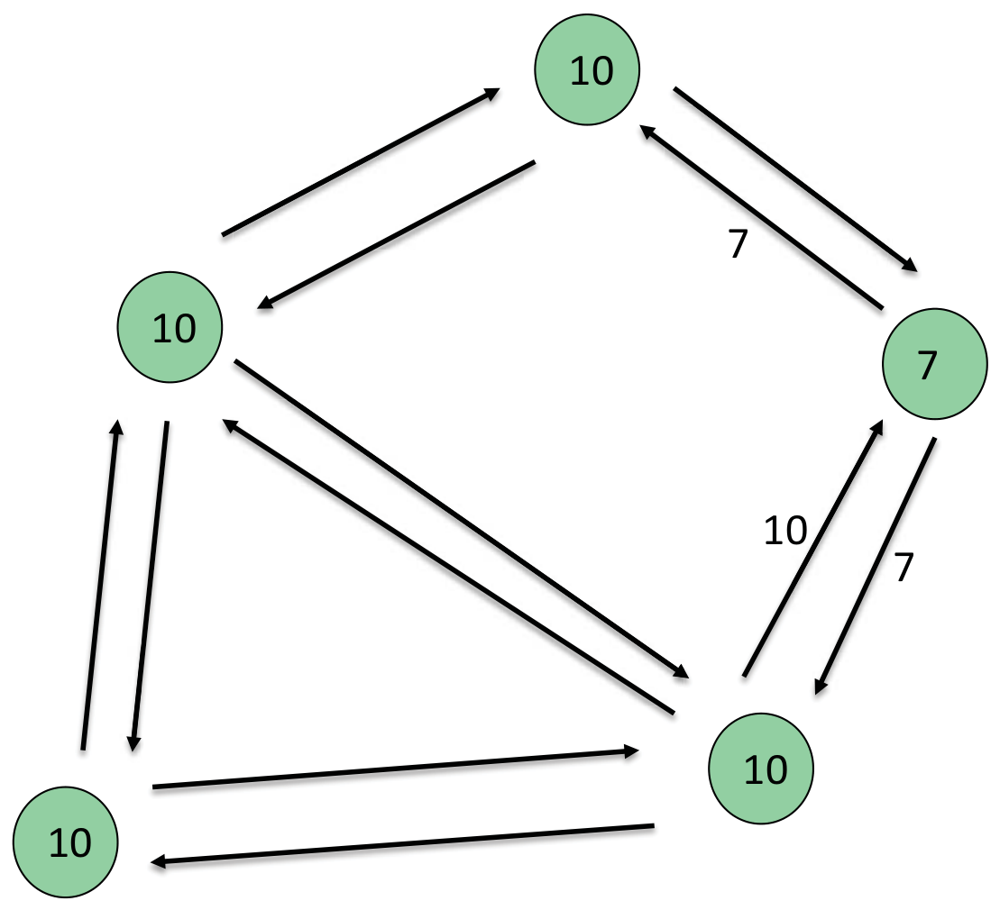

> [原图说明] 原页附图（p44）：Max 传播推进。此图将在统一裁剪阶段作为原图插回。

<!-- ===== PDF p45 ===== -->

**Max 系统（Max System）**

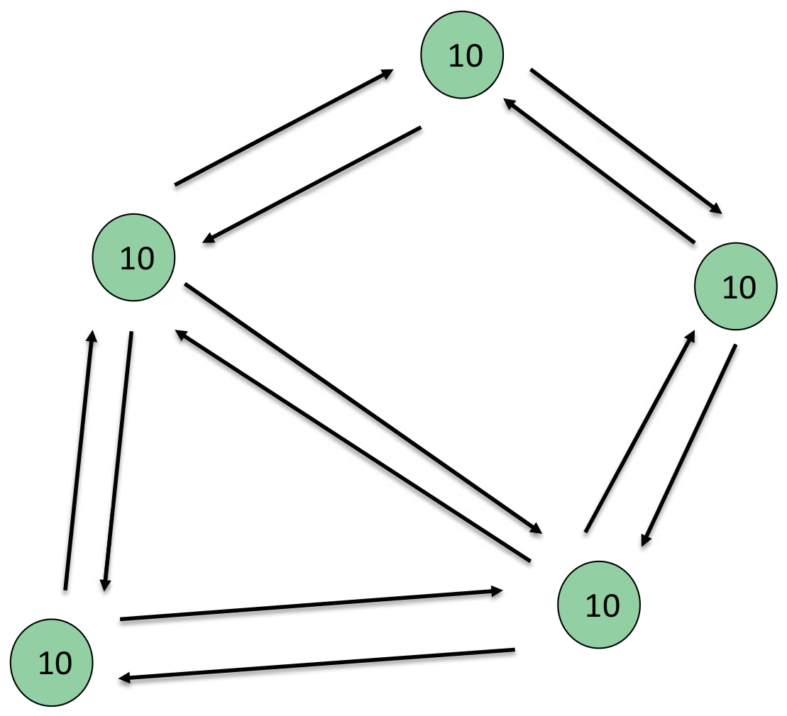

> [原图说明] 原页附图（p45）：Max 传播完成——所有节点收敛到全局最大值 10。此图将在统一裁剪阶段作为原图插回。

<!-- ===== PDF p46 ===== -->

**复杂度（Complexity）**

- **消息复杂度**：整个执行期间的消息总数 = **$O(n \cdot |E|)$**。
- **时间复杂度**：
  - **问（Q）**：应该量什么？
  - 不明显，因为各组件**以任意顺序**执行步骤——**没有「轮」**。
  - 一个常见方法：
    - 假设执行基本步骤的时间有**实时上界**：
      - $d$：信道投递下一条消息的时间
      - $l$：进程执行下一步的时间
  - 推断求解整体问题的**实时上界**。

> **[note] Note（译者注，异步复杂度度量）:** 这一页要解决的是一个度量问题：没有 round（轮）的系统里，时间该挂在哪根轴上。结论是挂到 real time（实时）上，用两个上界常数代替轮数。这不是记账习惯的偏好，它决定了你后面能证明什么。
>
> 先把因果链说透。同步模型里「第 $r$ 轮」是一个良定义的全局对象，因为每一轮所有 process（进程）都各走一步，所以「$r$ 轮之后系统的状态」可以被精确定义，时间界就是轮数。异步模型里没有这个对象：每个 process（进程）有自己的局部步序列，两个 process（进程）的「第 $r$ 步」不可比，于是任何以「步」计价的时间都无法在不同执行之间对照。退一步的办法是承认自己不知道执行速度，只假设一个最坏速度：channel（信道）投递一条 message（消息）至多花 $d$，process（进程）执行一步至多花 $l$。这两个数不是测出来的平均值，是假设的最坏缺省值，因此推出来的界对每一个满足假设的执行都成立。
>
> 为什么必须是上界而不能是下界，值得单独说一句。若假设「投递至少花 $d$」，你只能推出「至少要这么久」，这是下界，无法回答「什么时候一定完成」；而算法分析要的正是后者。反过来，上界的好处是「越快越安全」：一个执行比假设更快，它只会更早完成，所以上界结论自动覆盖它。这也是为什么 $d$ 与 $l$ 可以设得很保守而不影响结论的正确性，只影响结论的紧度。
>
> 顺手把 $l$ 的作用量化一下，否则容易把它当噪声。若某个 node（节点）上的 process（进程）每走一步要 5 ms，一次重计算或一次垃圾回收停顿就足以把它拖慢，而 $d$ 仍是 1 ms，那么每跳的单价从 1.2 ms 变成 6 ms，10 跳从 12 ms 变成 60 ms —— 时间界的八成由本地处理贡献，光优化网络毫无意义。这也解释了工程上为什么要做 batch（批处理）：把多个动作合并成一次 process（进程）步骤，等于把 $l$ 摊薄到每一步的多个 action（动作）上。
>
> 复合规则只有两条：一条 causal chain（因果链）上的延迟相加，互相独立的分支取最大值而不是相加。前者来自「后一件事必须等前一件」，后者来自「并行」。异步系统的加速全部来自第二类，绝不可能来自单步更快 —— 所以你会看到所有界都写成「链长乘单步」的形状。
>
> 算一个能手算复核的例子。取一条 10 跳的路径，$d = 1$ ms、$l = 0.2$ ms，每跳要花 $1 + 0.2 = 1.2$ ms，10 跳合计 12 ms。若每条 channel（信道）上还堆了 8 条 message（消息）要排队，每跳就变成 $8$ 乘 $1.2 = 9.6$ ms，10 跳 96 ms，整整 8 倍。对照本讲后一页的公式 $diam$ 乘 $n$ 乘 $d$，取 $n = 8$、$diam = 10$ 得 80 ms，与我算的 96 ms 相差的那 16 ms 正是 $l$ 的部分 —— 讲义把本地处理忽略了，所以两套记账在同一个量级上吻合。12 ms 的量级说明：小图里异步几乎不花钱，真正把时间吃掉的是排队项。
>
> 跨课程看，CSAPP 第 6 章其实早就在用同一套办法：L1 命中约 4 个周期、L2 约 12 个、DRAM 约 200 个，把每一层压成一个常数，才能写出端到端的摊还成本。路径也一样：先给每个组件一个延迟，再沿访问链相加。区别在于数字的性质 —— CSAPP 里的周期数是测得的典型值，用来预测程序跑多快；这里的 $d$ 与 $l$ 是假设的最坏上界，用来证明「无论执行多慢都会被完成」。一个是估计，一个是承诺，混淆这两者会让结论失去保证力。
>
> 一句话收束：度量方式不是描述方式，而是证明义务的一部分 —— 你选的钟决定你能断言什么，选轮数你只能谈结构，选 real time（实时）你才谈得上「多久」。

<!-- ===== PDF p47 ===== -->

**复杂度（Complexity）**

- **时间复杂度**：假设 $d$（信道投递）与 $l$（进程一步）的上界，推断求解问题的实时上界。
- 对 **Max 系统**：
  - 忽略本地处理时间（$l = 0$），只考虑信道发送时间。
  - **朴素的（straightforward）上界：$O(\operatorname{diam} \cdot n \cdot d)$**
  - 考虑 max 沿图中一条最短路到达任意特定顶点 $u$ 的时间。
  - 最坏情况下，它要在路径上的每条信道里等待**所有其他值**，每条信道至多 $n \cdot d$ 时间。

> **[note] Note（译者注，$O(\operatorname{diam} \cdot n \cdot d)$ 的来由）:** 这个三项乘积不是估出来的毛估，它是三个互相独立的最坏情形来源相乘的结果。看懂了三个因子各自的出处，你就能一眼判断什么时候该改哪一个。
>
> 逐项拆。第一个因子是 diameter（直径），它管「要跳几次」：最大值必须沿图里的路径走，最坏路径的 hop（跳）数就是 diameter（直径），再快也快不过这个跳数。第二个因子是 $n$，它管「一条 channel（信道）上最多堆几条 message（消息）」：每个 node（节点）的 estimate（估计值）只能从 $n$ 个初值里挑，而它单调不减，所以一个 node（节点）对某个邻居至多入队 $n$ 条 message（消息），一条有向 channel（信道）上的待投递量因此是 $O(n)$。第三个因子是 $d$，它管「一条 message（消息）过一条 channel（信道）要多久」。三者相乘隐含一个关键前提：FIFO channel（信道）里的 message（消息）是一条一条串行投递的，所以「排在前面的 $n$ 条」是加时间，不是并行掉。
>
> 再往下挖一层，为什么这个堆积因子没法靠「多发几条并行」摊薄。FIFO 的语义是先入先出，一条 channel（信道）在任意时刻只有队头能被投递，其余全在等；这不是实现细节，而是模型给出的顺序保证 —— 正因为有它，同一条 channel（信道）上的 message（消息）不会重排，算法才能依赖「改进按产生顺序到达」。代价就是串行化：你不可能既要求不重排，又要求同一条 channel（信道）上的 message（消息）并行投递，这两个要求在这层模型里互斥。
>
> 反过来说，为什么不是 diameter（直径）乘 $d$ 再乘边数？因为瓶颈只在一条 channel（信道）的队列上：别的边可以同时推进，所以边的总数 $|E|$ 只进 message（消息）复杂度的账，不进时间界。这也解释了为什么式子里没有 $l$ —— 讲义把本地处理时间忽略了，一旦加回来，每跳的单价就是 $d + l$。
>
> 算一个能手算复核的例子。取 $n = 1000$、diameter（直径）为 20、$d = 0.5$ ms，代进去是 $20$ 乘 $1000$ 乘 $0.5$ ms 等于 10 s。同步模型下同样的图只要 20 轮乘 $0.5$ ms 等于 10 ms，两者差 1000 倍，正好是因子 $n$。换成数据中心那种两层网络：$n = 10^{6}$、diameter（直径）只有 2、$d = 0.5$ ms，得 $2$ 乘 $10^{6}$ 乘 $0.5$ ms 等于 1000 s，约 16.7 分钟。注意这里 diameter（直径）小到可以忽略，时间完全被 $n$ 吃掉 —— 这就是为什么真实系统一定要上 flow control（流控），用窗口把「一条 channel（信道）上在途的 message（消息）条数」压成常数 $W$。取 $W = 16$，同一张图的时间界变成 $2$ 乘 $16$ 乘 $0.5$ ms 等于 16 ms，从 16.7 分钟掉到 16 毫秒。算法一个字没改，只改了一个因子的来源。
>
> 还有个埋伏要记住：$n$ 这个因子之所以成立，是因为 Max 系统的 estimate（估计值）单调且只有 $n$ 种取值，改进次数天然有限。等后面换成带权松弛的异步 Bellman-Ford，骨架还是「改进即重播」，但候选距离的来源变成指数多条路径，每个 node（节点）的入队次数不再被 $n$ 卡住，$n$ 会膨胀成指数。同一个公式骨架换个算法，因子就换了量级。
>
> 跨课程看，CLRS 的 BFS（广度优先搜索） 复杂度 $O(V + E)$ 从来没有 contention（争用）这一项，因为它默认每个内存操作占一步、步骤之间不互相等待；那是单机成本模型的特权。分布式成本模型必须为 contention（争用）付账，因为一条 channel（信道）是物理共享资源，两条 message（消息）不能同刻通过。这也和 6.042J 的乘法法则一致：三个独立自由度相乘，缺一项就等于漏掉一类最坏情形。
>
> 一句话收束：看到三项乘积，先问三个因子各代表哪个最坏来源；能改掉其中一个的来源，比如用窗口把 $n$ 换成常数，比优化常数系数有用得多。

<!-- ===== PDF p48 ===== -->

**广度优先生成树（Breadth-First Spanning Trees）**

> [原图说明] 原页为章节分隔页（p48），仅标题「Breadth-First Spanning Trees」。

<!-- ===== PDF p49 ===== -->

**广度优先生成树（Breadth-First Spanning Trees）**

- **问题（Problem）**：在**异步网络**中计算一棵广度优先生成树。
- 连通图 $G = (V, E)$。
- 特殊根顶点 $v_a$。
- 进程对图没有知识。
- 进程有 UID：
  - $i_a$ 是根 $v_a$ 的 UID。
  - 进程知道邻居的 UID，知道哪个端口连到哪个邻居。
- 进程必须产生一棵以 $v_a$ 为根的 BFS 树。
- 每个进程 $i \ne i_a$ 应输出 parent $j$，表示 $j$ 的顶点是 $i$ 在 BFS 树中的父节点。

<!-- ===== PDF p50 ===== -->

**第一次尝试（First Attempt）**

- **直接把同步 BFS 算法异步地跑**。
- 进程 $i_a$ 发送 search 消息，每个人**第一次收到就转发**。
- 每个人都选**第一个**向它发送 search 消息的节点作为父节点。
- **非确定性**：
  - 进程决定中**不再有非确定性**（先到先得）。
  - 但出现了**大量新的非确定性**：消息投递顺序、进程步骤顺序。

> **[note] Note（译者注，「第一次尝试」的陷阱）:** 这一页的陷阱不在代码里，在一个被悄悄删掉的定理里：同步模型保证「到达时刻编码距离」，删掉 round（轮）就等于删掉了这条保证，而很多人只当自己删掉了一个计数器。
>
> 先把这条定理的来历说清。同步模型里所有 process（进程）在一轮里各走一步，因此一条 search（搜索）message（消息）在第 $r$ 轮被收到，当且仅当它走的路径恰好 $r$ 跳。这不是算法算出来的，是模型赠送的：轮同步把「hop（跳）数」变成了「时钟刻度」。算法于是可以偷懒，用「第一个到达的 message（消息）」代替「最短路径上的 message（消息）」，因为两者在同步里是同一件事。异步模型里这条等价断掉了：一条 message（消息）的时延等于它经过的每条 channel（信道）上排队长度乘 $d$ 之和，再加 hop（跳）数乘 $d$，而排队长度由别人的执行历史决定，与图上的距离毫无关系。
>
> 算一个能手算复核的例子。设 $d = 1$ ms，短路径只有 2 跳，但它第一跳的 channel（信道）上已经积压了 50 条 message（消息），长路径有 10 跳而一路畅通。短路径那条 message（消息）要等前面的 50 条各投递一次，再加上自己这一次，即 $51$ 乘 $1$ ms，然后第二跳再 1 ms，共 52 ms 才到达。长路径只需 $10$ 乘 $1$ ms 等于 10 ms。于是先到的是长路径，父节点被定在 10 跳外，树的深度是 10 而不是 2，凭空多出 8 跳。反解阈值更有意思：要让短路径赢，需要 $(q + 1)$ 乘 $1$ 加 $1$ 小于 10，即 $q$ 小于 8 —— 只要第一跳前排着 8 条以上的 message（消息），短路径就必输。这个 8 不是常数，它随着长路径的跳数一起变，所以「等一会儿再决定」这种补丁根本修不了。
>
> 为什么这个错误无法挽回，值得单独点一句。第一次尝试里 parent（父节点）是一次性决定：一旦从「未定」变成某个邻居，就再也不改，转发也只在第一次标记时发生一次。这与 Max 系统形成对照 —— Max 的 estimate（估计值）可以被更大的值覆盖，所以先到的坏值只是暂时的；BFS（广度优先搜索） 的先到决定是 commit（提交），没有回滚路径。**一次性决定加上错误的判据，等于永久错误**。
>
> 这里还藏着一个关于 non-determinism（非确定性）的转手。第一次尝试把「process（进程）决定里的掷硬币」取消了，改成先到先得，看上去更确定；但它同时把非确定性搬到了 scheduling（调度）上，而且是搬给了一个不受你控制、甚至可以对你不友好的调度者。这一点很致命：随机化算法能说「以概率一成功」，因为硬币由算法自己掷；而异步的调换顺序由环境决定，环境可以专门挑最坏的那种顺序，所以你连概率保证都拿不到，只能对最坏执行负责。换句话说，非确定性没有消失，只是从「可分析的」变成了「adversarial（对抗性的）」。
>
> 跨课程看，6.042J 里那个按轮归纳的不变式「$r$ 轮结束时恰好距离小于 $r$ 的 node（节点）被标记」，归纳是对轮做的：假设第 $r$ 轮成立，推出第 $r+1$ 轮成立。删掉轮之后这个归纳的索引直接消失，证明必须换成按 causal chain（因果链）长度或者按事件偏序来做 —— 这正是后面 p70 改用「不变式加时序性质」的原因。再借 CSAPP 第 11 章的一个同构案例：用第一个到达的报文段估计往返时延，会在重传时被骗到，所以 Karn 的规则干脆不用重传样本；道理一样，先到的是「运气好的那条路」，不是「最近的终点」。
>
> 一句话收束：在异步系统里，「先到」是 speculation（投机），只有当算法自带撤销与重估机制时才可以下这种注；否则第一版越自然，错得越彻底。

<!-- ===== PDF p51 ===== -->

**进程自动机 $P_u$（Process Automaton $P_u$）**

- **输入动作**：$\operatorname{receive}(\text{search})_{v,u}$
- **输出动作**：$\operatorname{send}(\text{search})_{u,v}$；$\operatorname{parent}(v)_u$
- **状态变量**：
  - `parent`：$r(u) \cup \{\bot\}$，初始 $\bot$
  - `reported`：布尔，初始 false
  - 对每个 $v \in r(u)$：
    - `send(v) ∈ {search, ⊥}`，初始：若 $u = v_a$ 则 search，否则 $\bot$
- **迁移**：
  - $\operatorname{receive}(\text{search})_{v,u}$：效果——若 $u \ne v_a$ 且 parent = $\bot$，则 parent := $v$，并对每个 $w$ 令 `send(w) := search`。

> **[note] Note（译者注，BFS 自动机的状态）:** 这一页列的不是「实现细节」，是把一个算法改造成可归纳对象的全部接口：state（状态）变量、precondition（前提）、effect（效果）。三列写对了，复杂度和正确性都能直接从定义里读出来。
>
> 逐个看状态的含义。`parent`（父节点）取值在邻居集合加一个特殊值 $\bot$ 之内，用 $\bot$ 而不是用「空指针」或 $-1$，是为了让「未定」成为一个真正的取值，于是 guard（守卫条件）`parent = ⊥` 就是一次可判定的比较，不需要额外约定。`reported` 是一个一次性开关，保证 parent 输出动作至多发生一次 —— 输出动作若可以重复触发，同一个 node（节点）就会向环境报告多次，语义上比多发一条 message（消息）更糟。`send(v)` 取 search 或 $\bot$，本质是一个「欠账位」：置为 search 表示我欠 $v$ 一条 message（消息），发出去之后置回 $\bot$，而且**再没有任何迁移会把它置回 search**。这一条限制比它看起来重要得多。
>
> 从这条限制可以直接读出复杂度。每个 node（节点）对每个邻居至多置一次欠账位，所以每条有向边至多承载一条 search（搜索）message（消息），总 message（消息）数不超过两倍边数；加上每个非根 node（节点）一次 parent 输出，总数是 $2|E| + n - 1$。代一个具体数：$n = 5$、$|E| = 6$，界是 12 加 4 等于 16 条。这个界还是 tight（紧的）：根向所有邻居各发一次，之后每个 node（节点）被标记的那一刻向所有邻居各转发一次，于是每条有向边恰好被用一次，12 条一条不多一条不少。
>
> 反过来问，为什么「没有重发机制」是设计选择而不是疏漏。因为欠账位一次清零，channel（信道）上永远不会堆积第二条 search（搜索），所以 p64 那个干净的时间界 diameter（直径）乘 $d$ 才成立 —— 每跳只排一条 message（消息），没有排队项。代价就是你熟悉的那条：迟到的更好 message（消息）被永久忽略。时间界的干净与结构正确，在这份状态定义里就已经被绑成了二选一。
>
> 还有一个「缺什么」值得注意：状态里没有任何计数器，没有轮号，也没有「已走步数」。这正是异步与同步在数据结构层面的分界 —— 同步算法常常需要一个轮号来做守卫，异步算法一旦引入轮号就必须再引入一个全局一致的时间源，而那东西根本不存在。也就是说，能不能写出这份状态表，本身就是「算法是否真的异步」的判据。
>
> 至于为什么欠账位是「每个邻居一个」，而不是一个全局的「待广播」标志，原因在公平性作用的对象上：fairness（公平性）说的是「每个 enabled 的 action（动作）最终都会被执行」，而 action（动作）是按邻居标号的，所以待发状态必须细化到邻居粒度，否则「只发出去一半」这种中间状态无法被表达，公平性也就无从谈起。
>
> 跨课程看，6.042J 讲过用 state machine（状态机）加 invariant（不变式）证明性质：先定义状态集合与迁移规则，再对步数做归纳。这里一模一样，只是状态被写成三列并且带 I/O 标签。再看 CSAPP 第 11 章，TCP 的 SYN-SENT、ESTABLISHED、TIME-WAIT 也是同一套路：用少量状态位编码协议进度，绝不靠时钟推断「对面到哪一步了」。区别在于责任归属 —— TCP 的状态机由内核实现并有规范背书，你只需相信它；这里的 automaton（自动机）是你自己写的，每一条 invariant（不变式）都得自己证。
>
> 一句话收束：这份三列蓝图是后面所有版本的地基 —— p68 与 p77 的改动只是在同一张表上把欠账位换成 FIFO queue（队列）、把 guard（守卫条件）换成松弛不等式，其余骨架不动。

<!-- ===== PDF p52 ===== -->

**进程自动机 $P_u$（Process Automaton $P_u$）**

- **迁移**：
  - $\operatorname{receive}(\text{search})_{v,u}$：效果——若 $u \ne v_a$ 且 parent = $\bot$，则 parent := $v$，并对每个 $w$ 令 `send(w) := search`。
  - $\operatorname{send}(\text{search})_{u,v}$：前提——`send(v) = search`；效果——`send(v) := ⊥`。
  - $\operatorname{parent}(v)_u$：前提——parent = $v$ 且 `reported = false`；效果——`reported := true`。

<!-- ===== PDF p53 ===== -->

**异步运行简单 BFS（Running Simple BFS Asynchronously）**

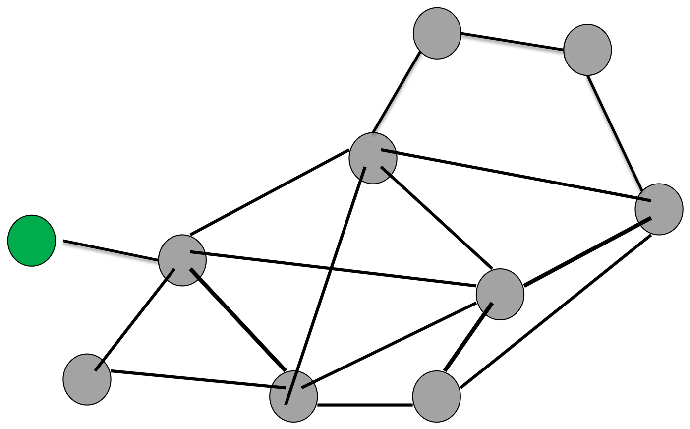

> [原图说明] 原页附图（p53）：异步运行简单 BFS 的起始。此图将在统一裁剪阶段作为原图插回。

<!-- ===== PDF p54 ===== -->

**异步运行简单 BFS（Running Simple BFS Asynchronously）**

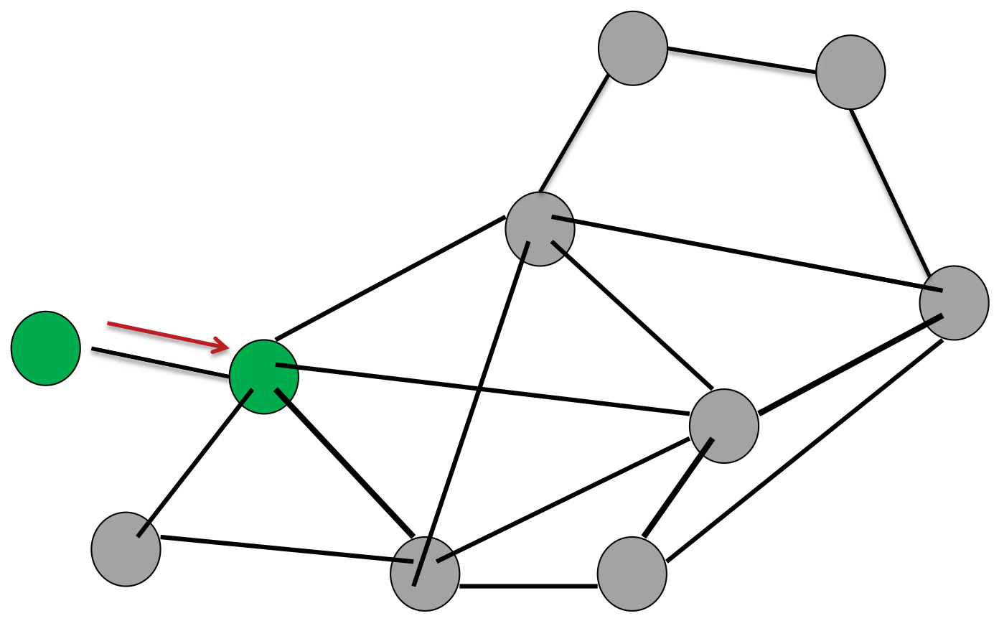

> [原图说明] 原页附图（p54）：search 消息沿某条路径先传播。此图将在统一裁剪阶段作为原图插回。

<!-- ===== PDF p55 ===== -->

**异步运行简单 BFS（Running Simple BFS Asynchronously）**

> [原图说明] 原页附图（p55）：search 沿长路径快速传播（s 标记）。此图将在统一裁剪阶段作为原图插回。

<!-- ===== PDF p56 ===== -->

**异步运行简单 BFS（Running Simple BFS Asynchronously）**

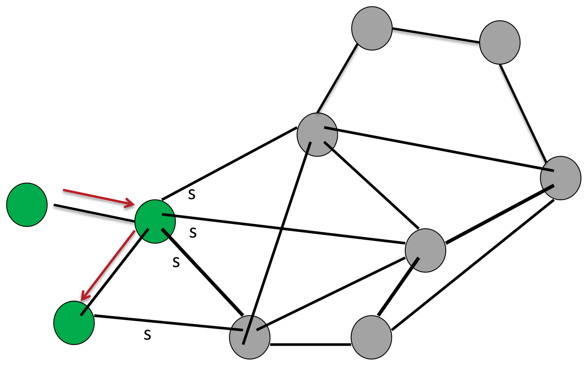

> [原图说明] 原页附图（p56）：更多节点沿长路径先被标记。此图将在统一裁剪阶段作为原图插回。

<!-- ===== PDF p57 ===== -->

**异步运行简单 BFS（Running Simple BFS Asynchronously）**

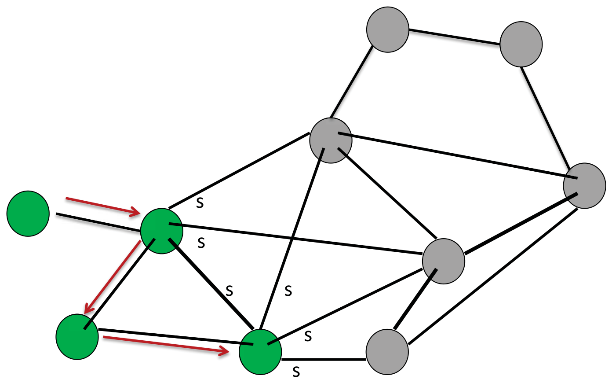

> [原图说明] 原页附图（p57）：长路径波前继续推进。此图将在统一裁剪阶段作为原图插回。

<!-- ===== PDF p58 ===== -->

**异步运行简单 BFS（Running Simple BFS Asynchronously）**

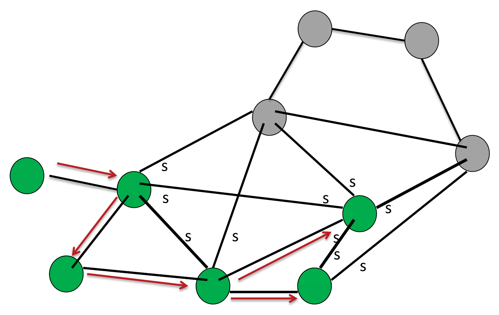

> [原图说明] 原页附图（p58）：大量节点被长路径标记。此图将在统一裁剪阶段作为原图插回。

<!-- ===== PDF p59 ===== -->

**异步运行简单 BFS（Running Simple BFS Asynchronously）**

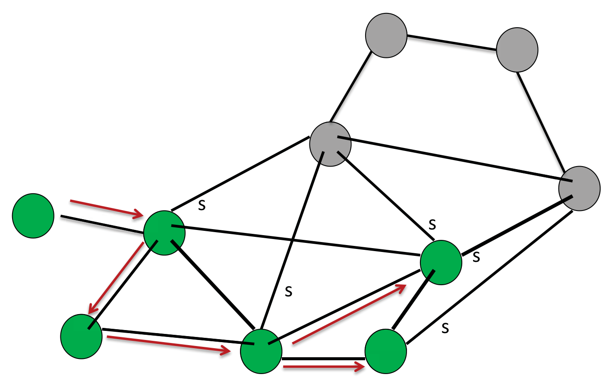

> [原图说明] 原页附图（p59）：短路径的消息此时才到达，但节点已被标记。此图将在统一裁剪阶段作为原图插回。

<!-- ===== PDF p60 ===== -->

**异步运行简单 BFS（Running Simple BFS Asynchronously）**

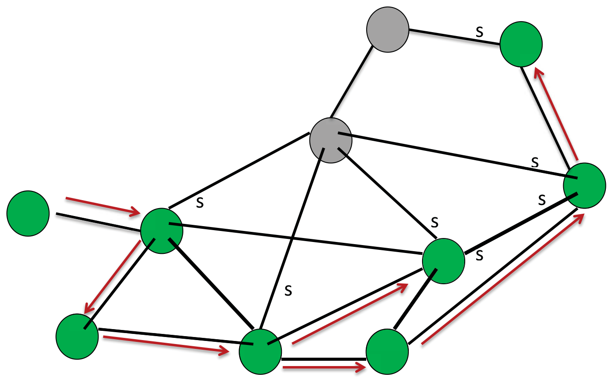

> [原图说明] 原页附图（p60）：最终全部节点被标记。此图将在统一裁剪阶段作为原图插回。

<!-- ===== PDF p61 ===== -->

**最终生成树（Final Spanning Tree）**

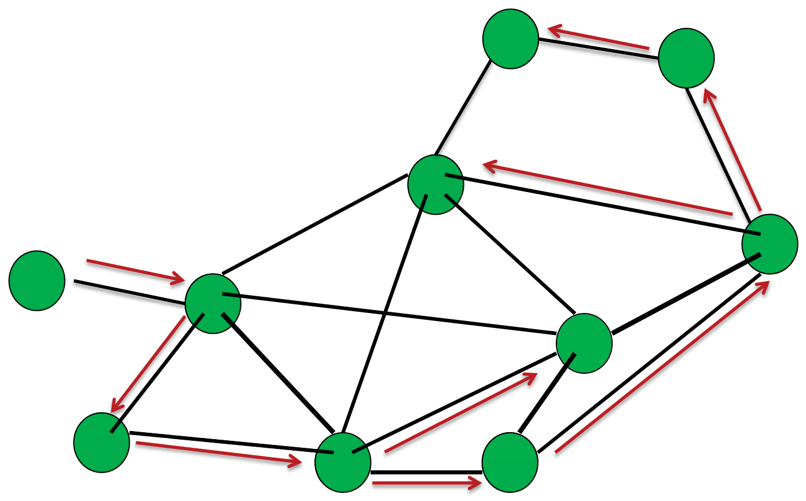

> [原图说明] 原页附图（p61）：第一次尝试产生的生成树（注意：可能不是 BFS 树）。此图将在统一裁剪阶段作为原图插回。

<!-- ===== PDF p62 ===== -->

**真实 BFS（Actual BFS）**

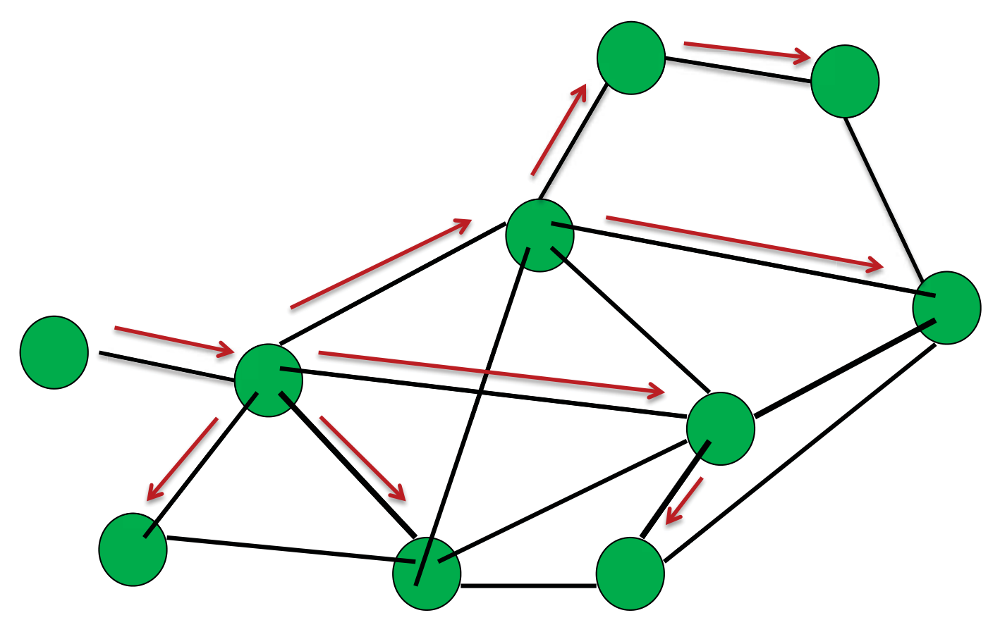

> [原图说明] 原页附图（p62）：对照真实 BFS 树（正确的按层结构）。此图将在统一裁剪阶段作为原图插回。

<!-- ===== PDF p63 ===== -->

**异常（Anomaly）**

- 算法产生的路径可能**比最短路径更长**。
- 因为在异步网络中，**消息可能沿更长的路径传播得更快**。

> **[note] Note（译者注，异步异常 Anomaly）:** 这个 anomaly（异常）不是实现瑕疵，是模型层面的必然结果。一句话说清它的根：在异步系统里，delay（时延）不是 distance（距离）的函数。
>
> 把时延的构成摊开看就明白了。一条 message（消息）从根走到某个 node（节点），花的时间等于它经过的每条 channel（信道）上的排队等待之和，加上 hop（跳）数乘 $d$。第二项与图结构有关，第一项只与别人的执行历史有关：同一时刻是否有别的 message（消息）先占了队列，完全是调度决定的。于是存在两个执行，一个里距离短的路径上排着长队、另一个里距离长的路径一路畅通，结论就只能反过来。要强调的是这不是「概率上偶尔出错」，而是「任何只依赖到达时刻的判据，都不可能是距离的单调函数」—— 判据与目标之间缺少任何一个可靠的中介。
>
> 算一个能手算复核的例子。设 $d = 2$ ms，从根到终点有两条路：一条 2 跳，一条 4 跳。短路径的第一条 channel（信道）上已经积压了 30 条 message（消息），那条 search（搜索）message（消息）要等前 30 条各投递一次，再算自己这一次，即 $31$ 乘 $2$ ms 等于 62 ms，然后第二跳再 2 ms，共 64 ms 到达。长路径 4 跳全程畅通，只要 $4$ 乘 $2$ ms 等于 8 ms，早到 56 ms。于是父节点被定在 4 跳外，树的深度从最优的 2 变成 4。把积压换成本讲后面会用到的量级 $n = 1000$：短路径要 $1001$ 乘 $2$ ms 约 2 s，长路径仍是 8 ms，差 250 倍。偏差的量级由队列长度决定，与 diameter（直径）无关，所以「再多等一会儿再决定」这种补丁根本不成立 —— 你等的那个更长。
>
> 换个角度确认这不是图论问题：图上的最短路径一步没变，变的只是执行顺序。所以修法只能在算法一侧 —— 把距离当成 payload（负载）随 message（消息）一起传，收到时比较数值而不是比较到达时刻。这也解释了为什么第二次尝试要把 `dist` 塞进状态里。
>
> 「异常」这个词选得也有讲究：相对于同步语义它是意外，相对于异步语义它才是常态。同步模型里异常根本不可能出现，因为轮同步把时延钉成了距离的等距映射；异步模型里能出现「树不是 BFS（广度优先搜索） 树」这件事，恰恰说明模型里少了一个约束。判断一个模型是否真的异步，一个实用的办法就是看它允不允许这种反例。等后面把边权加进来，问题还会再加一层：跳数少不代表权和小，于是「先到」不仅和排队打架，还要和权重打架，两种偏差会叠在一起 —— 那是本讲最后一节要付指数代价的地方。
>
> 跨课程看，CLRS 的 Dijkstra 之所以能「按 key（键值）从小到大出队」，是因为它有一个全局 priority queue（优先队列）在提供真实的全局顺序；分布式网络里没有这个对象，第一次尝试的「先到先得」其实是在用一个假的 priority queue（优先队列）出队，出队顺序完全由队列的拥堵决定，与 key（键值）无关。再借 CSAPP 第 6 章的观察：一次 cache（缓存）访问的耗时也不是「数据在层级里有多远」的可靠代理，一次 miss 引发的 TLB 走表能把「近」的地址拖成「远」的延迟 —— 结构与时间分离，是这两处的共同机制。
>
> 一句话收束：asynchronous（异步）系统里，距离必须被显式携带，不能从到达顺序里被推断；把这个判据换掉，异常才会消失。

<!-- ===== PDF p64 ===== -->

**复杂度（Complexity）**

- **消息复杂度**：$O(|E|)$。
- **时间复杂度**：直到所有进程选好父节点的时间。
  - 忽略本地处理时间。
  - **$O(\operatorname{diam} \cdot d)$**
- **问（Q）**：既然有些路径更长，为什么是 $\operatorname{diam}$？
- **答**：一个节点收到 search 消息的时间**至多**等于沿最短路径传播所需的时间。

> **[note] Note（译者注，为什么时间仍是 $\operatorname{diam} \cdot d$）:** 这里要解开的表面矛盾是：树都选错了，为什么完成时间界还这么干净。答案是两个界量的根本不是一个东西 —— 时间界问「什么时候收到某条 search（搜索）」，不问「收到的是不是最短那条」。
>
> 把论证补全。对每个 node（节点）取定它自己的一条最短路径，记 $T_k$ 为「到根距离不超过 $k$ 的 node（节点）全部已把 search（搜索）message（消息）交出去」的最晚时刻。基例是 $T_0$：根一开始就把所有欠账位置成待发，fairness（公平性）保证这些 message（消息）各自在 $d$ 之内被 channel（信道）投递，所以 $T_1$ 不超过 $d$。步进靠两个事实：第一，第 $k$ 层的 node（节点）在收到 message（消息）后立刻把欠账位给下一层置上；第二，也是最关键的一条，第一次尝试里每条 channel（信道）至多承载一条 search（搜索）message（消息），因为欠账位清零后永不复位。没有第二条，队列里就可能堆着别人的 message（消息），每跳要等 $n$ 条；有了它，每跳恰好只等一条，于是 $T_{k+1}$ 不超过 $T_k + d$，归纳得 $T$ 不超过 diameter（直径）乘 $d$。
>
> 注意这里谁都没用到「父节点选得对」。论证只用到两件事：最短路径存在，以及 enabled 的 action（动作）最终会被执行。也就是说，**上界只需要一条路走得通，不需要所有路都走得快**。把这条记成一个可复用的模板：凡是要给「最晚完成」定界，先找一条能走通的路，再用公平性把「迟早会走」换成「至多走多久」，路径的条数根本不进式子。
>
> 算一个能手算复核的例子。取 diameter（直径）为 12、$d = 0.5$ ms，完成时间界是 $12$ 乘 $0.5$ ms 等于 6 ms。哪怕某个 node（节点）最终认了个 12 跳外的父节点，它的完成时间也还是 6 ms。换成第二次尝试的松弛版本，因为允许重播，一条 channel（信道）可以堆到 $n$ 条，取 $n = 1000$ 时同一条式子变成 $12$ 乘 $1000$ 乘 $0.5$ ms 等于 6000 ms，即 6 s，正好差 1000 倍。而如果这颗树本身的最优深度只有 3，那么「6 ms 完成、树高 12」与「6 s 完成、树高 3」是两组完全不同的数，互不替代。
>
> 再补一个能说明「界有多脆」的对照。假设把算法放松一点点，允许每个 node（节点）对同一邻居最多重发一次 search（搜索）message（消息），于是每条 channel（信道）上最多两条。此时每跳要等两条 message（消息）过去，界变成两倍 diameter（直径）乘 $d$，用上面的数就是 24 乘 $0.5$ ms 等于 12 ms。重发次数每加一，界就按同样的倍数涨 —— 这说明时间界的干净程度不是算法「聪明」换来的，而是「限制重发」这条约束换来的。反过来说，任何为了修正结构错误而加入的重播，都会在这里立刻被记上一笔，这正是松弛版把 6 ms 变成 6 s 的机制来源之一。
>
> 跨课程看，这是 6.042J 里「存在性就够用」的分析习惯的直接应用：证上界时你只需要构造一条路径，不必刻画全部路径。对比 CLRS 的 BFS（广度优先搜索） 分层，那里给的是等号「层数等于距离」，信息量最大但也最脆，一旦时序假设去掉就全废；这里退成不等号，信息量少了，剩下那部分却在异步下仍然成立。这和 CSAPP 第 6 章把性能拆成 miss rate 与 hit time 两个独立量是同一类操作：拆开度量维度，才能让每个结论各自站得住。
>
> 一句话收束：完成时间上界与树的质量是两条独立的定理，一个算法完全可以同时「很快」和「很错」；看异步算法时，先把这两个问题分开问。

<!-- ===== PDF p65 ===== -->

**扩展（Extensions）**

- **子指针**：与同步 BFS 一样——每个收到 search 的人发回 parent 或 nonparent 响应。
- **终止**：
  - 一个节点对其所有 search 消息都收到响应后，就知道谁是自己孩子、且它们都被标记。
  - 树的叶子知道自己是叶子。
  - 用汇播策略，如之前一样。
  - 时间复杂度：树完成后，done 信息传到 $i_a$ 需 $O(n \cdot d)$ 时间。
  - 消息复杂度：$O(n)$。

<!-- ===== PDF p66 ===== -->

**应用（Applications）**

- **消息广播**：进程 $i_a$ 用树（带子指针）广播消息。需 $O(n \cdot d)$ 时间和 $n$ 条消息。
- **全局计算**：每个进程以初始值开始，$i_a$ 确定所有进程值的某个函数。用树上的汇播。需 $O(n \cdot d)$ 时间和 $n$ 条消息。

<!-- ===== PDF p67 ===== -->

**第二次尝试（Second Attempt）**

- 一个**松弛算法**，像同步 Bellman-Ford。
- 之前（同步），我们**纠正了「多跳但低权」的路径**。
- 现在，我们转而**纠正异步造成的误差**。
- **策略（Strategy）**：
  - 每个进程**跟踪跳数距离**，当得知**更短路径**时**改变父节点**，并传播改进后的距离。
  - **最终稳定**到一棵广度优先生成树。

> **[note] Note（译者注，第二次尝试：用松弛对抗异步）:** 第二次尝试改的不是数据流，是决定的性质：把「一次性决定」换成「可以推翻的决定」。这一步把异步从敌人变成了背景噪声。
>
> 机制上只有三处改动，但每一处都在回应一个具体的失效点。第一，加入 `dist`，把距离变成随 message（消息）走的 payload（负载），于是判据不再依赖到达时刻。第二，收到 message（消息）时不再比「谁先来」，而是比数值：若 $m + 1$ 小于当前的 `dist`，就更新 `dist`、改 `parent`（父节点）、向所有邻居重新入队。第三，`send(v)` 从单值升级为 FIFO queue（队列），因为一个 node（节点）可能先后产生多个版本的 `dist`，队列让每个版本都能依次发出，于是 p70 那本「每条 message（消息）对应一次改进」的账才算得清。
>
> 为什么这样做就对，可以压成两个性质。第一个是下界不变式：任何时刻 $dist$ 都大于等于真实距离。理由是 message（消息）里带的 $m$ 是发信方某个时刻的 `dist`，而 `dist` 单调下降，所以 $m$ 只会偏大不会偏小；一条边最多把距离改变 $1$（跳数版），于是 $m + 1$ 仍然对应某条真实路径的长度，绝不可能出现「比真实最短还短」的谎话。第二个是单调性：`dist` 只减不增，取值只有 $0$ 到 $n-1$ 外加无穷，所以每个 node（节点）至多改进 $n$ 次，改进不可能永远进行下去。两者一夹，再加上时序性质「最终 $dist$ 不超过真实距离」，就得到等号 —— 这是一套通用的夹逼到 fixed point（不动点）的套路：下界给正确，上界给到达，等号给答案。
>
> 算一个能手算复核的例子。取 $n = 100$、$|E| = 200$、diameter（直径）为 8、$d = 0.5$ ms。每个 node（节点）至多改进 99 次，每次向所有邻居入队，故总 message（消息）数不超过 $99$ 乘 $2|E|$ 等于 $99$ 乘 $400$ 等于 39600 条，约四万条；第一次尝试只要 $2|E|$ 等于 400 条，差 100 倍。时间上，松弛版是 $8$ 乘 $100$ 乘 $0.5$ ms 等于 400 ms，第一次尝试是 $8$ 乘 $0.5$ ms 等于 4 ms，同样差 100 倍。这两个 100 倍不是巧合：它们都来自同一个因子，也就是「每个 node（节点）最多改多少次」。
>
> 还有一个细节值得单独拎出来：guard（守卫条件）必须是严格小于。假如放宽成小于等于，那么收到与自己当前值相等的 message（消息）也会触发一次「更新」，estimate（估计值）一步都不降，但每次触发又要向所有邻居入队一遍。于是改进次数不再被 $n$ 卡住 —— 消息会在邻居之间来回反射，数量无界，前面那个「每个 node（节点）至多改 $n$ 次」的界立刻作废，四万条 message（消息）的估计也就成了空话。严格性在这里不是数学洁癖，它是整个复杂度论证的支点。
>
> 跨课程看，CLRS 的 Bellman-Ford 在串行机上做 $n-1$ 轮、每轮扫全部边，总计 $O(n|E|)$ 次 relaxation（松弛）检查，正好等价于这里四万条 message（消息）的量级 —— 串行版的「每轮扫一遍所有边」在分布式版里就变成了「每个 node（节点）每次改进向所有邻居发一次」，两边记的是同一本账。区别在驱动者：串行版由外面那层 for 循环推着走，你清楚知道第几轮；分布式版没有这个 for 循环，全靠改进事件自己推自己，所以代价也从「可数的轮数」变成了「不可数的 message（消息）」。
>
> 往前看一步，distance vector（距离向量）路由就在用同一套东西：每个路由器维护到各目的地的估计，收到邻居的更小估计就更新并重播。它的老毛病 count-to-infinity（计数到无穷）与下一节要讲的指数爆炸同源 —— 都是「改进波在传播延迟内反复追上自己」。要想让这类算法真正可控，下一讲那种把异步模拟成同步轮次的 synchronizer（同步器）才是正路。
>
> 一句话收束：relaxation（松弛）用「允许推翻」换来「抗乱序」，代价是把一次性决定变成可能反复的决定；正确性当场到手，代价则在 p80 那一段以指数形式一次性结清。

<!-- ===== PDF p68 ===== -->

**进程自动机 $P_u$（Process Automaton $P_u$）**

- **输入动作**：$\operatorname{receive}(m)_{v,u}$，$m$ 为非负整数
- **输出动作**：$\operatorname{send}(m)_{u,v}$，$m$ 为非负整数
- **状态变量**：
  - `parent`：$r(u) \cup \{\bot\}$，初始 $\bot$
  - `dist ∈ ℕ ∪ {∞}`：初始若 $u = v_a$ 则 0，否则 $\infty$
  - 对每个 $v \in r(u)$：`send(v)`，$\mathbb{N}$ 的 FIFO 队列，初始若 $u = v_a$ 则 (0)、否则空
- **迁移**：
  - $\operatorname{receive}(m)_{v,u}$：效果——若 $m + 1 < \operatorname{dist}$，则 $\operatorname{dist} := m+1$、parent := $v$、对每个 $w$ 把 $\operatorname{dist}$ 加入 `send(w)`。

> **[note] Note（译者注，松弛 BFS 自动机与消息队列）:**
>
> 这一页要回答的设计问题是：**一个「决定」如何变成「可以反悔的决定」**。第一次尝试里 `parent` 一旦赋值就永久固定，自动机没有第二条通道去传播修正；relaxation（松弛）版本把 `parent` 降级成「当前最好的猜测」，于是必须新增一条传播通道，而这条通道的容量不能再是一个槽位。
>
> 机制上逐句拆：`receive(m)` 触发更新的判据是 $m+1 < \operatorname{dist}$，严格不等式意味着**只有改进才动作**；改进后 `dist` 变小（单调下降），而 `dist` 的取值来自「从根到本节点某条路径的跳数」，跳数上界是 $n-1$，所以一个节点最多改进 $n-1$ 次。既然最多改进 $n-1$ 次，那么每个邻居方向最多收到 $n-1$ 个不同的值，一个固定大小的槽位装不下，必须换成 FIFO（先进先出）的 queue（队列）。这是「改进有界推出缓冲有界」的推导，不是凭感觉加一个队列。
>
> 队列带来第二个问题：发送顺序。`send(v)` 在进程侧是 queue（队列），`mqueue` 在 channel（信道）侧也是 queue（队列），两级 FIFO（先进先出）叠加，保证同一发送者发出的值**按产生顺序**到达接收者。若没有这两级保序，一条旧的 $m=5$ 可能追过新的 $m=2$，接收者先用旧值算出 $6$ 再做一次无谓的比较；更糟的情形是新值先到、旧值后到，旧值虽然被 $6<\operatorname{dist}$ 挡住，但它已经占用了 channel（信道）的排队时间，把后面真正有用的消息推后。保序不是效率优化，它堵住的是正确性论证上的一个漏洞：只有保序，才能说「我发出的第 $k$ 个估计一定先于第 $k+1$ 个到达」。
>
> 算一个具体例子。取 vertex（顶点）集为 $r,a,b,c$，edge（边）为 $\{r,a\},\{r,b\},\{r,c\},\{a,c\},\{b,c\}$，根是 $r$，全部按跳数计。一次执行：$r$ 发出的三个 $0$ 中，通往 $b$ 的那条先到，$b$ 改进为 $1$、`parent` 设为 $r$，向 $r$ 与 $c$ 各发一条 $1$；$c$ 收到 $b$ 的 $1$，得 $\operatorname{dist}=2$、`parent` 设为 $b$，向 $r,a,b$ 各发一条 $2$；随后 $r\to a$ 的 $0$ 才到，$a$ 改进为 $1$，向 $r,c$ 各发一条 $1$，$c$ 收到后算 $1+1=2$ 不小于 $2$，不动；最后 $r\to c$ 的 $0$ 抵达，$c$ 发现 $0+1=1<2$，改进为 $1$、`parent` 改为 $r$，再向 $r,a,b$ 各发一条 $1$。数消息：$3+2+3+2+3=13$ 条；这张图的 $|E|=5$，单向 channel（信道）共 $10$ 条。也就是说relaxation（松弛）版本在四个顶点上多发 $3$ 条消息，换回的是 `parent(c)` 从 $b$ 纠正为 $r$，`dist(c)` 从 $2$ 降为 $1$。
>
> 顺带排除一个错误选项：这里不能用 LIFO（后进先出）的栈。栈让最新的估计先发出、旧的估计后发出，接收者于是在 `dist` 已经降到 $1$ 之后又收到旧值 $5$，虽然被 $5<\operatorname{dist}$ 挡住，但这条旧值占用的排队时延会把后面节点的时间上界抬到一个与「实际改进次数」无关的量上，时序性质的计数论证就断了。保序在证明里是硬需求，不是为了让实现省事。
>
> 跨课程连接：CSAPP 第 6 章的 store buffer（存储缓冲）与 write buffer（写缓冲）是同一类结构——CPU 把待写回的值排队，一个槽位装不下就必须排队，而排队立刻引出「乱序会不会破坏语义」的追问，那里用 memory barrier（内存屏障）回答，这里用两层 FIFO（先进先出）回答。区别在于：cache（缓存）的屏障是硬件强制的顺序点，进程侧的 queue（队列）是协议自己维护的顺序，前者你绕不过，后者你可以写错。
>
> 一句话收束：`send(v)` 从单值升到 queue（队列）不是实现细节，它是「决定可反悔、反悔要广播、广播要保序」这条链条的必然终点。

<!-- ===== PDF p69 ===== -->

**进程自动机 $P_u$（Process Automaton $P_u$）**

- **迁移**：
  - $\operatorname{receive}(m)_{v,u}$：效果——若 $m + 1 < \operatorname{dist}$，则 $\operatorname{dist} := m+1$、parent := $v$、对每个 $w$ 把 $m+1$ 加入 `send(w)`。
  - $\operatorname{send}(m)_{u,v}$：前提——$m = \operatorname{head}(\operatorname{send}(v))$；效果——移除队头。
  - **没有终止动作**……

> **[note] Note（译者注，「没有终止动作」的含义）:**
>
> 这一页要回答的设计问题是：**在一个没有全局时钟的系统里，「我算完了」这句话由谁来宣布**。同步模型有一个免费的答案——轮数：等够 $n$ 轮，所有人的 `dist` 必然收敛。异步模型把轮数拿走了，于是算法的行为集合里只剩「继续处理消息」这一种，幻灯片用「没有终止动作」把这件事写成一行说明。
>
> 机制上，「静默稳定」需要三个条件同时成立。其一，状态单调：`dist` 只减不增。其二，改进次数有界：每个节点的 `dist` 从 $\infty$ 开始，每次改进至少减 $1$，而它的下限是真实距离，跳数下界为 $0$，所以改进次数至多 $n-1$ 次。其三，fairness（公平性）保证每条已经进入 channel（信道）的消息最终被投递。三者合起来推出：存在一个有限时刻，此后系统不再产生任何新消息。注意这个结论是一个**全局谓词**——「整个系统没有 enabled 的 send 动作」——而每个进程只能看见自己的状态和自己的输入。于是「系统已经静默」在局部不可观测。这就是「没有终止动作」的严格含义：不是作者懒得写，是抽象里不存在那个动作。
>
> 一个常见的错误补救是静默计时：进程若连续 $k$ 个时间单位没有收到能改进的消息，就宣布自己稳定，直接输出答案。算一下它为什么不成立。取 $n=8$ 的环，$d=10\ \mathrm{ms}$，直径 $4$。最晚的那条改进消息沿最短路走 $4$ 跳到达，每一跳最坏要排在 $n=8$ 条消息后面，于是最晚时刻是 $4\times 8\times 10=320\ \mathrm{ms}$。若某进程在 $t=30\ \mathrm{ms}$ 时已经静默了 $3$ 个 $d$ 就宣布稳定，它离真正的最晚消息还有 $290\ \mathrm{ms}$，也就是 $90.6\%$ 的等待窗口还没过完就交卷了。静默计时把「最终」偷换成「足够久」，而 fairness（公平性）只承诺「最终发生」，不承诺任何下界——只要每个 enabled 的动作最终发生，一个把所有消息压到 $319\ \mathrm{ms}$ 才投递的执行同样合法。
>
> 更细一层：静默计时还有一个更隐蔽的失败模式。即使进程等得足够久，它也无法区分两种「静默」——一是「全网收敛」，二是「自己这条路被堵住，别人还在改」。第二种情况下，本进程的 `dist` 已经不再变化，但它上游可能马上要发来一条更小的值。所以静默的是「本进程」，需要的是「全网」。局部谓词无法判定全局谓词，这是分布式里反复出现的一类不可能性，只是这里的表现比较温和：多加一层协议就能解决，而不是彻底无解。
>
> 跨课程连接：CSAPP 第 11 章的 TCP（传输控制协议）用 FIN（结束标志）显式告诉对端「我没有数据了」，`read` 返回 $0$ 是这条显式信号的本地表现；CSAPP 第 12 章用 `pthread_join` 显式等待线程结束，而不是轮询「现在还有几个线程在跑」。两处的共同点是：**结束必须由协议携带，不能由旁观者推断**。区别在于 TCP 的 FIN 有确定的发送者与接收者，而这里的「系统静默」没有发送者——没有人有资格发这条消息，这正是异步模型的边界所在。
>
> 收束：`dist` 稳定之后所有到达的消息都满足 $m+1 \ge \operatorname{dist}$，被静默丢弃，算法活着的部分只剩空转。要让进程知道自己可以输出，只能外加 convergecast（汇播）这类结构信号，正文下一段正是在补这一层。

<!-- ===== PDF p70 ===== -->

**正确性（Correctness）**

- 对同步 BFS，我们**精确刻画了 $r$ 轮后的情况**。
- **现在做不到**。
- 相反，陈述**抽象性质**，例如**不变式**与**时序性质**：
  - **不变式（Invariant）**：任意时刻，对任何节点 $u \ne v_a$，若其 $\operatorname{dist} \ne \infty$，则它是某条从 $v_a$ 到 $u$ 的路径上的**真实距离**，且其 parent 是这条路径上 $u$ 的前驱。
  - **时序性质（Timing property）**：对任何节点 $u$ 与任何 $r$（$0 < r < \operatorname{diam}$），若存在从 $v_a$ 到 $u$ 的至多 $r$ 跳路径，则**到 $r \cdot n \cdot d$ 时刻**，节点 $u$ 的 $\operatorname{dist} \le r$。

> **[note] Note（译者注，异步证明：不变式 + 时序性质）:**
>
> 这一页给出的是异步算法证明的正确形态：**不是在描述某一执行，而是在给所有执行的集合划边界**。同步模型能写「$r$ 轮之后恰好是距离小于 $r$ 的节点被标记」，因为轮是对所有执行都成立的外部坐标；异步模型没有这个坐标，只能退到两条陈述，一条管「算出来的对不对」，一条管「对的什么时候算出来」。
>
> 为什么要分成两条，而不是合成一条。因为两者的量词顺序不同。invariant（不变式）是「对执行中的每一个状态都成立」——形如「对所有时刻，某陈述成立」；timing property（时序性质）是「存在某个时刻使某陈述成立」——形如「存在时刻，某陈述成立」。前者的证明靠归纳：初始状态成立，对每个动作验证保持性；后者的证明靠计数：一条信息从根到目标要经过几条 channel（信道），每条前面最多排多少条消息，乘以每条消息的延迟上界 $d$。合成一条会要求「任意时刻」与「某个时刻」同时处理，两个量词的顺序一旦交换意思就变了，无法一次归纳完。
>
> 具体看这两条陈述各自堵住什么漏洞。invariant（不变式）说：`dist` 不为 $\infty$ 时，它一定是某条从根到该节点的真实路径上的距离，且 `parent` 是这条路径上的前驱。这一条排除的是「编造一个比真实距离更小的数」——如果允许这种数存在，算法会输出一棵带非法分支的树，而且从外部看它可能「看起来收敛了」。timing property（时序性质）说：若存在一条从根到该节点、至多 $r$ 跳的路径，则到 $r\cdot n\cdot d$ 时刻，该节点的 `dist` 已降到不超过 $r$。这一条排除的是「永远正确但永远不出现」，也就是 liveness（活性）层面的失效。
>
> 算一下这个上界长什么样。取 $n=10$、$d=1\ \mathrm{ms}$、$r=3$：到 $3\times 10\times 1=30\ \mathrm{ms}$，凡是有 $3$ 跳以内路径的节点都已获得 $r$ 跳以内的估计。同一件事在同步模型里只要 $3$ 轮；若每轮本地计算耗时 $l=1\ \mathrm{ms}$，总共 $3\ \mathrm{ms}$。比值 $30/3=10$，恰好等于 $n$。这个 $n$ 不是凭空冒出来的系数，它就是「一条 channel（信道）里最多堆多少个不同版本的估计」：每跳最多堆 $n$ 条，每条至多 $d$。所以异步的相对代价可以精确读成「每一跳的排队长度」，这也解释了为什么 p47 分析 Max 系统时用的是同一个 $n\cdot d$。
>
> 一个容易被忽略的细节：这两条陈述的证明**不能互相借用**。invariant（不变式）根本不关心消息何时到达，它只关心「一个 `dist` 值一旦被写入，是否对应一条真实路径」——这条性质在一次消息被丢弃的执行里同样成立。timing property（时序性质）则完全依赖 fairness（公平性），若某个 channel（信道）永远不投递，时序性质立刻失效，而 invariant（不变式）照旧。反过来，一个不检查路径合法性的算法可以很快到货，时序性质成立、不变式崩溃。两条陈述各自可以单独成立、单独失效，这正是它们必须分开陈述的理由。
>
> 跨课程连接：你在并发编程里见过同一组二分，只是换了名字。safety（安全性）对应 invariant（不变式）——CSAPP 第 12 章互斥锁保证「任意时刻至多一个线程在临界区」；liveness（活性）对应 timing property（时序性质）——「等待的线程最终进入」。区别在于：CSAPP 的 liveness 只由调度器保证，给不出时间；这里的 liveness 由一个可计算的上界 $r\cdot n\cdot d$ 保证，能报出毫秒数。这个差别来自模型是否给延迟设上界。
>
> 收束：`dist` 的合法性靠归纳，`dist` 的到货时间靠计数，两条都证完才叫「这个算法在异步网络里是正确的」。

<!-- ===== PDF p71 ===== -->

**复杂度（Complexity）**

- **消息复杂度**：$O(n \cdot |E|)$。
- **时间复杂度**：直到所有进程的 dist 与 parent 稳定。忽略本地处理时间。**$O(\operatorname{diam} \cdot n \cdot d)$**。
  - 每个节点沿最短路收到一条消息的时间，每条链路计 $O(n \cdot d)$ 时间。

> **[note] Note（译者注，松弛 BFS 复杂度 vs 第一次尝试）:**
>
> 这一页是两条曲线的对照，核心设计问题是：**结构正确性从哪里买来，价格是多少**。第一次尝试付 $O(|E|)$ 条消息，买到一棵生成树，但这棵树不保证是 BFS 树；第二次尝试付 $O(n|E|)$ 条消息与 $O(\operatorname{diam}\cdot n\cdot d)$ 时间，才买到「一定是 BFS 树」。这两笔账必须分开看，因为它们各自的钱花在不同的地方。
>
> 消息那边多出来的 $n$ 倍有精确来源，不是估出来的。relaxation（松弛）版本里每个节点最多改进 $n-1$ 次：`dist` 从 $\infty$ 起步，每次改进严格减少至少 $1$，而它的取值下界是 $0$（根的距离），上界是 $n-1$，因为简单路径至多 $n-1$ 跳。每改进一次，进程向全部邻居各入队一条。于是总消息数被 $\sum_{u}(n-1)\cdot \deg(u)=(n-1)\cdot 2|E|$ 卡住，其中系数 $2$ 来自无向 edge（边）对应两条单向 channel（信道）。这个上界不依赖执行顺序，对所有执行一致，所以它比第一次尝试的 $O(|E|)$ 差的就是严格的一个 $n$，而不是「平均差多少」。
>
> 时间那边多出来的 $n$ 倍来源不同，它来自堆积分母。第一次尝试里一条 search 消息沿最短路径推进，每跳最坏等这条 channel（信道）里已经排队的消息，而那时每条 channel（信道）上的排队长度是 $O(1)$；relaxation（松弛）版本里新的估计不断产生，每条 channel（信道）最坏堆 $O(n)$ 条，于是 $\operatorname{diam}\cdot d$ 变成 $\operatorname{diam}\cdot n\cdot d$。两个 $n$ 指向同一件事：**改进会产生重复传播**，而重复传播既花消息，也排队。
>
> 算一组带真实带宽的数字，让这个 $n$ 倍落到地上。取 $n=100$、$|E|=300$、$d=1\ \mathrm{ms}$、$\operatorname{diam}=6$，每条消息 16 字节即 $128$ bit。第一次尝试：$300$ 条消息，耗时 $6\times 1=6\ \mathrm{ms}$；带宽占用 $300\times 128=38400$ bit，在 $10\ \mathrm{Mb/s}$ 下传输需 $3.84\ \mathrm{ms}$，小于 $6\ \mathrm{ms}$，说明这个规模下瓶颈在延迟而不在带宽。第二次尝试：$(n-1)\cdot 2|E|=99\times 600=59400$ 条，耗时 $6\times 100\times 1=600\ \mathrm{ms}$；带宽占用 $59400\times 128=7.60\times 10^{6}$ bit，在 $10\ \mathrm{Mb/s}$ 下传输需 $0.76\ \mathrm{s}$，也就是 $760\ \mathrm{ms}$——**传输时间已经超过计算时间**。同一张图，relaxation（松弛）把系统从「延迟受限」推进「带宽受限」，这时再改算法里的常数已经没有意义，必须减少消息条数本身。
>
> 跨课程连接：CLRS 里单源最短路的两条路线与此同构。Dijkstra 用 $O(E\log V)$ 换「不需要重复relaxation（松弛）」，Bellman-Ford 用 $O(VE)$ 换「允许重复relaxation（松弛）直到收敛」；前者快，但要求权重非负这个结构性假设，后者慢，但假设更弱。这里的对应关系是：第一次尝试快，但要求「先到即最优」——这在异步网络里是个不成立的结构性假设；第二次尝试慢，但只要求 fairness（公平性）。区别在于 CLRS 用一轮轮扫描实现relaxation（松弛），扫描的边界由控制流给出；这里用异步消息实现relaxation（松弛），边界只能由消息本身携带，所以「轮」这个计量单位被换成了 channel（信道）里的排队长度。
>
> 还有一处值得单独记下：这个 $n$ 倍的代价是**上界意义上的**，不是每次执行都真花这么多。若图的 diameter（直径）很小、消息到达顺序恰好友好，relaxation（松弛）版本的改进次数会远少于 $n-1$。但异步算法的复杂度必须按最坏执行报，因为算法无法控制消息顺序，而最坏执行一定存在。
>
> 收束：$O(\operatorname{diam}\cdot d)$ 与 $O(\operatorname{diam}\cdot n\cdot d)$ 的差别，就是「相信先到」与「不相信先到」的价钱，而这个价钱在最坏执行里一定付得出来。

<!-- ===== PDF p72 ===== -->

**终止性（Termination）**

- **问（Q）**：进程如何知道树已完成？如何知道自己可以输出 dist 和 parent？
- 知道 $n$ 的界**在这里没用**：**不能用它数轮**（没有轮）。
- 可以用汇播，如同步 Bellman-Ford 那样：
  - 计算并**重算**子指针。
  - 进程 $i \ne v_a$ 在以下条件满足后向其**当前父节点**发送 done：
    - 它已收到所有消息的响应，所以**相信自己知道所有孩子**，且
    - 它已收到所有这些孩子的 done。
  - **同一进程可能多次参与**，基于改进后的估计。

> **[note] Note（译者注，异步终止更难）:**
>
> 这一页要解决的设计问题是：**终止信号从哪里来**。同步版本的答案是「等 $n$ 轮」，因为轮数是一个能对所有执行统一计数的外部坐标；异步版本没有轮，等待无法映射到任何可观测事件，所以必须换一种信号源——由树自身的结构提供。
>
> 机制分三段，缺一段都构不成一次有效参与。第一段：进程必须**先确定自己的孩子集合**，否则它不知道要等几个 `done` 回来。这里的「确定」比「我知道邻居里谁是孩子」复杂得多，因为 child pointer（子指针）会随 `dist` 改进而变动：一条 `parent` 响应把某个邻居加入 children，一条 `nonparent` 响应把它移出，而 `dist` 一旦改进，children 整个被清空重来。于是进程只能等到「所有已发出的消息都收到响应」，才能说「我此刻的孩子集合是完整的」。第二段：收齐每个孩子的 `done`。第三段：把 `done` 发给**当时的** parent（父节点）。三段缺一，parent（父节点）那边就少一个分支的确认，整棵树无法宣布完成。
>
> 为什么「同一进程可能多次参与」不是笔误。设节点 $u$ 先把 `parent` 设为 $p_1$，向 $p_1$ 发起过一轮 convergecast（汇播）；后来一条更短路径的消息到达，`parent` 改为 $p_2$。此时 $u$ 对 $p_1$ 发过的那轮 `done` 已经作废——因为 $p_1$ 的子树上少了一个分支，$p_1$ 不能再据此宣布自己完成；$u$ 必须向 $p_2$ 重新走一遍「等响应、等孩子 `done`、发 `done`」。换句话说，**换父不只是改一个指针，它撤销了一次正在进行的协议实例**。而 convergecast（汇播）的状态是分布的，撤销不会被自动感知，所以旧父那边还要靠 `nonparent` 消息显式纠正。
>
> 算一下次数与代价。取 $n=8$ 的树、树高 $3$、每条 channel（信道）$d=10\ \mathrm{ms}$。静态情况下 convergecast（汇播）需要 $n-1=7$ 条 `done`，最晚一条走 $3$ 跳抵达根，耗 $3\times 10=30\ \mathrm{ms}$。现在设某个中间节点在过程中换父 $3$ 次：首次一遍，加上三次重来，一共 $4$ 轮，时间被抬到 $4\times 30=120\ \mathrm{ms}$，`done` 条数的粗上界被抬到 $7\times 4=28$ 条。这个放缩很粗，但它已经展示出结构：**终止的代价随「树被改动的次数」线性增长**。而在异步 Bellman-Ford 里，树被改动的次数可以是指数级的 —— 正文 p81 之后会给出一个确实达到 $2^{n/2}$ 的构造 —— 于是终止本身也变成指数开销。
>
> 还有一个反直觉的推论：**知道 $n$ 没用，知道树的形状也没用**。哪怕进程事先知道 $n=8$，它也无法把「等 $8$ 轮」翻成「等 $8$ 个什么事件」，因为轮在异步里不存在。哪怕它知道整张图，它也无法预知消息顺序，而树结构由消息顺序决定。可用的只有本地可判定的事实：我的消息都收到了响应、我的孩子都发了 `done`。终止协议因此只能建立在本地事实的会聚上。
>
> 跨课程连接：CSAPP 第 11 章的 TCP（传输控制协议）四次挥手也是显式终止信号，但它能工作是因为 FIN 的个数是固定的——每个方向一次，双方各发一个，一共两个，序号还保证不重复。这里的 `done` 个数**不固定**：同一进程可能发多次，parent（父节点）也无法靠计数判断「该收的都收了」，只能靠「所有响应到齐 + 所有孩子 `done` 到齐」这种数据依赖的谓词。区别就在这条：TCP 的终止可以写死状态机，动态树上的终止必须靠谓词会聚。
>
> 收束：`done` 消息的条数上限，本质上是「这棵树被改了几次」的计数，而不是「这棵树有几个节点」的计数，这正是异步终止比同步贵的地方。

<!-- ===== PDF p73 ===== -->

**广度优先生成树的用途（Uses of Breadth-First Spanning Trees）**

- 与同步网络相同，例如：
  - 广播一系列消息
  - 全局函数计算
- 类似成本，但现在**把时间计成 $d$ 而不是一轮**。

<!-- ===== PDF p74 ===== -->

**最短路生成树（Shortest Paths Trees）**

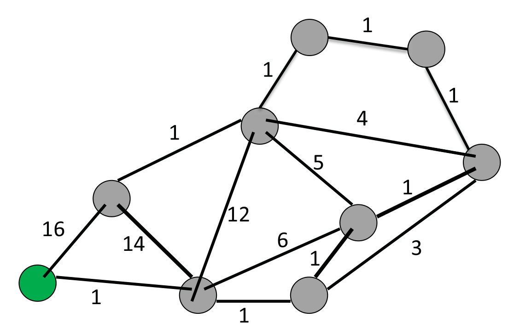

> [原图说明] 原页附图（p74）：最短路示例图（带权边，根 $v_o$）。此图将在统一裁剪阶段作为原图插回。

<!-- ===== PDF p75 ===== -->

**最短路（Shortest Paths）**

- **问题（Problem）**：在异步网络中计算一棵最短路生成树。
- 连通**加权**图，根顶点 $v_a$。边 $\{u, v\}$ 有权 $\operatorname{weight}(u, v)$。
- 进程对图没有知识，**只知道关联边的权**。
- 有 UID。
- 进程必须产生一棵以 $v_a$ 为根的最短路生成树。
- 每个进程 $u \ne v_a$ 应输出自己的距离和树中的父节点。

<!-- ===== PDF p76 ===== -->

**最短路（Shortest Paths）**

- 再次使用**松弛算法**。
- **异步 Bellman-Ford**。
- 现在，它处理**两类修正**：
  - 因为**长而低权**的路径（如同步 Bellman-Ford）。
  - 因为**异步**（如异步广度优先搜索）。
- 组合导致**出奇高的消息与时间复杂度**，比任何一类修正单独造成的都糟得多（**指数级**）。

> **[note] Note（译者注，两类修正叠加 = 指数灾难）:**
>
> 这一页是本讲的转折点。前面每个算法只对付一种偏差，异步 Bellman-Ford 要同时对付两种，而它的代价不是两种代价之和，是两种代价**互为输入**之后的结果。
>
> 机制上，两类偏差共用同一个通道：**每次改进都触发广播**。第一类偏差是「多跳低权路径」——同步 Bellman-Ford 也在修它，改进来自路径的更优组合；第二类偏差是「异步迟到导致先到非最优」——异步 BFS 也在修它，改进来自迟到的更好估计。当两者同时存在，一次改进可能由前者触发，却撤销了后者造成的一个错误；这次撤销沿路径产生新的候选距离，反过来又触发前者。于是改进的触发链不再是单向推进的波前，而是**在局部可以互相循环触发**。单类修正时，改进次数被路径结构卡住（最多 $n-1$ 次）；两类叠加时，卡住它的量变成路径条数，量级是 $O(n!)$。
>
> 「叠加不等于相加」这句话要读准。相加的意思是「做 $A$ 花 $c_A$，做 $B$ 花 $c_B$，一起做花 $c_A+c_B$」。这里不成立，因为 $A$ 与 $B$ 修改的是**同一个状态变量的同一个值**，每一次 $A$ 的改进都改变了 $B$ 下一次改进的起点，反之亦然。两个过程共享状态时，交互项不可加，这是复杂性分析里最容易被忽略的一条。
>
> 算量级，取 $|E|=30$；每条 edge（边）两个方向各一条单向 channel（信道），共 $2|E|=60$ 条。每条 channel（信道）上最坏堆积 $2^{n/2}$ 条消息、每条消息 $128$ bit、链路 $10\ \mathrm{Mb/s}$ 即 $10^{7}$ bit/s。$n=20$ 时 $2^{10}=1024$，全系统 $60\times 1024=6.14\times 10^{4}$ 条，$7.86\times 10^{6}$ bit，传输 $0.79\ \mathrm{s}$。$n=40$ 时 $2^{20}\approx 1.05\times 10^{6}$，全系统 $6.29\times 10^{7}$ 条，$8.05\times 10^{9}$ bit，传输 $805\ \mathrm{s}$，约 13.4 分钟。$n=60$ 时 $2^{30}\approx 1.07\times 10^{9}$，全系统 $6.44\times 10^{10}$ 条，$8.25\times 10^{12}$ bit，传输 $8.25\times 10^{5}\ \mathrm{s}$，约 9.5 天。三点连起来看：节点数从 20 到 60 只涨 3 倍，传输时间从 $0.79\ \mathrm{s}$ 涨到 $8.25\times 10^{5}\ \mathrm{s}$，跨了六个数量级。这才是「指数」的实际含义——它不是一个形容词，是一张 60 节点的图要跑九天半。
>
> 还有一个记号上的细节值得追一句：正文 p80 给的上界是 $O(n^n)$ 而不是 $O(n!)$。两者只差一个指数底，$n!$ 更紧，$n^n$ 更好写；讲义的推导路径是「一个节点的 `dist` 可能有多少个候选值」再乘以「每条 channel（信道）上能排多少」，粗估成每个位置可取 $n$ 种、连乘得 $n^n$，所以两个数都出现在正文里，用途不同：$n!$ 说明来源（路径条数），$n^n$ 说明量级（指数）。
>
> 顺带说清一个常见的误读：$2^{n/2}$ 不是说每个节点有 $2^{n/2}$ 条出边，而是说**一条 channel（信道）里可以排队排出 $2^{n/2}$ 条消息**。图的度数可能只有 $2$ 或 $3$，排队长度照样爆炸，因为每条消息都是某个中间估计值的一次重播，而中间估计值的个数由图里路径的多样性决定，不由度数决定。
>
> 跨课程连接：CLRS 里 Bellman-Ford 的 $n-1$ 轮上界之所以干净，是因为它**人为规定了relaxation（松弛）的同步性**——第 $i$ 轮只允许用第 $i-1$ 轮结束时的值，于是不同路径的估计不会交错污染。这门课在同步模型里也享受同样的保护：轮把「同一时刻」定义清楚了。异步模型把这道屏障拆掉，让不同路径的估计可以在任意时刻互相覆盖，上界的形状就从 $n$ 变成 $n!$。可以复用的判断法是：**当某个复杂度证明依赖「某类操作不交错」，把交错放开后必须重算，不能照抄**。这一点在 CLRS 里看不出，只有在异步模型里才显形。
>
> 收束：$2^{n/2}$ 也不是悲观估计的松上界，正文 p81 会给出一个真的达到它的执行，那时这条注里的每个数字都会有一个具体的构造撑着。

<!-- ===== PDF p77 ===== -->

**异步 Bellman-Ford，进程 $P_u$（Asynch Bellman-Ford, Process $P_u$）**

- **输入动作**：$\operatorname{receive}(m)_{v,u}$，$m$ 为非负整数
- **输出动作**：$\operatorname{send}(m)_{u,v}$，$m$ 为非负整数
- **状态变量**：
  - `parent`：$r(u) \cup \{\bot\}$，初始 $\bot$
  - `dist ∈ ℕ ∪ {∞}`：初始若 $u = v_a$ 则 0，否则 $\infty$
  - 对每个 $v \in r(u)$：`send(v)`，$\mathbb{N}$ 的 FIFO 队列，初始若 $u = v_a$ 则 (0)、否则空
- **迁移**：
  - $\operatorname{receive}(m)_{v,u}$：效果——若 $m + \operatorname{weight}(v,u) < \operatorname{dist}$，则 $\operatorname{dist} := m + \operatorname{weight}(v,u)$、parent := $v$、对每个 $w$ 把 $\operatorname{dist}$ 加入 `send(w)`。

> **[note] Note（译者注，异步 Bellman-Ford 与 BFS 的唯一差别）:**
>
> 这一页的价值全在对照上：两个自动机的状态变量、输入输出动作、迁移结构逐字相同，只有一处算术不同——relaxation（松弛）的判据从 $m+1<\operatorname{dist}$ 换成 $m+\operatorname{weight}(v,u)<\operatorname{dist}$。因此「BFS 就是全部 edge weight（边权）为 $1$ 的最短路」不是修辞，是字面事实：把 $\operatorname{weight}(v,u)$ 恒取 $1$，带权自动机立刻退化成跳数自动机。
>
> 为什么这一处替换会炸掉复杂度界，要看两边的「候选值集合」有多大。跳数版本里，从根到某节点的任意简单路径至多 $n-1$ 跳，所以该节点的 `dist` 最多有 $n$ 个可能取值，改进次数至多 $n-1$ 次。带权版本里，`dist` 的候选值是「所有从根到该节点简单路径的权和」，候选值个数等于路径条数，量级是 $O(n!)$。用一句话概括：**跳数版本天然提供了一个粗粒度的等价类划分——按跳数分层；带权版本把这个划分拆成细粒度，层没了，界的来源也就没了**。这一条不是技巧问题，是结构问题，任何实现优化都补不回来。
>
> 再把两个自由度分开看会更清楚。异步给的是「迟到」这个自由度；权值给的是「候选值离散且跨度大」这个自由度。两者单独都还能忍受：异步 BFS 里迟到的消息只可能带来更小的跳数，最多 $n-1$ 次；同步 Bellman-Ford 里权值再悬殊，轮次是同步的，每轮只向前推进一层，最多 $n-1$ 轮。合在一起才出问题：一条迟到的消息可以带来一个「只小一点点」的权和，于是同一个节点能经历一长串每次严格下降的估计值，而每一次下降都触发一次广播。
>
> 算一个最小的例子。取一条链 $v_0\to v_1\to v_2\to v_3$，edge weight（边权）依次为 $1,2,4$，正是正文 p81 构造的缩小版。若消息全部按顺序到达，$v_3$ 先拿到 $1+2+4=7$；随后迟到的消息逐段改小，它可能依次经历 $6,5,4,3,2,1,0$ 共 $7$ 次改进，也就是 $2^{3}-1$ 次，每次向 $v_2$ 方向重播一条不同的值，累计 $7$ 条。把指数从 $3$ 抬到 $10$：权值取 $1,2,4,\ldots,512$，改进次数变成 $2^{10}-1=1023$，消息 $1023$ 条。再抬到 $k=20$：$2^{20}-1\approx 1.05\times 10^{6}$ 条。这就是「一个数字之差」在 $k=20$ 时的具体价格；按 p81 的构造 $n\approx 2k+1$，这条链只有 $41$ 个 vertex（顶点）。
>
> 还有一层值得指出：权值悬殊在这里不是「更坏」，而是**这种坏的必要条件**。若所有权值都落在 $[1,n]$ 的整数区间，`dist` 的候选值就被压在多项式多个，复杂度回到多项式。指数的来源是「权值的二进制位数」而不是「权值大小」本身——$2^k$ 这种权值让每个二进制位都能单独触发一次改进，改进次数因此正比于数值本身，而数值是指数的。这解释了为什么 p82 的构造要精心设计成 $2^k,2^{k-1},\ldots,2^0$ 的递减阶梯。
>
> 跨课程连接：6.006 与 CLRS 里 BFS 是 Dijkstra 在「全部 edge weight（边权）为 $1$」时的特例，那里两个算法的差异落在数据结构上：FIFO（先进先出）的 queue（队列）对 priority queue（优先队列），代价差一个对数因子。这里两个算法的差异落在relaxation（松弛）判据上，代价差一个指数。同一个「特例关系」，在串行语境与异步分布式语境里的价格完全不同，这个对照本身比任何一个算法都值得记：**特例关系的代价取决于你在哪个模型里跑它**。区别的根源是同步性由谁提供——串行里由控制流提供，分布式里只能由消息提供，而消息会迟到。
>
> 收束：这处替换是「把等距换成就近」，等距天然分层，就近没有层，一切复杂度差异都从「层还在不在」长出来。

<!-- ===== PDF p78 ===== -->

**异步 Bellman-Ford，进程 $P_u$（Asynch Bellman-Ford, Process $P_u$）**

- **迁移**：
  - $\operatorname{receive}(m)_{v,u}$：效果——若 $m + \operatorname{weight}(v,u) < \operatorname{dist}$，则更新 dist、parent、入队重播。
  - $\operatorname{send}(m)_{u,v}$：前提——$m = \operatorname{head}(\operatorname{send}(v))$；效果——移除队头。
  - **没有终止动作**……

<!-- ===== PDF p79 ===== -->

**正确性：不变式与时序性质（Correctness: Invariants and Timing Properties）**

- **不变式（Invariant）**：任意时刻，对任何节点 $u \ne v_a$，若其 $\operatorname{dist} \ne \infty$，则它是某条从 $v_a$ 到 $u$ 的路径上的真实距离，且 parent 是该路径上前驱。
- **时序性质（Timing property）**：对任何节点 $u$ 与任何 $r$（$0 < r < \operatorname{diam}$），若 $p$ 是从 $v_a$ 到 $u$ 的任意至多 $r$ 跳路径，则到时刻 ???，节点 $u$ 的 dist $\le$ $p$ 的总权。
- **问（Q）**：??? 是什么？
- 它取决于**一条信道上可能堆积多少消息**。
- 这**可能很多**！

> **[note] Note（译者注，「???」与消息堆积的失控）:**
>
> 这一页上出现的三个问号，是这份讲义里少见的诚实标注：作者在写 timing property（时序性质）时需要一个「到时刻 $T$」里的 $T$，但此刻他还不知道 $T$ 该填什么，于是留空。这个空不是笔误，它精确指出证明缺了哪一块砖——**一条 channel（信道）上最多堆积多少条消息**。
>
> 为什么这一个量能决定整条性质的成立与否，看证明骨架就明白。时序性质的论证是计数：一条信息从根走到距离 $r$ 的节点要经过 $r$ 条 channel（信道）；在每条 channel（信道）前面，它最多被多少条已排队的消息挡住；每条消息的投递上界是 $d$。三者相乘就是这条路径的时间上界，骨架里唯一的未知就是「排队长度」。异步 BFS 里这个长度是 $O(n)$——每个 vertex（顶点）最多贡献 $n-1$ 个不同版本的估计，摊到各方向上界仍是 $n$；异步 Bellman-Ford 里它是路径条数量级，也就是指数。于是 $T$ 只能填一个指数表达式，性质仍然成立，但「到时刻 $T$ 保证到达」里的 $T$ 已经大到没有工程意义。
>
> 算三个数看量级，取 $d=1\ \mathrm{ms}$、每跳最坏堆积 $2^{n/2}$ 条。$n=20$ 时每跳 $2^{10}=1024$ 条，最坏时刻 $1024\ \mathrm{ms}\approx 1.02\ \mathrm{s}$。$n=40$ 时 $2^{20}\approx 1.05\times 10^{6}$，最坏时刻 $1.05\times 10^{6}\ \mathrm{ms}=1049\ \mathrm{s}$，约 17.5 分钟。$n=60$ 时 $2^{30}\approx 1.07\times 10^{9}$，最坏时刻 $1.07\times 10^{9}\ \mathrm{ms}=1.07\times 10^{6}\ \mathrm{s}$，约 12.4 天。三组数说的是同一件事：**vertex（顶点）数每增加 20，保证的到达时间从「秒」跳到「分钟」，再跳到「周」**。一张 60 个 vertex（顶点）的网络，等它收敛要十二天多。
>
> 这也正是「正确」与「可用」在这里分家的地方。invariant（不变式）那条不依赖堆积量，所以它一路成立；timing property（时序性质）依赖堆积量，于是它的结论从「多项式时间到达」退化成「指数时间到达」。一个算法同时拥有「永远正确」和「几乎永远等不到」两个属性，这在理论上完全自洽，因为 liveness（活性）只承诺「最终」，不承诺「多快」。把「最终」读成「很快」，是分布式系统里最常见的一类误读，也是把教科书结论直接搬到生产环境时最容易踩的坑。
>
> 还要看清一件事：这个 $T$ 填不出来，不是因为分析手段不够强，而是因为**上界确实那么大**。若存在一个多项式下界更优的证明，就等价于存在一个多项式时间的执行上界，而正文 p81 的构造会给出一个真花 $2^{n/2}$ 条消息的执行——两件事不能同时为真。所以留空是诚实的做法，不是推导失败。
>
> 跨课程连接：Awerbuch 于 1985 年在 JACM 第 32 卷第 4 期第 804 至 823 页发表的 synchronizer（同步器）工作，正是针对这个问题：用 $\alpha,\beta,\gamma$ 三种同步器把异步网络**模拟**成同步轮次，让同步算法可以直接搬过来用，代价是每轮额外的通信开销——$\alpha$ 每轮只增加常数时间但增加 $O(|E|)$ 条消息，$\beta$ 与 $\gamma$ 在时间与消息之间取不同折中。与本讲的差别在于思路方向：本讲接受异步、忍受复杂度；同步器不接受异步、把它翻译回同步。前者不改网络，后者改变算法看到的模型，两者都在 6.852/18.437 里展开。
>
> 收束：三个问号里藏着本讲的道德——`dist` 一定会收敛，但在一张 60 个 vertex（顶点）的图上，收敛的时刻可能落在十二天之后。

<!-- ===== PDF p80 ===== -->

**复杂度（Complexity）**

- 从 $v_0$ 到任何其他节点 $u$ 的**简单路径数**是 $O(n!)$，即 $O(n^n)$。
- 所以任何信道上发送的消息数是 **$O(n^n)$**。
- **消息复杂度**：$O(n^n \cdot |E|)$。
- **时间复杂度**：$O(n^n \cdot n \cdot d)$。
- **问（Q）**：这样的指数界真的能实现吗？

> [原图说明] 原页附图（p80）：用于证明指数界可达的示例图——$v_{-1}, v_0, v_1, \ldots, v_k, \ldots, v_{L-1}$ 链，边权为 $2^k, 2^{k-1}, \ldots, 2^0, 0$ 等。此图将在统一裁剪阶段作为原图插回。

> **[note] Note（译者注，$O(n!)$ 与 $O(n^n)$ 的来由）:** 这条注要回答三件事：指数上界从哪里来、它紧不紧、以及为什么「路径的条数」可以充当复杂度的度量。
>
> 先把 relaxation（松弛）的因果链拆开。一个 process（进程）只在 `dist` 严格变小时才动作，动作的内容是「把新 `dist` 发给所有邻居」。所以一个 process（进程）一生中发出的 message（消息）条数，恰好等于它的 `dist` 被严格改小的次数。于是问题化归为：`dist` 最多能被改小多少次？每次改小后的取值必是某条从 $v_a$ 出发的真实路径的权（这是 invariant（不变式）的内容），而不同的 simple path（简单路径）最多 $O(n!)$ 条，因为一条 simple path（简单路径）就是顶点集合的一个排列前缀。这条三段链 —— 路径条数决定候选取值个数，候选取值个数决定 message（消息）条数 —— 就是指数上界的全部来源：message（消息）数不是被图的大小撑大的，而是被「可以走到的候选值」的个数撑大的。
>
> 反过来看，如果算法能记住「这条路径我试过了」，就不必重播；但它记不住。每个 process（进程）只有常数个标量状态，唯一能区分「新值」与「旧值」的东西就是数值本身。这是一次信息论式的截断：用常数状态去分辨 $O(n!)$ 种历史，只能靠「值不同才动作」来省掉重复，也必然在「值不同但路径不同」时付全价。这条推理同时解释了为什么这个界很松：绝大多数 simple path（简单路径）算出来的权和是重复的，重复值不触发重播，所以真实的 message（消息）数远小于路径条数。
>
> 代数字核对。取 $n = 20$，$20! = 2{,}432{,}902{,}008{,}176{,}640{,}000 \approx 2.43\times 10^{18}$。设一条 channel（信道）投递一条 message（消息）耗 $d = 1\ \mathrm{ms}$，要把这些候选值各发一次，仅这一条 channel（信道）就要 $2.43\times 10^{15}\ \mathrm{s}$，除以每年 $3.16\times 10^{7}$ 秒，得约 $7.7\times 10^{7}$ 年。同一张 20 顶点的图上，breadth-first（广度优先）只需要 $0$ 到 $19$ 共 20 个取值、20 条 message（消息）、$20\ \mathrm{ms}$。两个数字差 $10^{17}$ 量级，说明 $O(n!)$ 是极松的统计界。也正因如此，真正可达的坏例子必须人为设计 edge weight（边权）让候选值互不相同：p81-82 取权为 $2$ 的各次幂，$k$ 个二进制位恰好给出 $2^k$ 个互不相同的子集和，才把界逼到 $2^{n/2}$ 量级。
>
> 跨课程连接。6.006 与 CLRS 第 24 章的 Dijkstra 算法在同一问题上给出多项式界 $O((|V|+|E|)\log|V|)$，它靠的是一个全局事实：一旦顶点被取出，它的 `dist` 就定稿，永不再被 relaxation（松弛）。维护这个「定稿集合」需要全局的取最小顺序，而异步模型没有全局时钟，任何 process（进程）都无法知道自己已定稿，于是「定稿」这一刀剪不掉，全部候选值都要走一遍网络。差别精确地落在这一点：不是 relaxation（松弛）写错了，而是「谁有权宣布定稿」在异步模型里不存在。6.042J 里数 simple path（简单路径）用的排列计数，与这里数候选值是同一套计数法，只是那边数的是路径，这边数的是「可能被写进 `dist` 的数」。
>
> 顺带把「$O(n!)$」与「$O(n^n)$」的区别算清。两者都是 exponential（指数）量级，差别只在底数：由 Stirling 公式 $n! \approx \sqrt{2\pi n}\,(n/e)^n$，取 $n = 20$ 时 $\sqrt{2\pi n} \approx 11.21$，$(n/e)^n$ 的对数底十是 $20\log_{10} 7.357 \approx 17.33$，两者相乘正好回到 $2.43\times 10^{18}$；而 $20^{20} \approx 1.05\times 10^{26}$。比值 $20!/20^{20} \approx 2.3\times 10^{-8}$。所以 $O(n!)$ 与 $O(n^n)$ 之间只差一个 $e^{n}$ 量级的因子，写哪一个都不改变「随 $n$ 指数增长」这个定性结论，但报上界时写紧的那个才不给后续分析留隐患。
>
> 收束一句：$O(n!)$ 说的是候选取值有多少个，不是图有多大；把它读成「图大就慢」会漏掉这条注的全部内容。

<!-- ===== PDF p81 ===== -->

**复杂度（Complexity）**

- **问（Q）**：这样的指数界真的能实现吗？
- **例（Example）**：
  - 存在下面网络的**一个执行**，其中节点 $v_k$ 向节点 $v_{k+1}$ 发送 **$2^k \approx 2^{n/2}$** 条消息。
  - **消息复杂度是 $O(2^{n/2})$**。
  - **时间复杂度是 $O(2^{n/2} \cdot d)$**。

> [原图说明] 原页附图（p81）：指数可达性示例链——$v_{-1} \to v_0 \to v_1 \to \cdots \to v_k \to \cdots \to v_{L-1}$，边权 $2^k, 2^{k-1}, \ldots, 2^0, 0$。此图将在统一裁剪阶段作为原图插回。

> **[note] Note（译者注，指数界可达性的直觉）:** 上一条给的是上界，这一条要给的是「它真的能被达到」。p81-82 的构造只有一条链，边权取 $2$ 的各次幂，却让某个 process（进程）向邻居发出 $2^k$ 条 message（消息）；这条注要拆的就是「为什么 $2$ 的幂能把一个松上界逼成紧下界」。
>
> 先看边权为什么这样选。$2$ 的各次幂做 edge weight（边权）时，任意两个不同的子集和都不相等 —— 这正是二进制表示的唯一性：一个整数只有一种写法把它拆成不同的 $2$ 的幂之和。把一条链上「走不走这条边」当成「这一位取不取」，则每条 simple path（简单路径）对应一个唯一的权和。于是 $k+1$ 条边就给出 $2^{k}$ 个互不相同的 candidate（候选）距离。上一条说的「候选值互相重复所以界很松」在这里被关掉了：界松是因为重复多，权取 $2$ 的幂就是**人为消掉全部重复**。
>
> 再看这些值怎么被逐个访问。relaxation（松弛）只在 `dist` 严格变小时动作，所以要让 $2^k$ 个值全部被写进 `dist`，必须让它们**严格递减地**到达：先是高权路径的和（大），接着是去掉某些高权位后的和（小一点），最后一个不漏地降到 $0$。异步执行恰好允许这种顺序 —— 消息在不同 channel（信道）里走的速度由执行决定，慢的那条自然后到。每次变小都把新值塞进每个 `send(v)` 队列，FIFO（先进先出）的 channel（信道）又把这些 message（消息）**按产生顺序串行化**，于是倒计时不会被并行地抹平。
>
> 代数字。取 $k = 20$：按 p81 的构造，上链与下链各 $k=20$ 条 edge（边），顶点数 $n = 2k+1 = 41$，则 $2^{20} = 1{,}048{,}576$ 条 message（消息）要从一个 process（进程）流向它的邻居。设 $d = 1\ \mathrm{ms}$，这一条 channel（信道）要排 $1048.576\ \mathrm{s}$，约 17.5 分钟；而同一张 41 顶点的图上，同步 Bellman-Ford 只要 $n-1 = 40$ 轮、$40\ \mathrm{ms}$ 就足以算对。比值 $1048.576 / 0.040 \approx 2.62\times 10^{4}$。整条链上各顶点发出的 message（消息）数是 $\sum_{k=1}^{20} 2^{k} = 2^{21}-2 = 2{,}097{,}150$ 条。一个 40 毫秒算得完的问题，消息面上要跑 17 分钟 —— 差的是四个半数量级。
>
> 补一句机制上的边界：这个构造依赖 channel（信道）是 FIFO（先进先出）。若 channel（信道）会重排，倒计时就会被并行地合并，$2^{k}$ 条 message（消息）会塌缩成少量；所以「指数可达」是「严格改进才广播」这条规则与「FIFO（先进先出）」这条假设共同的结果，少任何一条都不成立。
>
> 这个构造还说明一件容易被忽略的事：坏例子不需要大图。$n = 41$ 的一条链、40 条边就够，因为复杂度的来源是**候选值的个数**而不是顶点数。这正是 lower bound（下界）构造的通用模板，可以命名为「互异化 + 逆序到达」：先用权值设计把候选值做成两两不同（互异化），再用异步的执行顺序把它们排成最坏的一列（逆序到达）。任何「每个改进都要广播」的算法都能套这个模板，区别只在于代价函数换成该算法的改进次数。
>
> 跨课程连接。CSAPP 第 2 章讲 unsigned（无符号）位模式与数值的一一对应，证明方法与这里同源：$k$ 位只能表示 $2^{k}$ 个值，且每个值有唯一表示。区别在于「谁在枚举」：编码系统里枚举的是值本身，值域是静态的；这里枚举的是执行的到达顺序，而到达顺序在异步模型里可以任意。6.042J 的计数与排列也在这里被再次用到 —— 上一条数路径用的是排列，这一条用子集，两者都是「先数清楚可能的输入，再证明算法确实会走遍它们」。
>
> 收束一句：$2^{n/2}$ 不是数学游戏，它告诉你「不加限制的异步 + 严格改进才广播」这条规则本身就放出了指数个可区分的状态。

<!-- ===== PDF p82 ===== -->

**复杂度（Complexity）**

- 存在节点 $v_k$ 向 $v_{k+1}$ 发送 $2^k$ 条消息的执行。
- $v_k$ 可能的距离估计是 $2^k - 1, 2^k - 2, \ldots, 0$。
- 而且，$v_k$ 可以**按顺序经历所有这些估计**：
  - 首先，消息沿上链传播，给出 $2^k - 1$。
  - 然后最后一条下链消息到达 $v_k$，给出 $2^k - 2$。
  - 然后 $v_{k-2} \to v_{k-1}$ 的下链消息到达，把 $v_{k-1}$ 的估计减 2，$v_{k-1} \to v_k$ 的消息沿上链到达，给出 $2^k - 3$。
  - 依此类推。**按二进制倒计数**。
  - 若这发生得很快，就在信道 $e_{v_{k-1}, v_k}$ 里堆积 $2^k$ 条 search 消息。

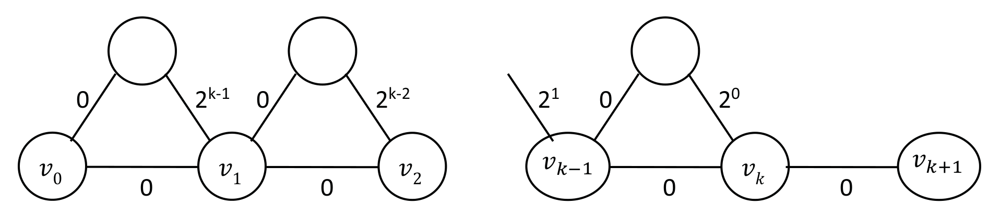

> [原图说明] 原页附图（p82）：二进制倒计时的消息路径示意（上链/下链交替）。此图将在统一裁剪阶段作为原图插回。

> **[note] Note（译者注，二进制倒计时的机制）:** 这一页要回答的机制问题是：为什么 $v_k$ 的估计会**一格一格**地走完 $2^{k}-1, 2^{k}-2, \ldots, 0$，而不是一步跳到底？答案是「每一个中间值都是一条真实路径的权和」，所以 invariant（不变式）抓不住它们，relaxation（松弛）只能老老实实地逐个接受。
>
> 把机制拆成三层。第一层，上链先跑通：高权的那条简单路径虽然权大，但它是**一条**路径，只需要有限几条 message（消息）就能把值顶到 $v_k$，于是 `dist` 先被设成一个偏大的值 $2^{k}-1$。第二层，下链的低权 message（消息）**迟到**：它晚到一次，就把某个上游节点的估计压低一次，该节点再把变小的估计沿上链推给 $v_k$，使 $v_k$ 的 `dist` 恰好少 $1$ 或少 $2$。第三层，因为 relaxation（松弛）只在 `dist` **严格变小**时动作，每一次压低必然生成一条新的 message（消息）并塞进 `send(v)` 队列。于是 message（消息）的条数就等于被压低的次数，也就等于倒计时走过的格子数。
>
> 为什么必须取 $2$ 的幂？因为要让「压低一格」永远对应一个**合法**的 candidate（候选）值。若 edge weight（边权）取任意整数，「$2^{k}-2$ 是不是某条 simple path（简单路径）的权和」很可能是否定的，那么 invariant（不变式）里「`dist` 非无穷则必是真实路径的权」这一条就会在某个时刻对不上，算法根本走不到那些值。取 $2$ 的幂之后，从 $2^{k}-1$ 到 $0$ 的每一个整数都能写成某个子集和，逐个都是合法候选，倒计时才能被走满。这条推理值得记成模板：**构造下界时，先保证目标序列的每一项都是合法的中间状态，再安排它们的到达顺序**。
>
> 代数字。取 $k = 10$，倒计时从 $1023$ 走到 $0$，共 1024 个取值，每个取值触发一条 message（消息）；链路两端各有邻居，共约 2048 条 message（消息）。设 $d = 1\ \mathrm{ms}$，仅这一个 process（进程）的倒计时就要跑 $1.024\ \mathrm{s}$。同一件事在 CPU 上是什么代价？一次 `dec` 加一次条件跳转只花一到两个 cycle，1024 次递减在 $3\ \mathrm{GHz}$ 上是 $1024 / 3\times 10^{9} \approx 3.4\times 10^{-7}\ \mathrm{s}$，约 0.34 微秒。两者相差约 $3\times 10^{6}$ 倍。这个比值就是 $d$ 的物理含义：**一次网络投递的时间，等于三百万个 CPU cycle**。整条链上 $\sum_{k=1}^{10} 2^{k} = 2046$ 条 message（消息）；若这些 message（消息）都挤在同一条 channel（信道）上排，按 $d = 1\ \mathrm{ms}$ 计就是 $2.046$ 秒。
>
> 还有一个必须说清的细节：FIFO（先进先出）在这里起了负面作用。它保证同一条 channel（信道）上的 message（消息）按产生顺序投递，于是一次次「变小」被**串行**排进队列，不能并行合并；如果 channel（信道）会重排，两个相邻的估计可能互相抵消，倒计时就塌缩了。因此在 p81-82 的构造里，「$2^{k}$ 条 message（消息）堆积在 $e_{v_{k-1},v_{k}}$ 这条 channel（信道）里」不是比喻，而是队列的真实长度。
>
> 跨课程连接。CSAPP 第 3 章讲机器级指令时算过循环的 cycle 成本：`dec`、`jne`、乃至分支预测失败，量级都是几个 cycle。这里同一个递减动作被搬到网络上，成本换成 $d$，量级差六个数量级。CSAPP 第 6 章 cache 的 miss penalty（几百 cycle）给了同样的直觉：**同样的逻辑操作，取决于它跨过了哪一层边界，价格完全不同**。区别在于 cache miss 可以靠流水与预取**重叠**掉一部分延迟，而这里的 $d$ 被 FIFO（先进先出）串行化，重叠不成立 —— 这正是拓扑上的一条 channel（信道）与 CPU 里的一组并行 miss 的差别。
>
> 收束一句：倒计时不是算法写错了，而是「每个中间值都合法」的必然结果；要剪掉它，只能引入额外信息，例如「这个估计已经定稿」。而在没有全局时钟的模型里，没有任何 process（进程）有权宣布定稿。

<!-- ===== PDF p83 ===== -->

**终止性（Termination）**

- **问（Q）**：进程如何知道树已完成？如何知道自己可以输出 dist 和 parent？
- **又是汇播（Convergecast, once again）**：
  - 计算并**重算**子指针。
  - 进程 $i \ne v_a$ 在「已收到所有消息响应（相信自己知道所有孩子）」且「已收到所有孩子 done」后，向其**当前父节点**发送 done。
  - **同一进程可能多次（很多次）参与**，基于改进后的估计。

> **[note] Note（译者注，指数次汇播）:** 这条注要讲清的是：终止在异步 distributed algorithm（分布式算法）里不是一次判断，而是一项**要花消息的协议**。p83 的 convergecast（汇播）与 p72 的写法一模一样，但代价从多项式变成了 exponential（指数），原因不在汇播本身，而在它所依附的那棵树**一直在变**。
>
> 先看子指针维护的因果链。一次 relaxation（松弛）改进 `dist` 时，process（进程）做三件事：把 `children` 清空、向旧父发一条 nonparent、向新父发一条 parent。对方收到 parent 才把它记进 `children`，收到 nonparent 才把它移出。这套规则保证了「任何时刻 `children` 与当前 parent（父指针）一致」，但也带来一个后果：**换一次父，这个节点的整棵子树的 `done` 全部作废**。作废不是局部事件 —— 它要让上游知道「你原来收到的那份 `done` 不算了」，也就是说失效要沿树向上传播。
>
> 再看终止条件的因果链。一个 process（进程）只有在两件事同时成立时才向当前父发 `done`：它已收到自己所有 message（消息）的响应，于是相信自己知道全部孩子，且它已收到所有这些孩子的 `done`。第一件排除「还有孩子没被发现」，第二件排除「孩子还没算完」。若把第一件去掉，就会出现「先发 `done`、后来又冒出新孩子」的漏算；若把第二件去掉，就会出现「子树还在改、父却已宣布完成」的早停。两条都不能省。
>
> 关键在于：树的变化次数不是外生干扰，而是算法追求正确性的代价。第一次尝试（先到先得）禁掉了换父，所以它的 convergecast（汇播）只需一遍，代价 $O(n \cdot d)$；异步 Bellman-Ford 允许换父，于是「参与汇播的次数」= 「改进的次数」，而改进次数可以到 $2^{n/2}$。
>
> 代数字。$n = 41$、$k = 20$ 时单个 process（进程）可有 $2^{20} = 1{,}048{,}576$ 次改进，每次参与至少 2 条 message（消息，一条 nonparent、一条 done），仅这一个节点的收尾记账就是 $2{,}097{,}152$ 条。设 $d = 1\ \mathrm{ms}$，这些 message（消息）串行排在同一条 channel（信道）上要 $2097\ \mathrm{s}$，约 35 分钟；而答案在 $40\ \mathrm{ms}$ 时就已经算对了。比值 $2097 / 0.040 \approx 5.2\times 10^{4}$：**等了五万倍的时间，只为确认一件早已成立的事**。更糟的是这个记账量与本体的 message（消息）数同阶，所以终止没有「便宜的实现」，它和计算一个价。
>
> 再估一个更悲观的界，用来说明「重叠」为什么是必需的。树深最坏为 $n-1 = 40$，一次完整的 convergecast（汇播）至少要走 40 层，每层一跳花 $d$，即 $40$ 毫秒。若 $2^{20}$ 次汇播完全串行，总时间是 $1{,}048{,}576 \times 0.040$ 秒 $= 4.19\times 10^{4}$ 秒，约 11.6 小时。实际运行中这些汇播大幅重叠，真实上界才回到 $O(2^{n/2} \cdot d)$ 量级；重叠靠的正是 FIFO（先进先出）channel（信道）把多轮 `done` 按序排队，与 p47 那次「一条 channel（信道）上堆积多少条 message（消息）」的分析是同一套账。
>
> 跨课程连接。CSAPP 第 11 章 socket 编程里的 TCP 四次挥手是同一类结构：数据面早已结束，控制面还要 FIN、ACK 走一个往返，最后进 TIME_WAIT 等 2MSL。连接路径是「数据流结束 ≠ 内核可回收状态」，两边都必须有显式的收尾协议。区别在代价的形状：TCP 的收尾是**常数**个 segment（4 个），因为连接的结构不会变；这里的收尾与**结构变化的次数**成正比，所以它继承了算法的复杂度。CSAPP 第 8 章讲的僵尸进程是另一面：子进程已退出但父进程还没 `waitpid`，资源悬着不回收 —— 那也是「结束 ≠ 回收」，区别是僵尸只等一次 `waitpid`，而这里的孩子集合会变，`wait` 可能要重来很多次。
>
> 收束一句：这就是动态结构加无全局时钟的税 —— 只要树会变，终止就必须按「变了几次」收费。

<!-- ===== PDF p84 ===== -->

**最短路（Shortest Paths）**

- **道德（Moral）**：**不加约束的异步可能引发问题**。
- **怎么办（What to do）**？
- **去 6.852/18.437 分布式算法课找答案！**

> **[note] Note（译者注，本讲道德）:** 这条注要说的是：p84 的「moral（道德）」不是一句收场话，而是一条设计指令 —— 不加约束的异步会把 polynomial（多项式）买成 exponential（指数），而「把结构买回来」是有价目表的。三条主线先复述一遍：第一次尝试先到先得，质量错；第二次尝试 relaxation（松弛），质量对了但 message（消息）数乘 $n$；异步 Bellman-Ford 两类修正叠加，直接失控。真正值得写下来的是第四步：用什么办法把结构买回来。
>
> synchronizer（同步器）的机制，可以一句话说完：用「每条 edge（边）上第几条 message（消息）」当钟。alpha（阿尔法）型的具体做法：每个 process（进程）维护一个轮计数器 r；进入第 r 轮时，它在每条相邻 edge（边）的每个 outgoing 端口上发一条 message（消息，可以为空），然后等每条相邻 edge（边）各来一条 message（消息）；全部到齐，才允许把计数器加一进入第 r+1 轮。为什么这能冒充时钟？因为 channel（信道）是 FIFO（先进先出），所以「这条 edge（边）上第 r 条 message（消息）」是唯一确定的：发送方至多发出第 r 条，接收方也至多只能收到第 r 条，计数不会串。为什么它必须这么贵？因为要让任意两个 process（进程）的进度差不超过一轮，必须让每一对相邻 process（进程）每轮至少通一次信 —— 于是每轮 message（消息）数下界就是边的条数。
>
> 还要说清「买回来」到底买到了什么。买到的不是速度，而是**语义**：synchronizer（同步器）让每个 process（进程）能够说出「我在第 r 轮」这句话，于是同步算法那套按轮归纳的正确性证明可以整段搬过来，不用重写。翻译规则只有两条：每一轮的时间计 $O(d)$（一跳），每一轮的 message（消息）计 $O(|E|)$。反过来，如果不用 synchronizer（同步器），你连「第 r 轮结束时系统的状态」都不能陈述，证明就只能退到 invariant（不变式）加 timing property（时序性质）那种更弱的形态 —— p70 已经演示过这条路有多难走。
>
> 顺带记下两个改良版本的区别，它们体现的是同一条权衡（时间换 message（消息））。beta（贝塔）型把图切成 cluster（簇）：簇内照用 alpha（阿尔法）型的每轮对账，簇间只走一棵 spanning tree（生成树），于是每轮不必每条边都通气。gamma（伽马）型用 leader（领导者）加 k-spanner（k-支撑子图），每轮 message（消息）数为 $O(n^{1+1/k})$，时间每轮 $O(k)$。三者都说的是同一件事：给异步注入结构要付 message（消息），付得越多，时间越短。
>
> 代数字。取稠密图 $n = 41$、$|E| = n(n-1)/2 = 820$，每边两方向，共 $2|E| = 1640$ 条 channel（信道）。模拟同步 Bellman-Ford 的 40 轮：alpha（阿尔法）型每轮 1640 条，共 $40 \times 1640 = 65{,}600$ 条 message（消息）；时间每轮一跳，$40 \cdot d = 40$ 毫秒。gamma（伽马）型取 $k = 2$，每轮 $41^{1.5}\approx 263$ 条，40 轮共 $1.05\times 10^{4}$ 条，比 alpha（阿尔法）型省 6.2 倍。而原生异步 Bellman-Ford 的最坏是 $2^{20} = 1{,}048{,}576$ 条、$1048$ 秒：alpha（阿尔法）型比它省 16 倍，gamma（伽马）型省 100 倍，时间上省下 $2.6\times 10^{4}$ 倍。这组数字就是 p84 那句「怎么办」的定价：每轮每条边一条空 message（消息）的价格，换回四个数量级。
>
> 跨课程连接。CSAPP 第 12 章讲 pthread 的 barrier（屏障），机制与 alpha（阿尔法）型一模一样：每个线程到达后把原子计数器加一，等到计数到 n 才全部放行；这个计数器就是「第几轮」的唯一凭据，线程的任意调度被重新对齐成轮。连接路径是「用计数冒充时钟」，连失效模式都相同：只要有一个线程永远不到，所有人陪等。区别在代价与凭据：共享内存屏障靠原子指令与 futex 唤醒，一次开销是微秒级系统调用；分布式 synchronizer（同步器）只能靠 message（消息），一次脉搏就是 2|E| 条 message（消息）。所以同一个抽象在单机上是纳秒级技巧，在网络上就是复杂度预算里的头号开支。
>
> 收束一句：synchronizer（同步器）不是把网络变成同步的，它只是把「第几条 message（消息）」当成时钟用；它买回的是可分析性，付的是每轮那批可能是空的 message（消息）。

<!-- ===== PDF p85 ===== -->

**接下来是什么？（What's Next?）**

- **6.852/18.437 分布式算法（Distributed Algorithms）**
  - 基础研究生课程。
  - 覆盖同步、异步与时序型算法。
- **同步算法**：
  - 领导者选举
  - 构造各种生成树
  - 极大独立集与其他网络结构
  - 容错（Fault tolerance）
  - 容错共识、提交及相关问题

<!-- ===== PDF p86 ===== -->

**异步算法（Asynchronous Algorithms）**

- 异步网络模型
- 领导者选举、网络结构。
- **算法设计技术**：
  - 同步器（Synchronizers）
  - 逻辑时间（Logical time）
  - 全局快照、稳定性质检测（Global snapshots, stable property detection）。
- **异步共享内存模型**
  - 互斥、资源分配
- 容错
  - 容错共识及相关问题
- 原子数据对象、原子快照
- 模型之间的变换。
- **自稳定算法（Self-stabilizing algorithms）**

> **[note] Note（译者注，研究生课程预告）:** 这张幻灯片不是课程目录，而是四张「补丁」：异步模型缺的是全局时钟，缺了之后「全局状态」「事件先后」「一致决定」这些概念都无法直接定义，于是每一条技术都在补一个具体的假设。按这个角度读，比背课程大纲有用得多。
>
> 先说 logical time（逻辑时间）。没有共享时钟时，唯一可信的序是因果序：若事件 a 的信息能被 b 看到，就记 a 先于 b。Lamport 时钟的做法是：每个 process（进程）维护一个本地计数器，发送时把当前值搭在 message（消息）上，接收时把计数器改成「本地值与收到的值中较大者加一」。为什么必须取较大者再加一？因为若 b 是 a 的因果后继，b 的编号必须严格大于 a；取较大者保证「不小于上游」，加一保证「严格大于」，两条合起来才让编号对因果序单调。
>
> 算一遍。三个 process（进程）：P1 依次发生 e11、e12、e13，编号 1、2、3，其中 e12 发出一条 message（消息）带时间戳 2；P2 先有 e21 编号 1，随后收到该 message（消息），编号改成 max(1, 2) 加一等于 3，接着 e23 发出 time stamp（时间戳）4；P3 先有 e31 编号 1，收到时间戳 4 后编号变成 5。检验因果链：e12 是 2，e23 是 4，P3 的接收是 5，严格递增，符合要求。但反方向不成立：e21 是 1，小于 e13 的 3，而这两个事件之间没有任何因果路径，它们是并发的 —— 编号只给出一个总序，不给出「真的谁先发生」。这一点要记牢：logical time（逻辑时间）补的是因果，不是真实时间。
>
> 再说 global snapshot（全局快照），Chandy-Lamport 的做法：发起者先在本地记账，然后沿每条出边发一个 marker（标记）；每个 process（进程）第一次收到 marker（标记）时记下自己的状态、并把 marker（标记）转发给所有邻居，之后从那条 channel（信道）收到的业务 message（消息）单独记成「在途」。它为什么一致？因为 marker（标记）与业务 message（消息）走同一条 FIFO（先进先出）channel（信道），所以「marker（标记）之前发的业务 message（消息）」必然排在 marker（标记）之前到达，cut（全局切面）不会出现「已收到但未发出」的矛盾记录。代价是可数的：$n = 5$、$|E| = 7$ 的无向图每边两方向，共 $2|E| = 14$ 条 marker（标记），加 $n = 5$ 份本地状态，与业务量无关。
>
> 第三条是 FLP，这是 Fischer、Lynch、Paterson 三人姓氏的首字母，$1985$ 年发表于 JACM 的 impossibility（不可能性）结果：异步模型加上哪怕一个 crash fault（崩溃故障），deterministic（确定性）共识无法保证终止。证明的思路是构造一个 bivalent（双价）的初始格局 —— 两种决定都还可能 —— 再让敌手把每条 message（消息）延迟到恰好不让任何一方跨出临界点；而本讲的 fairness（公平性）只要求「最终投递」，恰好给这种任意长的延迟留了位置。所以它不是工程没做好，而是模型允许敌手这么干。对比之下，同步模型里 $3f+1 = 4$ 个副本就能容 $f = 1$（PBFT 一类协议每阶段 $O(n^{2}) = 16$ 条 message（消息），三阶段约 48 条）—— 差别不在算法聪明与否，而在模型有没有给「延迟上界」。
>
> 第四条是 self-stabilizing（自稳定）：不管初始状态多乱，只要运行足够久就回到合法状态。本讲 p69 那个「没有终止动作」的自动机正好是这个形态：它不宣布结束，只是静默地不再改变。
>
> 跨课程连接。6.042J 里讲过偏序集与线性扩展：happens-before（先于关系）是一个 strict partial order（严格偏序），Lamport 时钟给出的是它的一个 linear extension（线性扩展），而且要求这个扩展对偏序单调。区别在于自由度：6.042J 里任何拓扑序都算合法的线性扩展，选哪个无所谓；这里必须选一个「保因果」的，代价是并发事件被强行排出先后，并发信息丢失。CSAPP 第 12 章讨论并发与内存序时踩的是同一个坑：编译器和 CPU 会重排访存，program order 不等于可见顺序，所以要用 barrier（屏障）与原子操作把序补回来；区别是那边的序由硬件协议定义 —— 如 x86 的强序或 ARM 的弱序模型 —— 这边的序只能由 message（消息）的因果链定义。
>
> 收束一句：这四件事分别是补因果序、补一致切面、证明有些东西补不了、补自愈能力 —— 它们都是对「没有全局时钟」这一个缺陷的不同应对。

<!-- ===== PDF p87 ===== -->

**以及更多（And More）**

- **时序型算法（Timing-based algorithms）**
  - 模型
  - 重访某些问题
  - 新问题，如**时钟同步（clock synchronization）**。
- **更新的工作（也许）**：
  - 动态网络算法
  - 无线网络
  - **昆虫群落算法**与其他**生物分布式算法**

> **[note] Note（译者注，生物分布式算法）:** 这条注要回答的是：把生物的分布式行为拿来当算法，究竟给出了什么**新的设计约束**。答案不是更快，而是「在无 UID（唯一标识）、无全局时钟、有噪声」这三个条件下仍然收敛 —— 这三条恰好是本讲两个模型都不完全具备的。
>
> 先看果蝇的 SOP（sensory organ precursor，感觉器官前体）选择。每个 pre-neural cluster（前神经细胞簇）里有 20 到 30 个细胞，最终只有一个成为 SOP，其余全部退出。这不是由一个中央控制器指定的，而是靠 lateral inhibition（侧向抑制）：一旦某个细胞开始表达 Delta 并激活邻居的 Notch 通路，邻居就被压制，压制又反过来削弱邻居抑制别人的能力，于是竞争在几轮之内决出唯一胜者。用图论的语言重述：选出的集合内部没有相邻对，且每个未选中的细胞都有一个选中的邻居 —— 这正是 MIS（极大独立集）的两条定义，在细胞两两相邻的簇里，MIS（极大独立集）的规模就是 1。讲次 19 的 Luby 算法解的是同一个问题，区别只在破对称的手段：Luby 抽随机优先级，果蝇用分子层面的随机涨落。
>
> 再看蚂蚁。单只蚂蚁没有地图，只按信息素浓度做概率选择，并在返回时沿路沉积。短路径先被走完，单位时间内往返次数多，沉积频率高，浓度就高，后来的蚂蚁更可能选它，于是浓度更高 —— 一个正反馈环。这套机制与本讲 p33 的 Max 自动机在结构上是同一个：单调改进加公平传播 —— 浓度只增，相对优势只会扩大；每只蚂蚁都有机会走每条路。
>
> 代数字算一遍。设两条路长度 1 与 2，初始浓度各为 1，每只蚂蚁到达后按 $1/L$ 沉积，即短路径 1 单位、长路径 0.5 单位；选择概率按浓度比例。32 只蚂蚁、第一轮浓度相等，各走 16 只，浓度变成 $1+16 = 17$ 与 $1+8 = 9$，比例 $17/26$ 约 0.654；第二轮约 21 只走短、11 只走长，浓度变成 $17+21 = 38$ 与 $9+5.5 = 14.5$，比例 $38/52.5$ 约 0.724；第三轮 23 对 9，浓度 $61$ 与 $19$，比例约 0.762。概率序列 0.5、0.65、0.72、0.76 单调上升并趋近 1，每一轮都把差距放大一点。注意这个序列不需要任何蚂蚁知道全局信息，也不需要任何一轮同步。
>
> 跨课程连接。6.431（Bertsekas 那本概率论教材，课程号 6.431）里的 Markov chain（马尔可夫链）正是描述这件事的语言：状态是浓度向量，转移是「按比例抽样 + 按 $1/L$ 沉积」，短路径占优是全吸收的那个状态；把挥发率与沉积率代入，收敛速度与「采样噪声何时能被正反馈压过」就是一个标准的 hitting time（首达时间）问题。区别在于提问的方向：6.431 的题目给你转移矩阵、问你收敛多快，这里反过来 —— 参数是进化定下来的，你只能观测它是否落在「噪声不会把优势抹掉」的那个区间里。6.042J 的图论提供了另一块拼图：MIS（极大独立集）的定义与「每个点要么入选要么有邻居入选」的等价表述，正好是果蝇那条局部规则的判据。
>
> 还有一个必须说清的边界：这套东西在 20 到 30 个细胞、在几十只蚂蚁的规模上有效，不能就此推断它在 $10^{6}$ 个节点上也是好算法。Luby 算法有 $O(\log n)$ 的期望阶段数，靠的是随机优先级的极值分布；生物系统不给你这个保证，它靠的是「规模小、噪声大、失败重来」的冗余。所以「局部规则导致全局涌现」这个说法要加三条可检验的条件：有破对称的随机源、有单调的性能反馈、有公平的采样机会。三条缺一条，系统要么永久僵持，要么被噪声推到错误的一端。
>
> 收束一句：生物分布式算法贡献的是设计约束的清单，而不是复杂度的胜利；它提醒你，全局最优并不需要全局信息，但一定需要破对称。

<!-- ===== PDF p88 ===== -->

**MIT OpenCourseWare**

http://ocw.mit.edu

**6.046J / 18.410J 算法设计与分析（Design and Analysis of Algorithms）**

Spring 2015（2015 春季学期）

有关引用这些材料的信息或我们的使用条款（Terms of Use），请访问：http://ocw.mit.edu/terms。
