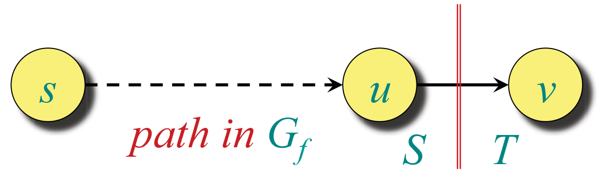
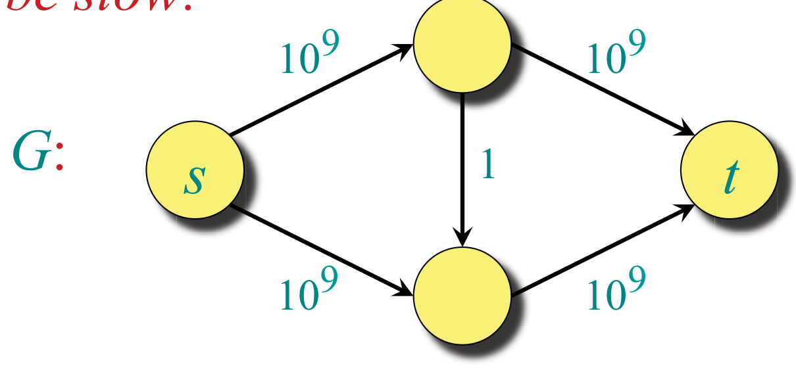
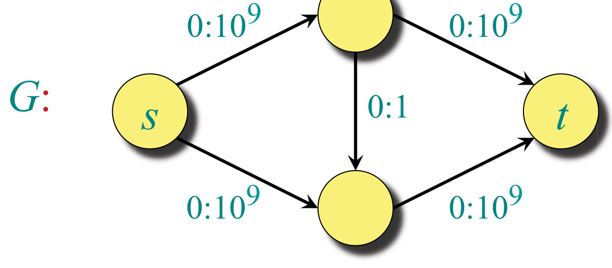
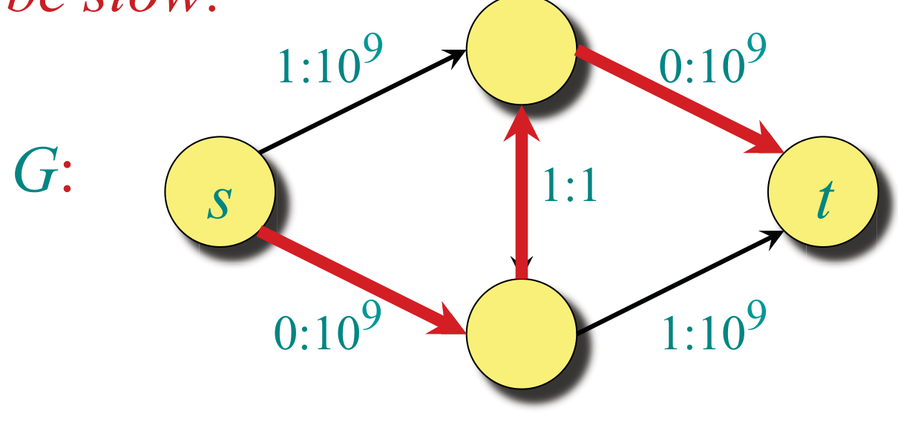
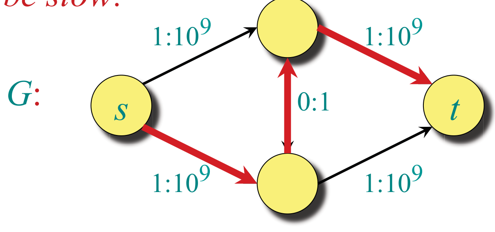
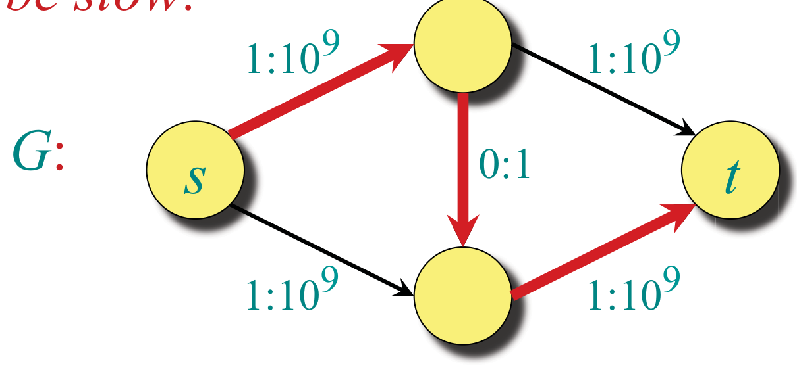
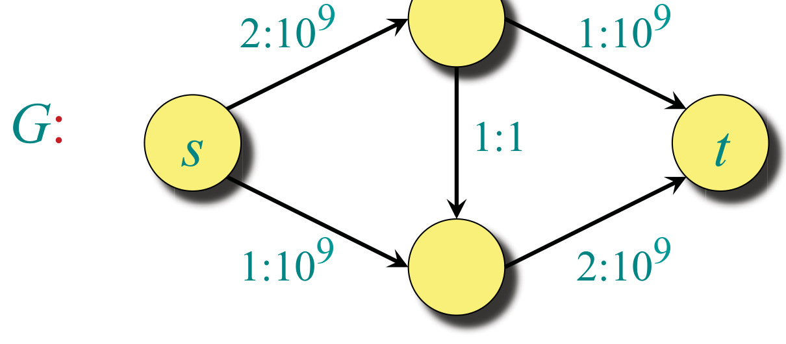

<!-- ===== PDF p1 ===== -->

<span style="color:#c0392b">**讲次 14（Lecture 14）：网络流与应用（Network Flow & Applications）**</span> <span style="color:#7f8c8d;">（Design and Analysis of Algorithms, 6.046J/18.401J, © 2001–15 by Leiserson et al, L14.1）</span>

本讲大纲：
- 回顾（Review）
- 最大流最小割定理（Max-flow min-cut theorem）
- Edmonds-Karp 算法（Edmonds Karp algorithm）
- 流整性（Flow Integrality）
- 第二部分：应用（Part II: Applications）

---

<!-- ===== PDF p2 ===== -->

<span style="color:#c0392b">**回顾讲次 13（Recall from Lecture 13）**</span>

- 流价值（Flow value）：$|f| = f(s, V)$。
- 割（Cut）：$V$ 的任意划分 $(S, T)$，使得 $s \in S$ 且 $t \in T$。
- **引理（Lemma）**：对任意割 $(S, T)$，$|f| = f(S, T)$。
- **推论（Corollary）**：对任意割 $(S, T)$，$|f| \le c(S, T)$。
- **残量图（Residual graph）**：图 $G_f = (V, E_f)$，其残量容量严格为正 $c_f(u, v) = c(u, v) - f(u, v) > 0$。
- **增广路径（Augmenting path）**：$G_f$ 中任何从 $s$ 到 $t$ 的路径。
- **增广路径的残量容量（Residual capacity of an augmenting path）**：$c_f(p) = \min_{(u,v) \in p} \{ c_f(u, v) \}$。

> <span style="color:#1e8449;">**[note] Note（译者注）:**</span> 这一页看着像复习清单，实际是本讲的理论地基：讲次 13 只留下三个等价陈述和一句 "Proof. Next time!"，本讲要用两条恒等式把它们焊死。第一条是 $|f| = f(S,T)$，第二条是 $|f| \le c(S,T)$。前者是等式，后者是不等式；一个精确、一个给出上界，两者夹在一起就是 strong duality（强对偶）的骨架。
>
> 先把第一条的因果链拆开。设 $f$ 是任意可行流：每条边满足 capacity（容量）约束，除 $s$ 与 $t$ 外每个顶点满足 flow conservation（流量守恒）。于是对 $u \notin \{s,t\}$，净流出 $\sum_v f(u,v) - \sum_v f(v,u) = 0$；对 $s$ 这个和等于 $|f|$。现在把 $S$ 内所有顶点的净流出加起来：内部边两端都在 $S$，它的 $+f$ 项与 $-f$ 项互相抵消，只剩跨割的边，即 $f(S,T) - f(T,S)$；而 $S$ 里只有 $s$ 可能有非零净流出（$t \notin S$），故 $|f| = f(S,T) - f(T,S)$。因为 flow 非负，$f(T,S) \ge 0$，立刻有 $|f| \le f(S,T) \le c(S,T)$。整个过程只用了 capacity 与 flow conservation 两条定义，没用到任何算法 —— 这就是 weak duality（弱对偶）的全部内容。讲义把第一步简写成 $|f| = f(S,T)$，是省掉了 $f(T,S) = 0$ 这一项；下一页的证明会把这一项补回来。
>
> 代入一组数复核。四个顶点，边与 capacity 为 $s \to a: 10$、$s \to b: 10$、$a \to b: 4$、$a \to t: 8$、$b \to t: 9$。取 flow：$f(s,a) = 10$、$f(a,b) = 2$、$f(a,t) = 8$、$f(s,b) = 7$、$f(b,t) = 9$。验 $a$：流入 10，流出 $2+8 = 10$；验 $b$：流入 $7+2 = 9$，流出 9。故 $|f| = 10 + 7 = 17$。取 $S = \{s\}$，$c(S,T) = 20$，弱对偶只给 $17 \le 20$，此时上界是松的，差距为 3。换成 $S = \{s,a,b\}$，跨割边只剩 $a \to t$ 与 $b \to t$，$c(S,T) = 8+9 = 17$，取等。两次代入说明同一件事：不等式对每个割都成立，但只有特定割取等号，而强对偶断言「取等的割一定存在」。
>
> 跨课程连接之一。Boyd 的凸优化教材前 5 章里，linear programming（线性规划）的标准形是 $\max c^{\top}x$ 受 $Ax \le b$、$x \ge 0$ 约束，它的 dual（对偶）问题是 $\min b^{\top}y$ 受 $A^{\top}y \ge c$、$y \ge 0$ 约束；任取一对可行解，把两组不等式各自乘上变量再相加，就得到 $c^{\top}x \le b^{\top}y$，弱对偶两行证完。最大流的 primal 是「在 capacity 与 flow conservation 下最大化 $|f|$」，它的对偶变量是给每个顶点一个电位 $d_v$，钉住 $d_s = 1$、$d_t = 0$，目标为 $\min \sum_{(u,v)} c(u,v)\cdot \max(0, d_u - d_v)$；最优解总可在 $d_v \in \{0,1\}$ 处取到，此时 $d$ 就是一个割的指示向量，目标恰好退化成 $c(S,T)$。所以 minimum cut（最小割）就是 maximum flow（最大流）的对偶问题，本讲要证的两个方向就是强对偶的两个方向。区别在于：网络流的约束矩阵结构特殊，强对偶可以纯组合地证，不必搬出 simplex（单纯形法）那一整套。
>
> 跨课程连接之二。MIT 6.042J 的图论部分在证 Hall 定理时用的正是「任意割给出上界」这一半：匹配大小不超过 vertex cover（顶点覆盖）大小，这一半就是弱对偶；另一半要靠 König 定理补。本讲用下一页的 (3)⇒(1) 一步补齐了「另一半」，这也是为什么后面把二分图匹配归约成最大流是合法的 —— 归约的正确性就架在这条等式上。
>
> 还有一个容易滑过的细节：上界只能用正向容量 $c(S,T)$，不能把 $c(T,S)$ 也算进去。理由是在 $S$ 内求和之后出现的是净流 $f(S,T) - f(T,S)$，而 $f(T,S) \ge 0$ 只能往小里用。拿上面的四顶点例子试：取 $S = \{s,b\}$，正向边是 $s \to a$ 的 10 与 $b \to t$ 的 9，合计 19；反向边是 $a \to b$ 的 4。若误把反向也加上，得到 23，而上界本来是 19，真实最大流是 17 —— 多算反向只会把上界弄松，绝不会更紧。这也说明 capacity 的记账方向是有讲究的：割的容量只数从 $S$ 指向 $T$ 的边，反向边一条都不数。
>
> 收束一句：这两条恒等式不是要背的公式，而是同一个动作（在 $S$ 内部求和、把内部边消掉）的两次使用；第一次消出 $f(S,T) - f(T,S)$，第二次拿掉非负项得到上界。

---

<!-- ===== PDF p3 ===== -->

<span style="color:#c0392b">**Ford-Fulkerson 最大流算法（Ford-Fulkerson max-flow algorithm）**</span>

**算法（Algorithm）**：

```
f[u, v] ← 0 for all u, v ∈ V
while 存在关于 f 的增广路径 p（在 G 中）
    do 用 cf(p) 增广 f
```

---

<!-- ===== PDF p4 ===== -->

<span style="color:#c0392b">**最大流最小割定理（Max-flow, min-cut theorem）**</span>

<span style="color:#2471a3;">**[theorem]**</span> **定理（Theorem）**：以下三命题**等价**：
1. 对某个割 $(S, T)$，$|f| = c(S, T)$。
2. $f$ 是最大流。
3. $f$ 没有增广路径。

**证明（Proof）**：
- **(1) ⇒ (2)**：由于对任意割 $(S, T)$ 都有 $|f| \le c(S, T)$，假设 $|f| = c(S, T)$ 意味着 $f$ 是最大流。
- **(2) ⇒ (3)**：若存在增广路径，流价值就能增加，与 $f$ 的最大性（maximality）矛盾。

> <span style="color:#1e8449;">**[note] Note（译者注）:**</span> 这条注要处理的是「三等价怎么证」这件事本身。三个命题分别是：某割上流值等于割容量、流最大、无增广路。要证两两等价，朴素做法是证六个方向；讲义只证三个，因为蕴含关系有传递性 —— 三个方向首尾相接成环就够了：$(1) \Rightarrow (2) \Rightarrow (3) \Rightarrow (1)$，环上任意两点都能顺着环走过去。这个模板可以直接复用，叫 cyclic implication（环形蕴含）；判断能不能用，只看蕴含关系是否构成有向环覆盖全部命题。
>
> 先看前两条边为什么「平凡」。$(1) \Rightarrow (2)$ 是从「存在某个割取等」推到「流最大」。设 $|f| = c(S,T)$。对任意可行流 $f'$，弱对偶给出 $|f'| \le c(S,T) = |f|$，所以没有流能超过 $f$。关键在「对任意流」四个字：弱对偶给的是对所有流统一成立的上界，只要有一条流顶到了这个上界，它必然是最大的；反过来若没有弱对偶，这一步就无从下手 —— 全部重量都压在 $|f| \le c(S,T)$ 上。$(2) \Rightarrow (3)$ 用反证加一个单调性事实：若存在 augmenting path（增广路）$p$，沿它增广得到 $f'$，则 $|f'| = |f| + c_f(p) > |f|$，与最大性矛盾。注意这一步只用到「能增广就能变大」，没有用到增广多少，所以它对任何路径选择策略都成立 —— 这也是后面「Ford–Fulkerson 任意选路仍然正确」的依据。
>
> 真正难的是 $(3) \Rightarrow (1)$，难在它的方向：从否定命题造肯定对象。已知「不存在增广路」这个否定事实，要凭空造出一个割并证明它取等。前两个方向都是把已有对象拿来比对（比上界、反证），第三个方向必须构造。这类构造在网络流里靠可达集，下一页展开，这里先记住结构上的不对称：三等价证明里，环上必有一条边是构造性的，找它就是找证明的重心。
>
> 用讲义的 4 顶点反例演练一次 $(1) \Rightarrow (2)$。边与 capacity 为 $s \to u: 10^9$、$s \to v: 10^9$、$u \to v: 1$、$u \to t: 10^9$、$v \to t: 10^9$。取 flow：$f(s,u) = 10^9$、$f(u,t) = 10^9$、$f(s,v) = 10^9$、$f(v,t) = 10^9$、$f(u,v) = 0$，于是 $|f| = 2 \times 10^9$。取 $S = \{s,u,v\}$，跨割边是 $u \to t$ 与 $v \to t$，$c(S,T) = 2 \times 10^9$，恰好取等；按 $(1) \Rightarrow (2)$，不必跑任何算法就能断言这是最大流。顺便记住这个数：割容量 $2 \times 10^9$，讲次后半「20 亿次迭代」正是它的来源，因为那条坏路径每次只推 1 单位。
>
> 跨课程连接。本课程讲次 11 讲最短路与差分约束时，最优性条件的形状与这里同构：Bellman–Ford 的终止判据是「再没有 relaxable（可松弛）的边」，即不存在改进操作；由「无改进操作」推到「当前距离即最短距离」，中间一步是把「最短路上每条边满足三角不等式」沿着路径求和，得到「路径上的距离估计之和不超过真实距离」。这与这里在 $S$ 内求和、消掉内部边是同一个动作：都是把一个逐边条件累积成一个全局等式或不等式。区别在于对偶变量的形态：最短路的对偶变量是顶点势 $d_v$，连续取值；割的对偶变量是二值指示函数，离散取值。再往上抬一层就是 linear programming（线性规划）的弱对偶与强对偶：弱对偶一行代数即可，强对偶才需要额外结构，而这里的额外结构就是「可达集」。
>
> 收束：三等价不是三条独立结论，而是「一个平凡比对 + 一个反证 + 一个构造」这一个模板的三个位置；读任何三等价定理，先找哪一条是构造性的。

---

<!-- ===== PDF p5 ===== -->

<span style="color:#c0392b">**证明（续）（Proof continued）**</span>

- **(3) ⇒ (1)**：假设 $f$ 没有增广路径。定义

```math
S = \{ v \in V : G_f \text{ 中存在从 } s \text{ 到 } v \text{ 的路径} \}
```

并令 $T = V - S$。观察到 $s \in S$ 且 $t \in T$，因此 $(S, T)$ 是一个割。

考虑任意顶点 $u \in S$ 与 $v \in T$：



> <span style="color:#7f8c8d;">[原图说明] 原页附图：残量网络 $G_f$ 中从 $s$ 到 $u$ 的路径示意，$u \in S$、$v \in T$。图注强调「$G_f$ 中的路径」。</span>

我们必须有 $c_f(u, v) = 0$，因为若 $c_f(u, v) > 0$，则 $v \in S$，而非假设的 $v \in T$。于是 $f(u, v) = c(u, v)$，因为 $c_f(u, v) = c(u, v) - f(u, v)$。对所有 $u \in S$ 与 $v \in T$ 求和得 $f(S, T) = c(S, T)$，又因为 $|f| = f(S, T)$，定理得证。

> <span style="color:#1e8449;">**[note] Note（译者注）:**</span> 这是全讲最该逐字吃透的一段：已知「$G_f$ 里没有 $s \to t$ 的路」，要造出一个割并证明它取等。讲义的做法用一个集合把否定事实变成了肯定对象。
>
> 机制分四步。第一步，令 $S$ 为 residual graph（残量图）中从 $s$ 可达的顶点集合，$T = V - S$。第二步，$t \notin S$：若 $t$ 可达，那条残量路径就是 augmenting path（增广路），与前提矛盾；所以 $t \in T$，$(S,T)$ 是合法割。第三步，取任意 $u \in S$、$v \in T$。若残量容量 $c_f(u,v) > 0$，残量图里就有边 $u \to v$，于是 $s \to \cdots \to u \to v$ 可达，$v \in S$，矛盾；故 $c_f(u,v) = 0$。对正向边 $c_f(u,v) = c(u,v) - f(u,v)$，于是 $f(u,v) = c(u,v)$ —— 跨割的正向边全部 saturated（饱和）。第四步，反方向的 flow 也必须为零：若 $f(v,u) > 0$，残量图里就有一条容量为 $f(v,u)$ 的反向弧 $u \to v$，同样让 $v$ 可达，矛盾；故 $f(T,S) = 0$。四步合起来：$|f| = f(S,T) - f(T,S) = c(S,T) - 0 = c(S,T)$。讲义那一页把 $f(T,S) = 0$ 一句带过，但它是「$f(S,T) = c(S,T)$ 能直接推出 $|f| = c(S,T)$」的必要环节，漏掉它，证明就断在半路。
>
> 手算一例。五条边：$s \to a: 10$、$s \to b: 3$、$a \to t: 2$、$a \to b: 4$、$b \to t: 10$。取 flow：$f(s,a) = 6$、$f(a,t) = 2$、$f(a,b) = 4$、$f(s,b) = 3$、$f(b,t) = 7$。验 $a$：流入 6，流出 $2+4 = 6$；验 $b$：流入 $3+4 = 7$，流出 7；$|f| = 6+3 = 9$。现在在 $G_f$ 里从 $s$ 出发：$s \to a$ 还剩 $10-6 = 4$，可达 $a$；从 $a$ 出发，$a \to t$ 剩 0、$a \to b$ 剩 0，只剩反向弧 $a \to s$（容量 6），回不到新顶点。故 $S = \{s,a\}$，$T = \{b,t\}$。跨割边三条，逐条核残量：$s \to b$ 为 $3-3 = 0$，$a \to b$ 为 $4-4 = 0$，$a \to t$ 为 $2-2 = 0$，全部为零，即三条都饱和；反方向 $f(b,a) = 0$。于是 $c(S,T) = 3+4+2 = 9 = |f|$。这三条零残量说明「$S$ 的边界必然饱和」不是巧合，而是被可达性逼出来的：任何一条有残量，它对面的顶点就会跑进 $S$。
>
> 跨课程连接。第一，CLRS 第 26 章（第 3 版；第 4 版把流这一章挪到第 24 章）的 max-flow min-cut theorem（最大流最小割定理）证明就是这段，但 CLRS 用 $c_f$ 的对称定义把「正向饱和」与「反向零流」合并成一个等式 $c_f(u,v) = 0$ 对所有 $u \in S, v \in T$ 成立，写法更短，机制相同。第二，MIT 6.042J 里二分图匹配的 König 定理说最大匹配大小等于最小顶点覆盖大小；把匹配归约成最大流后，这个割读出来就是那个顶点覆盖：$S$ 里除 $s$ 之外的左边顶点，加上 $T$ 里右边的顶点，合起来大小正好等于匹配数。6.042J 用 alternating path（交替路）证明，本讲用残量图可达集证明，两条路其实是同一棵交替树，只是前者向左部生长、后者顺着残量弧生长。第三，linear programming（线性规划）里这个现象有名字，叫 complementary slackness（互补松弛）：primal 的某条约束取紧（这里对应边饱和），它的对偶变量就可以非零（这里对应 $d_u = 1$、$d_v = 0$）；约束不紧，对偶变量必须为零（这里对应残量正、两端同在 $S$ 的边）。饱和边与割的指示向量正是这一组互补关系的具体形态。
>
> 再补一个观察，说明可达集给出的割为什么是「最靠 $s$ 的那个」最小割。设 $(S',T')$ 是任意另一个取等的割。因为 $f(S',T') = c(S',T')$，同样的推理给出 $S'$ 的边界也全饱和。而 $s \in S'$，所以 $s$ 在残量图里可达的每个顶点也必然落在 $S'$ 里：否则就有一条残量弧跨出 $S'$，它的残量是正的，与「边界全饱和」矛盾。于是 $S \subseteq S'$ 对一切最小割成立 —— 可达集给的不是随便一个最小割，而是所有最小割的交，也就是最靠近源点的那一个。这条性质在实现里有直接用处：跑完最大流后做一次从 $s$ 出发的遍历就够，不必再去搜索其他最小割。
>
> 收束：这段证明的真正产出不只是「定理成立」，还有一个算法副产品 —— 最大流跑完之后，从 $s$ 在残量图里做一次 breadth-first search（广度优先搜索）就免费得到最小割。这是本讲后半所有应用（包括图像分割那条线）能落地的原因。

---

<!-- ===== PDF p6 ===== -->

<span style="color:#c0392b">**Ford-Fulkerson 最大流算法（续）**</span>

**算法**：

```
f[u, v] ← 0 for all u, v ∈ V
while 存在关于 f 的增广路径 p（在 G 中）
    do 用 cf(p) 增广 f
```

**可能很慢（Can be slow）**：


> <span style="color:#7f8c8d;">[原图说明] 原页附图：一个 4 顶点网络 $G$（$s \to u, s \to v, u \to v, u \to t, v \to t$），各边容量为 $10^9$ 或 $1$（如 $s \to u$ 容量 $10^9$、$u \to v$ 容量 $1$ 等）。这是展示 Ford-Fulkerson 最坏情形的经典例子。</span>

---

<!-- ===== PDF p7 ===== -->

<span style="color:#c0392b">**Ford-Fulkerson 最坏情形演示（Can be slow）**</span>



> <span style="color:#7f8c8d;">[图注说明] 原页附图：4 顶点网络 $G$ 的流状态第 1 帧，边标注 0:10⁹、0:10⁹、0:10⁹、0:1、0:10⁹（初始零流）。</span>

---

<!-- ===== PDF p8 ===== -->

<span style="color:#c0392b">**Ford-Fulkerson 最坏情形演示（续）**</span>


> <span style="color:#7f8c8d;">[图注说明] 原页附图：流状态第 2 帧，边标注 0:10⁹、0:10⁹、0:10⁹、0:1、0:10⁹（与 p7 相同——演示从空流开始）。</span>

---

<!-- ===== PDF p9 ===== -->

<span style="color:#c0392b">**Ford-Fulkerson 最坏情形演示（续）**</span>


> <span style="color:#7f8c8d;">[图注说明] 原页附图：流状态第 3 帧，边标注 1:10⁹、0:10⁹、1:10⁹、1:1、0:10⁹（沿第一条增广路径送 1 单位）。</span>

---

<!-- ===== PDF p10 ===== -->

<span style="color:#c0392b">**Ford-Fulkerson 最坏情形演示（续）**</span>



> <span style="color:#7f8c8d;">[图注说明] 原页附图：流状态第 4 帧，边标注 1:10⁹、0:10⁹、1:10⁹、1:1、0:10⁹（与 p9 相同）。</span>

---

<!-- ===== PDF p11 ===== -->

<span style="color:#c0392b">**Ford-Fulkerson 最坏情形演示（续）**</span>



> <span style="color:#7f8c8d;">[图注说明] 原页附图：流状态第 5 帧，边标注 1:10⁹、1:10⁹、1:10⁹、0:1、1:10⁹（沿第二条增广路径送 1 单位，注意 $u \to v$ 的流回落为 0）。</span>

---

<!-- ===== PDF p12 ===== -->

<span style="color:#c0392b">**Ford-Fulkerson 最坏情形演示（续）**</span>



> <span style="color:#7f8c8d;">[图注说明] 原页附图：流状态第 6 帧，边标注 1:10⁹、1:10⁹、1:10⁹、0:1、1:10⁹（与 p11 相同）。</span>

---

<!-- ===== PDF p13 ===== -->

<span style="color:#c0392b">**Ford-Fulkerson 最坏情形演示（续）**</span>


> <span style="color:#7f8c8d;">[图注说明] 原页附图：流状态第 7 帧，边标注 2:10⁹、1:10⁹、2:10⁹、1:1、1:10⁹（又沿第一条路径送 1 单位）。</span>

---

<!-- ===== PDF p14 ===== -->

<span style="color:#c0392b">**Ford-Fulkerson 最坏情形演示（续）**</span>



> <span style="color:#7f8c8d;">[图注说明] 原页附图：流状态第 8 帧，边标注 2:10⁹、1:10⁹、2:10⁹、1:1、1:10⁹。最终标注：**在一个只有 4 个顶点的图上进行了 20 亿次迭代！**（2 billion iterations on a graph with 4 vertices!）</span>

🎥 *Devadas 在视频中[强调最坏情形的荒谬]*："So 2 billion iterations for a graph with four vertices. Now that's performance for you."（翻译：所以，对一个只有 4 个顶点的图，要 20 亿次迭代。这可真够「高效」的。）——讽刺语气点出：Ford-Fulkerson 若增广路径选得不好（每次只增广 1 单位、路径反复震荡），复杂度可以极差——这正是下一节 Edmonds-Karp 要修复的。

> <span style="color:#1e8449;">**[note] Note（译者注）:**</span> 这个 4 顶点反例值得把每一轮都算出来，因为它是「正确性与复杂度无关」这个说法唯一干净的实物证据。图是：$s \to u: 10^9$、$s \to v: 10^9$、$u \to v: 1$、$u \to t: 10^9$、$v \to t: 10^9$。
>
> 机制。若算法贪心地选 $s \to u \to v \to t$，瓶颈是 $u \to v$ 的 1，只能推 1 单位。推完之后 $u \to v$ 饱和，但残量图里多了一条反向弧 $v \to u$，容量 1。下一步若选 $s \to v \to u \to t$，瓶颈仍是那条反向弧的 1，又推 1 单位，同时把 $u \to v$ 上的流抵消回 0。于是两条路径交替出现，每轮净增 2，一共要增到 $2 \times 10^9$。这个值就是最小割：取 $S = \{s,u,v\}$，跨割边 $u \to t$ 与 $v \to t$ 各 $10^9$，得 $2 \times 10^9$；取 $S = \{s\}$ 也得 $2 \times 10^9$；取 $S = \{s,u\}$ 得 $s \to v$ 加 $u \to v$ 加 $u \to t$，是 $2 \times 10^9 + 1$，更大；取 $S = \{s,v\}$ 对称，也是 $2 \times 10^9$。所以最大流恰好 $2 \times 10^9$，每次推 1，迭代次数就是 $2 \times 10^9$ —— 讲义那句「20 亿次」是算出来的，不是夸张。
>
> 量级对比。这张图一次增广要遍历 5 条边找路，按每条边 20 ns 的邻接访问开销计，单次约 100 ns，乘 $2 \times 10^9$ 次约 200 秒。换成 breadth-first search（广度优先搜索）选最短路，第一步走 $s \to u \to t$，瓶颈 $10^9$，第二步走 $s \to v \to t$，瓶颈 $10^9$，两步结束，约 0.2 微秒。理论界同样说得清：Edmonds-Karp 的界是 $O(VE^2) = 4 \times 25 = 100$ 次增广，也远小于 $2 \times 10^9$。同一条流、同一个答案，耗时差 $10^9$ 量级，差别全部来自「选哪条路」。
>
> 这背后有一个更本质的病，叫 pseudo-polynomial（伪多项式）：Ford–Fulkerson 的迭代次数由流值本身决定，是 $O(E \cdot |f^{*}|)$，而输入里 capacity 的数值 $C$ 只用 $\log C$ 个比特表示。用比特数衡量输入规模时，$O(C)$ 步相当于 $2^{\log C}$，对输入长度是指数级 —— 这也解释了为什么把 capacity 从 32 位整数换成 64 位整数救不了它：位数每加一位，最坏迭代次数就翻一倍。同样的病在 0-1 背包的 $O(nW)$ 动态规划上出现过，CLRS 在第 15 章与第 34 章都点过名，那里的 $W$ 也是数值而不是规模。更狠的是容量取实数：Ford 与 Fulkerson 自己给出的例子用 $\varphi = (\sqrt{5}-1)/2$ 做容量，算法可以不终止，且收敛到的流值 $4+\sqrt{5}$ 严格小于真正最大值；最小的非终止反例后来由 Zwick 在 1995 年缩小到更少的顶点。
>
> 跨课程连接。CSAPP 第 6 章讲 cache 时反复强调「用工作集大小估计复杂度，而不是用地址位宽」，与这里「用比特数估计复杂度，而不是用数值大小」是同一种记账纪律：规模必须是输入的长度，不是输入里出现的最大数。在 6.006 的动态规划里，同样的纪律决定了背包「能不能算得快」；在 18.065 的迭代法里，它决定了「收敛要多少次矩阵向量乘」。修复方向有两条：Edmonds-Karp 用 BFS 强制选最短路，把迭代次数压到 $O(VE)$；capacity scaling（容量缩放）从高位比特开始，只沿残量至少 $2^k$ 的边增广，迭代次数降到 $O(E \log C)$ 量级，总时间约 $O(E^2 \log C)$。前者对付「路径选得坏」，后者对付「数值取得大」。
>
> 把反例一族化，更能看清「数值决定迭代次数」这件事：把 $u \to v$ 的 capacity 从 1 改成 $d$，两条坏路径每轮各推 $d$，总迭代次数变成 $2 \times 10^9 / d$；若取 $d = 0.5$，迭代次数翻成 $4 \times 10^9$。迭代次数随 capacity 的数值线性变化，而输入长度只随 $\log d$ 变化 —— 这就是伪多项式的定义性特征，也是「复杂度里出现数值变量就是坏信号」这条经验法则的来源。
>
> 收束：这一页是 method 与 algorithm 的分界线 —— 增广路法作为 method 只保证「最终会到最大流」，只有路径选择策略被固定下来，它才成为有复杂度可谈的 algorithm；讲次后半的全部工作，都是在给这个 method 挑一个好的策略。

---

<!-- ===== PDF p15 ===== -->

<span style="color:#c0392b">**Edmonds-Karp 算法（Edmonds-Karp algorithm）**</span>

**Edmonds 与 Karp** 注意到：许多人对 Ford-Fulkerson 的实现都沿**广度优先增广路径（breadth-first augmenting path）**增广——即 $G_f$ 中从 $s$ 到 $t$ 的**最短路径**（每条边权重为 1）。这些实现总是运行得相对较快。

由于广度优先增广路径可以在 $O(E)$ 时间内找到，他们的分析——它给出了最大流问题的**第一个多项式时间界**——聚焦于**限制增广次数**。（在独立工作中，**Dinic** 也给出了多项式时间界。）

> <span style="color:#1e8449;">**[note] Note（译者注）:**</span> Edmonds-Karp 只改了一行（用广度优先搜索找最短增广路），却把最坏情形从 $2 \times 10^9$ 次降到 $O(VE)$ 次。关键不是「短路跑得快」，而是「短路让距离单调」。
>
> 先证距离单调性。记 $\delta_f(v)$ 为 $G_f$ 中 $s$ 到 $v$ 的最少边数。断言：沿最短路增广后，所有顶点的 $\delta$ 不减。反证：设增广后某个点距离变小，取其中 $\delta_{f'}$ 最小的那个 $v$，取它在新的最短路上的前驱 $u$，则 $\delta_{f'}(v) = \delta_{f'}(u) + 1$；由 $v$ 的取法，$u$ 不是反例，故 $\delta_{f'}(u) \ge \delta_f(u)$。若边 $(u,v)$ 在老残量图里就存在，则 $\delta_f(v) \le \delta_f(u) + 1 \le \delta_{f'}(u) + 1 = \delta_{f'}(v)$，与「变小」矛盾。所以 $(u,v)$ 必是新增的残量边，它只能来自这次增广在反向弧 $(v,u)$ 上推了流；而这次增广走的是最短路，故 $\delta_f(v) = \delta_f(u) - 1$，即 $\delta_f(u) = \delta_f(v) + 1$，代入得 $\delta_{f'}(v) = \delta_{f'}(u) + 1 \le \delta_f(u) + 1 = \delta_f(v) + 2$。再用「$\delta_{f'}(v) < \delta_f(v)$」与上式比较：若 $\delta_{f'}(v) \le \delta_f(v) - 1$，则 $\delta_{f'}(u) \le \delta_f(v) - 2 = \delta_f(u) - 3$，与 $\delta_{f'}(u) \ge \delta_f(u)$ 矛盾。故 $\delta$ 单调不减。
>
> 有了单调性就能记账。路径上取到瓶颈的那条边叫关键边，它在本次增广后被填满、从残量图里消失。它要重新变正，必须有一次增广走它的反向弧，而那要求它尾点的距离至少增加 2；距离最大只到 $V-1$，所以每条边最多「关键」约 $V/2$ 次。$E$ 条边合计 $O(VE)$ 次增广，每次 BFS 为 $O(E)$，总计 $O(VE^2)$。这套论证属于 amortized analysis（摊还分析）里的 charging argument（记账法），与动态数组扩容、并查集路径压缩同一路数：把总代价摊到一个只增不减的量上（这里是距离，那里是势能）。
>
> 手算对比。还是那张 4 顶点图 $s \to u: 10^9$、$s \to v: 10^9$、$u \to v: 1$、$u \to t: 10^9$、$v \to t: 10^9$。BFS 得 $\delta(s) = 0$、$\delta(u) = \delta(v) = 1$、$\delta(t) = 2$，最短路只有 $s \to u \to t$ 与 $s \to v \to t$ 两条，瓶颈都是 $10^9$。第一次增广后 $s \to u$ 与 $u \to t$ 双双饱和；第二次增广后 $s \to v$ 与 $v \to t$ 饱和；此后 $s$ 没有出边，$\delta(t)$ 无穷大，算法停止。两次，而任意选路要 $2 \times 10^9$ 次。
>
> 这条界也有代价。取 $V = 10^4$、$E = 10^5$，$O(VE)$ 是 $10^9$ 次增广，每次 $O(E) = 10^5$，总计 $10^{14}$ 次基本操作 —— 多项式，但单机上仍不可行。这正是后面 push-relabel（预流推进）与 Orlin 的 $O(VE)$ 算法要解决的问题：前者把「一次增广一条路」换成「一次推一片」，后者把总时间压到 $O(VE)$ 而不带额外的 $E$ 因子。
>
> 归属。同一思想由 Dinitz 在 1970 年先发表，用 level graph（分层图）加 blocking flow（阻塞流）把复杂度做成 $O(V^2E)$；Edmonds 与 Karp 在 1972 年的 JACM 论文里独立给出最短路增广与 $O(VE^2)$ 分析。讲义写的是独立工作，按时间 Dinitz 更早，按教材影响 Edmonds-Karp 更常被引用，因为它的分析只需单调性一条引理。
>
> 单调性还有一个直接推论，是 Dinic 分层的出发点：既然 $\delta(t)$ 只增不减，整条算法的增广过程可以按 $\delta(t)$ 的值切成若干段，同一段内的所有增广都走长度相同的最短路，走完一段 $\delta(t)$ 才增加。段数不超过 $V$，每段先用一次 BFS 建分层图、再用阻塞流把这一层能推的增广一次做完，于是每次 BFS 服务多次增广 —— 这就是把 $O(VE)$ 次 BFS 压成 $O(V)$ 次 BFS 的手法，复杂度从 $O(VE^2)$ 降到 $O(V^2E)$。所以 Dinitz 的改进不是换路径策略，而是「一次 BFS 用到底」。
>
> 跨课程连接。6.006 里 BFS 是「无权图最短路」的标准工具，这里它同时承担两件事：算出最短路，并且只走最短路 —— 后者才是复杂度的来源。CSAPP 第 11 章 socket 编程里的阻塞读可以作反面参照：一次 `recv` 返回多少字节不受你控制，就像 Ford–Fulkerson 走到多长的路不受你控制；把「来多少算多少」换成「先读长度前缀」，与把「随便找条路」换成「只走最短路」，是同一种把不确定性关进笼子的手法。收束：Edmonds-Karp 的全部技术含量就是一句「只选最短路」，它成立的理由是一条单调性引理加一次摊还记账，二者缺一不可。

---

<!-- ===== PDF p16 ===== -->

<span style="color:#c0392b">**至今最好（Best to date）**</span>

- **Edmonds-Karp 最大流算法**运行在 $O(VE^2)$ 时间。
- 广度优先搜索需 $O(E)$ 时间
- 最坏情形下 $O(VE)$ 次增广
- 到 **2011 年为止**渐近最快的最大流算法，由 **King、Rao 与 Tarjan** 提出，运行在 $O\left(VE \log_{\frac{E}{V \lg V}} V\right)$ 时间。
- 最近 **Orlin** 提出了一个 $O(VE)$ 时间的算法！
- 一个变体使用快速矩阵乘法

> <span style="color:#1e8449;">**[note] Note（译者注）:**</span> 这一页把最大流半个世纪的复杂度史压成五行。把它读成一张「谁在什么图上赢」的分工表，比记公式有用。
>
> 先把条目核实清楚。Ford 与 Fulkerson 在 1956 年的 Canadian Journal of Mathematics 发表 "Maximal Flow Through a Network"，给出增广路方法与 min-cut（最小割）对偶，但没有多项式界（迭代次数随流值走）。Dinitz 1970 年用分层图加阻塞流得到 $O(V^2E)$。Edmonds 与 Karp 1972 年在 JACM 给出最短路增广的 $O(VE^2)$。Karzanov 1974 年用预流思想做到 $O(V^3)$。Goldberg 与 Tarjan 1988 年系统化 push-relabel（预流推进），常见界是 $O(V^3)$ 与 $O(V^2\sqrt{E})$。King、Rao、Tarjan 的确定性算法 1994 年发表在 Journal of Algorithms 第 17 卷 447 至 474 页，界是 $O(VE\log_{E/(V\log V)}V)$。Orlin 在 2013 年 STOC 给出 $O(VE + E^{31/16}\log^2 V)$，讲义说的「最近」即指此。
>
> 那行字为什么能叫「至今最好」，代进去算一遍就明白。取 $V = 10^4$、$E = 10^6$（中等稠密）：Edmonds-Karp 的 $VE^2 = 10^{16}$；Dinic 的 $V^2E = 10^{14}$；push-relabel 的 $V^2\sqrt{E} = 10^8 \times 10^3 = 10^{11}$；Orlin 的 $VE = 10^{10}$。四代之间差六个数量级，而它们解的是同一个问题。再看稀疏端 $V = 10^4$、$E = 10^5$：Orlin 给 $10^9$，Edmonds-Karp 给 $10^{14}$，差五个数量级。
>
> King-Rao-Tarjan 那个界有个容易忽略的坑：对数底数是 $E/(V\log V)$，必须大于 1 才有意义，也就是 $E > V\log V$ 的稠密情形。取 $V = 10^4$，$\log V \approx 13.3$，则 $V\log V \approx 1.33 \times 10^5$。若 $E = 10^6$，底数约 7.5，$\log_{7.5}(10^4) \approx 4.6$，界约 $4.6 \times 10^{10}$，比 Orlin 略差、比 push-relabel 好得多。若 $E = 10^5$，底数小于 1，这个界直接失效。这就解释了讲义为什么要并列写 KRT 与 Orlin，而不是把其中一个当唯一答案：一个管稠密，一个管稀疏，分工不同。讲义写「到 2011 年为止」，指的是讲义修订时的认知；KRT 论文本身是 1994 年的，这一点不要被「2011」误导。
>
> 「一个变体使用快速矩阵乘法」这句指的是另一条技术路线：不再靠组合增广，而是把流问题整形成线性代数形式，用矩阵乘法的指数换加速，或用内点法加动态数据结构。这条路线在 2022 年被推到顶点：Chen、Kyng、Liu、Peng、Probst Gutenberg、Sachdeva 在 FOCS 2022 给出 $m^{1+o(1)}$ 的 almost-linear（近线性）时间算法，即对边数几乎是线性，只差 subpolynomial（次多项式）因子。这意味着「把图读进来」本身就要 $O(E)$，之后几乎没有额外代价。从这个角度看，组合派追求的 $O(VE)$ 已经不是终点，而这门课讲 Ford–Fulkerson 与 Edmonds-Karp 的理由也随之变了：它们从「最快的工具」变成了「理解结构的锚」。
>
> 顺带说清 push-relabel 为什么能绕开「流值」这个坑。它放弃「任何时刻都保持可行流」这条纪律，允许顶点暂时囤积多余流量，这种状态叫 preflow（预流）；再用一个高度函数把多余流量往高度更低的邻居推，推不动就把自己抬高，直到多余量全部回流到 $s$ 或送去 $t$。每一步都是局部操作，与流值大小无关，所以界里只出现 $V$ 与 $E$。代价是牺牲了「时刻可行」这条好性质，实现要额外维护高度标签与过冲量；工程上也因此出现分工：稠密小图上预流推进常数好，而实际视觉分割里更常用 Boykov 与 Kolmogorov 那种把两条最短路边启发式合起来的增广实现 —— 理论界不变，常数小一个量级。
>
> 跨课程连接。「逐个消去 $\log$ 因子」这条主线在 6.006 里至少出现两次：矩阵乘法的 Strassen 递归分块把指数从 3 压到 2.81，之后几十年靠降低 $\omega$ 与消除 $\log$ 推进；范围树把二维查询从 $O(\log^2 n)$ 压到 $O(\log n)$，靠的是 fractional cascading（分数级联）把两层搜索合并成一次下探。三者的共同点是把「每层各付一次 $\log$」改成「层间共享一次搜索」；区别在于加速的源头：矩阵乘法来自代数结构，范围树来自数据布局，Orlin 的最大流算法来自把「逐条增广」换成「对偶可行流的局部改动」，三者不可互相替换。收束：读这张表只看三件事 —— 界的形态、适用的图密度、它属于组合派还是代数派。

---

<!-- ===== PDF p17 ===== -->

<span style="color:#c0392b">**流整性（Flow Integrality）**</span>

- **声明（Claim）**：假设流网络有**整数容量**。那么最大流将是**整数值**的。

**证明（Proof）**：先在所有边上设流为 0。使用 Ford-Fulkerson。初始时、以及在每一步，Ford-Fulkerson 都会找到一条残量容量为整数的增广路径。因此，算法过程中所有边上的流值始终保持**整数**（integral）。

> <span style="color:#1e8449;">**[note] Note（译者注）:**</span> 这条定理只有两行证明，但它决定了整章应用能不能成立。先把断言写准：整数 capacity 的网络里，存在一个取整数值的最大流。注意是「存在」，不是「所有最大流都整数」—— 这个区别后面会看到一个反例。
>
> 证明靠归纳。初始化 $f \equiv 0$ 是整数流。归纳步：若 $f$ 各边取整数，则正向残量容量 $c_f(u,v) = c(u,v) - f(u,v)$ 与反向的 $f(u,v)$ 都是整数，故 augmenting path（增广路）的瓶颈 $c_f(p)$ 是有限个整数的最小值，仍是整数；沿它增广后新流仍是整数流。只要还有增广路就继续，整数流值每步至少加 1，又被最小割容量封顶，所以过程必然终止，终点的流就是整数最大流。全部内容是「整数减整数还是整数」这一句，没有任何估界技巧。
>
> 换个视角，这条定理其实是 linear programming（线性规划）里一个结构事实的特例。若整数矩阵的每个方形子式（取若干行若干列组成的方阵）行列式只取 $-1$、$0$、$1$，就称它 totally unimodular（全幺模）；对这种矩阵，多面体 $\{x : Ax \le b,\ x \ge 0\}$ 的所有顶点都是整数点，于是线性目标的最优值一定能在整数点取到。网络流的约束矩阵正好是这个形状：每个变量 $f(u,v)$ 出现在两条 flow conservation（流量守恒）行里，符号 $+1$ 与 $-1$；出现在一条 capacity 行里，符号 $+1$。这样的矩阵叫 network matrix，属于全幺模族。这解释了一件乍看奇怪的事：一般 integer programming（整数规划）是 NP-hard，为什么网络流这个整数规划这么容易？答案是它的可行多面体自己就长在整数格点上，不需要分支定界。
>
> 但「所有顶点整数」推不出「所有最优点整数」。最优解集是一个凸多面体，它的顶点整数，内部点可以是分数。具体例子：$s \to p: 1$、$p \to t: 1$，另加一个二边环 $p \to q: 1$、$q \to p: 1$。最大流值是 1。一个取法是 $f(p,q) = f(q,p) = 0$，纯整数；另一个取法是 $f(p,q) = f(q,p) = 0.5$，验 $p$：流入 $1 + 0.5$，流出 $1 + 0.5$；验 $q$：流入 0.5，流出 0.5，全都守恒，流值仍然是 1。所以分数最大流确实存在。这就是为什么定理必须写成「存在」：如果写成「所有最大流都整数」，这个反例立刻推翻它。
>
> 那为什么做题时只关心「存在」？因为归约关心的是「手上的求解器吐出什么」。跑 Ford–Fulkerson 且 capacity 整数时，算法每一步都在整数上走，输出必然整数，于是归约得到的解可以直接读成组合对象；换成某个基于内点法的求解器，它可能吐出上面那个 0.5 的解，流值虽同样最优，却翻译不回「谁配谁」。所以 flow integrality（流整性）的实践含义是双层的：定理保证存在，构造性证明保证特定算法一定命中存在的那一个。两者缺一，归约就不成立。
>
> 手算一个归约实例。左部 $\{A, B\}$、右部 $\{X, Y\}$，允许的边是 $A-X$、$A-Y$、$B-X$。建网络：$s \to A: 1$、$s \to B: 1$、每条允许边 capacity 1、$X \to t: 1$、$Y \to t: 1$。取 flow $f(s,A) = 1$、$f(A,Y) = 1$、$f(s,B) = 1$、$f(B,X) = 1$、$f(X,t) = 1$、$f(Y,t) = 1$，流值 2。2 就是最大匹配数：Hall 条件检查 $\{A,B\}$ 的邻域是 $\{X,Y\}$，大小 2，够；$\{B\}$ 的邻域是 $\{X\}$，也够。整数性在这里的作用是：这条流可以逐边读成「$A$ 配 $Y$、$B$ 配 $X$」，两个整数 1，没有半个配对。
>
> 跨课程连接。MIT 6.042J 用 Hall 定理直接判定匹配的存在性，不给构造；这里给出构造，代价是跑一次最大流。CLRS 第 26 章把整性作为一条独立定理紧接在 Ford–Fulkerson 之后给出，然后立刻用它证明二分图匹配那节的正确性 —— 这个排版顺序本身就在说「整性是为归约服务的」。反方向的连接在 CLRS 第 34 章：那里证明一般整数规划是 NP 完全的，正是为了对比出「网络流为什么不难」，而对比的关键就是全幺模。收束：这两行证明的分量不在技巧，而在它把「流」与「组合解」之间的翻译合法性钉死了，后面所有应用都站在这一点上。

---

<!-- ===== PDF p18 ===== -->

<span style="color:#c0392b">**应用（Applications）**</span>

- **棒球淘汰（Baseball Elimination）**
- **二分匹配（Bipartite Matching）**
- **流整性**对把这些问题归约到最大流**至关重要**（important to reducing these problems to max flow）！
- 棒球淘汰的更多说明见 L14 附加讲义（additional notes）

> <span style="color:#1e8449;">**[note] Note（译者注）:**</span> 这一页只给两个名字，真正的信息量在「它们为什么能用同一个算法解」。答案是一句结构话：两个问题都能写成「一组带容量上限的局部需求，彼此不相容，问全局能不能同时满足」。
>
> 先看 bipartite matching（二分图匹配）。左部 $L$、右部 $R$、允许边集合。建三层网络：$s$ 连所有左点、capacity 1；每条允许边 capacity 1；所有右点连 $t$、capacity 1。任给一个匹配，令匹配边上的流为 1、其余为 0，则左点出流至多 1、右点入流至多 1，flow conservation（流量守恒）自动满足，流值等于匹配大小。反过来任给一个整数流，流值为 1 的边构成匹配：capacity 1 保证每条边最多用一次，conservation 保证每个点最多用一次。两个方向都只用到 capacity 1 与 conservation，所以最大流等于最大匹配。前面那条 flow integrality（流整性）在这里是必需的：只有整数流才读得成匹配，分数流读不成。
>
> 再看 baseball elimination（棒球淘汰）。设定：每队已有胜场 $w_i$、剩余场次 $r_i$，$g_{ij}$ 为 $i$ 与 $j$ 之间还剩几场。判据取常见约定「不能以并列第一完赛即淘汰」。先算天花板 $B = w_z + r_z$，即 $z$ 全胜时的胜场。建网络：$s$ 连每个比赛节点 $(i,j)$、capacity $g_{ij}$，只对 $i,j \ne z$ 的比赛建；比赛节点向 $i$ 与 $j$ 各连一条无穷 capacity 的边；每支队节点 $i$ 向 $t$ 连 capacity $B - w_i$ 的边。含义是：剩余比赛必须分出胜负，每场胜利都要落到某队头上，而每队最多还能从剩余赛程里吸收 $B - w_i$ 场胜利，否则它的总胜场就超过 $B$。若最大流等于所有 $s$ 出发边的容量之和，说明赛程可以全部消化，$z$ 还有并列夺冠的可能；若小于，则无论赛程怎么打，总有一队被逼超过 $B$，$z$ 出局。
>
> 代入数字。$z$ 队：$w = 8$、$r = 0$，故 $B = 8$。另两队 $Y$ 与 $Z$：$w_Y = w_Z = 7$、$r_Y = r_Z = 2$，二者之间还剩 2 场。建网：$s \to$ 比赛节点 capacity 2；比赛节点分别向 $Y$、$Z$ 各连无穷边；$Y \to t$ capacity $8-7 = 1$；$Z \to t$ capacity 1。最大流 $= \min(2,\ 1+1) = 2$，满流，说明 2 场胜利可以分给两队各 1 场，两队都停在 8 场，$z$ 仍可并列第一，未淘汰。把剩余场次改成 3 场：需求变 3，可吸收仍是 2，最大流 $2 < 3$，$z$ 淘汰。两次只差一个数字，结论翻转 —— 这正是「联合天花板」的量化含义：单个对手都没超过 8（各自的天花板都是 9），但两者之间的 3 场比赛必然产生 3 场胜利，塞不进总容量 2。
>
> 归约的严谨性靠两条细节：一是每场比赛都必须产生一胜，所以要给比赛节点装一条容量恰好等于场次的入边，这条边不满就说明有比赛没被安排；二是无穷 capacity 的边保证某场比赛的胜利可以记在任一方头上。若把无穷换成 1，就把「这场胜利归谁」写死了，模型立刻算错 —— 这是最容易手滑的地方。
>
> 跨课程连接与拓展。第一，这条归约在 Kleinberg 与 Tardos 的 Algorithm Design 第 7.12 节有完整叙述，那里的重点是「淘汰证书」：一个不满的割直接给出一个队伍子集，这个子集内部剩余比赛总场次超过它们能吸收的上限 —— 证书对人可读，这也是本讲说「更多说明见附加讲义」的原因。第二，6.042J 的 Hall 定理可以看成二分图版的同一件事：Hall 条件不满足的那个子集，正是残量图可达集在左部留下的那一块，换句话说割就是违反 Hall 的证书。第三，往智能科学与技术这个方向走一步：图像分割把像素当顶点、相邻像素的相似度当 capacity、用户标注的前景与背景分别接到 $s$ 与 $t$ 上，最小割给出的二值分割等价于最小化一个含数据项与边界项的能量，这就是 Boykov 与 Jolly 在 ICCV 2001 提出的 interactive graph cuts（交互式图割），后来成为 GrabCut 与大量分割、立体匹配流程的骨架；多标签版本走 $\alpha$-expansion 这类近似最小割。这条线说明，这一页的两个应用不是练习题，而是一整类「离散优化等于割」问题的入口。
>
> 收束：组合问题 → flow network（流网络）→ 最大流 → 整数解，四步里最难的是第一步建模（每场必须产生一胜、每个对手有吸收上限），后三步是同一套现成机器。

---

<!-- ===== PDF p19 ===== -->

<span style="color:#7f8c8d;">**MIT OpenCourseWare**</span>

<span style="color:#7f8c8d;">http://ocw.mit.edu</span>

<span style="color:#7f8c8d;">**6.046J / 18.410J 算法设计与分析（Design and Analysis of Algorithms）**</span>

<span style="color:#7f8c8d;">Spring 2015（2015 春季学期）</span>

<span style="color:#7f8c8d;">有关引用这些材料的信息或我们的使用条款（Terms of Use），请访问：http://ocw.mit.edu/terms。</span>
